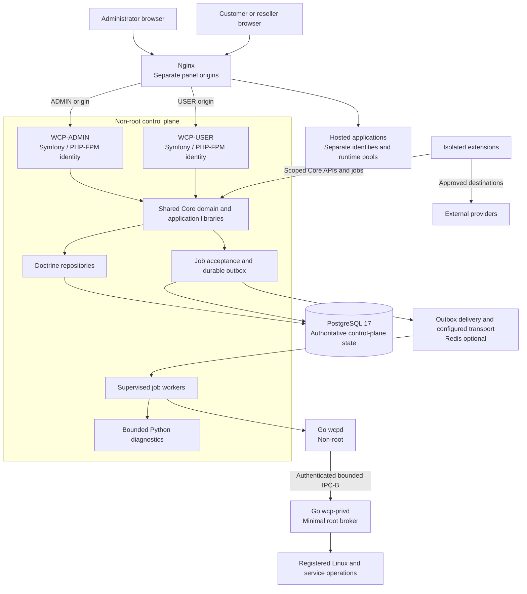
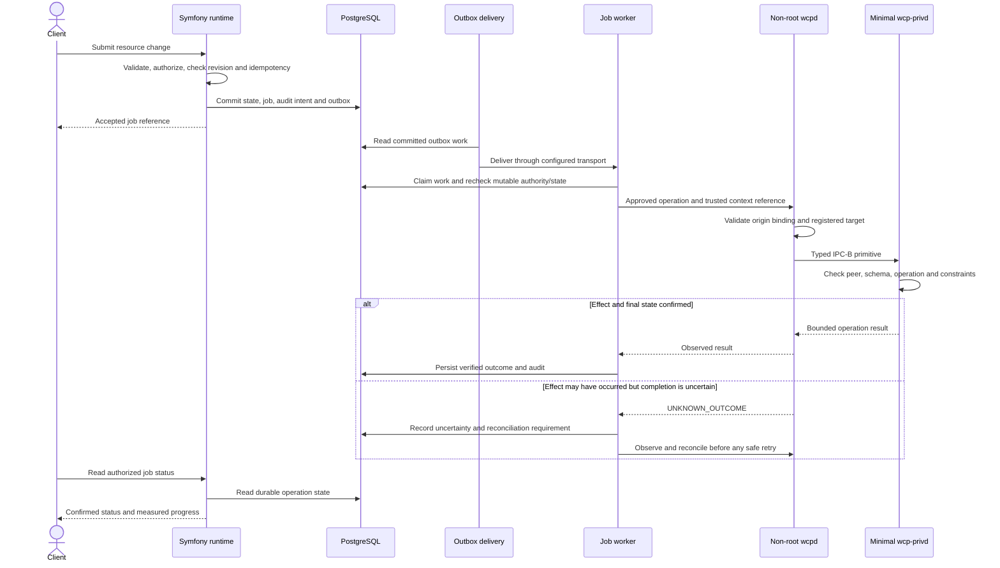

# WCP360 Architecture

**PHP/Symfony control plane · Isolated hosting workloads · Bounded system operations**

This document explains the target structure of WCP360, how components collaborate, and which boundaries implementations must preserve. It is intended for contributors, operators, reviewers, and extension developers.

> **Document status:** non-normative architecture overview. The [baseline manifest](https://github.com/yyogas/wcp360/blob/main/documentation/manifests/WCP360-BM-0001.md) and approved owner contracts remain authoritative. Architecture diagrams describe the target; they are not evidence of a deployed or production-qualified system.

[System overview](#system-overview) · [Core structure](#core-structure) · [Operation flows](#operation-flows) · [Data and tenancy](#data-and-tenancy) · [Extensions](#extension-architecture) · [Deployment](#deployment-model) · [Implementation status](#implementation-status)

## Contents

- [Architectural principles](#architectural-principles)
- [System overview](#system-overview)
- [Technology responsibilities](#technology-responsibilities)
- [Core structure](#core-structure)
- [Operation flows](#operation-flows)
- [Data and tenancy](#data-and-tenancy)
- [System agents and IPC](#system-agents-and-ipc)
- [Extension architecture](#extension-architecture)
- [WCP360 Internal](#wcp360-internal)
- [Deployment model](#deployment-model)
- [Reliability and observability](#reliability-and-observability)
- [Implementation status](#implementation-status)
- [Verification expectations](#verification-expectations)
- [Reference documents](#reference-documents)

## Architectural principles

| Principle | Consequence |
| :--- | :--- |
| An autonomous hosting Core | Essential hosting, local administration, audit, and local recovery continue when optional extensions or vendor services are unavailable. |
| One authoritative owner per capability | A domain owns its resource state and mutations. Dashboards and global settings summarize and link to that owner. |
| Shared mechanisms | Forms, tables, validation, authorization, jobs, events, audit, and error handling are reused across modules. |
| Explicit tenant boundaries | Ownership, membership, delegation, roles, and entitlements remain distinct and are enforced server-side. |
| Minimal privilege | PHP, workers, diagnostics, and `wcpd` run without root. Only bounded registered primitives reach `wcp-privd`. |
| Durable operation records | Accepting a request, committing database state, dispatching work, and verifying an external effect are separate milestones. |
| Declared integration contracts | Providers and engines expose capabilities, compatibility, permissions, failure behavior, and migration constraints. |
| Evidence-based evolution | Implementations, migrations, releases, and security claims require version-bound validation and the applicable owner decisions. |

## System overview

WCP360 combines a modular PHP/Symfony control plane with separate operating-system agents and isolated hosted workloads. Shared Core libraries do not require a microservice for each domain.



The shared-library node represents code reuse, not a third shared web runtime. ADMIN and USER instantiate approved services inside their separate security contexts. Rendered Twig responses and authorized Turbo updates return through the requesting origin.

The outbox/delivery path represents durable publication to configured workers; it does not imply that every Messenger handler runs asynchronously. Customer applications and databases do not share panel credentials or PHP-FPM identities.

## Technology responsibilities

| Component | Target responsibility |
| :--- | :--- |
| PHP 8.4 / Symfony | Request handling, business rules, authentication, authorization, forms, APIs, and orchestration. |
| Twig and Twig Components | Server-rendered layouts, reusable views, resource tables, dialogs, and form presentation. |
| Symfony UX Turbo / Stimulus | Navigation, partial HTML updates, and focused browser interactions. Selected Live Components remain subject to server authorization. |
| AssetMapper and TailwindBundle | Prepared frontend assets, design tokens, themes, and responsive styling. Builds belong to development/release environments. |
| Doctrine ORM / DBAL / Migrations | Controlled persistence and schema evolution behind repository interfaces. |
| PostgreSQL 17 | Authoritative logical control-plane state, relationships, desired state, operation records, audit, and outbox data. |
| Symfony Messenger | Routing and processing of configured asynchronous work with supervised handlers. |
| Redis | Optional job transport, separate from authoritative domain state and customer Redis services. A database-backed transport is an alternative deployment choice to qualify. |
| Go `wcpd` | Non-root control-request validation, approved adapter coordination, observation, and reconciliation. |
| Go `wcp-privd` | Minimal root broker for registered, typed, bounded system primitives. |
| Python | Specialized diagnostics and automation under approved non-root identities, inputs, dependencies, and resource budgets. |
| Nginx | HTTPS termination and routing for configured panel origins and hosted applications. |
| PHP-FPM | Separate panel runtime pools and account-isolated hosted PHP application pools. |
| Debian 13 / amd64 | Initial target operating-system and architecture boundary defined by the baseline. |

These are target selections. Exact framework/package revisions, build inputs, runtime extensions, and compatibility matrices belong to each qualified component release. The current inert daemon has its own narrowly approved toolchain.

## Core structure

### Domain modules and shared foundations

The Core is organized around hosting domains, with reusable cross-cutting services underneath them.

| Area | Responsibility |
| :--- | :--- |
| Shared foundations | Identity, permissions, tenant context, configuration, persistence contracts, APIs, jobs, events, auditing, secrets, errors, and UI components. |
| Accounts and service plans | Account lifecycle, tenant ownership, reseller delegation, entitlements, resource ceilings, and quotas. |
| Websites, domains, DNS, and TLS | Application resources, virtual hosts, aliases/redirects, authoritative DNS, delegation, and certificate lifecycle. |
| Mail and databases | Mailbox/domain management, database identities and grants, engine integration, and baseline recovery. |
| Files and transfer | Managed files, SFTP access, confinement, ownership, quotas, and controlled file operations. |
| Backup and restore | Local recovery points, verification, retention, and authorized restore. Remote destinations add optional integration. |
| Server operations | Services, network/firewall policy, storage dependencies, observed health, packages, and controlled updates. |

The complete functional inventory is maintained in the [project README](https://github.com/yyogas/wcp360/blob/main/README.md#required-panel-capabilities); optional workflows and provider integrations are described in the [plugin catalog](https://github.com/yyogas/wcp360/blob/main/PLUGIN_CATALOG.md).

### Layers inside a module

| Layer | Owns | Dependency rule |
| :--- | :--- | :--- |
| Presentation | ADMIN/USER controllers, forms, request mapping, Twig components, API responses, and browser interaction hooks. | Calls application use cases; does not execute system operations or bypass domain authorization. |
| Application | Use-case orchestration, authorization context, transaction boundaries, command/query handlers, and job coordination. | Depends on domain rules and explicit persistence/integration interfaces. |
| Domain | Resource ownership, state transitions, invariants, effective policy, and engine-independent rules. | Remains independent of controllers, Twig, provider protocols, and raw system commands. |
| Infrastructure | Doctrine repositories, approved clients/adapters, transport integration, secret references, and operation result mapping. | Implements interfaces and maps technology-specific behavior to validated contracts. |

Reviewed Core modules and dependencies are assembled through Symfony's service container during a controlled build. Their integration is separate from the detached-extension lifecycle.

### Reuse and navigation ownership

Shared UI services provide tables, pagination, filtering, forms, validation, dialogs, notifications, and measured job progress. Modules supply schemas and domain behavior rather than copying these mechanisms.

System Settings owns global defaults and policy floors. Resource centers own operational inventories and mutations. Reseller/user choices remain inside the effective delegated envelope. A settings summary or dashboard widget must deep-link to the canonical owner instead of creating another editable resource model.

## Operation flows

### Reads and synchronous changes

1. Nginx routes the request to the correct ADMIN or USER origin and runtime.
2. Symfony establishes the authenticated surface context and resolves the requested resource within the permitted scope.
3. Domain policies verify permissions, ownership/delegation, entitlements, authentication strength, and relevant resource state.
4. A query uses scoped repositories; a synchronous change follows its approved transaction, concurrency, idempotency, and audit rules.
5. Twig or the API returns an authorized representation. Turbo Frames, Live Actions, exports, and downloads retain the same checks.

A browser-supplied tenant ID, hidden field, visible button, or opaque resource identifier never establishes authority.

### Asynchronous system change

The following flow illustrates a mutation that includes a privileged primitive. Other work may execute entirely under an account, worker, or adapter identity.



Outbox delivery is a logical responsibility; its process placement and transport configuration follow the approved deployment design. A durable acceptance is not a guarantee that a service change has completed.

### Idempotency and reconciliation

| Concern | Required behavior |
| :--- | :--- |
| Mutation submission | Use the canonical idempotency binding. Reusing a key for a different semantic request is a conflict. |
| Duplicate delivery | A handler detects repeated work and preserves one logical outcome; a queue does not provide exactly-once system effects by itself. |
| Concurrency | Bind changes to resource revisions, leases/locks, and operation-specific constraints. |
| Revocation | Recheck mutable security facts before effects rather than relying only on submission-time approval. |
| Uncertain dispatch | Record `UNKNOWN_OUTCOME`, inspect observed state, and reconcile. Destructive operations are never blindly redispatched. |
| Partial effects | Preserve evidence and follow the registered recovery procedure. `PARTIAL_EFFECT` is a result classification, not a new canonical job state. |
| Rollback and compensation | A rollback, compensating action, and reconciliation are different operations. Their safety depends on the resource and contract. |

Canonical job states and API schemas are defined by the API contract; this overview does not introduce parallel enums or endpoints.

## Data and tenancy

### Authority and ownership

PostgreSQL records logical authority and desired state. Linux services and the filesystem expose observed physical state. Reconciliation compares these views; a database commit does not prove that an external effect succeeded.

| Concept | Meaning |
| :--- | :--- |
| Account | Commercial/administrative owner; distinct from a tenant and from a login/session identity. |
| Tenant | Security and data-isolation boundary with exactly one owning Account. |
| Hosting Account | Hosting resource belonging to exactly one Tenant, with its managed runtime identity and resources. |
| Organization | Optional grouping/membership construct; membership does not itself authorize tenant access. |
| Reseller | Account-associated profile with explicit, revocable tenant delegation; delegation never transfers ownership. |
| Principal and session | Authentication context with the applicable surface, grants, delegation, policy, strength, and expiry. |
| Resource | Domain-owned object whose access and operations resolve through authoritative ownership and policy. |

Ownership, membership, delegation, roles, and entitlements must remain explicit relational facts. They cannot be replaced by client claims, free-form JSON, or an extension's private interpretation.

### Persistence boundaries

| Data class | Boundary |
| :--- | :--- |
| Core model | Repository-controlled PostgreSQL schemas and constraints, aligned with the approved database contract. |
| ADMIN and USER sessions | Distinct canonical session stores and database access grants; one surface's runtime cannot read or manipulate the other surface's sessions. |
| Hosted databases | Customer-managed engines and data are separate from the Core database and credentials. |
| Extension-owned data | Isolated namespace/store and migrations; Core resources are accessed through approved APIs and commands. |
| Credentials and keys | Consumer-scoped secret references and protected storage, outside versioned code and diagnostic payloads. |
| Logs, metrics, and audit | Different retention and access needs; audit intent/outcomes are durable, and sensitive identifiers follow the canonical telemetry policy. |

Doctrine mappings and migrations must preserve the physical constraints, revision rules, transaction boundaries, and delete behavior of the canonical model. A migration is reviewed and tested against representative data; reversibility is declared rather than assumed.

## System agents and IPC

The privileged path is fixed:

```text
backend
→ wcpd (non-root)
→ bounded authenticated IPC-B
→ wcp-privd (minimal root)
→ explicit privileged primitive
```

| Boundary | Contract |
| :--- | :--- |
| Application to `wcpd` | A versioned control request with approved action/resource binding and trusted context. This overview selects no new backend transport or listener. |
| `wcpd` to broker | The canonical `WCP360-IPC-B/1` contract; `wcpd` is the only authorized normal client. |
| Local peer identity | Unix peer credentials and expected service context, socket/directory ownership, and access rules defined by the IPC contract. |
| Message processing | Bounded framing and strict typed payloads; reject malformed, oversized, unknown, or incompatible requests before effects. |
| Privileged target | Registry-backed resource references and closed operation IDs; the broker independently enforces relevant constraints. |
| Result handling | Bounded output, deadlines, audit correlation, observed outcomes, and explicit reconciliation after uncertainty. |

Web runtimes, ordinary workers, extensions, hosted processes, and diagnostics have no direct broker access. Arbitrary shell strings, executable/argv/environment payloads, systemd unit names, filesystem targets, SQL, signals, and generic sudo/root proxies are forbidden.

A local socket does not establish encryption. Local authenticated IPC and any future network control channel have separate transport and trust requirements. A network channel requires its approved authenticated-encryption contract.

Python diagnostics are separate non-root workloads. They cannot become an alternate privileged execution path.

## Extension architecture

### Core modules, adapters, and optional workflows

| Type | Role | Lifecycle boundary |
| :--- | :--- | :--- |
| Core domain module | Essential hosting capability and its authoritative rules/state. | Part of the controlled Core build and release. |
| Core engine adapter | Implements an essential service using a specific engine. | Replaceable implementation, but an active engine cannot be removed until dependent resources are safely migrated. |
| Optional module | Adds a detachable workflow such as application installation, delivery pipelines, or recovery exercises. | Own process/data; disablement preserves Core and existing workload operation. |
| Provider connector | Integrates DNS, storage, identity, telemetry, commerce, or other external APIs. | Scoped credentials, capabilities, approved endpoints, timeout/backoff, and explicit outage behavior. |
| Recipe or UI pack | Declares installation definitions or reviewed presentation contributions. | Validated content and assets, with compatibility and trust checks. |

Detached extension code is not imported into Core as an arbitrary Symfony bundle. A manifest declares compatibility, permissions, contributions, data, jobs, network needs, and lifecycle; it does not grant authority or permit direct Core-table writes.

### Admission and execution

An installable extension needs an identifiable publisher, artifact digest, verified trust evidence, compatibility/dependency checks, reviewed capability set, owned-data migration strategy, health checks, resource budget, and recovery/removal plan.

At runtime it uses a dedicated identity, restricted resources and network access, scoped credentials, and approved APIs/events/jobs. UI contributions must respect the panel origin and asset trust contract.

| Lifecycle action | Expected effect |
| :--- | :--- |
| Enable | Verify readiness/canary results, then publish approved routes and consumers. |
| Update | Review permission differences, compatibility, migrations, and rollback limitations. |
| Disable | Reject new work, withdraw routes/subscriptions, drain or checkpoint active jobs, and preserve owned data. |
| Quarantine | Stop execution/access, block outbound connections as required, and retain diagnostic evidence. |
| Uninstall | Check jobs/dependencies, revoke credentials, and explicitly retain, export, or delete owned data. |
| Replace an in-use provider/engine | Plan service-specific migration and recovery; verify live resource dependencies before withdrawal. |

The [plugin catalog](https://github.com/yyogas/wcp360/blob/main/PLUGIN_CATALOG.md) records the 149-entry design inventory, family contracts, local package profiles, and ownership/reuse rules. A catalog record is not an installable release.

## WCP360 Internal

WCP360 Internal is a private vendor control plane deployed separately from customer servers. It is not a plugin and does not run inside the public Core.

| Private service | Customer-side boundary |
| :--- | :--- |
| License/entitlement authority | A constrained verification client with approved caching/grace behavior; licensing cannot remove Core login, export, local recovery, or existing workload service. |
| Catalog and update origin | Verification clients for approved metadata and artifacts; current hosting continues during discovery/download outages. |
| Consented diagnostic service | An optional customer-controlled connector with selected evidence categories, redaction, retention, and explicit sharing. |
| Build and release services | Separate controlled distribution lanes; a detached extension build cannot silently become a Core release. |

Vendor data collection does not create general remote administration. The Insights Connector's local simulation does not establish production mTLS, consent enforcement, signatures, or credential rotation.

## Deployment model

### Initial target

The initial platform boundary is Debian 13 on amd64. A single managed node contains isolated panel runtimes, control-plane persistence, workers, agents, and enabled hosting services. External providers and vendor services remain separate dependencies with explicit failure behavior.

This is a target deployment model, not an available installer or a qualified minimum hardware configuration. Multi-node control, clustering, HA, virtualization, and advanced storage require their own validated adapters and operating procedures.

### Runtime separation

| Runtime | Isolation boundary |
| :--- | :--- |
| WCP-ADMIN and WCP-USER | Separate origins, Unix identities, PHP-FPM pools, session contexts, and scoped database credentials. |
| Job workers | Dedicated non-root identity, bounded concurrency, supervised lifecycle, and task-class resource budgets. |
| `wcpd` | Dedicated non-root daemon identity and exclusive normal access to the broker protocol. |
| `wcp-privd` | Minimal privileged service with a closed operation registry and no general command interface. |
| Hosted applications | Account-specific identities and runtime pools; no panel write access, control groups, or Core secrets. |
| Extensions and diagnostics | Dedicated identities/environments with approved writable paths, network access, and execution limits. |

### Filesystem and release authority

| Location or state | Responsibility |
| :--- | :--- |
| `/usr/lib/wcp360` | Versioned product code; application runtimes cannot write releases. |
| `/etc/wcp360` | Controlled system configuration; changes use approved configuration/privileged operations. |
| `/var/lib/wcp360` | Materialized, node-local, reconstructable state; not a replacement for authoritative logical PostgreSQL state. |
| `/run/wcp360` | Ephemeral runtime state and approved local IPC paths. |
| `/var/cache/wcp360` | Reconstructable caches. |
| Managed hosting storage | Registry-derived account/resource roots and storage dependencies, separate from panel execution and secret locations. |

Release builds prepare dependencies, assets, and caches from pinned inputs. Deployment validates compatibility and migrations, stages a verified release, checks health, and follows the declared recovery procedure. Production web requests do not run `git pull`, `composer update`, dependency downloads, or improvised builds.

Configuration changes follow their operation-specific plan: prepare controlled output, validate, bind to the expected resource revision, apply safely, reload only the approved service, verify observed health, and persist the outcome. Package rollback cannot silently reverse an irreversible data migration.

## Reliability and observability

| Concern | Design requirement |
| :--- | :--- |
| Queue failure | Preserve durable operation intent and visible status; bound retries and failed work. Transport changes are explicit, tested recovery operations. |
| Worker or agent restart | Use the canonical lease, concurrency, idempotency, and reconciliation rules; do not infer failure solely from a lost response. |
| Provider outage | Use timeouts, bounded buffering/backoff, and visible stale/unavailable states. Preserve the declared Core fallback. |
| Invalid configuration | Prevent invalid output from replacing a working configuration; retain a supported recovery path and evidence. |
| Resource pressure | Budget PHP-FPM, database connections, workers, archives, backup jobs, scans, and extensions so one task class cannot exhaust the panel. |
| Observability | Distinguish request latency, queue wait, execution duration, observed service state, and verified completion. Record real measurements and freshness. |
| Secrets and identifiers | Redact sensitive payloads and follow canonical log/trace/metric rules; correlation is not authorization. |
| Backup and incident recovery | Protect recovery material, verify readability and restores, preserve evidence, and keep local administration available without optional integrations. |

PHP OPcache, prepared Symfony/Twig assets, query discipline, and worker isolation support the performance design. Capacity, latency, JIT choices, and pool sizing require measurements on a specified workload and environment; no benchmark guarantee follows from the language or framework choice.

## Implementation status

The current manifest records **SC-M01 limited to the inert daemon foundation**, **SC-M02 not authorized**, and **CODE-BASELINE = NONE**. Candidate branches and prototypes must be evaluated separately from the target architecture.

| Area | Current interpretation |
| :--- | :--- |
| `main` | Reference documentation, specifications, governance, catalogs, and explicitly published artifacts. |
| Symfony/Twig Core | Selected target; the complete framework integration, business domains, persistence, and hosting execution are not established by this overview. |
| `source/full-platform-candidate` | Candidate PHP kernel, static interface, and daemon sources; source presence is not Core integration or production qualification. |
| `source/sc-m01-inert-daemon` | Inert Go CLI foundation; it does not activate IPC, a privileged broker, database access, or hosting effects. |
| `extensions/file-manager-v0.3.0-import` | Standalone File Manager development package; Core integration remains blocked pending contracts and an adapter. |
| File Manager storage | Private single-owner storage exclusively modified by that module; unsuitable as a hostile multi-tenant home backend concurrently writable through SSH, FTP, PHP, or cron. |
| Design workspace and Insights Connector | Prototypes and simulated interactions; production transport, authorization, cryptography, and lifecycle still require implementation evidence. |

The local workspace layout differs from the GitHub repository. A clone of `main` does not by itself provide a complete running panel.

## Verification expectations

| Area | Evidence required for an implementation |
| :--- | :--- |
| Boundaries and authorization | Cross-tenant and cross-surface rejection, revoked delegation, constrained entitlements, and execution-time reauthorization. |
| API/data contracts | Typed input/output, canonical identifier binding, database constraints, expected revisions, idempotency conflicts, and transaction/audit durability. |
| Privileged execution | Unauthorized peer, malformed frame, unknown operation, escaping target, stale resource, unsafe fallback, and secret-output rejection. |
| Jobs and failure | Duplicate delivery, worker termination, lost acknowledgment, partial effects, unknown outcomes, and reconciliation before safe retry. |
| Extensions and providers | Isolation, capability changes, unavailable dependencies, queue/resource limits, disable/quarantine, removal, and active-engine migration. |
| Release and recovery | Artifact verification, migration rehearsal, configuration validation, rollback limits, and tested restore/emergency access. |
| UI and performance | Shared component behavior, accessibility, authorized partial requests, measured progress, and workload-specific latency/resource use. |

Evidence identifies the source revision or artifact, environment, procedure, result, and limitations. Automated checks and same-author verification are not independent technical review. This document does not grant implementation authority or replace the applicable review gates.

## Reference documents

| Document | Role |
| :--- | :--- |
| [Project README](https://github.com/yyogas/wcp360/blob/main/README.md) | Product scope, selected stack, capability inventory, requirements, and branches. |
| [Baseline manifest](https://github.com/yyogas/wcp360/blob/main/documentation/manifests/WCP360-BM-0001.md) | Current authority, baseline versions, and implementation gates. |
| [API contract](https://github.com/yyogas/wcp360/blob/main/documentation/specifications/api/WCP360_API_Contract_v1.0_CANONICAL_IMPLEMENTATION_EXPORT.md) | Authentication/scope, type boundaries, API schemas, job binding, errors, and compatibility. |
| [IPC contract](https://github.com/yyogas/wcp360/blob/main/documentation/specifications/ipc/WCP360_IPC_Contract_WCP360-IPC-B-1_CANONICAL_IMPLEMENTATION_EXPORT.md) | Physical privileged boundary, caller identity, framing, operations, validation, and uncertain outcomes. |
| [Database model](https://github.com/yyogas/wcp360/blob/main/documentation/specifications/database/WCP360_DB_Model_v1.0_Canonical_Implementation_Contract.md) | Logical/physical state authority, ownership, sessions, operations, and persistence constraints. |
| [Security policy](https://github.com/yyogas/wcp360/blob/main/SECURITY.md) | Private vulnerability reporting, review context, and required security boundaries. |
| [Security Baseline](https://github.com/yyogas/wcp360/blob/main/documentation/specifications/security/WCP360_Security_Baseline_v1.0_CANONICAL_IMPLEMENTATION_EXPORT.md) and [Permission Registry](https://github.com/yyogas/wcp360/blob/main/documentation/specifications/security/WCP360_Permission_Registry_v1.0_CANONICAL_IMPLEMENTATION_EXPORT.md) | Canonical security rules, permission namespaces, and operation bindings. |
| [Plugin catalog](https://github.com/yyogas/wcp360/blob/main/PLUGIN_CATALOG.md) | Optional workflows, providers, engine adapters, and local package evidence. |
| [Contributing](https://github.com/yyogas/wcp360/blob/main/CONTRIBUTING.md) and [review policy](https://github.com/yyogas/wcp360/blob/main/documentation/governance/REVIEW-MERGE-POLICY.md) | Contribution process, evidence, ownership, and independent review requirements. |
