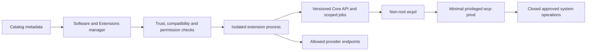

# WCP360 Plugin Catalog

**Discover integrations, understand their boundaries, and define a safe installation contract.**

[Project overview](https://github.com/yyogas/wcp360/blob/main/README.md) · [Family index](#family-index) · [Local packages](#local-package-profiles) · [Plugin contract](#required-plugin-record) · [Security and lifecycle](#security-and-lifecycle) · [Ownership and reuse](#ownership-and-reuse)

---

This catalog describes **149 design entries in 21 families**: **142 optional modules, connectors, recipe packs, UI packs, and capability adapters**, plus **7 Core engine adapter entries**. An entry can represent a pack rather than a single installable artifact. These counts describe the documented scope, not published or production-ready plugins.

Two development packages are documented separately: **File Manager** and **Insights Connector**. Insights also has a design entry in the support family; its profile is not counted as another entry. File Manager is a standalone implementation candidate for an essential Core capability and is outside the 149-entry design inventory.

> **NON-NORMATIVE DESIGN CATALOG.** Publication does not imply owner approval, amend canonical contracts, or authorize implementation. Contract decisions require the applicable owner ratification and project gates.

**Catalog revision: October 31, 2026.** The underlying product is in development. This file is a documentation catalog, not a live package registry, release feed, or dependency lockfile. Provider names identify integration targets; they do not establish partnerships, certified compatibility, available licenses, or downloadable WCP360 packages.

## Contents

- [Reading the catalog](#reading-the-catalog)
- [Family index](#family-index)
- [Local package profiles](#local-package-profiles)
- [Design catalog](#design-catalog)
- [Ownership and reuse](#ownership-and-reuse)
- [Required plugin record](#required-plugin-record)
- [Security and lifecycle](#security-and-lifecycle)
- [Catalog and manager interface](#catalog-and-manager-interface)
- [Maintaining the catalog](#maintaining-the-catalog)
- [Architecture references](#architecture-references)

## Reading the catalog

| Field | Meaning |
| :--- | :--- |
| Catalog key | A proposed documentation key such as `apps.installer`. It is not an approved package identifier, manifest field, or capability grant. |
| Type | Module, connector, adapter, recipe pack, UI pack, or Core adapter. Packs may contain multiple separately versioned drivers. |
| Functions | Target operations to implement and qualify. They are not statements of current availability. |
| Access and safety condition | Entry-specific constraints in addition to the family contract and common platform policy. |
| State | Documentation maturity, independent of an installation's runtime state. |

| Documentation state | What is established | What is still required |
| :--- | :--- | :--- |
| Design | A described integration or workflow. | Implementation, a manifest, compatible versions, release artifacts, trust evidence, tests, and operational qualification. |
| Local prototype | A local package or UI simulation exists and is linked in its profile. | Production implementation and evidence for each declared permission, transport, lifecycle transition, and supported environment. |
| Engine design | An alternative implementation of an essential Core service is described. | An approved adapter contract, migration and recovery procedures, and validation of live workload dependencies. |
| Standalone candidate | A local application exists independently of Core. Used only in the File Manager profile. | A reviewed Core adapter and integration qualification before it can manage hosting resources. |

The family contract applies to every entry in that family. “Dependencies” names target service contracts, not packages that are all currently implemented. “Access” describes the intended permission boundary; actual machine-readable capability identifiers must be defined by the versioned platform contract. **Deny by default remains the baseline.**

A panel role named ROOT does not grant Linux root execution. WCP-ADMIN governs server policy; WCP-USER receives only explicitly delegated capabilities for owned accounts and resources.

## Family index

| Family | Entries | Audience and use |
| :--- | :--- | :--- |
| [Applications, CMS platforms, and site tools](#applications-cms-platforms-and-site-tools) | 7 | Administrators, resellers, and hosting users within their sites. |
| [Runtimes, dependencies, and application workers](#runtimes-dependencies-and-application-workers) | 9 | Administrators configure engines; hosting users manage delegated applications. |
| [Git, CI/CD, and delivery pipelines](#git-cicd-and-delivery-pipelines) | 8 | Developers and delegated site operators; administrators govern runners and providers. |
| [Domains, external DNS, and specialized certificates](#domains-external-dns-and-specialized-certificates) | 10 | Administrators and owners of explicitly delegated domains. |
| [Advanced mail and webmail clients](#advanced-mail-and-webmail-clients) | 9 | Mail administrators and authorized mailbox or domain owners. |
| [Database tools and advanced data services](#database-tools-and-advanced-data-services) | 8 | Database administrators and hosting users limited to their own databases. |
| [Remote backups, engines, and recovery assurance](#remote-backups-engines-and-recovery-assurance) | 9 | Administrators define destinations; delegated users operate permitted recovery points. |
| [Advanced protection, scanners, and investigation](#advanced-protection-scanners-and-investigation) | 10 | Security administrators; scoped findings may be shown to affected account owners. |
| [Enterprise identity and secret vaults](#enterprise-identity-and-secret-vaults) | 5 | Administrators and organizations with delegated identity policy. |
| [Observability and external monitoring](#observability-and-external-monitoring) | 7 | Administrators and permitted resource owners; external teams receive scoped telemetry. |
| [Notifications, communication, and on-call services](#notifications-communication-and-on-call-services) | 4 | Administrators and users controlling their own verified destinations. |
| [Shared storage and specialized engines](#shared-storage-and-specialized-engines) | 7 | Infrastructure administrators; users receive only assigned storage capabilities. |
| [Virtualization, containers, and clusters](#virtualization-containers-and-clusters) | 8 | Infrastructure administrators and explicitly delegated VM or container owners. |
| [Advanced networking, load balancing, and availability](#advanced-networking-load-balancing-and-availability) | 7 | Infrastructure administrators; narrow per-service views may be delegated. |
| [Datacenter and hardware](#datacenter-and-hardware) | 4 | Infrastructure administrators with dedicated management-plane access. |
| [Billing, commerce, and third-party licenses](#billing-commerce-and-third-party-licenses) | 7 | Hosting providers, resellers within scope, and commercial operations. |
| [Support, customer portal, and consented diagnostics](#support-customer-portal-and-consented-diagnostics) | 5 | Customers, support agents, and administrators according to the selected workflow. |
| [Personal data, retention, and governance](#personal-data-retention-and-governance) | 5 | Authorized privacy, compliance, and operations staff; scoped customer request views. |
| [Automation, infrastructure as code, and AI assistance](#automation-infrastructure-as-code-and-ai-assistance) | 8 | Administrators, developers, and delegated operators within existing permissions. |
| [Customization and productivity](#customization-and-productivity) | 5 | Administrators, resellers, and end users within their own customization scope. |
| [Alternative Core engine adapters](#alternative-core-engine-adapters) | 7 | Administrators responsible for the hosting service baseline. |

## Local package profiles

These profiles summarize sources imported under `WCP360_Plugins/`. Manifest declarations are recorded as declarations; they are not evidence that a signature, compatibility range, or production transport has been verified.

### File Manager — standalone candidate

| Property | Local evidence or integration boundary |
| :--- | :--- |
| Package identity | `wcp360/file-manager` in the local extension metadata and Composer package. |
| Declared version | `0.3.0-alpha-pro`; development status. |
| Source | [Package README](https://github.com/yyogas/wcp360/blob/main/WCP360_Plugins/wcp360-file-manager-xampp/README.md), [extension metadata](https://github.com/yyogas/wcp360/blob/main/WCP360_Plugins/wcp360-file-manager-xampp/extension.json), and [Composer requirements](https://github.com/yyogas/wcp360/blob/main/WCP360_Plugins/wcp360-file-manager-xampp/composer.json). |
| Runtime | PHP `^8.2`, Symfony `^7.4`, JSON and fileinfo; ZIP operations require the relevant runtime support. The WCP360 target remains PHP 8.4. |
| Implemented mode | Standalone single-owner private storage. The storage must be exclusively modified by this module. |
| Functional scope | File navigation, search, create/copy/move/rename, trash/restore, bounded uploads and downloads, text editing/history, and permissions within the process identity. See the package README for exact limits. |
| Core integration | Metadata states `blocked-pending-contracts-and-adapter` and `official_wcp360_baseline: false`. A Symfony host adapter is required. |
| Privilege boundary | No privileged operations declared. No general terminal, Linux root/CHOWN, or system quota management. |
| Tenant boundary | This standalone design is not a backend for live multi-tenant homes also writable by SSH, FTP, or hosted scripts. Core integration needs a separately validated file-operation and isolation contract. |
| License | Composer declares `proprietary`. Distribution rights require review for the relevant artifact. |
| Environment evidence | Metadata says local testing; a Windows launcher is included and Windows execution is unverified. No new runtime validation is asserted by this catalog. |
| Catalog relationship | File operations and SFTP are required Core capabilities. This package is an implementation candidate, not a second optional file-management authority. |

### Insights Connector — local prototype

| Property | Local evidence or integration boundary |
| :--- | :--- |
| Manifest identity | `com.wcp360.insights-connector`. Design catalog key: `support.insights`. |
| Declared version | `1.0.0` in the manifest; a version string does not establish a production release. |
| Source | [Package README](WCP360_Plugins/wcp360-insights-connector/README.md), [manifest](WCP360_Plugins/wcp360-insights-connector/manifest.json), and [prototype UI](WCP360_Plugins/wcp360-insights-connector/index.html), published as development sources on `main`. |
| Current behavior | The README describes a browser-storage simulation of a signed, mutually authenticated exchange. |
| Distribution intent | Separate optional package, disabled by default, removable, and not bundled into Core. |
| Declared compatibility | WCP360 `>=2.5 <3.0` and API `insights/v1`. This is metadata to reconcile with the approved Core contract, not a tested compatibility matrix. |
| Declared allowed operations | Read inventory and health summaries, read extension health, generate audit findings, create reviewed support reports, and contact the configured diagnostic endpoint. |
| Explicitly forbidden | Shell execution, root impersonation, hosted file contents, database rows, mailbox contents, secret export, and remote remediation. |
| Consent and retention | Default consent is none. The customer selects evidence categories, schedule, and retention; the manifest declares a 30-day default. Production collection must enforce these settings. |
| Transport and trust | Production requires mTLS, a pinned endpoint, credential rotation, replay protection, and consent receipts. Signature, SBOM, provenance, encryption, and signed-index fields express requirements; they do not prove those mechanisms are implemented. |
| Endpoint | `insights.internal.example.com` is a manifest example, not a deployable vendor endpoint. |
| Disable and removal | Stop collection/transmission, revoke pairing, and withdraw routes; Core and hosted workloads remain autonomous. The complete state transitions still require production evidence. |
| INTERNAL boundary | The private vendor control plane is a separate service and repository. It is never installed on customer servers as a plugin. |
| License | Not specified in the inspected manifest; distribution terms must be established before publication. |

## Design catalog

Each family lists its target contracts followed by its entries. All entries are **Design** unless their state explicitly says **Local prototype** or **Engine design**. No entry in this table is presented as a verified installable release.

### Applications, CMS platforms, and site tools

| Family contract | Target requirement |
| :--- | :--- |
| Audience | Administrators, resellers, and hosting users within their sites. |
| Dependencies | Core site, domain, runtime, database, file, backup, and job APIs; an approved recipe source. |
| Access | Read scoped site requirements; request named install, clone, update, and restore jobs. Dependency installers run as the application identity. |
| Owned data | Recipe metadata, instance mappings, update results, and staging policies; Core remains the owner of sites, databases, and accounts. |
| Disablement or service exit | Installed applications keep serving. Withdraw installer and update routes; preserve instance mappings and recovery references. |

| Entry / catalog key | Type | Target functions | Additional access or safety condition | State |
| :--- | :--- | :--- | :--- | :--- |
| **Application installer** <code>apps.installer</code> | Module | Recipe catalog, compatible versions, dependencies, installation, updates, removal, and per-instance reports. | Pin recipe artifacts and verify requirements before creating Core resources. | Design |
| **WordPress Toolkit** <code>apps.wordpress-toolkit</code> | Module | Multi-site inventory, core/plugins/themes, controlled updates, maintenance, hardening, and vulnerability tracking. | Scope administration to selected instances; separate plugin/theme changes from database operations. | Design |
| **CMS and e-commerce recipes** <code>apps.cms-recipes</code> | Recipes | Integration packages for WordPress, Drupal, Joomla, PrestaShop, or other applications, with recipe-specific settings and checks. | Each recipe declares upstream source, supported runtime, writable paths, database needs, and removal behavior. | Design |
| **Business application recipes** <code>apps.business-recipes</code> | Recipes | Guided deployment of collaboration, analytics, or business applications with declared resources, dependencies, and update procedures. | Separate application licensing and credentials from panel entitlements. | Design |
| **Site staging and cloning** <code>apps.staging-clones</code> | Module | File/database copying, URL changes, environment isolation, and comparison before promotion. | Choose target ownership, sanitize copied data, suppress outbound mail, and control search indexing. | Design |
| **Verified application updates** <code>apps.verified-updates</code> | Module | Pre-update backup, isolated testing, and validation before promotion when the application engine allows it. | Require a recovery point, compatibility check, maintenance plan, and post-update health check. | Design |
| **Application fleet management** <code>apps.fleet-management</code> | Module | Cross-application views of versions, dependencies, health, and bulk actions on authorized applications. | Select explicit sites and execution batches; isolate failures and report per-instance results. | Design |

### Runtimes, dependencies, and application workers

| Family contract | Target requirement |
| :--- | :--- |
| Audience | Administrators configure engines; hosting users manage delegated applications. |
| Dependencies | Core runtime, service, isolation, quota, log, and job contracts; detected compatible engine packages. |
| Access | Request per-application process jobs, scoped environment changes, and bounded logs. No host-wide process control or shared superuser credentials. |
| Owned data | Application-to-runtime mappings, worker definitions, and adapter settings; secrets remain references. |
| Disablement or service exit | Loss of the management extension must not terminate running applications. Stop new management jobs; retiring an active runtime requires migration. |

| Entry / catalog key | Type | Target functions | Additional access or safety condition | State |
| :--- | :--- | :--- | :--- | :--- |
| **Node.js applications** <code>runtime.nodejs</code> | Adapter | Versions, entrypoint, variables, dependency installation, processes, restart, and logs. | Validate entrypoints and bind addresses; run dependency scripts under the site identity. | Design |
| **Python WSGI/ASGI applications** <code>runtime.python</code> | Adapter | Isolated environment, dependencies, entry module, application server, health, and logs. | Select an isolated environment, WSGI/ASGI entrypoint, process budget, and approved socket. | Design |
| **Ruby / Passenger applications** <code>runtime.ruby-passenger</code> | Adapter | Versions, bundles, environment, web-engine integration, and authorized lifecycle commands. | Keep gems, application identity, and engine-specific settings isolated by account. | Design |
| **Hosted Go applications** <code>runtime.go-apps</code> | Adapter | Binary deployment, environment, internal ports, supervision, and availability checks. | Accept a verified application artifact and bounded service definition; keep it separate from WCP360 Go agents. | Design |
| **Dependency managers** <code>runtime.dependencies</code> | Adapter pack | Composer, npm, pip, or Bundler adapters running under the project's identity with results and resource constraints. | Lock dependency sources and limit build network access, scripts, runtime, and artifact ownership. | Design |
| **Customer application workers** <code>runtime.workers</code> | Module | Dedicated background processes, supervision, concurrency, restart, and logs; separate from the panel's internal workers. | Assign concurrency, retry, restart, and log limits to the customer process only. | Design |
| **Customer Redis services** <code>runtime.redis</code> | Adapter | Instances or access scopes, credentials, memory limits, metrics, and authorized operations. | Use tenant-specific credentials and isolation; never grant access to the panel job transport. | Design |
| **Customer Memcached services** <code>runtime.memcached</code> | Adapter | Assignments, memory, connections, status, and purging limited to scopes that can actually be isolated. | Restrict service exposure, allocation, and access to the intended account. | Design |
| **RabbitMQ messaging** <code>runtime.rabbitmq</code> | Adapter | Virtual hosts, users, permissions, queues, and backend-specific observability; an optional service separate from internal job transport. | Delegate named virtual hosts, users, queues, and limits; no broker-wide administrator account. | Design |

### Git, CI/CD, and delivery pipelines

| Family contract | Target requirement |
| :--- | :--- |
| Audience | Developers and delegated site operators; administrators govern runners and providers. |
| Dependencies | Core sites, secrets, jobs, events, backups, and scoped deployment APIs; isolated runner infrastructure where needed. |
| Access | Scoped repository and artifact access, validated webhooks, and named deployment jobs. Build code runs outside the panel and privileged agents. |
| Owned data | Repository bindings, pipeline definitions, run summaries, and artifact references; bounded retention for build logs. |
| Disablement or service exit | The last deployed release keeps serving. Pause triggers, drain jobs safely, and retain deployment history. |

| Entry / catalog key | Type | Target functions | Additional access or safety condition | State |
| :--- | :--- | :--- | :--- | :--- |
| **Git repositories** <code>delivery.git</code> | Module | Connections, authorized branches, deployment keys, synchronization, and per-project history. | Limit repository URLs, keys, target directories, branches, and update actions. | Design |
| **GitHub / GitLab / Bitbucket connectors** <code>delivery.providers</code> | Connector pack | Provider authentication, verified webhooks, accessible repositories, and delivery triggers. | Use least-scope app credentials and verify webhook authentication and replay limits. | Design |
| **Deployment pipelines** <code>delivery.pipelines</code> | Module | Versioned steps, preconditions, artifacts, checks, promotion, and supported rollback. | Validate the release target and approved artifact; deployment is a Core job, not a root runner script. | Design |
| **Isolated runners** <code>delivery.runners</code> | Module | Dedicated identities, limited resources, secrets injected by reference, and workspace cleanup. | Treat repository code as untrusted; use disposable workers without panel or agent secrets. | Design |
| **Artifact and image registries** <code>delivery.registries</code> | Connector | Authorized artifact retrieval, provenance, checksums, and tracking of deployed versions. | Restrict registries, repositories, artifact digests, and image pull credentials. | Design |
| **Preview environments** <code>delivery.previews</code> | Module | Temporary per-branch environments, limits, expiration, and controlled resource cleanup. | Create expiring scoped resources; sanitize cloned data and revoke access on cleanup. | Design |
| **Dependency analysis** <code>delivery.dependency-analysis</code> | Module | Inventory, versions, declared licenses, and vulnerability advisories from configured sources. | Record source and applicability; a finding never authorizes an automatic production change. | Design |
| **External deployment secrets** <code>delivery.deployment-secrets</code> | Connector | Secret-vault connections, project-specific scope, rotation, and no plaintext values in logs. | Resolve named secrets for a job; prevent plaintext persistence in pipeline configuration and logs. | Design |

### Domains, external DNS, and specialized certificates

| Family contract | Target requirement |
| :--- | :--- |
| Audience | Administrators and owners of explicitly delegated domains. |
| Dependencies | Core domain, authoritative DNS, TLS, secret-reference, and job contracts; configured provider accounts. |
| Access | Restrict credentials by zone, record, domain, and operation; permit only approved provider endpoints. Domain purchases and transfers require explicit effect review. |
| Owned data | Provider bindings, record mappings, challenge receipts, and synchronization history; Core owns the domain model. |
| Disablement or service exit | Local authoritative DNS and existing certificates continue. Provider-dependent changes or renewals may pause and must raise actionable expiry warnings. |

| Entry / catalog key | Type | Target functions | Additional access or safety condition | State |
| :--- | :--- | :--- | :--- | :--- |
| **Cloudflare DNS** <code>domains.cloudflare</code> | Connector | Delegated management of zones, records, synchronization, conflicts, and API call history. | Limit zone tokens and synchronize only records owned by the selected workflow. | Design |
| **Route 53 DNS** <code>domains.route53</code> | Connector | Map provider zones and permissions to the panel's domain model. | Restrict hosted zones and permitted record changes for the selected account. | Design |
| **Other DNS providers** <code>domains.dns-providers</code> | Connector pack | Shared contracts with provider-specific drivers; capability discovery, limits, and synchronization status. | Each driver declares record types, API limits, ownership, and conflict behavior. | Design |
| **Domain registrars** <code>domains.registrars</code> | Connector pack | Registration, transfer, renewal, contacts, and nameservers according to the API; possible drivers include Dynadot, Spaceship, and ResellerClub. | Separate lookup, registration, transfer, renewal, glue, and nameserver changes; review financial effects. | Design |
| **RDAP / WHOIS** <code>domains.rdap-whois</code> | Connector | Registry observations, expiration dates, and status with source and timestamp, separate from local domain state. | Read-only lookup with bounded caching, rate limits, and personal-data handling. | Design |
| **CDN and edge** <code>domains.cdn-edge</code> | Connector | Origin binding, caching, purging, rules, and propagation checks according to provider support. | Scope origin and edge changes; prove origin reachability and retain a withdrawal plan. | Design |
| **Global traffic routing** <code>domains.global-routing</code> | Module | Geographic rules, weighting, and external health checks beyond the server's local routing. | Use measured target health, bounded changes, and explicit rollback or manual routing recovery. | Design |
| **Provider DNS-01 challenges** <code>domains.dns01</code> | Adapter pack | Automate ACME challenges using credentials restricted to authorized zones. | Allow only needed challenge records; remove stale challenges without deleting unrelated DNS data. | Design |
| **Additional ACME authorities** <code>domains.acme-authorities</code> | Adapter | Configure compatible authorities, accounts, policies, and order tracking; baseline TLS remains in the Core. | Select an approved endpoint and account; track issuance limits, renewal, and recovery. | Design |
| **Domain monitoring** <code>domains.domain-monitoring</code> | Module | Aggregate expiration dates, observed delegation changes, and external consistency checks. | Track observation time and expiry uncertainty; monitoring cannot change registrar ownership. | Design |

### Advanced mail and webmail clients

| Family contract | Target requirement |
| :--- | :--- |
| Audience | Mail administrators and authorized mailbox or domain owners. |
| Dependencies | Core mailboxes, domains, mail service, TLS, secrets, and jobs; selected client, relay, or migration endpoint. |
| Access | Separate mailbox content access, configuration changes, and migration rights. Relays receive only their approved transport credentials. |
| Owned data | Client and relay bindings, report aggregates, migration checkpoints, and product-specific policy. |
| Disablement or service exit | Core mailbox management and SMTP/IMAP remain operable. Plan a route change before removing a relay or gateway used by live mail. |

| Entry / catalog key | Type | Target functions | Additional access or safety condition | State |
| :--- | :--- | :--- | :--- | :--- |
| **Roundcube** <code>mail.roundcube</code> | Adapter | Installation or connection, secure access, configuration, and client health tracking. | Use a reviewed client deployment and bounded login handoff without exposing mailbox passwords. | Design |
| **SnappyMail** <code>mail.snappymail</code> | Adapter | Client integration, authorized launch, compatibility, and an independent update lifecycle. | Restrict client configuration, session handoff, update source, and published endpoint. | Design |
| **SOGo** <code>mail.sogo</code> | Adapter | Connect a collaboration suite, expose supported functions, and configure selected capabilities. | Declare the required mail/calendar services and scoped account mappings. | Design |
| **External SMTP relays** <code>mail.smtp-relays</code> | Connector pack | Provider drivers, routing rules, limited credentials, and delivery feedback; Brevo is a possible connector. | Constrain sender domains and credentials; test delivery and a deliberate route change before removal. | Design |
| **DMARC report analysis** <code>mail.dmarc</code> | Module | Report ingestion, per-domain aggregation, sending sources, and trends; separate from Core DMARC publication. | Treat reports as untrusted input; cap parsing and keep domain-specific aggregates. | Design |
| **BIMI and mail brand identity** <code>mail.bimi</code> | Module | DNS and prerequisite checks for the mechanism; no guarantee of display or deliverability. | Validate relevant DNS and branding artifacts; do not promise recipient-side logo display. | Design |
| **Mailing lists** <code>mail.mailing-lists</code> | Adapter | Connect a list engine, subscriptions, and moderation without treating aliases as an implicit substitute. | Require domain ownership, recipient access control, rate limits, and unsubscribe handling. | Design |
| **MailGuard / mail security gateways** <code>mail.mailguard</code> | Connector | Third-party filters, quarantine, rules, and observations supplementing local mail protection. | Map actual licensed capabilities and mail routes; preserve a documented bypass or replacement procedure. | Design |
| **External mailbox migration** <code>mail.mailbox-migration</code> | Module | Account mapping, message transfer, recovery, volume checks, and per-mailbox reports. | Use temporary scoped credentials, resumable checkpoints, duplicate detection, and content-transfer consent. | Design |

### Database tools and advanced data services

| Family contract | Target requirement |
| :--- | :--- |
| Audience | Database administrators and hosting users limited to their own databases. |
| Dependencies | Core database, grants, backup, jobs, and secret APIs; a compatible database engine or external service. |
| Access | Use dedicated database identities; isolate administrative tools. Query content, EXPLAIN, extensions, and replication each need explicit scope. |
| Owned data | Tool access configuration, diagnostic results, replication plans, and anonymization rules; no access to Core tables. |
| Disablement or service exit | Managed databases remain available. Stop analysis and orchestration jobs; replication or external engine dependencies require a service-specific exit plan. |

| Entry / catalog key | Type | Target functions | Additional access or safety condition | State |
| :--- | :--- | :--- | :--- | :--- |
| **phpMyAdmin / Adminer** <code>data.mysql-admin-tools</code> | Adapter pack | Temporary access limited to authorized databases, version management, and publication restrictions. | Expose tools through time-limited scoped access; never publish Core credentials. | Design |
| **pgAdmin** <code>data.pgadmin</code> | Adapter | Connection and controlled access to PostgreSQL databases without exposing the Core database. | Only authorized databases and roles; no automatic connection to the panel metadata database. | Design |
| **Per-account SQLite** <code>data.sqlite</code> | Adapter | Database files, permissions, WAL where supported, quotas, and backups. | Keep files within the assigned account storage and enforce backup and locking constraints. | Design |
| **Database replication** <code>data.replication</code> | Module | Topology, lag, status, initialization, and failover only when the adapter provides a safe procedure. | Validate topology, recovery point, fencing, and engine-specific failover before any promotion. | Design |
| **SQL performance analysis** <code>data.sql-analysis</code> | Module | Connections, locks, slow queries, and explainable recommendations without automatic schema changes. | Redact query parameters and sensitive text; limit diagnostic query cost. | Design |
| **PostgreSQL extension catalog** <code>data.postgres-extensions</code> | Module | Metadata, versions, and authorization policies for extensions; activation remains controlled by the database domain. | Check installed packages and database privileges; activation stays with the Core database owner. | Design |
| **External databases** <code>data.external-databases</code> | Connector | Connect a remote or managed engine, access, observations, and backups according to contracts actually exposed. | Constrain endpoints and credentials; present only operations the remote service supports. | Design |
| **Staging data anonymization** <code>data.anonymization</code> | Module | Transformation rules, verification, and reporting before making a database copy available. | Run transforms in an isolated copy and verify results before granting staging access. | Design |

### Remote backups, engines, and recovery assurance

| Family contract | Target requirement |
| :--- | :--- |
| Audience | Administrators define destinations; delegated users operate permitted recovery points. |
| Dependencies | Core local backup, restore, jobs, storage, retention, and secrets; reachable destinations and detected engine capabilities. |
| Access | Read only approved backup artifacts; restrict destination credentials and restore targets. Encryption keys follow a separate recovery procedure. |
| Owned data | Repository bindings, remote artifact indexes, verification receipts, schedules, and recovery exercises. |
| Disablement or service exit | Local backup and restore stay available. Pause remote transfers; preserve remote data, encryption material references, and an independent recovery path. |

| Entry / catalog key | Type | Target functions | Additional access or safety condition | State |
| :--- | :--- | :--- | :--- | :--- |
| **SFTP destination** <code>backup.sftp</code> | Connector | Restricted remote identity, directory, availability, and backup-artifact transfers. | Pin server identity and restrict key, destination path, transfer, and deletion rights. | Design |
| **S3-compatible destination** <code>backup.s3</code> | Connector | Buckets, restricted credentials, storage, retention, and verification of effective capabilities. | Limit bucket/prefix access and verify the actual retention, encryption, and object-lock capabilities. | Design |
| **NFS destination** <code>backup.nfs-destination</code> | Connector | Authorized directory, availability, capacity, and backup-specific access rules. | Use an approved mount and backup subdirectory; do not acquire general storage administration. | Design |
| **Restic engine** <code>backup.restic</code> | Adapter | Repositories, policies, progress, verification, restore, and key management according to its contract. | Declare repository format, key recovery, locking, checks, and supported restore procedure. | Design |
| **Borg engine** <code>backup.borg</code> | Adapter | Engine-specific repositories and operations with documented compatibility, retention, and recovery. | Declare engine/version compatibility, repository access, retention, and independent recovery. | Design |
| **rclone / rsync transfers** <code>backup.transfers</code> | Adapter pack | Transfer profiles, scope, dry runs when available, and per-operation results. | Use structured transfer profiles rather than unrestricted command strings; guard delete and overwrite options. | Design |
| **Immutable storage** <code>backup.immutable</code> | Connector | Detect and use locking mechanisms actually provided by the destination. | Verify effective retention and lock mode; show irreversible policy changes before submission. | Design |
| **Isolated restore tests** <code>backup.restore-tests</code> | Module | Recreate a test environment, verify data and services, and produce recovery evidence. | Restore into disposable isolated targets and test results without contacting production customers. | Design |
| **Disaster recovery orchestration** <code>backup.disaster-recovery</code> | Module | Resource ordering, RPO/RTO objectives, exercises, dependencies, and return-to-service validation. | Review the resource graph, keys, destinations, RPO/RTO objectives, and return-to-service criteria. | Design |

### Advanced protection, scanners, and investigation

| Family contract | Target requirement |
| :--- | :--- |
| Audience | Security administrators; scoped findings may be shown to affected account owners. |
| Dependencies | Core authorization, audit, events, files, firewall, and jobs; selected scanner or licensed service. |
| Access | Separate observation, scan, quarantine, and blocking permissions. Sensitive evidence and customer content require bounded access and retention. |
| Owned data | Findings, scan profiles, exclusions, evidence references, and adapter decisions with provenance. |
| Disablement or service exit | Core authorization, isolation, firewall, and local audit continue. Withdraw optional scans and integrations; review persistent rules before uninstalling their owner. |

| Entry / catalog key | Type | Target functions | Additional access or safety condition | State |
| :--- | :--- | :--- | :--- | :--- |
| **ClamAV** <code>security.clamav</code> | Adapter | Targeted or scheduled scans, signatures, results, and controlled handling of detected items. | Constrain scan roots and resource use; observation and quarantine are separate actions. | Design |
| **Maldet** <code>security.maldet</code> | Adapter | Manage scans, exclusions, and results specific to the detection engine. | Review exclusions and signature sources; evidence must identify affected scope and engine result. | Design |
| **Imunify360** <code>security.imunify360</code> | Connector | Integrate actually licensed functions, events, and available actions without replacing Core permissions. | Only license-supported API operations; existing Core permission and isolation checks still apply. | Design |
| **CrowdSec** <code>security.crowdsec</code> | Adapter | Decisions, scenarios, and blocking integrations according to capabilities; complements baseline protection. | Review decision scope, expiry, allowlists, and blocking ownership to avoid competing firewall writers. | Design |
| **WAF / ModSecurity** <code>security.waf</code> | Adapter | Profiles, rules, exclusions, and event analysis supplementing panel application security. | Validate rules and exclusions with engine checks and a recovery path before reload. | Design |
| **File integrity monitoring** <code>security.file-integrity</code> | Module | Baselines, change detection, comparison, and alerts without treating every change as a compromise. | Protect baseline integrity and retain attributed differences; expected changes are not automatic incidents. | Design |
| **Threat Intelligence** <code>security.threat-intel</code> | Connector | Configured intelligence feeds, explained matches, and decisions kept separate from observations. | Record source, freshness, match confidence, and separate operator blocking decisions. | Design |
| **Forensics Lab** <code>security.forensics</code> | Module | Targeted evidence collection, timelines, isolated analysis environments, and controlled export. | Use bounded evidence collection and isolated analysis; require access controls, integrity records, and retention. | Design |
| **SIEM export** <code>security.siem</code> | Connector | Filtered transmission, event format, authentication, retries, and delivery tracking. | Redact and scope exports; track delivery gaps and protect destination credentials. | Design |
| **External vulnerability advisories** <code>security.advisories</code> | Connector | Sources, matching, exceptions, and evidence of applicability to observed components. | Match actual installed component versions and record uncertainty and reviewed exceptions. | Design |

### Enterprise identity and secret vaults

| Family contract | Target requirement |
| :--- | :--- |
| Audience | Administrators and organizations with delegated identity policy. |
| Dependencies | Core local authentication, recovery, roles, tenancy, sessions, and secret-reference APIs; configured identity provider. |
| Access | Restrict directories and claims; role mapping cannot grant above the delegator. Secret references are resolved for named consumers only. |
| Owned data | Provider mappings, synchronization checkpoints, and external secret references; Core owns local identities and authorization. |
| Disablement or service exit | Preserve tested local administrator recovery. Federation and provisioning may pause; do not silently delete accounts or widen access. |

| Entry / catalog key | Type | Target functions | Additional access or safety condition | State |
| :--- | :--- | :--- | :--- | :--- |
| **OIDC / OAuth** <code>identity.oidc</code> | Connector | Federated sign-in, identity and role mapping, session lifecycle, and provider-supported revocation. | Use OIDC for authentication; OAuth-only authorization is not a substitute for identity validation. | Design |
| **SAML** <code>identity.saml</code> | Connector | Federation, metadata, certificates, attribute mapping, and local recovery procedures. | Validate signatures, audience, recipients, time windows, metadata changes, and recovery access. | Design |
| **LDAP / Active Directory** <code>identity.ldap</code> | Connector | User/group lookup, restrictions, synchronization, and handling of provider outages. | Use encrypted directory access, scoped searches, explicit group mapping, and outage behavior. | Design |
| **SCIM** <code>identity.scim</code> | Connector | Identity provisioning and removal, group mapping, and synchronization history. | Authenticate the provisioner, bound its tenant, and reconcile deactivation without uncontrolled deletion. | Design |
| **Secret vaults / KMS** <code>identity.vaults-kms</code> | Connector | External references, limited read permissions, rotation, and error handling without exporting vault contents. | Grant named secret or key operations only; record consumers without exporting vault contents. | Design |

### Observability and external monitoring

| Family contract | Target requirement |
| :--- | :--- |
| Audience | Administrators and permitted resource owners; external teams receive scoped telemetry. |
| Dependencies | Core metric, log, trace, health, and event contracts; configured collection or dashboard endpoints. |
| Access | Read approved telemetry only, filter tenant and secret data, and restrict labels and outbound destinations. Export is independently consented where required. |
| Owned data | Sink configuration, cursor positions, dashboard references, and bounded delivery buffers. |
| Disablement or service exit | Local health, logs, and baseline alerts remain available. Bound buffering, report drops and stale data, and back off external sends. |

| Entry / catalog key | Type | Target functions | Additional access or safety condition | State |
| :--- | :--- | :--- | :--- | :--- |
| **Prometheus** <code>observe.prometheus</code> | Connector | Expose or transmit authorized metrics, labels, scope, and access controls. | Expose only authorized series; prevent tenant information leaks through labels. | Design |
| **OpenTelemetry** <code>observe.opentelemetry</code> | Connector | Transmit selected traces and metrics, correlation data, and sensitive-data filtering. | Filter baggage, trace attributes, URLs, and sensitive values before export. | Design |
| **Loki and centralized logs** <code>observe.loki</code> | Connector | Send authorized logs, labels, retention settings, and track losses or delays. | Use scoped streams, bounded buffering, and explicit retention and loss reporting. | Design |
| **Remote syslog** <code>observe.syslog</code> | Connector | Configured transport, format, destination, and delivery-error monitoring. | Choose authenticated transport where supported and expose delivery uncertainty. | Design |
| **Grafana** <code>observe.grafana</code> | Connector | Connect dashboards and data sources with permissions consistent with panel accounts. | Align dashboard and data-source permissions; embedded links cannot bypass account scoping. | Design |
| **SNMP / existing monitoring** <code>observe.snmp</code> | Connector | Inventory and forward supported metrics to an external monitoring system. | Use scoped read access and protected credentials; unsupported observations remain unknown. | Design |
| **External synthetic checks** <code>observe.synthetics</code> | Module | Availability scenarios and comparison between outside observations and local service state. | Restrict probe destinations, rates, and credentials; avoid arbitrary network probing. | Design |

### Notifications, communication, and on-call services

| Family contract | Target requirement |
| :--- | :--- |
| Audience | Administrators and users controlling their own verified destinations. |
| Dependencies | Core alerts, event routing, preferences, and secret references; configured communication provider. |
| Access | Send approved templates to verified destinations, with tenant scoping, rate limits, and deduplication. Inbound acknowledgments require authentication. |
| Owned data | Destination references, routing preferences, delivery receipts, and incident correlations. |
| Disablement or service exit | In-app alerts and verified administrator email remain available. Bound retries and surface delivery failure. |

| Entry / catalog key | Type | Target functions | Additional access or safety condition | State |
| :--- | :--- | :--- | :--- | :--- |
| **SMS** <code>notify.sms</code> | Connector | Providers, verified numbers, templates, sending limits, and failure tracking. | Verify numbers and enforce event, destination, spending, and retry limits. | Design |
| **Team messaging** <code>notify.team-messaging</code> | Connector pack | Destinations, routing rules, and filtered messages to configured platforms. | Allow selected workspaces/channels and redact secrets and customer content. | Design |
| **On-call and incidents** <code>notify.oncall</code> | Connector | Trigger, acknowledge, and synchronize incidents with a specialized platform. | Authenticate acknowledgments, map incident ownership, and prevent event feedback loops. | Design |
| **Push notifications** <code>notify.push</code> | Connector | Enroll destinations, select events, and support per-user revocation. | Register and revoke per-user endpoints; show only the recipient-authorized event summary. | Design |

### Shared storage and specialized engines

| Family contract | Target requirement |
| :--- | :--- |
| Audience | Infrastructure administrators; users receive only assigned storage capabilities. |
| Dependencies | Core storage inventory, mounts, quotas, resource dependencies, secrets, and job contracts; compatible backend. |
| Access | Separate read-only health from dataset, share, mount, or block-device changes. Destructive actions need dependency analysis and a recovery plan. |
| Owned data | Backend mappings, health observations, and managed volume references; Core owns resource dependencies. |
| Disablement or service exit | Stop management changes while preserving mounted and consumed resources. An in-use storage backend cannot be removed as a harmless UI extension. |

| Entry / catalog key | Type | Target functions | Additional access or safety condition | State |
| :--- | :--- | :--- | :--- | :--- |
| **ZFS** <code>storage.zfs</code> | Adapter | Dataset/pool inventory, health, snapshots, and explicitly supported operations. | Read health separately from pool/dataset mutations; block destructive changes with live consumers. | Design |
| **Ceph** <code>storage.ceph</code> | Adapter | Cluster health, pools, capacity, and backend-specific operations without hiding its distributed model. | Scope pools and identities; acknowledge cluster quorum, health, and recovery constraints. | Design |
| **GlusterFS** <code>storage.glusterfs</code> | Adapter | Volumes, peers, health, and synchronization according to adapter capabilities. | Check peer and volume state; avoid automatic destructive healing or detach actions. | Design |
| **NFS** <code>storage.nfs</code> | Adapter | Mounts, validated options, dependencies, and diagnostics; prevent unmounting while resources depend on the mount. | Validate export, mount, network, and account boundaries; block unmounts with dependents. | Design |
| **SMB / Samba** <code>storage.smb</code> | Adapter | Authorized shares, identities, access, and system-specific publication constraints. | Scope shares and credentials; validate filesystem and identity mappings. | Design |
| **Application object storage** <code>storage.object-storage</code> | Connector | Customer object-storage spaces, access, and uses; separate from backup destinations. | Separate customer data access from backup repositories and panel infrastructure credentials. | Design |
| **Advanced RAID / LVM management** <code>storage.raid-lvm</code> | Module | Inventory and health; changes only through dedicated workflows with dependency checks and recovery. | Confirm devices and consumers, recovery media, and effect before changing arrays or volumes. | Design |

### Virtualization, containers, and clusters

| Family contract | Target requirement |
| :--- | :--- |
| Audience | Infrastructure administrators and explicitly delegated VM or container owners. |
| Dependencies | Core node, resource, identity, network, storage, job, and secret contracts; compatible hypervisor or cluster APIs. |
| Access | Use scoped hypervisor or cluster credentials. No unrestricted host socket, privileged container, namespace escape, or automatic host enrollment. |
| Owned data | Provider bindings, image metadata, placement policy, and managed resource references. |
| Disablement or service exit | Existing hosting and managed workloads continue where the underlying platform remains healthy. Stop orchestration; drain and migrate before withdrawing required infrastructure. |

| Entry / catalog key | Type | Target functions | Additional access or safety condition | State |
| :--- | :--- | :--- | :--- | :--- |
| **Proxmox** <code>compute.proxmox</code> | Connector | Connection, resource inventory, images, VM plans, and API-permitted actions. | Use per-resource API access and approved node/image mapping. | Design |
| **KVM / QEMU / libvirt** <code>compute.libvirt</code> | Adapter | VM creation and management, resources, storage, and networking according to the engine contract. | Use bounded VM operations; do not expose a general hypervisor command or host filesystem. | Design |
| **LXC containers** <code>compute.lxc</code> | Adapter | Templates, limits, lifecycle, and controlled container access. | Constrain templates, mounts, devices, networking, and identity mappings. | Design |
| **Docker / Podman** <code>compute.containers</code> | Adapter pack | Images, containers, volumes, limits, and logs without exposing unrestricted privileged control. | Do not expose a host daemon socket; validate images, mounts, ports, and resource limits. | Design |
| **Kubernetes / K3s** <code>compute.kubernetes</code> | Connector | Namespaces, workloads, services, ingress, and logs using a scoped cluster identity. | Use namespace-scoped credentials and explicit workload kinds; forbid privilege escalation. | Design |
| **Image catalog** <code>compute.images</code> | Module | Approved images, versions, provenance, and compatibility of machine or container templates. | Pin image identity and provenance; check licensing, compatibility, and withdrawal policy. | Design |
| **Node group management** <code>compute.node-groups</code> | Module | Inventory, health, capacity, membership, and maintenance of managed nodes. | Authenticate enrollment and ownership; maintenance cannot silently detach active resources. | Design |
| **Placement and rolling operations** <code>compute.rolling-operations</code> | Module | Placement constraints, draining, and staged maintenance according to mechanisms actually available. | Enforce capacity and disruption budgets, health gates, and safe stop/resume behavior. | Design |

### Advanced networking, load balancing, and availability

| Family contract | Target requirement |
| :--- | :--- |
| Audience | Infrastructure administrators; narrow per-service views may be delegated. |
| Dependencies | Core network/IPAM, firewall, service, TLS, job, and secret contracts; selected controller or balancing engine. |
| Access | Only named network and service operations; validate reachability, topology, configuration diffs, and out-of-band recovery before applying changes. |
| Owned data | Controller bindings, routing and HA plans, peer references, and exercise results; one configuration writer per managed engine. |
| Disablement or service exit | Preserve active data-plane configuration. Disable orchestration safely; switching routes, VIPs, or controllers requires dependency and recovery checks. |

| Entry / catalog key | Type | Target functions | Additional access or safety condition | State |
| :--- | :--- | :--- | :--- | :--- |
| **HAProxy** <code>network.haproxy</code> | Adapter | Frontends, backends, target health, rules, and validated reloads. | Validate generated configuration and target health; coordinate the single writer and reload. | Design |
| **Traefik** <code>network.traefik</code> | Adapter | Routes, services, dynamic configuration, and control over authorized entrypoints. | Limit entrypoints and route ownership; secrets and provider discovery remain scoped. | Design |
| **VRRP / floating IP addresses** <code>network.vrrp-vip</code> | Adapter | VIP ownership, status, failover, and prerequisite checks according to the engine. | Validate addresses, peers, quorum/fencing needs, and split-brain behavior for the topology. | Design |
| **WireGuard / VPN** <code>network.wireguard</code> | Adapter | Peers, ranges, keys, and restricted management access; separate from hosted networks. | Scope peers and routes; never reveal private keys in logs or downloadable reports. | Design |
| **VLANs, bonding, and bridges** <code>network.interfaces</code> | Module | Interface relationships, compatible settings, and dependencies before changes. | Check interface graph and management reachability; require a recovery path before apply. | Design |
| **SDN** <code>network.sdn</code> | Connector | Connect a network controller and perform bounded mapping of authorized segments, rules, and assignments. | Restrict controller segments and operation rights; reconcile external and local ownership. | Design |
| **Service high availability** <code>network.service-ha</code> | Module | Monitoring, quorum/fencing where required, failover, reintegration, and service-specific exercises. | Use service-specific fencing, consistency checks, reintegration, and failover exercises. | Design |

### Datacenter and hardware

| Family contract | Target requirement |
| :--- | :--- |
| Audience | Infrastructure administrators with dedicated management-plane access. |
| Dependencies | Core node inventory, enrollment, jobs, secrets, and audit; authorized management endpoints and provisioning networks. |
| Access | Separate sensor reads, power control, and destructive reprovisioning. Use dedicated management credentials and explicit target identity. |
| Owned data | Asset mappings, sensor history, boot profiles, and provisioning receipts. |
| Disablement or service exit | Hosted services continue without the management connector. Cancel new provisioning; preserve node identity and installation evidence. |

| Entry / catalog key | Type | Target functions | Additional access or safety condition | State |
| :--- | :--- | :--- | :--- | :--- |
| **Redfish / IPMI** <code>hardware.redfish-ipmi</code> | Adapter pack | Hardware inventory, sensors, power state, and authorized commands through dedicated management access. | Separate sensor queries from power/reset; restrict access to the management network. | Design |
| **PXE provisioning** <code>hardware.pxe</code> | Module | Profiles, images, network bootstrap, installation jobs, and verified node enrollment. | Reprovision only an explicitly identified authorized node; verify boot image and enrollment. | Design |
| **Datacenter inventory** <code>hardware.inventory</code> | Module | Locations, equipment, and physical dependencies associated with technical resources. | Keep asset relations and source timestamps; inventory updates cannot imply device ownership. | Design |
| **Environmental sensors** <code>hardware.sensors</code> | Connector | Available temperature, energy, and other sensor measurements with source and timestamp. | Read only supported sources and expose freshness, units, and missing values. | Design |

### Billing, commerce, and third-party licenses

| Family contract | Target requirement |
| :--- | :--- |
| Audience | Hosting providers, resellers within scope, and commercial operations. |
| Dependencies | Core accounts, plans, usage, entitlements, jobs, and events; configured commercial service. |
| Access | Use a dedicated service identity and explicit customer mapping; signed or authenticated events request Core actions rather than write account state. |
| Owned data | External customer/product mappings, reconciliation records, and entitlement references; keep payment credentials outside the panel. |
| Disablement or service exit | Existing workloads, Core login, export, and recovery continue. Pause provisioning sync, show stale billing state, and preserve reconciliation history. |

| Entry / catalog key | Type | Target functions | Additional access or safety condition | State |
| :--- | :--- | :--- | :--- | :--- |
| **WHMCS** <code>commerce.whmcs</code> | Connector | Product/plan mapping, service accounts, provisioning and suspension requests, and status feedback. | Map product and customer IDs explicitly; deduplicate provision/suspend events. | Design |
| **Blesta** <code>commerce.blesta</code> | Connector | Synchronize technical resources with commercial operations through authorized APIs. | Authenticate service requests and reconcile desired and actual resource state. | Design |
| **FOSSBilling** <code>commerce.fossbilling</code> | Connector | Map plans, customers, and commercial lifecycle changes to Core commands. | Keep plan ceilings and account authorization in Core; replay-safe commercial requests only. | Design |
| **HostBill** <code>commerce.hostbill</code> | Connector | Connect the commercial catalog and track provisioning operations. | Track request correlation and outcomes; commercial retries cannot repeat destructive jobs. | Design |
| **Billable usage export** <code>commerce.usage</code> | Module | Explicitly transform measurements into commercial records, units, periods, and reconciliation checks. | Define units, periods, completeness, corrections, and reconciliation before charging. | Design |
| **Payments / accounting / CRM** <code>commerce.business-systems</code> | Connector pack | Potential connections to selected commercial tools without moving their sensitive data into the Core. | Keep payment processing with the selected provider; scope CRM/accounting data flows. | Design |
| **Third-party product licenses** <code>commerce.product-licenses</code> | Connector pack | Track LiteSpeed, CloudLinux, Imunify360, or other entitlements; follow the capabilities declared by each integration. | Track provider-specific entitlements and outage behavior without blocking Core recovery. | Design |

### Support, customer portal, and consented diagnostics

| Family contract | Target requirement |
| :--- | :--- |
| Audience | Customers, support agents, and administrators according to the selected workflow. |
| Dependencies | Core scoped resource summaries, health, events, audit, and report APIs; customer-approved external endpoints where applicable. |
| Access | Separate ticket data, attachments, diagnostic categories, and report delivery. Consent does not create general administration or content-access rights. |
| Owned data | Ticket bindings, articles, incident publications, report metadata, consent receipts, and bounded diagnostic queues. |
| Disablement or service exit | Hosting and local administration continue. Pause external synchronization or diagnostics; preserve exportable support and consent history. |

| Entry / catalog key | Type | Target functions | Additional access or safety condition | State |
| :--- | :--- | :--- | :--- | :--- |
| **Ticketing / helpdesk** <code>support.helpdesk</code> | Connector or module | Tickets, conversations, attachments, assignment, internal notes, and links to relevant resources. | Authorize ticket participants and attachments; sanitize uploads and redact support exports. | Design |
| **Knowledge base** <code>support.knowledge-base</code> | Module | Contextual articles, search, and help related to the current module. | Review published content and links; never embed secrets or privileged live data. | Design |
| **Status page** <code>support.status-page</code> | Module | Publish incidents and maintenance with information appropriate to the intended audience. | Separate private operational details from public incident and maintenance summaries. | Design |
| **Insights Connector** <code>support.insights</code> | Connector | Selected collection, consent, redaction, review, and diagnostic report delivery without general remote administration. | Local prototype: explicit consent, selected diagnostic categories, no remote execution or customer content. | Local prototype |
| **Operations reports** <code>support.reports</code> | Module | Periodic health, capacity, backup, and action reports within the recipient's scope. | Resolve recipient scope at delivery time and prevent stale links from exposing another tenant. | Design |

### Personal data, retention, and governance

| Family contract | Target requirement |
| :--- | :--- |
| Audience | Authorized privacy, compliance, and operations staff; scoped customer request views. |
| Dependencies | Core ownership, resource inventory, jobs, export, audit, backup, and retention policy contracts. |
| Access | Separate discovery, export, erase, hold, and archive rights. Respect policy floors and legal holds; inspect destination and recipient before export. |
| Owned data | Request cases, policy references, approved plans, evidence indexes, and deadlines; baseline auditing remains Core-owned. |
| Disablement or service exit | Never silently erase data or release a hold. Preserve active retention constraints through Core policy enforcement and expose paused workflows. |

| Entry / catalog key | Type | Target functions | Additional access or safety condition | State |
| :--- | :--- | :--- | :--- | :--- |
| **Data requests** <code>governance.data-requests</code> | Module | Inventory, collection, review, and export of data within the requested scope. | Verify requester, identity, scope, recipient, and reviewed export contents. | Design |
| **Erasure and anonymization** <code>governance.erasure</code> | Module | Plan affected resources, exceptions, validation, and evidence of completed operations. | Review resources, holds, backup behavior, exceptions, and evidence before deletion. | Design |
| **Retention and deletion holds** <code>governance.retention-holds</code> | Module | Policies, dependencies, deadlines, and explicit blocking of incompatible purges. | Core must retain applicable constraints when orchestration is disabled; no silent hold release. | Design |
| **Data residency and movement** <code>governance.residency</code> | Module | Assignments, destination restrictions, and export controls according to configured policy. | Check each transfer destination and dependency; configured policy is not a legal compliance certification. | Design |
| **Enhanced audit archiving** <code>governance.audit-archive</code> | Module | Export, integrity verification, and purpose-appropriate archive storage beyond mandatory local auditing. | Protect integrity, access, export keys, retention, and restore validation without replacing local audit. | Design |

### Automation, infrastructure as code, and AI assistance

| Family contract | Target requirement |
| :--- | :--- |
| Audience | Administrators, developers, and delegated operators within existing permissions. |
| Dependencies | Core versioned APIs, jobs, events, secrets, audit, and resource policy; approved automation or AI endpoint where used. |
| Access | The caller identity and policy constrain every step. Plans, credentials, external model access, and mutating actions are separately controlled. |
| Owned data | Versioned workflows, state references, run histories, approvals, and redacted prompt or result records where retained. |
| Disablement or service exit | Stop new triggers and missions; leave current resources serving. Hold uncertain actions for reconciliation instead of blindly retrying mutations. |

| Entry / catalog key | Type | Target functions | Additional access or safety condition | State |
| :--- | :--- | :--- | :--- | :--- |
| **Playbooks** <code>automation.playbooks</code> | Module | Versioned steps, parameters, preconditions, reliable dry runs, results, and controlled recovery. | Each step uses a closed API/job contract with validated parameters and execution identity. | Design |
| **Event-driven rules** <code>automation.event-rules</code> | Module | Triggers, conditions, authorized actions, limits, and loop prevention. | Bound triggers, recursion, concurrency, retries, and effect; record every action cause. | Design |
| **Terraform / OpenTofu** <code>automation.terraform-opentofu</code> | Connector | Provider using public APIs, state mapping, plans, and concurrent-change handling. | Use scoped tokens and lock/reconcile state; review a plan before resource destruction. | Design |
| **Ansible collection** <code>automation.ansible</code> | Connector | Modules and roles using authorized contracts, structured results, and machine-credential handling. | Structured module parameters only; no privileged arbitrary command endpoint in Core. | Design |
| **Read-only AI assistance** <code>automation.ai-readonly</code> | Module | Explain logs and diagnostics, identify consulted data, and separate generated results from measured facts. | Redact inputs, defend against untrusted instructions in data, and identify evidence and uncertainty. | Design |
| **AI missions with approval** <code>automation.ai-missions</code> | Module | Action plan, scope, permissions, human approval of mutations, and audited results; no implicit privileged shell. | Bind human approval to the exact action plan and resource version; recheck permissions at execution. | Design |
| **ChatOps** <code>automation.chatops</code> | Connector | Bounded commands through an authenticated channel, effect confirmation, and correlation with panel jobs. | Verify channel and caller identity; confirm sensitive effects and correlate with Core job IDs. | Design |
| **Energy optimization** <code>automation.energy</code> | Module | Move flexible jobs according to capacity and availability constraints, with explained decisions. | Respect service objectives and maintenance constraints; do not silently interrupt live services. | Design |

### Customization and productivity

| Family contract | Target requirement |
| :--- | :--- |
| Audience | Administrators, resellers, and end users within their own customization scope. |
| Dependencies | Core UI shell, routes, localization, token/component contracts, and authorization; a separate session broker for a web terminal. |
| Access | Declarative branding and reviewed assets only. Widgets consume scoped APIs; a terminal uses the authorized non-root operating-system identity. |
| Owned data | Branding, language and layout preferences, widget definitions, and terminal session metadata. |
| Disablement or service exit | Return to the standard theme, language, and dashboard. End optional terminal sessions without disrupting hosted services. |

| Entry / catalog key | Type | Target functions | Additional access or safety condition | State |
| :--- | :--- | :--- | :--- | :--- |
| **Reseller white labeling** <code>workspace.white-label</code> | Module | Branding and messages within the reseller's scope without changing security boundaries. | Limit branding to the reseller scope; keep security, consent, and operator identity clear. | Design |
| **Theme packs** <code>workspace.themes</code> | UI pack | Token- and component-compatible variants, accessibility checks, and return to the standard theme. | Use approved tokens/assets and accessibility checks; arbitrary executable theme code is excluded. | Design |
| **Translations and terminology** <code>workspace.translations</code> | UI pack | Language packs, key validation, local formats, and RTL support where planned. | Validate keys, placeholders, escaping, formats, and language fallback. | Design |
| **Custom dashboards** <code>workspace.dashboards</code> | Module | Authorized widgets and role-specific views without a second resource-editing authority. | Widgets use existing scoped APIs and deep-link to canonical resource owners. | Design |
| **Optional web terminal** <code>workspace.web-terminal</code> | Module | Session restricted to an explicitly authorized identity and scope, expiration, and redacted audit metadata. | Use expiring scoped sessions under an approved non-root identity; no privileged Core shell. | Design |

### Alternative Core engine adapters

| Family contract | Target requirement |
| :--- | :--- |
| Audience | Administrators responsible for the hosting service baseline. |
| Dependencies | Core service-specific adapter contracts, resource ownership, desired state, jobs, migration, and recovery; a validated engine build. |
| Access | Closed system primitives through the controlled agent boundary. No raw root shell; preserve engine-specific safety and tenancy constraints. |
| Owned data | Adapter capability declarations and engine mappings; Core owns service state, policy, dependencies, and audit. |
| Disablement or service exit | An active engine is a workload dependency. Block removal until resources have been migrated and service, access, and recovery have been verified. |

| Entry / catalog key | Type | Target functions | Additional access or safety condition | State |
| :--- | :--- | :--- | :--- | :--- |
| **Apache** <code>engine.apache</code> | Core adapter | Map the site model, virtual hosts, and authorized settings to another web engine. | A web-engine migration must validate virtual-host semantics, TLS, isolation, and recovery. | Engine design |
| **LiteSpeed / OpenLiteSpeed** <code>engine.litespeed</code> | Core adapter | Versions, configuration, and compatible functions; any license belongs to the third-party product. | Check engine-specific capabilities and any commercial entitlement before selecting it. | Engine design |
| **BIND / PowerDNS / Knot / NSD** <code>engine.dns</code> | Core adapter | Translate the Core DNS model to the selected engine, validating each engine's own capabilities. | Validate zone semantics, DNSSEC capability, delegation, synchronization, and cutover recovery. | Engine design |
| **Postfix / Exim / Dovecot** <code>engine.mail</code> | Core adapter | Drivers for selected SMTP/IMAP services, configuration, queues, identities, and operation status. | Migrate queues, identities, mailbox formats, authentication, and routing with service-specific checks. | Engine design |
| **nftables / firewalld** <code>engine.firewall</code> | Core adapter | Manage the firewall backend actually active without maintaining competing configurations. | Identify the active rules owner and preserve management access during backend migration. | Engine design |
| **AppArmor / SELinux** <code>engine.mac</code> | Core adapter | Read status and available controls while retaining each system's own policy model. | Retain mandatory security policy floors; different enforcement models are not interchangeable. | Engine design |
| **Native isolation / chroot / LVE / CageFS** <code>engine.isolation</code> | Core adapter | Map actual capabilities, limits, and constraints to the chosen engine without claiming identical isolation. | Demonstrate actual tenancy boundaries and per-engine limits before a workload migration. | Engine design |

## Ownership and reuse

An integration has one authoritative write owner. A dashboard, onboarding screen, or System Settings section may summarize its state and link to that owner; it must not introduce a second editable copy of the same resources.

| Related entries | Reuse boundary and single owner |
| :--- | :--- |
| Core file management and standalone File Manager | Core owns file and tenant policy. The standalone package is a candidate implementation, not another authority for the same home directories. |
| Application installer, recipes, WordPress Toolkit, and fleet operations | Reuse one application instance registry and installation/job contract; recipes supply definitions, specialized tools supply workflows. |
| DNS provider connectors and DNS-01 drivers | Reuse the same provider identity and scoped DNS transport. Challenge orchestration must not duplicate zone ownership or general DNS editing. |
| SFTP/NFS/S3 backup destinations and general storage adapters | A backup connector owns artifact transfer and repository mappings. The storage domain owns mounts, volumes, quotas, and shared capacity. |
| Customer Redis services and the panel job transport | Keep separate identities, data, configuration, and lifecycle. A customer service never receives the panel queue credentials. |
| Database tools, PostgreSQL extension catalog, and engine adapters | Tools request scoped access; the database domain owns identities, grants, engine configuration, and extension activation. |
| Vault connector and external deployment secrets | Reuse a secret-reference contract and reviewed provider driver; deployments consume permitted references without creating a second vault. |
| Mail client adapters, SMTP relays, gateways, and Core mail | Core owns mailbox lifecycle and base mail policy. Clients own login handoff; relays/gateways own explicitly selected external transport integration. |
| SIEM, logs, traces, metrics, and notification connectors | Reuse filtering, tenant scope, delivery accounting, and secret redaction. Each channel declares its own payload and destination rights. |
| Staging anonymization and privacy erasure workflows | Reuse approved transformation primitives; staging works on copies, while erasure follows a reviewed live-resource and retention plan. |
| Playbooks, event rules, ChatOps, IaC, and AI missions | Reuse versioned Core APIs, jobs, execution identity, approvals where required, and audit; no parallel privileged execution engine. |
| Core engine adapters and optional integrations | An engine serving live resources is a required dependency. Replacement needs an explicit migration; uninstalling its UI does not make the engine safe to remove. |

## Required plugin record

Before an entry can become an installable release, its publisher must provide a versioned record and corresponding evidence. Catalog keys in this document must be mapped explicitly to real package identities; they must not silently become production identifiers.

| Record area | Required information |
| :--- | :--- |
| Identity | Stable package ID, display name, type, family, publisher identity, source, description, documentation, and support contact. |
| Release | Artifact version and digest, release notes, channel, publication time, and withdrawn/revoked status. A catalog revision is not an artifact version. |
| Compatibility | Explicit Core/API/runtime ranges, architecture and operating-system matrix, prerequisites, conflicts, and a tested environment record. |
| License | Extension license, dependency licenses, distribution rights, and third-party subscription requirements or external costs where relevant. |
| Permissions | Exact actions, resources, tenant scope, default-denied permissions, and permission differences for an update. |
| Process | Dedicated identity, execution model, CPU/RAM/disk/time limits, worker concurrency, and isolation requirements. |
| Network and secrets | Allowed destinations and protocols, inbound hooks, credential scopes, secret references, rotation, and revocation procedure. |
| UI | Navigation family, canonical owner route, delegated visibility, translations, reviewed assets, accessibility, and UI/API compatibility. |
| Jobs and events | Closed operations, validated parameters, idempotency, event authentication, correlation, cancellation/retry limits, and reconciliation. |
| Data | Owned namespace, schemas, migrations, retention, export, backup/restore, privacy categories, and uninstall disposition. No direct writes to Core tables. |
| Health and failure | Readiness checks, failure budget, timeout/backoff, bounded queues, stale-data reporting, and the explicit Core fallback. |
| Trust | Artifact integrity, verified signature and publisher policy, SBOM, build provenance, verification results, and revocation handling. |
| Lifecycle | Installation plan, disposable checks, canary, activation, draining, quarantine, migration recovery, safe rollback conditions, and removal constraints. |
| Evidence | Source revision, test results and environment, integration acceptance, failure-injection results, and known limits. None may be inferred solely from a manifest field. |

PHP runtime modules, PostgreSQL engine extensions, and WCP360 plugins are different objects. PHP ZIP or PostgreSQL PostGIS, for example, belong in a detected engine/package catalog. Their activation uses the owning runtime/database contract, not the detached-plugin installer. See [managed PHP and PostgreSQL extensions](https://github.com/yyogas/wcp360/blob/main/README.md#managed-php-and-postgresql-extensions).

## Security and lifecycle

The following diagram shows the **target detached-extension boundary**. It does not describe a production implementation already present in this workspace.

Detached plugins may use Symfony in their own process. Their manifest does not permit arbitrary services, controllers, bundles, Twig templates, or JavaScript to be loaded into the privileged Core process or origin. Reviewed first-party Core code follows the Core build and release process. UI contributions use declared contracts and reviewed assets.

| Transition | Required behavior |
| :--- | :--- |
| Discover | Display identity, maturity, source, license, compatibility, permissions, dependencies, and known limits before proposing installation. |
| Verify and plan | Check publisher trust, signatures, artifact digest, provenance, SBOM, revocation, compatibility, dependency graph, resource budget, and exact permissions. |
| Install stopped | Prepare an isolated slot and identity; migrate only owned data. Installation does not authorize activation or extra permissions. |
| Activate | Run readiness and canary checks, then publish permitted routes, subscriptions, and job consumers. |
| Update | Review capability changes, use a separate slot, check data migration and recovery, and retain the prior artifact only when rollback remains safe. |
| Stop or disable | Reject new work, withdraw routes and subscriptions, checkpoint or drain jobs, revoke active access as appropriate, and preserve owned data. |
| Quarantine | Stop execution and external access, revoke tokens, and retain diagnostic evidence without compromising Core availability. |
| Roll back | Use the declared safe package/data recovery path. Never imply that every schema migration is reversible. |
| Uninstall | Require the extension to be disabled, check active jobs and consumers, and make the data retain/export/delete choice explicit. Revoke credentials and routes. |
| Replace an active engine | Validate the service-specific migration and recovery plan; migrate resources and verify access and health before withdrawing the old engine. |

**Core remains autonomous:** authentication, tenant isolation, account/plan/quota management, sites/domains/DNS/TLS, baseline mail and databases, files/SFTP, local backup/restore, jobs/audit/local alerts, services, firewall, networking, and signed updates cannot depend on an optional plugin or vendor service being reachable.

Autonomy does not make a removed provider available. External DNS renewal, SMTP relaying, remote storage, and cluster control need explicit dependency and exit plans. An extension outage must be visible; the UI must not claim success, invent progress, or silently change service configuration.

## Catalog and manager interface

This is the functional contract for a future catalog/manager view, not a claim that this document implements an installer.

| View | Required fields and behavior |
| :--- | :--- |
| Browse | Search names, keys, descriptions, and providers; filter by family, type, audience, maturity, runtime compatibility, required permissions, and license. Clearly label design-only entries. |
| Details | Functions, screenshots or demos labeled as prototypes, source, release versions, publisher, prerequisites, access, data flows, external costs, changelog, and failure/removal behavior. |
| Installation plan | Real artifact identity and digest, target node, dependency and conflict plan, exact permissions, outbound destinations, required secrets, migration effects, and rollback limits. |
| Installed | Show installed version, enabled state, actual runtime health, source, permissions, job activity, data usage, and update availability independently. |
| Updates | Compatibility, release changes, permission diff, migration plan, canary results, and rollback availability. Revoked releases cannot appear as recommended installs. |
| Permissions | Display granted versus requested scopes, delegations, endpoint allowlists, credential references, and last changes. Never reveal secret values. |
| Failures | Confirmed errors, stale observations, blocked dependencies, recovery actions, audit correlation, and affected resources. |
| Removal | Active dependents and jobs, persistent service configuration, credential revocation, data disposition, and recovery consequences. |

Use two distinct fields in the future registry: **documentation maturity** and **runtime lifecycle**. “Local prototype” does not mean “running”; “installed” does not mean “healthy”; and “unavailable” must identify whether the package, external provider, or telemetry is unavailable. ROOT governs installation and global policy; reseller/user access is delegated separately.

## Maintaining the catalog

1. Classify a proposal as a Core capability, an engine implementation, or an optional workflow before adding it.
2. Reuse an existing integration driver or shared service when only the workflow differs; add a separate record only when ownership or the deployment contract differs.
3. Preserve catalog keys, link renamed entries, and assign real package IDs only through the approved manifest contract.
4. Keep names and functions aligned with the 149-entry summaries in the [GitHub README](https://github.com/yyogas/wcp360/blob/main/README.md#potential-and-planned-extensions-and-plugins) and the local workspace `README.md`. Update all counts when the inventory changes.
5. Link local or released artifacts and evidence before changing maturity. Never infer release availability, security verification, or compatibility from a version string.
6. Record supported versions, licensing, provider costs, and integration limits for each actual release. Retain documented migration and removal paths.

## Architecture references

- [Project architecture, frontend/backend choices, and security requirements](https://github.com/yyogas/wcp360/blob/main/README.md).
- [Current baseline manifest](https://github.com/yyogas/wcp360/blob/main/documentation/manifests/WCP360-BM-0001.md).
- [Published specifications](https://github.com/yyogas/wcp360/blob/main/documentation/specifications/README.md) and [contracts](https://github.com/yyogas/wcp360/tree/main/documentation/contracts).
- [Repository documentation](https://github.com/yyogas/wcp360/blob/main/documentation/README.md).
- [Design System reference branch](https://github.com/yyogas/wcp360/tree/design-system/import-v2.5.3.36.4-markdown/design-system).
- [Review and merge evidence policy](https://github.com/yyogas/wcp360/blob/main/documentation/governance/REVIEW-MERGE-POLICY.md).

Imported design references (non-normative):

- [Core and extension boundaries](WCP360_Design_System/08-core-extension-architecture.md).
- [Plugin and Extension Manager](WCP360_Developper/280-plugin-extension-manager.md).
- [Plugin trust and permissions](WCP360_Developper/600-plugin-trust-signing.md).
- [Extension marketplace model](WCP360_Developper/601-extension-marketplace-model.md).
- [Extension UI contract](WCP360_Developper/82-extension-plugin-ui-contract.md).

These design references include illustrative contracts. Version ranges, sample endpoints, and sample capability names must be reconciled with the approved implementation before becoming release requirements.
