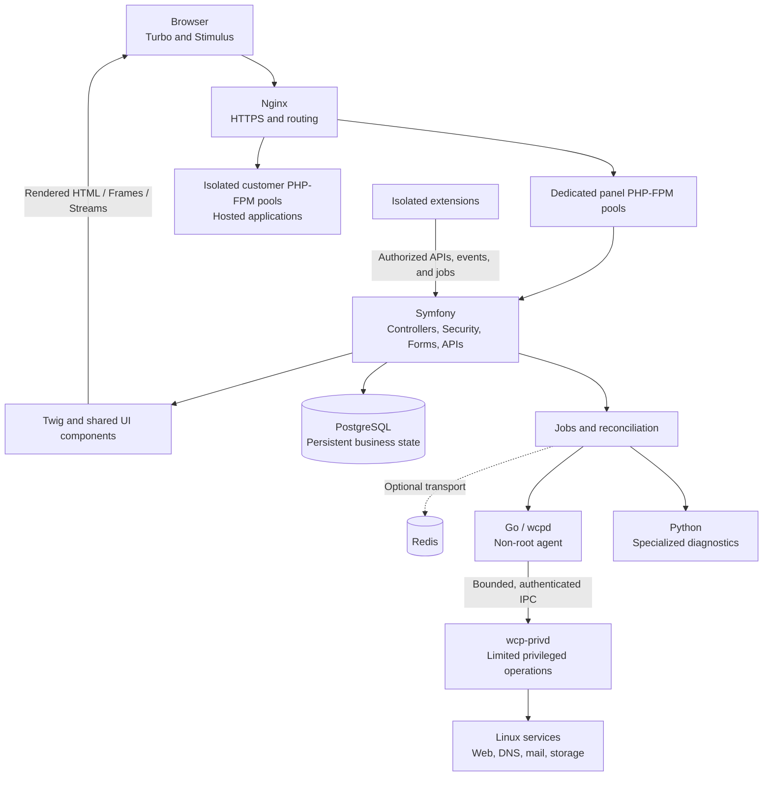

<div align="center">

# WCP360 — Web Control Panel 360

**Modular hosting management. A shared Symfony foundation. Controlled system operations.**

[](#current-project-status)
[](#modular-and-extensible-design)
[](#security-architecture)

[](#frontend-architecture)
[](#frontend-architecture)
[](#frontend-architecture)
[](#frontend-architecture)
[](#frontend-architecture)
[](#frontend-architecture)

[](#technology-stack-and-responsibilities)
[](#technology-stack-and-responsibilities)
[](#technology-stack-and-responsibilities)
[](#technology-stack-and-responsibilities)
[](#technology-stack-and-responsibilities)
[](#technology-stack-and-responsibilities)

[Frontend](#frontend-architecture) · [Architecture](#architecture-and-operation-flow) · [233 capabilities](#required-panel-capabilities) · [149 catalog entries](#potential-and-planned-extensions-and-plugins) · [Security](#security-architecture) · [Get started](#explore-and-get-started)

</div>

---

**A modular, extensible web hosting control panel designed to manage servers, services, and accounts through a unified interface.**

WCP360 targets a scope comparable to cPanel or Plesk: users, websites, domains, DNS, certificates, mail, databases, files, backups, and system services. Its architecture combines an **autonomous Core**, **domain modules**, and **optional extensions**.

| Product scope | Application surfaces | Extension model |
| :--- | :--- | :--- |
| **233 documented capabilities** across 21 domains | **WCP-ADMIN** for server operations and **WCP-USER** for customers and resellers | **149 catalog entries** covering optional modules, connectors, recipes, and engine adapters |

The target frontend is **PHP/Symfony with Twig, Symfony UX Turbo, Stimulus, and reusable Twig Components**. PostgreSQL stores Core data; optional Redis transports jobs; Go performs controlled system operations; Python handles specialized diagnostics; Nginx and PHP-FPM serve the panel and isolated hosted applications.

> [!NOTE]
> **In development — status documented on October 31, 2026.** This README describes the target architecture. The existing prototypes and candidate sources still require integration and qualification. See [Current project status](#current-project-status) and the [current manifest](https://github.com/yyogas/wcp360/blob/main/manifests/WCP360-BM-0001.md) for the authorized development scope.

## Contents

- [Project purpose and audience](#project-purpose-and-audience)
- [Why WCP360](#why-wcp360)
- [Modular and extensible design](#modular-and-extensible-design)
- [Technology stack and responsibilities](#technology-stack-and-responsibilities)
- [Frontend architecture](#frontend-architecture)
- [Architecture and operation flow](#architecture-and-operation-flow)
- [Security architecture](#security-architecture)
- [Required panel capabilities](#required-panel-capabilities)
- [Reusable components and services](#reusable-components-and-services)
- [Potential and planned extensions and plugins](#potential-and-planned-extensions-and-plugins)
- [Technical requirements](#technical-requirements)
- [Current project status](#current-project-status)
- [Explore and get started](#explore-and-get-started)
- [Repository layout](#repository-layout)
- [GitHub branches](#github-branches)
- [Documentation and contributing](#documentation-and-contributing)

## Project purpose and audience

WCP360 aims to simplify everyday hosting operations: create an account, assign a plan, publish a website, configure a domain, create a mailbox, restore a backup, or diagnose a service.

The panel should present resources, permissions, and actual operation status consistently. Long-running jobs are tracked; sensitive actions are authorized and audited; shared settings are reused across modules.

| Audience | Use |
| :--- | :--- |
| System administrators | Install, configure, monitor, and maintain server services. |
| Hosting providers | Manage customer accounts, plans, quotas, resources, and services. |
| Resellers and web agencies | Administer multiple customers and websites within their delegated scope. |
| Hosting customers | Manage their websites, domains, files, databases, mail, and backups. |
| Developers and integrators | Build extensions, connect services, and automate authorized operations. |

| Component group | Responsibility |
| :--- | :--- |
| **WCP360 Core** | Server-installed foundation, essential hosting capabilities, and shared services. |
| **WCP-USER** | Customer and reseller interface restricted to assigned resources and capabilities. |
| **WCP-ADMIN** | Administration interface for the server, services, and global policies. |
| **WCP360 Internal** | Private vendor services: licensing, catalog, builds, distribution, and support. Separate from the product installed on customer servers. |
| **Extensions and adapters** | Optional capabilities, provider connectors, and specialized integrations. |

ROOT, RESELLER, and USER denote panel scopes. The panel's ROOT role does not automatically grant unrestricted access to the Linux `root` account.

## Why WCP360

The project brings hosting operations commonly spread across multiple tools into one panel while maintaining clear boundaries between accounts and technical responsibilities.

Its design addresses five needs:

- **Centralize operations**: find resources, settings, jobs, and logs through organized navigation.
- **Reuse shared mechanisms**: build forms, tables, permissions, notifications, and processing mechanisms once.
- **Preserve server autonomy**: essential functions continue when optional integrations are unavailable.
- **Extend the product**: add capabilities and providers through documented contracts.
- **Support ongoing evolution**: change modules, data, and interfaces through versioning, migrations, and controlled recovery procedures.

## Modular and extensible design

### Three levels of modularity

| Level | Contents | Rule |
| :--- | :--- | :--- |
| **Shared foundations** | Identity, permissions, configuration, data, APIs, jobs, events, auditing, and UI components. | All modules use the same cross-cutting mechanisms. |
| **Core domain modules** | Accounts, websites, domains, DNS, TLS, mail, databases, files, local backups, and system operations. | Each domain owns its authoritative data, actions, and responsibilities. |
| **Optional extensions** | Advanced automation, external providers, commercial services, and specialized tools. | They can be disabled without interrupting essential Core functions. |

**Modular** means a capability has an identifiable boundary: a contract, permissions, data, operations, and an interface. A Core domain module remains essential to the product; an extension remains optional.

**Extensible** means these boundaries allow new capabilities, replacement adapters, or implementation changes without rewriting the entire panel. API versioning, data migrations, compatibility checks, and contract tests must accompany those changes.

### Organization principles

- Each resource has a domain owner and one authoritative editing interface. Dashboards and global settings link to it.
- WCP-USER and WCP-ADMIN share contracts and components while retaining surface-specific routes, sessions, and authorization.
- Providers connect through adapters: switching a provider should not change Core business logic.
- Extensions own isolated data and workers. They use authorized APIs and jobs to act on Core resources.
- An unavailable extension withdraws its routes and new jobs; the Core and existing hosting services remain usable.
- Private WCP360 Internal services are not installable plugins for customer servers.

## Technology stack and responsibilities

The following defines the **project's target stack**.

| Component | Responsibility |
| :--- | :--- |
| Frontend | PHP/Symfony-rendered pages, Twig components, forms, navigation, and charts |
| Symfony | Controllers, domain services, authentication, authorization, forms, and APIs |
| PostgreSQL | Persistent data and relationships |
| Redis | Asynchronous job transport, when needed |
| Go | Controlled system operations |
| Python | Diagnostics and specialized automation |
| Nginx | Web server and reverse proxy |
| PHP-FPM | Isolated execution of hosted PHP applications |

### How the components work in WCP360

| Component | Use in the panel |
| :--- | :--- |
| **Frontend** | Render WCP-USER and WCP-ADMIN with Symfony/Twig and shared UI components. Turbo, Stimulus, and selected Live Components add browser interactions while server-side services retain authority. |
| **Symfony** | Receive requests, validate data, enforce business rules and permissions, expose APIs, and coordinate processing. Business architecture remains organized into reusable domains. |
| **PostgreSQL** | Persist Core business state: accounts, plans, resources, relationships, policies, and operation tracking. Customer-hosted databases belong to a separate domain. |
| **Redis** | Provide message transport when justified. Redis remains optional: the job mechanism must have an alternative durable transport. Authoritative business data remains in PostgreSQL. |
| **Go** | Implement system agents and contract-defined operations: validation, service status, controlled configuration application, and result reporting. |
| **Python** | Run specialized diagnostics or automation as identified jobs with validated inputs, limits, and usable results. Python receives no unrestricted privileged server access. |
| **Nginx** | Serve web resources, terminate HTTPS connections according to configuration, and route requests to authorized services. |
| **PHP-FPM** | Execute account PHP applications in isolated pools. The panel runtime has its own scope, separate from hosted applications. |

Symfony renders the interface and applies business rules; Go performs authorized system operations; Python handles specialized processing. Twig templates and browser controllers never execute system operations directly.

## Frontend architecture

### PHP and Symfony frontend stack

**Symfony renders the WCP360 frontend on the server through Twig.** Symfony UX adds navigation, partial updates, reusable components, and focused browser interactions. Controllers, forms, components, APIs, and jobs call the same domain services and authorization rules.

This follows Symfony's documented [PHP and Twig frontend approach](https://symfony.com/doc/current/frontend.html).

| Layer | Selected technology | Role in WCP360 |
| :--- | :--- | :--- |
| Application and routing | PHP / Symfony | Render ADMIN and USER routes, resolve context, authorize requests, and call domain services. |
| Templates | [Twig](https://symfony.com/doc/current/templates.html) | Layouts, domain views, escaped output, form themes, and reusable presentation. |
| Components | [Symfony UX Twig Components](https://symfony.com/bundles/ux-twig-component) | Shared tables, dialogs, status badges, resource cards, menus, and permission-aware presentation. |
| Navigation and partial updates | [Symfony UX Turbo](https://symfony.com/bundles/ux-turbo) | Page navigation, scoped Frames, and targeted Streams using server-rendered HTML. |
| Browser interactions | [StimulusBundle](https://symfony.com/bundles/StimulusBundle) | Small controllers for dialogs, selections, uploads, clipboard actions, and measured job refreshes. |
| Reactive PHP components | [Symfony UX Live Components](https://symfony.com/bundles/ux-live-component) | Selected interactive filters and forms whose state is processed in PHP; server authorization applies on every action. |
| Forms and validation | [Symfony Form](https://symfony.com/doc/current/forms.html), Validator, and Security CSRF | Shared form types, field errors, constraints, and protected mutations. |
| Assets | [AssetMapper](https://symfony.com/doc/current/frontend/asset_mapper.html) | Import maps, versioned JavaScript/CSS, and local production assets served by Nginx. |
| Styling | WCP360 CSS variables and [TailwindBundle](https://symfony.com/bundles/TailwindBundle) | Preserve design tokens, themes, density, and responsive layouts; prepare CSS using the pinned standalone Tailwind binary. |
| Charts | [Symfony UX Chart.js](https://symfony.com/bundles/ux-chartjs) | Configure charts in PHP and display authorized usage and service measurements. |
| Localization | Symfony Translation and Intl | Shared messages, locale-aware dates/numbers, and translated interfaces. |
| Verification | [Symfony testing tools](https://symfony.com/doc/current/testing.html) and [Panther](https://symfony.com/doc/current/testing/end_to_end.html) | PHP unit/integration tests, form and authorization tests, and real-browser interaction checks. |

AssetMapper and the standalone Tailwind integration allow this frontend toolchain to run without a Node.js build dependency. Asset preparation belongs to development and release builds; the production web application must not download or update its own dependencies. [TailwindBundle deployment guidance](https://symfony.com/bundles/TailwindBundle).

### Shared presentation and module ownership

The UI library exposes WCP360 components such as `DataTable`, `FormPanel`, `ConfirmDialog`, `ResourceStatus`, and `JobProgress`. Domain modules consume these shared Twig/PHP components. Pagination, filtering, validation, accessibility, and confirmation behavior are maintained centrally.

The following is an intended implementation layout, rather than directories already present in `main`:

```text
presentation/
├── admin/              # ADMIN controllers, routes, forms, and templates
├── user/               # USER controllers, routes, forms, and templates
├── shared/
│   ├── components/     # Twig/PHP UI components
│   ├── form-types/     # Reusable Symfony forms and themes
│   ├── translations/   # Messages and formatting
│   └── assets/         # Design tokens and Stimulus controllers
└── modules/            # Domain presentation calling shared services
```

| Boundary | Implementation rule |
| :--- | :--- |
| ADMIN and USER | Separate bootstraps, Unix identities, PHP-FPM pools, session namespaces, and authorization contexts. |
| Page, Frame, and API | Recheck the same permissions and account ownership; a partial request is not a trusted shortcut. |
| Twig Components | Own presentation and call approved services; templates never run shell commands or arbitrary SQL. |
| Live Components | Explicitly declare writable state; validate changed resource IDs, arguments, and permissions on every action. |
| Forms | Reuse Symfony form types and server constraints; browser validation improves feedback but does not authorize mutations. |
| Turbo and Stimulus | Use one mechanism per interaction and managed controller lifecycles to prevent duplicate handlers and submissions. |
| Table state | Store non-sensitive filters in validated query parameters; keep permissions, secrets, and authoritative resource state on the server. |
| Job progress | Show server-confirmed states and measured progress, with bounded polling or authorized stream subscriptions. |
| Extensions | Accept declared contributions and reviewed assets; untrusted templates or scripts never enter the privileged shell. |
| Accessibility | Verify labels, focus, keyboard operation, dialogs, contrast, and reduced motion in the assembled interface. |

The current HTML/CSS/vanilla-JavaScript prototype remains the visual and behavioral reference. The target implementation moves shared rendering and form behavior into Symfony/Twig, with JavaScript confined to the browser interactions that require it.

## Architecture and operation flow

The browser receives HTML rendered by Symfony/Twig. Turbo and Stimulus enhance navigation and selected interactions. The same domain services authorize page requests, partial updates, APIs, and jobs.



Rendered responses return through the configured Nginx application origin. ADMIN and USER retain separate security contexts and PHP-FPM identities even when they share component and domain libraries.

1. Nginx routes a browser request to the intended Symfony application.
2. Symfony authenticates the session, verifies account ownership and permissions, and validates mutation input and request protection.
3. The domain service reads or records the requested state and creates a durable job for long-running work.
4. Approved workers, Go agents, or Python diagnostics perform their bounded operations; privileged effects pass through the broker.
5. Results are audited and reconciled with observed state.
6. Twig renders the updated view or Turbo response; authorized refreshes show server-confirmed job results.

Retries must not repeat the same effect. The diagram describes the target: the currently authorized daemon remains an inert CLI without a listener or privileged operations.

## Security architecture

Security belongs to the Core: authentication, tenant isolation, authorization, path confinement, controlled system operations, and recovery cannot depend on an optional plugin. The requirements below describe the intended implementation and its acceptance evidence; they are not a claim that the current prototype has passed a security assessment.

### Trust boundaries and deployment isolation

| Control | Required behavior |
| :--- | :--- |
| ADMIN and USER | Use separate Unix identities, PHP-FPM pools, session namespaces, route contexts, and rate limits. A USER session must never authenticate an ADMIN request. |
| Panel and hosted applications | Separate control-panel origins, document roots, runtime identities, and credentials from customer applications. Customer code cannot write panel releases or read panel secrets. |
| Web application and system agents | Run PHP, workers, and wcpd without root. Network-facing controllers never call the privileged broker directly. |
| Agent and privileged broker | Authenticate the caller and validate a closed operation contract at the broker boundary. Broker access is restricted to the approved local control path. |
| Core and extensions | Isolate workers, data, network access, and credentials. An extension cannot change Core authorization or write Core tables directly. |
| Customer server and Internal | Private vendor services remain separate. Diagnostics require explicit sharing; their availability cannot become a prerequisite for local recovery. |

These boundaries follow the project's ADMIN/USER isolation, broker, and extension contracts.

### Identity, sessions, and recovery controls

| Control | Required behavior |
| :--- | :--- |
| Initial owner setup | Use an explicit, local, single-use bootstrap mechanism. Do not ship a default administrator password. |
| Password handling | Use Symfony password hashing and controlled reset flows; never store recoverable passwords for panel identities. |
| Multifactor access | Require MFA for privileged production access according to policy. Enroll and revoke factors through reauthenticated flows. |
| Recovery codes | Store recovery material securely, enforce single use, and audit factor recovery without logging the codes. |
| Session cookies | Use Secure, HttpOnly, host-scoped cookies with explicit SameSite settings; separate ADMIN and USER cookie namespaces. |
| Session lifetime | Rotate session IDs after login and elevation. Enforce idle and absolute expiration, logout, per-session revocation, and revoke-all. |
| Sensitive changes | Require recent reauthentication for factor changes, secret disclosure, destructive actions, and critical network or security configuration. |
| Browser storage | Keep session IDs, API credentials, and provider secrets out of localStorage, sessionStorage, URLs, and client-side preference data. |

Cookie attributes and session lifecycle follow [OWASP session guidance](https://cheatsheetseries.owasp.org/cheatsheets/Session_Management_Cheat_Sheet.html); bootstrap and surface separation remain project-specific requirements.

### Authorization and tenant isolation controls

| Control | Required behavior |
| :--- | :--- |
| Default decision | Use Symfony Security voters and domain policies; deny access unless the action, actor, ownership, delegation, and effective policy explicitly allow it. |
| Every entry point | Apply the same checks to full pages, API requests, Turbo Frames, Live Actions, exports, downloads, and bulk operations. |
| Object ownership | Resolve resource IDs within the authorized account scope. Guess-resistant IDs do not replace ownership checks. |
| Reseller ceilings | Restrict delegated actions to owned customers and the administrator's ceiling; reject attempts to widen inherited permissions. |
| Queued work | Revalidate relevant permissions, ownership, and resource version before a queued operation applies changes. |
| Support impersonation | Retain real and effective actor identities, show a persistent session banner, and restrict sensitive actions during impersonation. |
| Presentation | Twig visibility checks improve the interface; Symfony domain authorization remains authoritative even when a button is hidden. |

The enforcement model uses [Symfony voters](https://symfony.com/doc/current/security/voters.html) and follows [OWASP authorization guidance](https://cheatsheetseries.owasp.org/cheatsheets/Authorization_Cheat_Sheet.html).

### Twig, Turbo, and browser protections

| Control | Required behavior |
| :--- | :--- |
| Template trust | Render reviewed Twig templates only. Never treat tenant content or extension input as executable template source. |
| Output handling | Keep contextual escaping enabled. Restrict raw HTML to reviewed, trusted content; validate URLs and avoid unsafe DOM insertion in Stimulus. |
| Symfony forms | Keep CSRF protection enabled for cookie-authenticated state changes; custom mutation endpoints need explicit protection. GET requests must not mutate resources. |
| Live Actions | Retain the bundle's request-header and same-origin protection. Do not enable permissive CORS; validate writable properties, resource IDs, and action arguments. |
| Content Security Policy | Use an application-tested CSP with explicit script and connection sources, protection against framing, and reviewed nonces or hashes for necessary import-map/bootstrap scripts. |
| Origin and proxy handling | Validate intended origins and configure trusted hosts/proxies explicitly. Do not let arbitrary forwarded headers redefine the application origin. |
| Sensitive page caching | Send private/no-store responses as appropriate and disable Turbo snapshot caching for sensitive pages. Clear relevant browser state when logging out or switching accounts. |
| Browser capabilities | Set appropriate content-type, referrer, and permissions headers. Limit privileged browser features to actual UI requirements. |

See [Symfony output escaping](https://symfony.com/doc/current/templates.html), [Symfony CSRF protection](https://symfony.com/doc/current/security/csrf.html), [Live Action protection](https://symfony.com/bundles/ux-live-component#actions-and-csrf-protection), [Turbo cache controls](https://turbo.hotwired.dev/handbook/building), and [OWASP CSP guidance](https://cheatsheetseries.owasp.org/cheatsheets/Content_Security_Policy_Cheat_Sheet.html).

### APIs, forms, webhooks, and resource limits

| Control | Required behavior |
| :--- | :--- |
| Typed input contracts | Validate request shape, lengths, ranges, enums, and writable fields. Reject attempts to set ownership, roles, or hidden administrative fields. |
| Database requests | Use parameterized queries/repositories and allowlisted sort fields. Never build SQL identifiers or fragments from unchecked browser input. |
| Machine access | Use scoped service accounts, expirations, rotation, and revocation. Keep machine-token authentication distinct from browser session authentication. |
| Webhook authenticity | Verify signatures over the expected payload, timestamp/replay rules, provider identity, and the scope of the triggered action. |
| Duplicate delivery | Use idempotency keys and recorded outcomes so retries cannot repeat provisioning, deletion, or other sensitive effects. |
| Abuse budgets | Bound request size, pagination, concurrent exports, upload size, expensive diagnostics, and retry rates by identity and resource. |
| Error responses | Return stable error codes and correlation IDs; keep stack traces, SQL, paths, secrets, and cross-account existence details out of public responses. |

### System agents and privileged operation controls

| Control | Required behavior |
| :--- | :--- |
| Minimal root component | Keep wcp-privd limited to privileged primitives. It has no web session handling, templates, general business logic, or command interpreter. |
| Closed action registry | Accept registered action IDs, typed arguments, and a validated resource context. Reject arbitrary shell, executable names, systemd units, paths, or opaque command strings. |
| Independent validation | The broker rechecks caller identity and relevant constraints; a request is not trusted merely because PHP or wcpd sent it. |
| Execution limits | Bound message size, operation time, output size, process count, and retries. Record the job and resource associated with an effect. |
| Replay and concurrency | Bind operations to authenticated request/job context and apply the contract's replay, version, idempotency, and locking rules. |
| Python diagnostics | Run under dedicated non-root identities with approved inputs, working directories, dependencies, and network access. |
| Review of new primitives | Require contract review and negative cases before adding a privileged operation. No extension receives a generic root shell. |

This is the target privileged-operation model. The currently authorized daemon remains inert, as documented in [Current project status](#current-project-status).

### Files, uploads, archives, and hosted code

| Control | Required behavior |
| :--- | :--- |
| Resource-to-path resolution | Resolve resource IDs through a central account-aware path resolver; do not accept arbitrary Linux paths from public requests. |
| Filesystem boundaries | Use account-confined, race-resistant operations where paths can change concurrently; enforce ownership, file type, symlink/hardlink, and mount policies. |
| Uploads into the panel | Store attachments and diagnostics outside panel execution roots. Validate expected file types, limits, and publication behavior. |
| Hosted application code | PHP uploads may be legitimate inside a customer's site, but must execute only under that site's isolated runtime, never under the panel's PHP-FPM identity. |
| Archives | Prevent path traversal and out-of-scope extraction; bound expanded size, file count, nesting, and processing time. |
| Previews and downloads | Treat HTML, SVG, scripts, and active documents as untrusted. Use safe download headers or isolated preview origins instead of privileged inline rendering. |
| Quotas and atomic changes | Check capacity before and during transfers; use safe temporary files and verified replacement where required. |
| Deletion and restore | Check dependencies, ownership, and the exact target again; retain an explicit audit and a supported recovery path. |

Panel attachment handling follows [OWASP file-upload guidance](https://cheatsheetseries.owasp.org/cheatsheets/File_Upload_Cheat_Sheet.html); customer application code additionally follows WCP360's hosting-account isolation contract.

### Secrets, database identities, and encryption

| Control | Required behavior |
| :--- | :--- |
| Secret references | Expose references to application services, not raw secrets in templates, job parameters, or diagnostic exports. |
| Local secret separation | Keep Core secrets outside release code, separated by consumer under the project's secret-store layout with minimal ownership and ACLs. |
| Excluded locations | Do not put Core secrets in Git, versioned environment files, URLs, logs, traces, audit payloads, or browser storage. |
| Database privileges | Use dedicated application identities and scoped grants. The runtime must not use a database superuser or customer database credentials. |
| Tenant-aware access | Apply ownership restrictions in repositories and commands; additional database isolation must be configured and tested rather than assumed. |
| Encryption and keys | Use maintained cryptographic libraries and managed key references for protected data and backups; document rotation and recovery. |
| Credential lifecycle | Track consumers, expiration, rotation, revocation, and recovery without displaying existing credentials by default. |

### Networking, SSRF, and provider connections

| Control | Required behavior |
| :--- | :--- |
| Public connector destinations | Allow approved schemes, hosts, ports, and operations. Block access to unrelated loopback, link-local, metadata, and private control endpoints. |
| Infrastructure destinations | Private service addresses require an explicitly authorized infrastructure adapter and inventory scope; they are not enabled by accepting any submitted URL. |
| DNS and redirects | Validate resolved destinations and connection behavior; reject or revalidate redirects and rebinding-sensitive destinations. |
| Outbound limits | Apply egress policy, connection/read timeouts, response-size limits, and bounded retries per connector. |
| TLS identity | Verify certificates and peer identity; do not silently disable verification to make a provider connection succeed. |
| Network changes | Validate before application, preserve a recovery path, and verify reachability after firewall, SSH, address, or route changes. |

Destination validation and egress restrictions follow [OWASP SSRF prevention guidance](https://cheatsheetseries.owasp.org/cheatsheets/Server_Side_Request_Forgery_Prevention_Cheat_Sheet.html), with explicit exceptions for authorized infrastructure management.

### Extension isolation and supply-chain controls

| Control | Required behavior |
| :--- | :--- |
| Package admission | Check publisher, compatibility, signature, integrity, provenance, dependencies, and requested capabilities before installation. |
| Runtime isolation | Use a dedicated identity, resource budget, network policy, secret scope, and data namespace per extension. |
| UI trust | Do not auto-load third-party extension code as Core Symfony bundles. Only reviewed assets and declared UI contributions enter the privileged interface. |
| Permissions on update | Show newly requested capabilities and reject undeclared privilege expansion. |
| Failure and quarantine | Withdraw routes and new jobs, stop outbound access when quarantined, and preserve Core availability and diagnostic evidence. |
| Dependencies and builds | Pin dependency inputs, retain an inventory/SBOM, check advisories and leaked secrets, and build signed artifacts in an isolated release environment. |
| Removal | Drain work and explicitly retain, export, or delete extension-owned data; never cascade into unrelated Core resources. |

### Configuration application and release safety

| Control | Required behavior |
| :--- | :--- |
| Configuration preparation | Generate into a controlled temporary location, set ownership/mode, validate syntax, and present the intended diff. |
| Safe application | Retain a recovery point, perform the required durable/atomic replacement, reload the permitted service, and verify health. |
| Failure handling | Do not replace the last working configuration with invalid output; recover, verify, and audit the failure. |
| Immutable releases | Distribute versioned, verified code and prepared assets with compatibility and migration information. |
| Production dependency policy | No web-triggered git pull, composer update, improvised builds, or runtime downloads of application dependencies. |
| Migration and rollback | Check data compatibility and recovery prerequisites; a package rollback must not pretend to reverse an irreversible schema change. |
| Deployment isolation | Test service-specific sandbox profiles and explicit writable paths; do not apply one unverified hardening profile to every process. |

### Audit, incident handling, and recovery

| Control | Required behavior |
| :--- | :--- |
| Attribution | Record real/effective actor, resource, action, timestamp, outcome, and correlation/job ID. |
| Audit access | Prevent ordinary application users from rewriting history; govern retention, export, and purge separately. |
| Sensitive-data minimization | Redact credentials and content not required for the investigation, including support bundles and AI outputs. |
| Local alerting | Keep in-panel alerts and verified ROOT email fallback usable without external messaging plugins. |
| Containment | Provide authorized session revocation, credential rotation, account/extension quarantine, and evidence preservation. |
| Backup recovery | Verify backup readability, test supported restores, protect recovery material, and document emergency access. |
| Support and AI | Share diagnostics explicitly; apply the same permissions and approval rules to generated recommendations and automated actions. |

### Security implementation acceptance

Each implementation must provide reproducible evidence for the relevant cases below, including negative cases. A framework default, hidden button, successful local build, or security badge does not replace those checks.

| Case | Required result |
| :--- | :--- |
| Cross-surface session reuse | A USER cookie cannot authenticate ADMIN pages, Frames, APIs, or Live Actions. |
| Cross-account resource access | Guessed IDs, bulk selections, exports, downloads, and queued work cannot reach another tenant's resources. |
| Mutation forgery | Missing/invalid CSRF protection, untrusted origins, and forged Live Action requests are rejected by the relevant endpoint. |
| Template and browser injection | Untrusted fields, filenames, HTML, and extension content cannot become executable privileged Twig or browser code. |
| Unauthorized privileged operation | Unknown action IDs, free command strings, arbitrary units, and out-of-scope paths are rejected before an effect. |
| Filesystem escape | Symlink/hardlink races and malicious archives cannot escape the authorized root. |
| Connector escape | Redirects, resolved addresses, and metadata/control endpoints cannot bypass destination policy. |
| Repeated or interrupted jobs | Retries, restarts, and partial failures do not repeat a destructive or provisioning effect. |
| Invalid configuration | A failed syntax or health check leaves a recoverable working configuration and a recorded failure. |
| Untrusted extension or release | Unsigned, incompatible, or privilege-expanding packages cannot be silently activated. |
| Secret leakage | Logs, errors, HTML, audit records, browser storage, and support exports contain no raw credentials. |
| Recovery and dependency outage | Documented local sign-in, export, recovery, and existing hosting continue when optional integrations are unavailable. |

Report suspected vulnerabilities using the repository’s [SECURITY.md](https://github.com/yyogas/wcp360/blob/main/SECURITY.md).

## Required panel capabilities

The following catalog details **233 functional capabilities across 21 domains**. It describes the intended scope, not delivery status. Advanced optional functions are detailed in the [extension catalog](#potential-and-planned-extensions-and-plugins).

For each domain, WCP-ADMIN manages server policies and resources; WCP-USER sees only assigned resources and actions. Variants depend on capabilities actually detected. Actions must be authorized by the backend, produce verified results, and appear in the task center when long-running.

| Functional domain | Capabilities described |
| :--- | :--- |
| [Authentication and access protection](#authentication-and-access-protection) | 10 |
| [Permissions, delegation, and account separation](#permissions-delegation-and-account-separation) | 10 |
| [Customers, resellers, and account lifecycle](#customers-resellers-and-account-lifecycle) | 10 |
| [Hosting plans, quotas, and usage metering](#hosting-plans-quotas-and-usage-metering) | 10 |
| [Websites, virtual hosts, and HTTP routing](#websites-virtual-hosts-and-http-routing) | 12 |
| [Domains, authoritative DNS, and resolution](#domains-authoritative-dns-and-resolution) | 13 |
| [Certificates, ACME, and TLS policies](#certificates-acme-and-tls-policies) | 10 |
| [PHP, PHP-FPM, and site dependencies](#php-php-fpm-and-site-dependencies) | 11 |
| [Databases and engine access](#databases-and-engine-access) | 13 |
| [Mail services and deliverability](#mail-services-and-deliverability) | 18 |
| [File management and web transfers](#file-management-and-web-transfers) | 13 |
| [SSH, SFTP, and technical access](#ssh-sftp-and-technical-access) | 9 |
| [Local backups, restoration, and retention](#local-backups-restoration-and-retention) | 12 |
| [Migration and transfers between instances](#migration-and-transfers-between-instances) | 10 |
| [System, services, packages, and local storage](#system-services-packages-and-local-storage) | 12 |
| [Networking, IP addresses, and firewall](#networking-ip-addresses-and-firewall) | 10 |
| [Security, secrets, and baseline compliance](#security-secrets-and-baseline-compliance) | 10 |
| [Metrics, alerts, incidents, and diagnostics](#metrics-alerts-incidents-and-diagnostics) | 10 |
| [Jobs, reconciliation, and long-running operations](#jobs-reconciliation-and-long-running-operations) | 10 |
| [Configuration, APIs, and application exchanges](#configuration-apis-and-application-exchanges) | 10 |
| [Installation, updates, and panel autonomy](#installation-updates-and-panel-autonomy) | 10 |

### Authentication and access protection

| Capability | Operations to cover |
| :--- | :--- |
| Sign-in and sign-out | Authenticate the account, explain failures without revealing other users, and end the session. |
| Multifactor authentication | Enroll, verify, and revoke factors; enforce the requirements associated with each role. |
| Passkeys / WebAuthn | Support an additional sign-in mechanism when the backend and policy allow it. |
| Access recovery | Manage recovery codes and documented recovery procedures without bypassing account controls. |
| Session management | List sessions, activity, and origin; revoke an individual session or other sessions. |
| Sensitive-action reauthentication | Require additional verification before identity changes, secret disclosure, or significant destructive operations. |
| Abuse protection | Limit attempts, enforce delays, and record temporary lockouts. |
| Passwords | Change or reset sign-in credentials with appropriate expiration and revocation. |
| Sign-in history | Review successful attempts, failures, and factor changes within the authorized scope. |
| Local recovery access | Maintain a documented procedure that remains usable when an external provider or extension is unavailable. |

### Permissions, delegation, and account separation

| Capability | Operations to cover |
| :--- | :--- |
| ROOT / RESELLER / USER roles | Define each role's responsibilities without confusing an application role with a Linux identity. |
| Action-level permissions | Separate read, create, update, delete, export, and sensitive-operation permissions. |
| Ownership checks | Verify account, domain, and resource ownership on every request. |
| Reseller delegation | Limit each reseller to their own customers and the ceiling set by the administrator. |
| Policy inheritance | Resolve server, plan, reseller, account, and resource constraints in an explicit order. |
| Effective permissions | Show why an action is allowed, denied, or restricted. |
| Data isolation | Prevent direct or indirect access to another account's files, databases, logs, and jobs. |
| Support mode / impersonation | Retain the real initiator, target, and scope; display a persistent banner and an immediate exit. |
| Service accounts | Assign a machine identity, limited permissions, an expiration, and revocable credentials. |
| Revocation and role changes | Remove effective permissions and invalidate affected access without leaving implicit grants. |

### Customers, resellers, and account lifecycle

| Capability | Operations to cover |
| :--- | :--- |
| Account creation | Check identifiers, owner, plan, initial domain, and available capacity before provisioning. |
| Onboarding | Track the steps required to activate hosting and the resources actually created. |
| Customer profile | Centralize contact details, language, time zone, assigned resources, and authorized history. |
| Resource inventory | Find an account's sites, domains, databases, mailboxes, access credentials, backups, and jobs. |
| Targeted suspension | Define affected services, the reason, and the resources retained. |
| Reactivation | Check prerequisites and restore authorized capabilities. |
| Closure and deletion | Present dependencies, affected data, backups, and retention rules before removal. |
| Ownership transfer | Check permissions, quotas, conflicts, and dependent resources when changing ownership. |
| Demo accounts | Use simulated data and actions without affecting real services. |
| Trial accounts | Support expiration, limits, and conversion without silently deleting data. |

### Hosting plans, quotas, and usage metering

| Capability | Operations to cover |
| :--- | :--- |
| Plan catalog | Create, version, and assign consistent sets of hosting capabilities. |
| Resource limits | Manage permitted numbers of sites, domains, databases, mailboxes, technical accounts, and jobs. |
| Storage and inodes | Distinguish allocated space, actual usage, file counts, and effective limits. |
| Bandwidth | Track volumes, measurement periods, thresholds, and resets according to policy. |
| CPU, RAM, and processes | Expose limits that can actually be enforced and usage collected by the backend. |
| I/O and connections | Manage supported limits without claiming isolation that the system does not provide. |
| Upgrades and exceptions | Apply an authorized override, record its justification, and support returning to inherited values. |
| Limit violations | Distinguish approaching a limit, exceeding it, active throttling, and suspension. |
| Usage history | Retain the interval, unit, source, and freshness of each measurement. |
| Usage export | Produce records for commercial connectors; distinguish resource consumption from billing. |

### Websites, virtual hosts, and HTTP routing

| Capability | Operations to cover |
| :--- | :--- |
| Site provisioning | Create resources and check the domain, document root, runtime, and permissions before publication. |
| Document roots | Validate paths and prevent access outside the account's scope. |
| Static and PHP sites | Configure request handling for the site's type and assigned runtime. |
| Nginx configuration | Generate structured configuration, check its syntax, and apply changes. |
| Web subdomains and aliases | Bind authorized names without duplicates or cross-account collisions. |
| Redirects | Manage destinations, status codes, and HTTPS redirects with loop and scope checks. |
| Reverse proxy | Define allowed destinations, upstreams, timeouts, and supported availability checks. |
| Per-site rules | Control index files, error pages, request limits, and permitted settings. |
| Directory access | Support access protection and publication restrictions according to engine capabilities. |
| Caching and compression | Configure available functions, purge the site's cache, and display collected measurements. |
| HTTP logs | Review site access and error logs with filtering, retention, and appropriate redaction. |
| Configuration apply and recovery | Present a diff, validate, reload, and retain a recovery configuration when possible. |

### Domains, authoritative DNS, and resolution

| Capability | Operations to cover |
| :--- | :--- |
| Domain inventory | Keep ownership, bindings, local state, and external observations separate. |
| Name validation | Normalize names, handle internationalized domains, and detect collisions. |
| Zones and records | Manage A, AAAA, CNAME, MX, TXT, SRV, NS, CAA, and PTR records as appropriate for the zone. |
| SOA, TTL, and serial numbers | Validate values and track the zone version actually published. |
| Zone templates | Apply templates at creation and show changes without overwriting exceptions. |
| Zone import and export | Validate data, detect conflicts, and retain a result for each record. |
| DNSSEC | Manage supported signing capabilities, keys, and DS information with change tracking. |
| Nameservers and glue | Check delegation, nameserver addresses, and information to submit to the registrar. |
| Primary and secondary DNS | Track publication, notifications, and authorized AXFR/IXFR/TSIG transfers. |
| Resolution diagnostics | Compare observations, propagation, and published state with source and timestamp. |
| Reverse DNS | Track PTR records and indicate whether changes depend on an external provider. |
| CAA, TLSA, and DANE | Validate records and security dependencies when these capabilities are supported. |
| DNS configuration drift | Detect differences between desired and observed state and offer controlled reconciliation. |

### Certificates, ACME, and TLS policies

| Capability | Operations to cover |
| :--- | :--- |
| Certificate inventory | List covered names, issuer, validity, fingerprint, and assigned services. |
| ACME accounts and authorities | Configure compatible accounts and authorities without relying on a single provider. |
| Orders and challenges | Track orders, HTTP-01 or DNS-01 steps, and validation errors. |
| Wildcard certificates | Verify that a compatible validation mechanism is available. |
| Renewal | Schedule attempts, report failures, and avoid renewal loops. |
| Import and CSR | Import certificates and chains or generate a request with controlled key handling. |
| Deployment across services | Assign a certificate to web, mail, or the panel and verify activation. |
| TLS profiles | Apply supported protocol and parameter profiles with compatibility checks. |
| Expiration and rotation | Alert, replace expiring material, and track references still in use. |
| Post-application verification | Confirm the chain and service presented; distinguish stored certificates from certificates actually deployed. |

### PHP, PHP-FPM, and site dependencies

| Capability | Operations to cover |
| :--- | :--- |
| PHP versions | Inventory available versions, their sources, and the applications that depend on them. |
| Per-site assignment | Select an authorized runtime and check incompatibilities before switching. |
| PHP-FPM pools | Manage identity, socket, process mode, capacity, and account-specific limits. |
| PHP settings | Edit permitted directives: memory, timeouts, uploads, and other schema-validated settings. |
| Effective configuration | Show inherited values, local overrides, and required reloads. |
| PHP extensions | List, enable, or remove permitted modules according to version, dependencies, and impact. |
| OPcache and diagnostics | Expose available settings and measurements without mixing pools or accounts. |
| Command-line PHP | Associate the CLI version with authorized tasks without confusing it with the web runtime. |
| Composer | Install project dependencies under the project's identity and directory, with a recorded outcome. |
| Startup and health | Check pool status, failures, saturation, errors, and restart requirements. |
| Version changes | Prepare compatibility checks and recovery when the application and backend support them. |

### Databases and engine access

| Capability | Operations to cover |
| :--- | :--- |
| Engine inventory | Detect installed versions, status, and actual capabilities. |
| Database creation | Assign an owner, engine, compatible options, and plan limits. |
| Users and credentials | Create, rotate, or revoke access without exposing passwords in logs. |
| Privileges | Manage per-database grants and distinguish usage rights from engine administration. |
| Remote access | Control allowed addresses, encryption, and network access rules. |
| Data import | Check format, size, available space, and import results. |
| Data export | Produce a consistent, protected export subject to the owner's permissions. |
| Backup and restore | Coordinate operations with the engine and account recovery points. |
| Connections and locks | Expose available diagnostics and restrict termination actions to authorized permissions. |
| Slow queries | Present measurements and filtered queries with sources and sensitive-data redaction. |
| PostgreSQL extensions | Manage available modules per database with dependency and privilege checks. |
| Deletion and dependencies | Identify affected users, applications, and backups before destruction. |
| Panel data separation | Isolate the Core PostgreSQL database from customer-hosted databases. |

### Mail services and deliverability

| Capability | Operations to cover |
| :--- | :--- |
| Mail domains | Enable or disable mail hosting and check DNS prerequisites. |
| Mailboxes | Create, update, suspend, delete, and track mailbox usage. |
| Quotas and sending limits | Define storage and usage ceilings by account, domain, or mailbox. |
| Aliases and recipient groups | Validate addresses and relationships without exposing other accounts. |
| Forwarders and catch-all | Check destinations, loops, and external-forwarding policy. |
| Vacation replies | Define the schedule, content, and frequency according to engine support. |
| Sieve filters | Build ordered, validated rules for filing, forwarding, and other permitted actions. |
| SMTP, IMAP, and authentication | Present client settings, service status, and secure configuration. |
| Autoconfig and Autodiscover | Prepare compatible configuration information for mail clients. |
| Webmail access | Create an authorized access flow to the configured client without exposing a general password. |
| Mail queue | Filter deferred messages, understand reasons, and perform authorized actions. |
| SPF, DKIM, and DMARC | Check configuration, publish required records, and track problems by domain. |
| DKIM key rotation | Prepare and verify selector changes and associated records. |
| Baseline mail protection | Apply spam controls, abuse checks, and protections available in the selected baseline. |
| Outbound abuse and reputation | Associate sending anomalies with accounts; throttle or suspend according to policy. |
| MTA-STS and TLS-RPT | Manage policies and observations when compatible services are enabled. |
| Deliverability diagnostics | Correlate PTR, DNS, TLS, rejections, and external observations without guaranteeing delivery. |
| Mail logs | Authorize access within the intended scope and redact sensitive data. |

### File management and web transfers

| Capability | Operations to cover |
| :--- | :--- |
| File explorer | Show a directory tree, breadcrumbs, metadata, permitted hidden files, and contextual navigation. |
| Creation and renaming | Create files and directories, rename items, and check conflicts. |
| Copy and move | Check capacity, destination, permissions, and the result for each item. |
| Uploads | Handle progress, collisions, limits, and per-file results; offer resuming only when the backend supports it. |
| Downloads | Check the resource, transfer scope, and lifetime of any generated links. |
| Text editor | Support highlighting, search and replace, encoding, unsaved changes, and saving. |
| Edit conflicts | Detect concurrent changes and prevent silent overwriting of another version. |
| Archives | Create or extract supported formats with limits on size, file count, and paths. |
| File permissions | Edit permitted modes and identities without bypassing account isolation. |
| Deletion and trash | Distinguish recoverable deletion from permanent removal according to storage capabilities. |
| Search and size calculation | Search within authorized limits and run costly operations as tracked jobs. |
| Path protection | Check symbolic links, directory traversal, and archive paths on the server. |
| Operation history | Track the actor, target, result, and any available recovery point. |

### SSH, SFTP, and technical access

| Capability | Operations to cover |
| :--- | :--- |
| Server SSH configuration | Manage permitted settings, listening addresses, and authentication policies. |
| User keys | Import, assign, revoke, and track keys belonging to the owner. |
| SFTP accounts | Define identity, accessible root, permissions, and restrictions. |
| Delegated shell access | Distinguish SFTP-only accounts from authorized shells; apply the hosting plan's scope. |
| Access restrictions | Define allowed users and groups and supported constraints. |
| Administrator lockout prevention | Validate configuration before reloading and retain a recovery path. |
| SSH host keys | Inventory fingerprints, any relevant expiration dates, and rotation procedures. |
| Sessions and logs | Track authorized connections and revoke access according to available capabilities. |
| Credential rotation | Remove old access and check automation dependencies. |

### Local backups, restoration, and retention

| Capability | Operations to cover |
| :--- | :--- |
| Backup policies | Select resources, schedules, retention, owner, and capacity constraints. |
| Per-resource backups | Cover files, databases, mail, DNS, and configuration within the selected scope. |
| Recovery points | Retain identifier, date, contents, engine, location, and verification status. |
| Execution and progress | Track steps, partial failures, duration, and storage consumption. |
| Data consistency | Coordinate mechanisms specific to the databases and services involved. |
| Encryption | Manage key references and recovery procedures according to engine capabilities. |
| Verification | Check integrity and readability; distinguish a completed backup from a verified backup. |
| Retention and pruning | Show recovery points to retain or delete before changing policy. |
| Targeted restoration | Select files, databases, mailboxes, or an entire account with conflict checks. |
| Restore preparation | Check permissions, capacity, dependencies, and the effect on existing data. |
| Restore results | Confirm recovered resources and identify items requiring intervention. |
| Independent recovery access | Keep local backup and restore usable without a remote connector. |

### Migration and transfers between instances

| Capability | Operations to cover |
| :--- | :--- |
| Source inventory | Discover accounts, domains, files, databases, mail, DNS, certificates, and scheduled tasks. |
| Compatibility checks | Identify versions, missing capabilities, and items that cannot be transferred. |
| Resource mapping | Map destination accounts, plans, paths, IP addresses, and engines. |
| Destination capacity | Check space, quotas, resources, and collisions before transfer. |
| Tracked transfers | Run jobs with progress and per-resource results. |
| Final synchronization | Support catching up with changes when the transfer protocol allows it. |
| Cutover preparation | Document DNS changes, any downtime, and checks before activation. |
| Post-transfer validation | Compare imported items and services; produce a verification report. |
| Recovery and cleanup | Distinguish incomplete transfers, available recovery options, and final removal of temporary data. |
| External formats | Use specialized importers for other panels; do not assume format compatibility. |

### System, services, packages, and local storage

| Capability | Operations to cover |
| :--- | :--- |
| Server identity | Show OS, architecture, kernel, hostname, FQDN, time zone, and clock status. |
| System users and groups | Manage identities needed by services and accounts through bounded operations. |
| Services | Read status and perform start, stop, reload, restart, or boot-enablement actions according to permissions. |
| Service dependencies | Identify affected resources before stopping a service or changing configuration. |
| Processes | Show owner, usage, and authorized actions without exposing secrets in arguments. |
| Packages and repositories | List versions and sources; execute validated, tracked package transactions. |
| Security updates | Identify applicable advisories and reboot requirements with source evidence. |
| System scheduling | Administer authorized jobs and timers, their owners, and their history. |
| Volumes and mounts | Show capacity, filesystem, options, and dependencies before unmounting. |
| Disk capacity and health | Monitor space, inodes, I/O errors, and SMART signals when available. |
| System logs | Filter journal and file logs; apply retention and access according to role. |
| Maintenance and reboot | Prepare service impact, retain recovery options, and verify restored health. |

### Networking, IP addresses, and firewall

| Capability | Operations to cover |
| :--- | :--- |
| Interface inventory | Expose links, status, addresses, MTU, and the detected configuration backend. |
| IPv4 and IPv6 | Manage addresses and prefixes with format, ownership, and usage validation. |
| IP pools and reservations | Allocate, reserve, and release addresses without collisions. |
| Routes and gateways | Control changes and their effect on panel connectivity. |
| Resolvers and local naming | Manage supported settings without confusing resolvers with authoritative DNS servers. |
| Ports and sockets | Identify listening endpoints, services, and authorized network exposure. |
| Firewall rules | Manage rules, profiles, the active configuration source, and post-application checks. |
| Blocks and exceptions | Review restrictions, expiration, and authorized unblocking. |
| Network diagnostics | Expose resolution, connectivity, and route tests with validated targets. |
| Sensitive network changes | Provide validation, checks that access remains available, and recovery after connectivity loss. |

### Security, secrets, and baseline compliance

| Capability | Operations to cover |
| :--- | :--- |
| Security center | Aggregate findings while retaining source, evidence, scope, and date. |
| Baseline hardening | Check required settings and propose changes compatible with the server. |
| Sign-in attack prevention | Manage the selected protections and exceptions without a second conflicting inventory. |
| Installed protection integrations | Detect spam engines, scanners, or MAC controls; expose only available functions. |
| Application secrets | Reference and protect service, provider, and technical-account credentials. |
| Sensitive-data redaction | Filter secrets and sensitive content from logs, audit records, errors, exports, and diagnostics. |
| Internal keys and certificates | Manage scope, rotation, and revocation of the panel's technical identities. |
| Request validation | Check inputs, attachments, sessions, origins, and sensitive operations on the server. |
| Change auditing | Retain the real actor, any delegation, resource, action, and outcome. |
| Evidence retention | Control access, retention, export, and changes to audit policies. |

### Metrics, alerts, incidents, and diagnostics

| Capability | Operations to cover |
| :--- | :--- |
| Server health | Distinguish healthy, degraded, unavailable, and unknown states using checks actually collected. |
| System metrics | Track CPU, RAM, storage, network, and saturation with units and measurement periods. |
| Per-account metrics | Restrict data to owned resources and delegated permissions. |
| History and trends | Compare periods and distinguish recent, delayed, or missing measurements. |
| Service checks | Check availability and application-level health of enabled services. |
| Alert rules | Define thresholds, windows, recipients, and event deduplication. |
| Notification center | Review, filter, and acknowledge events according to role. |
| Local alert fallback | Maintain panel notifications and a verified ROOT email address without an external extension. |
| Incident management | Associate symptoms, resources, remediation jobs, and maintenance events. |
| Diagnostic bundles | Collect information needed for intervention, with filtering and explicit sharing. |

### Jobs, reconciliation, and long-running operations

| Capability | Operations to cover |
| :--- | :--- |
| Task center | List operations, owner, resource, step, progress, and outcome. |
| Job persistence | Retain state and attempts across worker interruptions. |
| Idempotency | Recognize repeated requests and avoid repeating a system effect. |
| Locks and concurrency | Prevent incompatible changes to the same resource. |
| Preconditions | Check capacity, dependencies, and permissions before application. |
| Steps and checkpoints | Track partial operations and recovery checkpoints. |
| Recovery and retries | Limit retries and distinguish transient errors from cases requiring intervention. |
| Cancellation and compensation | Expose available actions according to the current step and technical safety. |
| Timeouts and resource budgets | Limit duration, consumption, and calls to dependent services. |
| Reconciliation | Compare desired and observed state and resolve differences through authorized operations. |

### Configuration, APIs, and application exchanges

| Capability | Operations to cover |
| :--- | :--- |
| Hierarchical configuration | Show effective values, origin, overrides, and return to inheritance. |
| Configuration validation | Check schemas, constraints, and dependencies before saving. |
| Diff and apply | Distinguish prepared changes, pending application, and the state actually active. |
| REST API | Expose domain operations with consistent pagination, filters, errors, and contracts. |
| Identifiers and correlation | Connect requests, jobs, events, and resource effects. |
| Tokens and restrictions | Manage scope, expiration, last use, and supported network constraints. |
| Outbound webhooks | Sign events, track deliveries and retries, and protect secrets. |
| Inbound webhooks | Verify source, authenticity, replay protection, and authorization for the triggered action. |
| Structured import and export | Validate formats, handle per-item errors, and enforce data permissions. |
| Capability detection | Adapt APIs and interfaces to engines, versions, and functions actually available. |

### Installation, updates, and panel autonomy

| Capability | Operations to cover |
| :--- | :--- |
| Prerequisite checks | Check the environment, access, network, storage, and components before installation. |
| Installation status | Show completed steps, errors, and recovery procedures. |
| Initial configuration | Create administrative access, local settings, and recovery options. |
| Update verification | Check artifact signatures, integrity, compatibility, and provenance. |
| Panel migrations | Prepare schema changes and the checks needed to apply them. |
| Controlled maintenance | Report operations in progress and preserve diagnostic and recovery functions. |
| Version rollback | Document actual code and data recovery options without promising universal rollback. |
| License entitlement status | Show the status and expiration of commercial capabilities without exposing keys. |
| Extension independence | Preserve sign-in, existing hosting services, export, and recovery when optional modules are stopped. |
| Private-service availability | Limit the impact of catalog, licensing, or support outages to operations that depend on those services. |

## Reusable components and services

WCP360 Core, its interfaces, and extensions should use shared contracts and components. Sensitive rules remain enforced on the server, including when the frontend hides an action.

### UI library

| Component | Use |
| :--- | :--- |
| DataTable / DataGrid | Lists of accounts, sites, domains, databases, services, and extensions. |
| Pagination and multi-column sorting | Browse lists and sort by name, status, date, or usage. |
| Search and advanced filters | Global or contextual search and combined criteria. |
| Form Builder and validation | Consistent fields, reusable forms, and understandable errors. |
| Modals and confirmations | Create, edit, and confirm sensitive operations. |
| Notifications and toasts | Action results, useful warnings, and access to job tracking. |
| Bulk actions | Operate on multiple resources with permission checks and per-item outcomes. |
| CSV / JSON exports | Export authorized data and reports. |
| Columns and saved views | Visible columns, display order, filters, and browsing preferences. |
| Charts and indicators | Usage, history, availability, and operation progress. |
| Command palette | Quick access to pages and actions available to the user. |
| Themes and translations | Light/dark modes, preferences, shared terminology, and internationalization. |
| Accessibility and responsive design | Keyboard navigation, focus, screen readers, contrast, and mobile/tablet layouts. |
| Interface states | Loading, empty lists, errors, access denied, processing, and service unavailable. |

### Shared application services

| Service | Responsibility |
| :--- | :--- |
| API and data contracts | Validated inputs/outputs, pagination, consistent errors, and interface versioning. |
| Data access | Repositories, transactions, relationships, migrations, and ownership-based data separation. |
| Policy resolution | Resolve permissions and limits across server policy, plan, reseller, and account. |
| Durable jobs | Locks, idempotency, bounded retries, timeouts, progress, recovery, and cancellation where possible. |
| Events and webhooks | Controlled change delivery, signatures, tracking, and delivery-failure handling. |
| Configuration | Defaults, scoped settings, and change validation. |
| Audit and observability | Correlate requests, jobs, and system effects; redact sensitive data. |
| Extension management | Manifest, compatibility, permissions, installation, activation, health, updates, and removal. |
| SDK and conformance | Reusable contracts and compatibility checks for extension developers. |

## Potential and planned extensions and plugins

The catalog below contains **149 entries across 21 families**: 142 modules, connectors, recipes, or adapters for optional capabilities, and 7 entries for Core engine adapters. An entry may represent a pack of drivers or recipes; this is not a count of already published plugins.

These items describe a design scope and potential integrations. Product names illustrate possible targets; versions, licenses, functions, and compatibility must be qualified for each integration. Components already present are identified in [Current project status](#current-project-status).

### Extension types and Core boundaries

| Type | Responsibility |
| :--- | :--- |
| Module | Adds an optional workflow or function with its own data, routes, and workers. |
| Connector | Links the panel to a provider or external system through a limited contract. |
| Adapter | Translates an engine's commands and states and declares its actual capabilities. |
| Recipes | Describe parameters, dependencies, and steps for a shared installer; each application does not require a new installer. |
| UI pack | Adds presentation or translations through authorized components and extension points. |
| Core adapter | Implements an essential service using a replaceable engine; it does not make the service optional. |

The Core retains authentication, authorization, accounts, quotas, websites, DNS, TLS, baseline mail, databases, files/SFTP, local backups, jobs, auditing, and essential operations. **Disabling a management extension must neither delete its resources nor interrupt existing hosting services.**

An engine used by websites, mailboxes, databases, or volumes cannot be removed like an interface module: replacement requires migration and dependency checks. A function does not become optional because its implementation uses an adapter.

| Family | Entries described |
| :--- | :--- |
| [Applications, CMS platforms, and site tools](#applications-cms-platforms-and-site-tools) | 7 |
| [Runtimes, dependencies, and application workers](#runtimes-dependencies-and-application-workers) | 9 |
| [Git, CI/CD, and delivery pipelines](#git-cicd-and-delivery-pipelines) | 8 |
| [Domains, external DNS, and specialized certificates](#domains-external-dns-and-specialized-certificates) | 10 |
| [Advanced mail and webmail clients](#advanced-mail-and-webmail-clients) | 9 |
| [Database tools and advanced data services](#database-tools-and-advanced-data-services) | 8 |
| [Remote backups, engines, and recovery assurance](#remote-backups-engines-and-recovery-assurance) | 9 |
| [Advanced protection, scanners, and investigation](#advanced-protection-scanners-and-investigation) | 10 |
| [Enterprise identity and secret vaults](#enterprise-identity-and-secret-vaults) | 5 |
| [Observability and external monitoring](#observability-and-external-monitoring) | 7 |
| [Notifications, communication, and on-call services](#notifications-communication-and-on-call-services) | 4 |
| [Shared storage and specialized engines](#shared-storage-and-specialized-engines) | 7 |
| [Virtualization, containers, and clusters](#virtualization-containers-and-clusters) | 8 |
| [Advanced networking, load balancing, and availability](#advanced-networking-load-balancing-and-availability) | 7 |
| [Datacenter and hardware](#datacenter-and-hardware) | 4 |
| [Billing, commerce, and third-party licenses](#billing-commerce-and-third-party-licenses) | 7 |
| [Support, customer portal, and consented diagnostics](#support-customer-portal-and-consented-diagnostics) | 5 |
| [Personal data, retention, and governance](#personal-data-retention-and-governance) | 5 |
| [Automation, infrastructure as code, and AI assistance](#automation-infrastructure-as-code-and-ai-assistance) | 8 |
| [Customization and productivity](#customization-and-productivity) | 5 |
| [Alternative Core engine adapters](#alternative-core-engine-adapters) | 7 |

### Applications, CMS platforms, and site tools

| Module, connector, or adapter | Planned functions | Type |
| :--- | :--- | :--- |
| Application installer | Recipe catalog, compatible versions, dependencies, installation, updates, removal, and per-instance reports. | Module |
| WordPress Toolkit | Multi-site inventory, core/plugins/themes, controlled updates, maintenance, hardening, and vulnerability tracking. | Module |
| CMS and e-commerce recipes | Integration packages for WordPress, Drupal, Joomla, PrestaShop, or other applications, with recipe-specific settings and checks. | Recipes |
| Business application recipes | Guided deployment of collaboration, analytics, or business applications with declared resources, dependencies, and update procedures. | Recipes |
| Site staging and cloning | File/database copying, URL changes, environment isolation, and comparison before promotion. | Module |
| Verified application updates | Pre-update backup, isolated testing, and validation before promotion when the application engine allows it. | Module |
| Application fleet management | Cross-application views of versions, dependencies, health, and bulk actions on authorized applications. | Module |

### Runtimes, dependencies, and application workers

| Module, connector, or adapter | Planned functions | Type |
| :--- | :--- | :--- |
| Node.js applications | Versions, entrypoint, variables, dependency installation, processes, restart, and logs. | Adapter |
| Python WSGI/ASGI applications | Isolated environment, dependencies, entry module, application server, health, and logs. | Adapter |
| Ruby / Passenger applications | Versions, bundles, environment, web-engine integration, and authorized lifecycle commands. | Adapter |
| Hosted Go applications | Binary deployment, environment, internal ports, supervision, and availability checks. | Adapter |
| Dependency managers | Composer, npm, pip, or Bundler adapters running under the project's identity with results and resource constraints. | Adapter pack |
| Customer application workers | Dedicated background processes, supervision, concurrency, restart, and logs; separate from the panel's internal workers. | Module |
| Customer Redis services | Instances or access scopes, credentials, memory limits, metrics, and authorized operations. | Adapter |
| Customer Memcached services | Assignments, memory, connections, status, and purging limited to scopes that can actually be isolated. | Adapter |
| RabbitMQ messaging | Virtual hosts, users, permissions, queues, and backend-specific observability; an optional service separate from internal job transport. | Adapter |

### Git, CI/CD, and delivery pipelines

| Module, connector, or adapter | Planned functions | Type |
| :--- | :--- | :--- |
| Git repositories | Connections, authorized branches, deployment keys, synchronization, and per-project history. | Module |
| GitHub / GitLab / Bitbucket connectors | Provider authentication, verified webhooks, accessible repositories, and delivery triggers. | Connector pack |
| Deployment pipelines | Versioned steps, preconditions, artifacts, checks, promotion, and supported rollback. | Module |
| Isolated runners | Dedicated identities, limited resources, secrets injected by reference, and workspace cleanup. | Module |
| Artifact and image registries | Authorized artifact retrieval, provenance, checksums, and tracking of deployed versions. | Connector |
| Preview environments | Temporary per-branch environments, limits, expiration, and controlled resource cleanup. | Module |
| Dependency analysis | Inventory, versions, declared licenses, and vulnerability advisories from configured sources. | Module |
| External deployment secrets | Secret-vault connections, project-specific scope, rotation, and no plaintext values in logs. | Connector |

### Domains, external DNS, and specialized certificates

| Module, connector, or adapter | Planned functions | Type |
| :--- | :--- | :--- |
| Cloudflare DNS | Delegated management of zones, records, synchronization, conflicts, and API call history. | Connector |
| Route 53 DNS | Map provider zones and permissions to the panel's domain model. | Connector |
| Other DNS providers | Shared contracts with provider-specific drivers; capability discovery, limits, and synchronization status. | Connector pack |
| Domain registrars | Registration, transfer, renewal, contacts, and nameservers according to the API; possible drivers include Dynadot, Spaceship, and ResellerClub. | Connector pack |
| RDAP / WHOIS | Registry observations, expiration dates, and status with source and timestamp, separate from local domain state. | Connector |
| CDN and edge | Origin binding, caching, purging, rules, and propagation checks according to provider support. | Connector |
| Global traffic routing | Geographic rules, weighting, and external health checks beyond the server's local routing. | Module |
| Provider DNS-01 challenges | Automate ACME challenges using credentials restricted to authorized zones. | Adapter pack |
| Additional ACME authorities | Configure compatible authorities, accounts, policies, and order tracking; baseline TLS remains in the Core. | Adapter |
| Domain monitoring | Aggregate expiration dates, observed delegation changes, and external consistency checks. | Module |

### Advanced mail and webmail clients

| Module, connector, or adapter | Planned functions | Type |
| :--- | :--- | :--- |
| Roundcube | Installation or connection, secure access, configuration, and client health tracking. | Adapter |
| SnappyMail | Client integration, authorized launch, compatibility, and an independent update lifecycle. | Adapter |
| SOGo | Connect a collaboration suite, expose supported functions, and configure selected capabilities. | Adapter |
| External SMTP relays | Provider drivers, routing rules, limited credentials, and delivery feedback; Brevo is a possible connector. | Connector pack |
| DMARC report analysis | Report ingestion, per-domain aggregation, sending sources, and trends; separate from Core DMARC publication. | Module |
| BIMI and mail brand identity | DNS and prerequisite checks for the mechanism; no guarantee of display or deliverability. | Module |
| Mailing lists | Connect a list engine, subscriptions, and moderation without treating aliases as an implicit substitute. | Adapter |
| MailGuard / mail security gateways | Third-party filters, quarantine, rules, and observations supplementing local mail protection. | Connector |
| External mailbox migration | Account mapping, message transfer, recovery, volume checks, and per-mailbox reports. | Module |

### Database tools and advanced data services

| Module, connector, or adapter | Planned functions | Type |
| :--- | :--- | :--- |
| phpMyAdmin / Adminer | Temporary access limited to authorized databases, version management, and publication restrictions. | Adapter pack |
| pgAdmin | Connection and controlled access to PostgreSQL databases without exposing the Core database. | Adapter |
| Per-account SQLite | Database files, permissions, WAL where supported, quotas, and backups. | Adapter |
| Database replication | Topology, lag, status, initialization, and failover only when the adapter provides a safe procedure. | Module |
| SQL performance analysis | Connections, locks, slow queries, and explainable recommendations without automatic schema changes. | Module |
| PostgreSQL extension catalog | Metadata, versions, and authorization policies for extensions; activation remains controlled by the database domain. | Module |
| External databases | Connect a remote or managed engine, access, observations, and backups according to contracts actually exposed. | Connector |
| Staging data anonymization | Transformation rules, verification, and reporting before making a database copy available. | Module |

### Remote backups, engines, and recovery assurance

| Module, connector, or adapter | Planned functions | Type |
| :--- | :--- | :--- |
| SFTP destination | Restricted remote identity, directory, availability, and backup-artifact transfers. | Connector |
| S3-compatible destination | Buckets, restricted credentials, storage, retention, and verification of effective capabilities. | Connector |
| NFS destination | Authorized directory, availability, capacity, and backup-specific access rules. | Connector |
| Restic engine | Repositories, policies, progress, verification, restore, and key management according to its contract. | Adapter |
| Borg engine | Engine-specific repositories and operations with documented compatibility, retention, and recovery. | Adapter |
| rclone / rsync transfers | Transfer profiles, scope, dry runs when available, and per-operation results. | Adapter pack |
| Immutable storage | Detect and use locking mechanisms actually provided by the destination. | Connector |
| Isolated restore tests | Recreate a test environment, verify data and services, and produce recovery evidence. | Module |
| Disaster recovery orchestration | Resource ordering, RPO/RTO objectives, exercises, dependencies, and return-to-service validation. | Module |

### Advanced protection, scanners, and investigation

| Module, connector, or adapter | Planned functions | Type |
| :--- | :--- | :--- |
| ClamAV | Targeted or scheduled scans, signatures, results, and controlled handling of detected items. | Adapter |
| Maldet | Manage scans, exclusions, and results specific to the detection engine. | Adapter |
| Imunify360 | Integrate actually licensed functions, events, and available actions without replacing Core permissions. | Connector |
| CrowdSec | Decisions, scenarios, and blocking integrations according to capabilities; complements baseline protection. | Adapter |
| WAF / ModSecurity | Profiles, rules, exclusions, and event analysis supplementing panel application security. | Adapter |
| File integrity monitoring | Baselines, change detection, comparison, and alerts without treating every change as a compromise. | Module |
| Threat Intelligence | Configured intelligence feeds, explained matches, and decisions kept separate from observations. | Connector |
| Forensics Lab | Targeted evidence collection, timelines, isolated analysis environments, and controlled export. | Module |
| SIEM export | Filtered transmission, event format, authentication, retries, and delivery tracking. | Connector |
| External vulnerability advisories | Sources, matching, exceptions, and evidence of applicability to observed components. | Connector |

### Enterprise identity and secret vaults

| Module, connector, or adapter | Planned functions | Type |
| :--- | :--- | :--- |
| OIDC / OAuth | Federated sign-in, identity and role mapping, session lifecycle, and provider-supported revocation. | Connector |
| SAML | Federation, metadata, certificates, attribute mapping, and local recovery procedures. | Connector |
| LDAP / Active Directory | User/group lookup, restrictions, synchronization, and handling of provider outages. | Connector |
| SCIM | Identity provisioning and removal, group mapping, and synchronization history. | Connector |
| Secret vaults / KMS | External references, limited read permissions, rotation, and error handling without exporting vault contents. | Connector |

### Observability and external monitoring

| Module, connector, or adapter | Planned functions | Type |
| :--- | :--- | :--- |
| Prometheus | Expose or transmit authorized metrics, labels, scope, and access controls. | Connector |
| OpenTelemetry | Transmit selected traces and metrics, correlation data, and sensitive-data filtering. | Connector |
| Loki and centralized logs | Send authorized logs, labels, retention settings, and track losses or delays. | Connector |
| Remote syslog | Configured transport, format, destination, and delivery-error monitoring. | Connector |
| Grafana | Connect dashboards and data sources with permissions consistent with panel accounts. | Connector |
| SNMP / existing monitoring | Inventory and forward supported metrics to an external monitoring system. | Connector |
| External synthetic checks | Availability scenarios and comparison between outside observations and local service state. | Module |

### Notifications, communication, and on-call services

| Module, connector, or adapter | Planned functions | Type |
| :--- | :--- | :--- |
| SMS | Providers, verified numbers, templates, sending limits, and failure tracking. | Connector |
| Team messaging | Destinations, routing rules, and filtered messages to configured platforms. | Connector pack |
| On-call and incidents | Trigger, acknowledge, and synchronize incidents with a specialized platform. | Connector |
| Push notifications | Enroll destinations, select events, and support per-user revocation. | Connector |

### Shared storage and specialized engines

| Module, connector, or adapter | Planned functions | Type |
| :--- | :--- | :--- |
| ZFS | Dataset/pool inventory, health, snapshots, and explicitly supported operations. | Adapter |
| Ceph | Cluster health, pools, capacity, and backend-specific operations without hiding its distributed model. | Adapter |
| GlusterFS | Volumes, peers, health, and synchronization according to adapter capabilities. | Adapter |
| NFS | Mounts, validated options, dependencies, and diagnostics; prevent unmounting while resources depend on the mount. | Adapter |
| SMB / Samba | Authorized shares, identities, access, and system-specific publication constraints. | Adapter |
| Application object storage | Customer object-storage spaces, access, and uses; separate from backup destinations. | Connector |
| Advanced RAID / LVM management | Inventory and health; changes only through dedicated workflows with dependency checks and recovery. | Module |

### Virtualization, containers, and clusters

| Module, connector, or adapter | Planned functions | Type |
| :--- | :--- | :--- |
| Proxmox | Connection, resource inventory, images, VM plans, and API-permitted actions. | Connector |
| KVM / QEMU / libvirt | VM creation and management, resources, storage, and networking according to the engine contract. | Adapter |
| LXC containers | Templates, limits, lifecycle, and controlled container access. | Adapter |
| Docker / Podman | Images, containers, volumes, limits, and logs without exposing unrestricted privileged control. | Adapter pack |
| Kubernetes / K3s | Namespaces, workloads, services, ingress, and logs using a scoped cluster identity. | Connector |
| Image catalog | Approved images, versions, provenance, and compatibility of machine or container templates. | Module |
| Node group management | Inventory, health, capacity, membership, and maintenance of managed nodes. | Module |
| Placement and rolling operations | Placement constraints, draining, and staged maintenance according to mechanisms actually available. | Module |

### Advanced networking, load balancing, and availability

| Module, connector, or adapter | Planned functions | Type |
| :--- | :--- | :--- |
| HAProxy | Frontends, backends, target health, rules, and validated reloads. | Adapter |
| Traefik | Routes, services, dynamic configuration, and control over authorized entrypoints. | Adapter |
| VRRP / floating IP addresses | VIP ownership, status, failover, and prerequisite checks according to the engine. | Adapter |
| WireGuard / VPN | Peers, ranges, keys, and restricted management access; separate from hosted networks. | Adapter |
| VLANs, bonding, and bridges | Interface relationships, compatible settings, and dependencies before changes. | Module |
| SDN | Connect a network controller and perform bounded mapping of authorized segments, rules, and assignments. | Connector |
| Service high availability | Monitoring, quorum/fencing where required, failover, reintegration, and service-specific exercises. | Module |

### Datacenter and hardware

| Module, connector, or adapter | Planned functions | Type |
| :--- | :--- | :--- |
| Redfish / IPMI | Hardware inventory, sensors, power state, and authorized commands through dedicated management access. | Adapter pack |
| PXE provisioning | Profiles, images, network bootstrap, installation jobs, and verified node enrollment. | Module |
| Datacenter inventory | Locations, equipment, and physical dependencies associated with technical resources. | Module |
| Environmental sensors | Available temperature, energy, and other sensor measurements with source and timestamp. | Connector |

### Billing, commerce, and third-party licenses

| Module, connector, or adapter | Planned functions | Type |
| :--- | :--- | :--- |
| WHMCS | Product/plan mapping, service accounts, provisioning and suspension requests, and status feedback. | Connector |
| Blesta | Synchronize technical resources with commercial operations through authorized APIs. | Connector |
| FOSSBilling | Map plans, customers, and commercial lifecycle changes to Core commands. | Connector |
| HostBill | Connect the commercial catalog and track provisioning operations. | Connector |
| Billable usage export | Explicitly transform measurements into commercial records, units, periods, and reconciliation checks. | Module |
