# WCP360 Workspace

> **Point d’entrée actuel du Core — 3 novembre 2026 :** consulter le [guide de travail](WCP360_Core/WORKING-GUIDE.md), l’[état vérifié](WCP360_Core/STATUS.md) et la [roadmap](WCP360_Core/ROADMAP.md). Ce fichier local contient une réécriture en cours et des inventaires historiques conservés ; les descriptions datées ci-dessous ne constituent pas l’état de livraison actuel. Le [README GitHub](README_GITHUB.md) présente la synthèse publique synchronisée. Les sources Site officiel et Internal citées dans l’historique sont hors du checkout Standalone.

Espace de travail du projet **WCP360 (Web Control Panel 360)**. Il regroupe la documentation de référence, le prototype du panneau de contrôle, le site officiel statique, un espace vendeur privé et des modules distribués séparément.

> **État observé le 31 octobre 2026 :** le workspace contient des prototypes HTML/CSS/JavaScript, un File Manager autonome PHP/Symfony et un corpus documentaire. Le Core produit n’est pas implémenté dans `WCP360_Core/`.

Le [README destiné à GitHub](README_GITHUB.md) présente le produit, ses publics, sa stack, ses prérequis, ses extensions et les branches du dépôt distant. Il distingue cet état du workspace local décrit ici.

Le [catalogue détaillé des plugins](PLUGIN_CATALOG.md), en anglais pour GitHub, complète les 149 entrées avec des clés uniques, les dépendances, les permissions attendues, les conditions de retrait et les fiches des paquets locaux.

Le [guide d'architecture](ARCHITECTURE.md), en anglais pour GitHub, présente les composants, les flux, les frontières du Core, les extensions, les agents système et le déploiement cible.

Les [dossiers de versions](WCP360_Releases/README.md) réservent `v1.0.0/`, `v1.1.0/` et `latest`. Les versions sont en préparation : les scripts sont des gabarits bloquants, les archives Core et les binaires de production restent à produire.

## Serveur d’application : PHP-FPM ou FrankenPHP Worker

Le candidat propose **PHP-FPM par défaut**, un réglage global administrateur pour les nouveaux plans et un choix par site. **FrankenPHP Worker est optionnel** : application compatible, nettoyage de l’état entre requêtes, processus et utilisateur Unix dédiés. Changer le défaut global conserve les choix des sites existants.

Les profils sont testés derrière Nginx dans des conteneurs Linux jetables. Le sélecteur ne change pas le runtime du Core lui-même. L’activation PHP-FPM via les agents candidats reste distincte du provisionnement de production ; Ubuntu et AlmaLinux restent à adapter et qualifier.

| Outil | Rôle |
| :--- | :--- |
| PHPUnit + Symfony Test Pack | Tests unitaires, intégration KernelTestCase et requêtes HTTP WebTestCase. |
| PHPStan niveau 8 | Analyse obligatoire avant les tests : Core implémenté, migrations, SDK candidat et plugin de référence. |
| Symfony Panther | Vrai Chromium : connexion, sélecteur de runtime, protection Stimulus et navigation Turbo. |
| PestPHP | Alternative facultative documentée, absente des dépendances par défaut ; version à aligner avec PHPUnit. |

Guides : [serveurs d’application](documentation/development/APPLICATION-SERVERS.md), [tests](documentation/development/TESTING.md), [provisionnement isolé](documentation/development/ISOLATED-PROVISIONING.md).

## Sommaire

- [233 capacités fonctionnelles — 21 domaines](#fonctionnalités-nécessaires-au-panneau)
- [149 entrées de modules, connecteurs, recettes et adaptateurs](#extensions-et-plugins-possibles-et-à-prévoir)
- [Catalogue détaillé des plugins : fiches, dépendances et permissions](PLUGIN_CATALOG.md)
- [Guide d'architecture](ARCHITECTURE.md)
- [Préparation des versions et distribution](WCP360_Releases/README.md)
- [Démarrage rapide](#démarrage-rapide)
- [Organisation du workspace](#organisation-du-workspace)
  - [Arborescence actuelle](#arborescence-actuelle)
  - [Composants navigables](#composants-navigables)
- [Analyse détaillée des dossiers existants](#analyse-détaillée-des-dossiers-existants)
- [Références principales](#références-principales)
- [Validation](#validation)
- [Frontières du projet](#frontières-du-projet)
- [Lecture recommandée](#lecture-recommandée)
- [Charte de mission WCP360](#charte-de-mission-wcp360)
- [Documents de conception](#documents-de-conception)
  - [Architecture technique](#architecture-technique)
  - [Fondations WCP360](#fondations-wcp360)
  - [Organisation de l’écosystème WCP360](#organisation-de-lécosystème-wcp360)
  - [Distribution, installation et licences](#distribution-installation-et-licences)

## Fonctionnalités nécessaires au panneau

Le catalogue suivant détaille **233 capacités fonctionnelles réparties en 21 domaines**. Il décrit le périmètre à couvrir, pas un état de livraison. Les fonctions avancées facultatives sont développées dans le [catalogue des extensions](#extensions-et-plugins-possibles-et-à-prévoir).

Pour chaque domaine, WCP-ADMIN administre les politiques et ressources du serveur ; WCP-USER ne voit que les ressources et actions qui lui sont attribuées. Les variantes dépendent des capacités effectivement détectées. Une action doit être autorisée côté backend, produire un résultat vérifié et rejoindre le centre de tâches lorsqu’elle est longue.

| Domaine fonctionnel | Capacités décrites |
| :--- | :--- |
| [Authentification et protection des accès](#authentification-et-protection-des-accès) | 10 |
| [Permissions, délégation et séparation des comptes](#permissions-délégation-et-séparation-des-comptes) | 10 |
| [Clients, revendeurs et cycle de vie des comptes](#clients-revendeurs-et-cycle-de-vie-des-comptes) | 10 |
| [Offres, quotas et mesure des consommations](#offres-quotas-et-mesure-des-consommations) | 10 |
| [Sites web, hôtes virtuels et routage HTTP](#sites-web-hôtes-virtuels-et-routage-http) | 12 |
| [Domaines, DNS faisant autorité et résolution](#domaines-dns-faisant-autorité-et-résolution) | 13 |
| [Certificats, ACME et politiques TLS](#certificats-acme-et-politiques-tls) | 10 |
| [PHP, PHP-FPM et dépendances des sites](#php-php-fpm-et-dépendances-des-sites) | 11 |
| [Bases de données et accès aux moteurs](#bases-de-données-et-accès-aux-moteurs) | 13 |
| [Messagerie et délivrabilité](#messagerie-et-délivrabilité) | 18 |
| [Gestion des fichiers et transferts web](#gestion-des-fichiers-et-transferts-web) | 13 |
| [SSH, SFTP et accès techniques](#ssh-sftp-et-accès-techniques) | 9 |
| [Sauvegardes locales, restauration et rétention](#sauvegardes-locales-restauration-et-rétention) | 12 |
| [Migration et transfert entre instances](#migration-et-transfert-entre-instances) | 10 |
| [Système, services, paquets et stockage local](#système-services-paquets-et-stockage-local) | 12 |
| [Réseau, adresses IP et pare-feu](#réseau-adresses-ip-et-pare-feu) | 10 |
| [Sécurité, secrets et conformité du socle](#sécurité-secrets-et-conformité-du-socle) | 10 |
| [Métriques, alertes, incidents et diagnostics](#métriques-alertes-incidents-et-diagnostics) | 10 |
| [Jobs, réconciliation et opérations longues](#jobs-réconciliation-et-opérations-longues) | 10 |
| [Configuration, API et échanges applicatifs](#configuration-api-et-échanges-applicatifs) | 10 |
| [Installation, mises à jour et autonomie du panneau](#installation-mises-à-jour-et-autonomie-du-panneau) | 10 |

### Authentification et protection des accès

| Capacité | Opérations à couvrir |
| :--- | :--- |
| Connexion et déconnexion | Authentifier le compte, expliquer les échecs sans révéler l’existence d’autres utilisateurs et terminer la session. |
| Authentification multifacteur | Enrôler, vérifier et révoquer les facteurs ; appliquer les exigences liées au rôle. |
| Passkeys / WebAuthn | Prévoir un mécanisme de connexion supplémentaire lorsque le backend et la politique le permettent. |
| Récupération d’accès | Gérer les codes de secours et procédures de récupération sans contourner les contrôles du compte. |
| Gestion des sessions | Lister les sessions, leur activité et leur origine ; révoquer une session ou les autres sessions. |
| Réauthentification sensible | Exiger une vérification supplémentaire avant changement d’identité, révélation de secret ou destruction importante. |
| Protection contre les abus | Limiter les tentatives, appliquer les délais et journaliser les blocages temporaires. |
| Mots de passe | Modifier ou réinitialiser les secrets de connexion avec expiration et révocation adaptées. |
| Historique de connexion | Consulter les succès, échecs et changements de facteurs dans le périmètre autorisé. |
| Accès de récupération local | Conserver une procédure documentée utilisable lorsqu’un fournisseur externe ou une extension est indisponible. |

### Permissions, délégation et séparation des comptes

| Capacité | Opérations à couvrir |
| :--- | :--- |
| Rôles ROOT / RESELLER / USER | Définir les responsabilités de chaque rôle sans confondre rôle applicatif et identité Linux. |
| Permissions par action | Séparer lecture, création, modification, suppression, export et opérations sensibles. |
| Contrôle des propriétaires | Vérifier l’appartenance du compte, du domaine et de chaque ressource à chaque requête. |
| Délégation revendeur | Limiter un revendeur à ses clients et au plafond fixé par l’administrateur. |
| Héritage des politiques | Résoudre les contraintes serveur, offre, revendeur, compte et ressource dans un ordre explicite. |
| Permissions effectives | Afficher pourquoi une action est autorisée, interdite ou limitée. |
| Isolation des données | Empêcher les accès directs ou indirects aux fichiers, bases, journaux et tâches d’un autre compte. |
| Mode support / impersonation | Conserver l’initiateur réel, la cible et le périmètre ; afficher un bandeau et une sortie immédiate. |
| Comptes de service | Attribuer une identité machine, des droits limités, une expiration et des identifiants révocables. |
| Révocation et changement de rôle | Retirer les droits effectifs et invalider les accès concernés sans laisser de permission implicite. |

### Clients, revendeurs et cycle de vie des comptes

| Capacité | Opérations à couvrir |
| :--- | :--- |
| Création d’un compte | Vérifier identifiants, propriétaire, offre, domaine initial et capacité avant le provisionnement. |
| Onboarding | Suivre les étapes nécessaires à l’ouverture de l’hébergement et les ressources effectivement créées. |
| Fiche client | Centraliser identité de contact, langue, fuseau, ressources rattachées et historique autorisé. |
| Inventaire des ressources | Retrouver sites, domaines, bases, boîtes, accès, sauvegardes et tâches d’un compte. |
| Suspension ciblée | Définir les services affectés, le motif et les ressources conservées. |
| Réactivation | Contrôler les prérequis et remettre en service les capacités autorisées. |
| Fermeture et suppression | Présenter dépendances, données concernées, sauvegardes et règles de conservation avant retrait. |
| Transfert de propriétaire | Vérifier droits, quotas, conflits et ressources dépendantes lors d’un changement d’affectation. |
| Comptes de démonstration | Utiliser des données et actions simulées sans produire d’effets réels sur les services. |
| Comptes d’essai | Prévoir expiration, limites et conversion sans suppression silencieuse des données. |

### Offres, quotas et mesure des consommations

| Capacité | Opérations à couvrir |
| :--- | :--- |
| Catalogue d’offres | Créer, versionner et affecter des ensembles cohérents de capacités d’hébergement. |
| Limites de ressources | Gérer nombres de sites, domaines, bases, boîtes, comptes techniques et tâches autorisés. |
| Stockage et inodes | Distinguer espace alloué, occupation, nombre de fichiers et limites effectives. |
| Bande passante | Suivre volumes, périodes de mesure, seuils et remise à zéro selon la politique. |
| CPU, RAM et processus | Exposer les plafonds réellement applicables et la consommation collectée par le backend. |
| I/O et connexions | Gérer les limites prises en charge, sans annoncer une isolation non fournie par le système. |
| Surclassement et exceptions | Appliquer une dérogation autorisée, sa justification et son retour à l’héritage. |
| Dépassements | Distinguer proximité de limite, dépassement, limitation effective et suspension. |
| Historique de consommation | Conserver intervalle, unité, source et fraîcheur pour chaque mesure. |
| Export d’usage | Produire des relevés exploitables par un connecteur commercial ; distinguer consommation et facturation. |

### Sites web, hôtes virtuels et routage HTTP

| Capacité | Opérations à couvrir |
| :--- | :--- |
| Provisionnement d’un site | Créer les ressources, vérifier le domaine, la racine, le runtime et les droits avant publication. |
| Racines documentaires | Valider les chemins et empêcher la sortie du périmètre du compte. |
| Sites statiques et PHP | Configurer le traitement adapté au type de site et au runtime attribué. |
| Configuration Nginx | Générer des configurations structurées, vérifier leur syntaxe puis appliquer les changements. |
| Sous-domaines et alias web | Rattacher les noms autorisés sans doublon ni collision entre comptes. |
| Redirections | Gérer destinations, codes et passage à HTTPS avec contrôle des boucles et de la portée. |
| Reverse proxy | Définir destinations autorisées, upstreams, délais et contrôles de disponibilité pris en charge. |
| Règles par site | Encadrer index, pages d’erreur, limites de requête et paramètres autorisés. |
| Accès aux répertoires | Prévoir protections d’accès et restrictions de publication selon les capacités du moteur. |
| Cache et compression | Configurer les fonctions disponibles, purger le cache du site et afficher les mesures collectées. |
| Journaux HTTP | Consulter erreurs et accès du site avec filtres, rétention et masquage appropriés. |
| Application et retour de configuration | Présenter le diff, valider, recharger puis conserver une configuration de récupération lorsque possible. |

### Domaines, DNS faisant autorité et résolution

| Capacité | Opérations à couvrir |
| :--- | :--- |
| Inventaire des domaines | Conserver propriétaire, rattachements, état local et observations externes séparément. |
| Validation des noms | Normaliser les noms, prendre en compte les domaines internationalisés et détecter les collisions. |
| Zones et enregistrements | Gérer A, AAAA, CNAME, MX, TXT, SRV, NS, CAA et PTR selon le type de zone. |
| SOA, TTL et numéros de série | Valider les valeurs et suivre la version de zone effectivement publiée. |
| Modèles de zones | Appliquer des modèles à la création et montrer les modifications sans écraser les exceptions. |
| Import et export de zones | Valider les données, détecter les conflits et conserver un résultat par enregistrement. |
| DNSSEC | Gérer les capacités de signature, clés et informations DS avec suivi des changements. |
| Serveurs de noms et glue | Vérifier délégations, adresses des nameservers et éléments à transmettre au registrar. |
| DNS primaire et secondaire | Suivre publication, notifications et transferts autorisés AXFR/IXFR/TSIG. |
| Diagnostic de résolution | Comparer observations, propagation et état publié avec source et horodatage. |
| Reverse DNS | Suivre les PTR et indiquer si la modification dépend d’un fournisseur externe. |
| CAA, TLSA et DANE | Valider les enregistrements et dépendances de sécurité lorsque ces capacités sont prises en charge. |
| Dérive de configuration DNS | Détecter un écart entre état demandé et état observé puis proposer une réconciliation contrôlée. |

### Certificats, ACME et politiques TLS

| Capacité | Opérations à couvrir |
| :--- | :--- |
| Inventaire des certificats | Lister noms couverts, émetteur, validité, empreinte et services affectés. |
| Comptes et autorités ACME | Configurer les comptes et autorités compatibles sans dépendre d’un fournisseur unique. |
| Demandes et challenges | Suivre commandes, étapes HTTP-01 ou DNS-01 et erreurs de validation. |
| Certificats wildcard | Vérifier qu’un mécanisme de validation compatible est disponible. |
| Renouvellement | Planifier les tentatives, signaler les échecs et éviter les boucles de renouvellement. |
| Import et CSR | Importer certificats et chaînes ou générer une demande avec gestion encadrée des clés. |
| Déploiement multi-service | Affecter un certificat au web, au mail ou au panneau et vérifier son activation. |
| Profils TLS | Appliquer des profils de protocoles et paramètres supportés, avec contrôle de compatibilité. |
| Expiration et rotation | Alerter, remplacer les éléments arrivant à échéance et suivre les références encore utilisées. |
| Vérification après application | Confirmer chaîne et service présentés ; distinguer certificat stocké et certificat réellement déployé. |

### PHP, PHP-FPM et dépendances des sites

| Capacité | Opérations à couvrir |
| :--- | :--- |
| Versions de PHP | Inventorier les versions disponibles, leurs sources et les applications qui en dépendent. |
| Affectation par site | Choisir un runtime autorisé et vérifier les incompatibilités avant changement. |
| Pools PHP-FPM | Gérer identité, socket, mode de processus, capacité et limites propres au compte. |
| Paramètres PHP | Éditer les directives permises : mémoire, temps, uploads et autres paramètres validés par schéma. |
| Configuration effective | Afficher valeur héritée, surcharge locale et rechargement requis. |
| Extensions PHP | Lister, activer ou retirer les modules autorisés selon version, dépendances et impact. |
| OPcache et diagnostic | Exposer les paramètres et mesures disponibles sans mélanger plusieurs pools ou comptes. |
| PHP en ligne de commande | Associer la version CLI aux tâches autorisées sans la confondre avec le runtime web. |
| Composer | Installer les dépendances d’un projet dans son identité et son répertoire, avec journal de résultat. |
| Démarrage et santé | Vérifier état du pool, échecs, saturation, erreurs et besoin de redémarrage. |
| Changement de version | Préparer le contrôle de compatibilité et le retour lorsque l’application et le backend le permettent. |

### Bases de données et accès aux moteurs

| Capacité | Opérations à couvrir |
| :--- | :--- |
| Inventaire des moteurs | Détecter version, état et capacités réellement installées. |
| Création de bases | Affecter propriétaire, moteur, options compatibles et limites de l’offre. |
| Utilisateurs et identifiants | Créer, renouveler ou révoquer les accès sans exposer les mots de passe dans les journaux. |
| Privilèges | Gérer les droits par base et distinguer droits d’usage et administration du moteur. |
| Accès distants | Encadrer adresses autorisées, chiffrement et règles d’accès réseau. |
| Import de données | Vérifier format, taille, espace disponible et résultat de l’import. |
| Export de données | Produire un export cohérent, protégé et soumis aux droits du propriétaire. |
| Sauvegarde et restauration | Coordonner les opérations avec le moteur et les points de reprise du compte. |
| Connexions et verrous | Exposer les diagnostics disponibles et limiter les actions de terminaison aux droits prévus. |
| Requêtes lentes | Présenter mesures et requêtes filtrées avec source et masquage des données sensibles. |
| Extensions PostgreSQL | Gérer les modules disponibles par base avec contrôle des dépendances et privilèges. |
| Suppression et dépendances | Identifier utilisateurs, applications et sauvegardes concernés avant destruction. |
| Séparation des données du panneau | Isoler la base PostgreSQL du Core des bases hébergées pour les clients. |

### Messagerie et délivrabilité

| Capacité | Opérations à couvrir |
| :--- | :--- |
| Domaines mail | Activer ou désactiver l’hébergement mail et vérifier les prérequis DNS. |
| Boîtes mail | Créer, modifier, suspendre, supprimer et suivre la consommation des boîtes. |
| Quotas et limites d’envoi | Définir stockage et plafonds d’usage selon compte, domaine ou boîte. |
| Alias et listes de destinataires | Valider les adresses et les relations sans exposer d’autres comptes. |
| Redirections et catch-all | Contrôler destinations, boucles et politique de transfert externe. |
| Répondeurs d’absence | Définir période, texte et fréquence selon le moteur. |
| Filtres Sieve | Construire des règles ordonnées et validées pour classement, redirection et autres actions permises. |
| SMTP, IMAP et authentification | Présenter paramètres clients, état des services et configuration sécurisée. |
| Autoconfig et Autodiscover | Préparer les informations de configuration compatibles pour les clients mail. |
| Accès webmail | Créer un parcours d’accès autorisé vers le client configuré sans exposer un mot de passe général. |
| File d’attente | Filtrer les messages différés, comprendre les motifs et effectuer les actions autorisées. |
| SPF, DKIM et DMARC | Vérifier la configuration, publier les éléments requis et suivre les problèmes par domaine. |
| Rotation des clés DKIM | Préparer et vérifier le changement de sélecteur et les enregistrements associés. |
| Protection mail de base | Appliquer les règles antispam, contrôle des abus et protections disponibles dans le socle choisi. |
| Abus et réputation sortante | Relier anomalies d’envoi à leurs comptes ; limiter ou suspendre selon la politique. |
| MTA-STS et TLS-RPT | Gérer les politiques et observations lorsque les services compatibles sont activés. |
| Diagnostic de délivrabilité | Corréler PTR, DNS, TLS, rejets et observations externes sans promettre la livraison. |
| Journaux mail | Autoriser la consultation du périmètre prévu et masquer les données sensibles. |

### Gestion des fichiers et transferts web

| Capacité | Opérations à couvrir |
| :--- | :--- |
| Explorateur | Afficher arborescence, fil d’Ariane, métadonnées, fichiers cachés autorisés et navigation contextualisée. |
| Création et renommage | Créer fichiers et dossiers, renommer et vérifier les conflits. |
| Copie et déplacement | Contrôler espace, destination, droits et résultat de chaque élément. |
| Téléversement | Gérer progression, collisions, limites et résultat par fichier ; reprise uniquement si le backend la fournit. |
| Téléchargement | Contrôler la ressource, la portée du transfert et la durée des liens éventuels. |
| Éditeur de texte | Prévoir coloration, recherche/remplacement, encodage, état modifié et sauvegarde. |
| Conflits d’édition | Détecter les changements concurrents et éviter l’écrasement silencieux d’une version. |
| Archives | Créer ou extraire les formats supportés avec limites de taille, nombre de fichiers et chemins. |
| Permissions de fichiers | Éditer modes et identités autorisés sans contourner l’isolation du compte. |
| Suppression et corbeille | Distinguer suppression réversible et définitive selon le stockage. |
| Recherche et calcul d’espace | Rechercher dans les limites autorisées et produire les opérations coûteuses comme tâches suivies. |
| Protection des chemins | Contrôler liens symboliques, traversées de répertoire et chemins d’archives côté serveur. |
| Historique des opérations | Retrouver acteur, cible, résultat et éventuel point de récupération. |

### SSH, SFTP et accès techniques

| Capacité | Opérations à couvrir |
| :--- | :--- |
| Configuration SSH du serveur | Gérer paramètres autorisés, écoute et politiques d’authentification. |
| Clés utilisateurs | Importer, affecter, révoquer et tracer les clés du propriétaire. |
| Comptes SFTP | Définir identité, racine accessible, droits et restrictions. |
| Accès shell délégué | Distinguer compte SFTP seul et shell autorisé ; appliquer le périmètre de l’offre. |
| Restrictions d’accès | Définir utilisateurs/groupes autorisés et contraintes prises en charge. |
| Anti-verrouillage administratif | Valider la configuration avant rechargement et conserver un chemin de récupération. |
| Clés d’hôte SSH | Inventorier empreintes, échéances éventuelles et procédure de rotation. |
| Sessions et journaux | Suivre les connexions autorisées et révoquer les accès selon les capacités. |
| Rotation des identifiants | Retirer les anciens accès et vérifier les dépendances des automatismes. |

### Sauvegardes locales, restauration et rétention

| Capacité | Opérations à couvrir |
| :--- | :--- |
| Politiques de sauvegarde | Choisir ressources, horaires, rétention, propriétaire et contraintes de capacité. |
| Sauvegarde par ressource | Couvrir fichiers, bases, mail, DNS et configuration selon le périmètre sélectionné. |
| Points de reprise | Conserver identifiant, date, contenu, moteur, emplacement et état de vérification. |
| Exécution et progression | Suivre étapes, erreurs partielles, durée et espace consommé. |
| Cohérence des données | Coordonner les mécanismes propres aux bases et services concernés. |
| Chiffrement | Gérer les références de clés et procédures de récupération selon les capacités du moteur. |
| Vérification | Contrôler intégrité et lisibilité ; distinguer sauvegarde produite et sauvegarde vérifiée. |
| Rétention et purge | Présenter les points conservés ou supprimés avant changement de politique. |
| Restauration ciblée | Choisir fichiers, bases, boîtes ou compte entier avec contrôle des conflits. |
| Préparation de restauration | Vérifier droits, capacité, dépendances et effet sur les données existantes. |
| Résultat de restauration | Confirmer les ressources rétablies et signaler les éléments nécessitant une intervention. |
| Accès autonome à la reprise | Conserver les sauvegardes et restaurations locales utilisables sans connecteur distant. |

### Migration et transfert entre instances

| Capacité | Opérations à couvrir |
| :--- | :--- |
| Inventaire de la source | Découvrir comptes, domaines, fichiers, bases, mail, DNS, certificats et tâches. |
| Contrôle de compatibilité | Identifier versions, fonctions absentes et éléments non transférables. |
| Correspondance des ressources | Associer comptes, offres, chemins, IP et moteurs de destination. |
| Capacité de destination | Vérifier espace, quotas, ressources et collisions avant transfert. |
| Transfert suivi | Exécuter des tâches avec progression et résultat par ressource. |
| Synchronisation finale | Prévoir le rattrapage des changements lorsque le protocole de transfert le permet. |
| Préparation de bascule | Documenter DNS, interruption éventuelle et vérifications avant mise en service. |
| Validation après transfert | Comparer éléments importés et services ; produire un rapport de contrôle. |
| Reprise et nettoyage | Distinguer transfert incomplet, retour possible et suppression finale des données temporaires. |
| Formats externes | Utiliser des importateurs spécialisés pour les autres panneaux ; ne pas supposer leurs formats compatibles. |

### Système, services, paquets et stockage local

| Capacité | Opérations à couvrir |
| :--- | :--- |
| Identité du serveur | Afficher OS, architecture, noyau, hostname, FQDN, fuseau et état de l’horloge. |
| Utilisateurs et groupes système | Gérer les identités nécessaires aux services et comptes par des opérations limitées. |
| Services | Lire l’état et effectuer start, stop, reload, restart ou activation au démarrage selon les droits. |
| Dépendances des services | Identifier les ressources affectées avant arrêt ou changement de configuration. |
| Processus | Afficher propriétaire, consommation et actions autorisées sans exposer de secrets dans les arguments. |
| Paquets et dépôts | Lister versions et sources ; exécuter des transactions de paquets validées et suivies. |
| Mises à jour de sécurité | Identifier les avis applicables et le besoin de redémarrage avec preuve de la source. |
| Planification système | Administrer les tâches et timers autorisés, leurs propriétaires et leur historique. |
| Volumes et montages | Afficher capacité, système de fichiers, options et dépendances avant démontage. |
| Capacité et santé disque | Surveiller espace, inodes, erreurs I/O et signaux SMART lorsqu’ils sont disponibles. |
| Journaux système | Filtrer journal et fichiers, appliquer rétention et accès selon le rôle. |
| Maintenance et redémarrage | Préparer l’impact sur les services, conserver les moyens de reprise et vérifier le retour de santé. |

### Réseau, adresses IP et pare-feu

| Capacité | Opérations à couvrir |
| :--- | :--- |
| Inventaire des interfaces | Exposer liens, état, adresses, MTU et backend de configuration détecté. |
| IPv4 et IPv6 | Administrer adresses et préfixes avec validation de format, propriétaire et usage. |
| Pools IP et réservations | Allouer, réserver et libérer les adresses sans collision. |
| Routes et passerelles | Contrôler les modifications et leurs effets sur la connectivité du panneau. |
| Résolveurs et nommage local | Administrer les paramètres pris en charge sans confondre résolveur et serveur DNS faisant autorité. |
| Ports et sockets | Identifier écoute, service et exposition réseau autorisée. |
| Règles de pare-feu | Gérer règles, profils, source active et vérification après application. |
| Blocages et exceptions | Consulter restrictions, expiration et déblocages autorisés. |
| Diagnostic réseau | Exposer tests de résolution, connectivité et chemin réseau avec cibles validées. |
| Changements réseau sensibles | Prévoir validation, contrôle d’accès restant et récupération en cas de perte de connexion. |

### Sécurité, secrets et conformité du socle

| Capacité | Opérations à couvrir |
| :--- | :--- |
| Centre de sécurité | Agréger les constats en conservant source, preuve, périmètre et date. |
| Durcissement de base | Contrôler les paramètres requis et proposer des changements compatibles avec le serveur. |
| Prévention des attaques de connexion | Piloter les protections retenues et leurs exceptions sans second inventaire divergent. |
| Intégration des protections installées | Détecter moteur antispam, scanner ou contrôle MAC ; annoncer seulement les fonctions disponibles. |
| Secrets applicatifs | Référencer et protéger les identifiants des services, fournisseurs et comptes techniques. |
| Masquage des données sensibles | Filtrer secrets et contenu sensible dans logs, audit, erreurs, exports et diagnostics. |
| Clés et certificats internes | Gérer portée, rotation et révocation des identités techniques du panneau. |
| Validation des requêtes | Contrôler entrées, pièces jointes, sessions, origines et opérations sensibles côté serveur. |
| Audit des changements | Conserver acteur réel, délégation éventuelle, ressource, action et résultat. |
| Conservation des preuves | Encadrer accès, rétention, export et modification des politiques d’audit. |

### Métriques, alertes, incidents et diagnostics

| Capacité | Opérations à couvrir |
| :--- | :--- |
| Santé du serveur | Distinguer sain, dégradé, indisponible et inconnu à partir des contrôles réellement collectés. |
| Métriques système | Suivre CPU, RAM, stockage, réseau et saturation avec unités et période de mesure. |
| Métriques par compte | Restreindre les données aux ressources possédées et aux droits délégués. |
| Historique et tendances | Comparer périodes et distinguer mesure récente, retardée ou manquante. |
| Vérifications de services | Contrôler disponibilité et état applicatif des services activés. |
| Règles d’alerte | Définir seuils, fenêtres, destinataires et déduplication des événements. |
| Centre de notifications | Consulter, filtrer et acquitter les événements selon le rôle. |
| Relais d’alerte local | Maintenir notifications du panneau et adresse ROOT vérifiée sans extension externe. |
| Gestion des incidents | Relier symptômes, ressources, tâches correctives et événements de maintenance. |
| Dossiers de diagnostic | Collecter les éléments nécessaires à une intervention, avec filtrage et partage explicite. |

### Jobs, réconciliation et opérations longues

| Capacité | Opérations à couvrir |
| :--- | :--- |
| Centre de tâches | Lister opérations, propriétaire, ressource, étape, progression et résultat. |
| Persistance des tâches | Conserver l’état et les tentatives malgré une interruption du worker. |
| Idempotence | Reconnaître une demande répétée et éviter de reproduire un effet système. |
| Verrous et concurrence | Empêcher les modifications incompatibles d’une même ressource. |
| Préconditions | Contrôler capacité, dépendances et droits avant application. |
| Étapes et checkpoints | Suivre les opérations partielles et les points de reprise. |
| Reprise et nouvelles tentatives | Limiter les répétitions et distinguer erreur transitoire et intervention nécessaire. |
| Annulation et compensation | Exposer les actions possibles selon l’étape et la sécurité technique de l’opération. |
| Délais et budgets de ressources | Limiter durée, consommation et appels vers les services dépendants. |
| Réconciliation | Comparer état demandé et état observé puis résoudre les écarts par opérations autorisées. |

### Configuration, API et échanges applicatifs

| Capacité | Opérations à couvrir |
| :--- | :--- |
| Configuration hiérarchique | Afficher valeur effective, origine, surcharge et retour à l’héritage. |
| Validation de configuration | Vérifier schéma, contraintes et dépendances avant sauvegarde. |
| Diff et application | Distinguer modification préparée, application en attente et état réellement actif. |
| API REST | Exposer les opérations de domaine avec pagination, filtres, erreurs et contrats cohérents. |
| Identifiants et corrélation | Relier requêtes, jobs, événements et effets sur les ressources. |
| Jetons et restrictions | Gérer portée, expiration, dernière utilisation et contraintes réseau prises en charge. |
| Webhooks sortants | Signer les événements, suivre livraisons et reprises, protéger les secrets. |
| Webhooks entrants | Vérifier source, authenticité, rejeu et droits de l’action déclenchée. |
| Import et export structurés | Valider les formats, traiter les erreurs par élément et respecter les droits sur les données. |
| Détection des capacités | Adapter API et interface aux moteurs, versions et fonctions effectivement disponibles. |

### Installation, mises à jour et autonomie du panneau

| Capacité | Opérations à couvrir |
| :--- | :--- |
| Contrôle des prérequis | Vérifier environnement, accès, réseau, stockage et composants avant installation. |
| État d’installation | Présenter étapes accomplies, erreurs et procédure de reprise. |
| Configuration initiale | Créer l’accès administratif, les paramètres locaux et les moyens de récupération. |
| Vérification des mises à jour | Contrôler signature, intégrité, compatibilité et provenance des artefacts. |
| Migrations du panneau | Préparer les changements de schéma et les vérifications nécessaires à leur application. |
| Maintenance contrôlée | Informer des opérations en cours et préserver les fonctions de diagnostic et de récupération. |
| Retour de version | Documenter les possibilités réelles de retour du code et des données, sans promettre un rollback universel. |
| État des droits de licence | Afficher état et échéance des capacités commerciales sans exposer les clés. |
| Indépendance des extensions | Conserver connexion, hébergement existant, export et récupération lorsque les modules facultatifs sont arrêtés. |
| Disponibilité des services privés | Limiter l’impact d’une indisponibilité du catalogue, des licences ou du support aux opérations qui en dépendent. |

## Extensions et plugins possibles et à prévoir

Consulter le [catalogue détaillé des plugins](PLUGIN_CATALOG.md) pour les 149 clés de classement, les contrats par famille, les précautions par entrée et les fiches locales File Manager / Insights Connector. Les états de conception, de prototype et de candidat autonome y sont distingués.

Le catalogue ci-dessous regroupe **149 entrées dans 21 familles** : 142 modules, connecteurs, recettes ou adaptateurs de capacités facultatives, et 7 entrées d’adaptateurs de moteurs du Core. Une entrée peut désigner un pack de pilotes ou de recettes ; ce nombre ne correspond pas à des plugins déjà publiés.

Ces éléments constituent un périmètre de conception et des pistes d’intégration. Les noms de produits illustrent les cibles possibles ; les versions, licences, fonctions et compatibilités restent à qualifier pour chaque intégration. Les composants déjà présents sont indiqués dans [État actuel du projet](README_GITHUB.md#current-project-status).

### Nature des extensions et frontières du Core

| Nature | Responsabilité |
| :--- | :--- |
| Module | Ajoute un parcours ou une fonction facultative, avec ses propres données, routes et traitements. |
| Connecteur | Relie le panneau à un fournisseur ou à un système externe par un contrat limité. |
| Adaptateur | Traduit les commandes et états d’un moteur ; il déclare ses capacités réelles. |
| Recettes | Décrivent des paramètres, dépendances et étapes pour un installateur commun ; chaque application ne nécessite pas un nouvel installateur. |
| Pack UI | Apporte présentation ou traductions via les composants et points d’extension autorisés. |
| Adaptateur Core | Implémente un service indispensable avec un moteur remplaçable ; il ne rend pas ce service facultatif. |

Le Core conserve authentification, autorisation, comptes, quotas, sites, DNS, TLS, mail de base, bases, fichiers/SFTP, sauvegardes locales, jobs, audit et exploitation essentielle. **Désactiver une extension de gestion ne doit ni supprimer ses ressources ni interrompre les services d’hébergement existants.**

Un moteur utilisé par des sites, boîtes, bases ou volumes ne peut pas être retiré comme un simple module d’interface : son remplacement exige une migration et la vérification des dépendances. Une fonction ne devient pas facultative parce que son implémentation passe par un adaptateur.

| Famille | Entrées décrites |
| :--- | :--- |
| [Applications, CMS et outils de sites](#applications-cms-et-outils-de-sites) | 7 |
| [Runtimes, dépendances et workers applicatifs](#runtimes-dépendances-et-workers-applicatifs) | 9 |
| [Git, CI/CD et chaîne de livraison](#git-cicd-et-chaîne-de-livraison) | 8 |
| [Domaines, DNS externes et certificats spécialisés](#domaines-dns-externes-et-certificats-spécialisés) | 10 |
| [Messagerie avancée et clients webmail](#messagerie-avancée-et-clients-webmail) | 9 |
| [Outils de bases de données et données avancées](#outils-de-bases-de-données-et-données-avancées) | 8 |
| [Sauvegardes distantes, moteurs et assurance de reprise](#sauvegardes-distantes-moteurs-et-assurance-de-reprise) | 9 |
| [Protection avancée, scanners et investigation](#protection-avancée-scanners-et-investigation) | 10 |
| [Identité d’entreprise et coffres de secrets](#identité-dentreprise-et-coffres-de-secrets) | 5 |
| [Observabilité et supervision externe](#observabilité-et-supervision-externe) | 7 |
| [Notifications, communication et astreinte](#notifications-communication-et-astreinte) | 4 |
| [Stockage partagé et moteurs spécialisés](#stockage-partagé-et-moteurs-spécialisés) | 7 |
| [Virtualisation, conteneurs et clusters](#virtualisation-conteneurs-et-clusters) | 8 |
| [Réseau avancé, équilibrage et disponibilité](#réseau-avancé-équilibrage-et-disponibilité) | 7 |
| [Datacenter et matériel](#datacenter-et-matériel) | 4 |
| [Facturation, commerce et licences tierces](#facturation-commerce-et-licences-tierces) | 7 |
| [Support, portail client et diagnostics consentis](#support-portail-client-et-diagnostics-consentis) | 5 |
| [Données personnelles, conservation et gouvernance](#données-personnelles-conservation-et-gouvernance) | 5 |
| [Automatisation, infrastructure déclarative et assistance IA](#automatisation-infrastructure-déclarative-et-assistance-ia) | 8 |
| [Personnalisation et productivité](#personnalisation-et-productivité) | 5 |
| [Adaptateurs de moteurs alternatifs du Core](#adaptateurs-de-moteurs-alternatifs-du-core) | 7 |

### Applications, CMS et outils de sites

| Module, connecteur ou adaptateur | Fonctions à prévoir | Nature |
| :--- | :--- | :--- |
| Installateur d’applications | Catalogue de recettes, versions compatibles, dépendances, installation, mise à jour, retrait et rapport par instance. | Module |
| WordPress Toolkit | Inventaire multi-sites, cœur/plugins/thèmes, mises à jour contrôlées, maintenance, durcissement et suivi des vulnérabilités. | Module |
| Recettes CMS et e-commerce | Paquets d’intégration pour WordPress, Drupal, Joomla, PrestaShop ou autres applications, avec paramètres et vérifications propres à chaque recette. | Recettes |
| Recettes d’applications métier | Déploiements guidés d’applications collaboratives, analytiques ou métier ; ressources, dépendances et procédures de mise à jour déclarées. | Recettes |
| Staging et clones de sites | Copie fichiers/base, changement d’URL, isolation des environnements et comparaison avant promotion. | Module |
| Mises à jour applicatives vérifiées | Sauvegarde préalable, tests en environnement isolé et validation avant promotion lorsque le moteur applicatif le permet. | Module |
| Gestion de parc applicatif | Vues croisées de versions, dépendances, état et actions groupées sur les applications autorisées. | Module |

### Runtimes, dépendances et workers applicatifs

| Module, connecteur ou adaptateur | Fonctions à prévoir | Nature |
| :--- | :--- | :--- |
| Applications Node.js | Versions, entrypoint, variables, installation de dépendances, processus, redémarrage et journaux. | Adaptateur |
| Applications Python WSGI/ASGI | Environnement isolé, dépendances, module d’entrée, serveur applicatif, santé et journaux. | Adaptateur |
| Applications Ruby / Passenger | Versions, bundles, environnement, intégration au moteur web et commandes de cycle de vie autorisées. | Adaptateur |
| Applications Go hébergées | Déploiement de binaires, environnement, ports internes, supervision et contrôles de disponibilité. | Adaptateur |
| Gestionnaires de dépendances | Adaptateurs Composer, npm, pip ou Bundler, exécutés dans l’identité du projet avec résultats et contraintes de ressources. | Pack d’adaptateurs |
| Workers des applications clientes | Processus de fond dédiés, supervision, concurrence, redémarrage et journaux ; séparés des workers internes du panneau. | Module |
| Services Redis pour clients | Instances ou espaces d’accès, identifiants, limites mémoire, métriques et opérations autorisées. | Adaptateur |
| Services Memcached pour clients | Affectations, mémoire, connexions, état et purge limitée au périmètre réellement isolable. | Adaptateur |
| Messagerie RabbitMQ | Vhosts, utilisateurs, droits, files et observabilité selon le backend ; service facultatif distinct du transport interne des jobs. | Adaptateur |

### Git, CI/CD et chaîne de livraison

| Module, connecteur ou adaptateur | Fonctions à prévoir | Nature |
| :--- | :--- | :--- |
| Dépôts Git | Connexions, branches autorisées, clés de déploiement, synchronisation et historique par projet. | Module |
| Connecteurs GitHub / GitLab / Bitbucket | Authentification fournisseur, webhooks vérifiés, dépôts accessibles et déclencheurs de livraison. | Pack de connecteurs |
| Pipelines de déploiement | Étapes versionnées, préconditions, artefacts, validations, promotion et retour de version supporté. | Module |
| Runners isolés | Identités dédiées, ressources limitées, secrets injectés par référence et nettoyage des environnements de travail. | Module |
| Registres d’artefacts et d’images | Récupération d’artefacts autorisés, provenance, empreintes et suivi de la version déployée. | Connecteur |
| Environnements de prévisualisation | Création temporaire par branche, limites, expiration et nettoyage contrôlé des ressources. | Module |
| Analyse des dépendances | Inventaire, versions, licences déclarées et avis de vulnérabilité issus de sources configurées. | Module |
| Secrets de déploiement externes | Connexion à un coffre de secrets, portée par projet, rotation et absence de valeurs en clair dans les journaux. | Connecteur |

### Domaines, DNS externes et certificats spécialisés

| Module, connecteur ou adaptateur | Fonctions à prévoir | Nature |
| :--- | :--- | :--- |
| DNS Cloudflare | Gestion déléguée des zones, enregistrements, synchronisation, conflits et journal des appels. | Connecteur |
| DNS Route 53 | Adaptation des zones et autorisations fournisseur au modèle de domaine du panneau. | Connecteur |
| Autres fournisseurs DNS | Contrat commun et pilotes spécifiques ; découverte des capacités, limites et état de synchronisation. | Pack de connecteurs |
| Registrars de domaines | Enregistrement, transfert, renouvellement, contacts et nameservers selon l’API ; pilotes Dynadot, Spaceship ou ResellerClub possibles. | Pack de connecteurs |
| RDAP / WHOIS | Observations de registre, échéances et statuts avec source et date, distincts de l’état local du domaine. | Connecteur |
| CDN et edge | Rattachement d’origine, cache, purge, règles et contrôle de propagation selon le fournisseur. | Connecteur |
| Routage global | Règles géographiques, pondération et contrôles de santé externes au routage local du serveur. | Module |
| Challenges DNS-01 fournisseurs | Automatisation des challenges ACME avec identifiants restreints aux zones autorisées. | Pack d’adaptateurs |
| Autorités ACME supplémentaires | Configuration d’autorités compatibles, comptes, politiques et suivi des demandes ; le socle TLS reste dans le Core. | Adaptateur |
| Surveillance des domaines | Regroupement des échéances, changements observés de délégation et contrôles externes de cohérence. | Module |

### Messagerie avancée et clients webmail

| Module, connecteur ou adaptateur | Fonctions à prévoir | Nature |
| :--- | :--- | :--- |
| Roundcube | Installation ou raccordement, accès sécurisé, configuration et suivi de santé du client. | Adaptateur |
| SnappyMail | Intégration du client, lancement autorisé, compatibilité et cycle de mise à jour indépendant. | Adaptateur |
| SOGo | Connexion à une suite collaborative, accès aux fonctions exposées et configuration selon les capacités retenues. | Adaptateur |
| Relais SMTP externes | Pilotes fournisseurs, règles d’acheminement, identifiants limités et retours de livraison ; Brevo est une piste de connecteur. | Pack de connecteurs |
| Analyse des rapports DMARC | Ingestion de rapports, agrégation par domaine, sources d’envoi et tendances ; distincte de la publication DMARC du Core. | Module |
| BIMI et identité de marque mail | Vérifications DNS et prérequis du mécanisme ; aucune garantie d’affichage ou de délivrabilité. | Module |
| Listes de diffusion | Raccordement à un moteur de listes, abonnements et modération sans utiliser les alias comme substitut implicite. | Adaptateur |
| Passerelles MailGuard / sécurité mail | Filtres tiers, quarantaine, règles et observations en complément des protections mail locales. | Connecteur |
| Migration de boîtes externes | Correspondance des comptes, transfert des messages, reprise, contrôles de volumes et rapport par boîte. | Module |

### Outils de bases de données et données avancées

| Module, connecteur ou adaptateur | Fonctions à prévoir | Nature |
| :--- | :--- | :--- |
| phpMyAdmin / Adminer | Accès éphémère limité aux bases autorisées, versions et restrictions de publication. | Pack d’adaptateurs |
| pgAdmin | Raccordement et accès contrôlé aux bases PostgreSQL sans exposer la base du Core. | Adaptateur |
| SQLite par compte | Fichiers de base, permissions, WAL selon capacités, quotas et sauvegardes. | Adaptateur |
| Réplication de bases | Topologie, retard, état, initialisation et bascule seulement si l’adaptateur fournit une procédure sûre. | Module |
| Analyse de performance SQL | Connexions, verrous, requêtes lentes et recommandations explicables sans modification automatique des schémas. | Module |
| Catalogue d’extensions PostgreSQL | Métadonnées, versions et politiques d’autorisation des extensions ; leur activation reste contrôlée par le domaine base de données. | Module |
| Bases de données externes | Raccordement à un moteur distant ou géré, accès, observations et sauvegardes selon les contrats réellement exposés. | Connecteur |
| Anonymisation de données de staging | Règles de transformation, vérification et rapport avant mise à disposition d’une copie de base. | Module |

### Sauvegardes distantes, moteurs et assurance de reprise

| Module, connecteur ou adaptateur | Fonctions à prévoir | Nature |
| :--- | :--- | :--- |
| Destination SFTP | Identité distante limitée, répertoire, disponibilité et transferts des artefacts de sauvegarde. | Connecteur |
| Destination compatible S3 | Buckets, identifiants restreints, stockage, rétention et vérification des capacités effectives. | Connecteur |
| Destination NFS | Répertoire autorisé, disponibilité, capacité et règles d’accès adaptées aux sauvegardes. | Connecteur |
| Moteur Restic | Dépôts, politiques, progression, vérification, restauration et gestion des clés selon son contrat. | Adaptateur |
| Moteur Borg | Dépôts et opérations propres au moteur, avec compatibilité, rétention et récupération documentées. | Adaptateur |
| Transferts rclone / rsync | Profils de transfert, périmètre, simulation lorsque disponible et résultat par opération. | Pack d’adaptateurs |
| Stockage immuable | Détection et utilisation des mécanismes de verrouillage réellement fournis par la destination. | Connecteur |
| Tests de restauration isolés | Recréer un environnement de contrôle, vérifier données et services puis produire une preuve de récupérabilité. | Module |
| Orchestration de reprise après incident | Ordre des ressources, objectifs RPO/RTO, exercices, dépendances et validation de retour en service. | Module |

### Protection avancée, scanners et investigation

| Module, connecteur ou adaptateur | Fonctions à prévoir | Nature |
| :--- | :--- | :--- |
| ClamAV | Scans ciblés ou planifiés, signatures, résultats et gestion contrôlée des éléments détectés. | Adaptateur |
| Maldet | Pilotage des analyses, exclusions et résultats propres au moteur de détection. | Adaptateur |
| Imunify360 | Intégration des fonctions réellement licenciées, événements et actions disponibles sans remplacer les permissions du Core. | Connecteur |
| CrowdSec | Décisions, scénarios et intégrations de blocage selon les capacités ; complément au socle de protection. | Adaptateur |
| WAF / ModSecurity | Profils, règles, exclusions et analyse des événements en complément de la sécurité applicative du panneau. | Adaptateur |
| Intégrité des fichiers | Références, détection de changement, comparaison et alertes sans assimiler tout changement à une compromission. | Module |
| Threat Intelligence | Flux de renseignements configurés, correspondances expliquées et décisions séparées des observations. | Connecteur |
| Forensics Lab | Collecte ciblée de preuves, chronologie, environnement d’analyse isolé et export contrôlé. | Module |
| Export SIEM | Transmission filtrée, format des événements, authentification, reprise et suivi de livraison. | Connecteur |
| Avis de vulnérabilité externes | Sources, correspondances, exceptions et preuve de l’applicabilité aux composants observés. | Connecteur |

### Identité d’entreprise et coffres de secrets

| Module, connecteur ou adaptateur | Fonctions à prévoir | Nature |
| :--- | :--- | :--- |
| OIDC / OAuth | Connexion fédérée, correspondance des identités et rôles, cycle de session et révocation selon le fournisseur. | Connecteur |
| SAML | Fédération, métadonnées, certificats, correspondance des attributs et procédure de récupération locale. | Connecteur |
| LDAP / Active Directory | Recherche des utilisateurs/groupes, restrictions, synchronisation et traitement des indisponibilités. | Connecteur |
| SCIM | Provisionnement et retrait des identités, correspondance des groupes et historique des synchronisations. | Connecteur |
| Coffres de secrets / KMS | Références externes, droits de lecture limités, rotation et gestion des erreurs sans exporter le contenu du coffre. | Connecteur |

### Observabilité et supervision externe

| Module, connecteur ou adaptateur | Fonctions à prévoir | Nature |
| :--- | :--- | :--- |
| Prometheus | Exposition ou transmission des métriques autorisées, labels, périmètre et contrôle d’accès. | Connecteur |
| OpenTelemetry | Transmission des traces et métriques retenues, corrélation et filtrage des données sensibles. | Connecteur |
| Loki et journaux centralisés | Envoi des journaux autorisés, labels, rétention et suivi des pertes ou retards. | Connecteur |
| Syslog distant | Transport configuré, format, destination et surveillance des erreurs de livraison. | Connecteur |
| Grafana | Raccordement de tableaux et sources de données avec droits cohérents avec les comptes du panneau. | Connecteur |
| SNMP / supervision existante | Inventaire et remontée des métriques prises en charge vers une supervision externe. | Connecteur |
| Tests synthétiques externes | Scénarios de disponibilité et comparaison entre observation extérieure et état local du service. | Module |

### Notifications, communication et astreinte

| Module, connecteur ou adaptateur | Fonctions à prévoir | Nature |
| :--- | :--- | :--- |
| SMS | Fournisseurs, numéros vérifiés, modèles, limites d’envoi et suivi des échecs. | Connecteur |
| Messageries d’équipe | Destinations, règles de routage et messages filtrés vers les plateformes configurées. | Pack de connecteurs |
| Astreinte et incidents | Déclenchement, acquittement et synchronisation des incidents avec une plateforme spécialisée. | Connecteur |
| Notifications push | Enrôlement de destinations, choix des événements et révocation par utilisateur. | Connecteur |

### Stockage partagé et moteurs spécialisés

| Module, connecteur ou adaptateur | Fonctions à prévoir | Nature |
| :--- | :--- | :--- |
| ZFS | Inventaire datasets/pools, santé, snapshots et opérations explicitement prises en charge. | Adaptateur |
| Ceph | Santé du cluster, pools, capacité et opérations propres au backend sans masquer son modèle distribué. | Adaptateur |
| GlusterFS | Volumes, pairs, santé et synchronisation selon les capacités de l’adaptateur. | Adaptateur |
| NFS | Montages, options validées, dépendances et diagnostic ; démontage interdit tant que des ressources en dépendent. | Adaptateur |
| SMB / Samba | Partages autorisés, identités, accès et contraintes de publication selon le système. | Adaptateur |
| Stockage objet applicatif | Espaces, accès et usages clients du stockage objet ; distinct des destinations de sauvegarde. | Connecteur |
| Gestion RAID / LVM avancée | Inventaire et santé ; mutations uniquement par workflows dédiés avec contrôle des dépendances et récupération. | Module |

### Virtualisation, conteneurs et clusters

| Module, connecteur ou adaptateur | Fonctions à prévoir | Nature |
| :--- | :--- | :--- |
| Proxmox | Connexion, inventaire des ressources, images, offres VM et actions permises par l’API. | Connecteur |
| KVM / QEMU / libvirt | Création et gestion des VM, ressources, stockage et réseau selon le contrat du moteur. | Adaptateur |
| Conteneurs LXC | Modèles, limites, cycle de vie et accès encadrés des conteneurs. | Adaptateur |
| Docker / Podman | Images, conteneurs, volumes, limites et journaux sans exposer un contrôle privilégié général. | Pack d’adaptateurs |
| Kubernetes / K3s | Namespaces, workloads, services, ingress et journaux avec identité de cluster à portée limitée. | Connecteur |
| Catalogue d’images | Images approuvées, versions, provenance et compatibilité des modèles de machines ou conteneurs. | Module |
| Gestion de groupes de nœuds | Inventaire, santé, capacité, adhésion et maintenance des nœuds gérés. | Module |
| Placement et opérations progressives | Contraintes de placement, drainage et maintenance par étapes selon les mécanismes réellement disponibles. | Module |

### Réseau avancé, équilibrage et disponibilité

| Module, connecteur ou adaptateur | Fonctions à prévoir | Nature |
| :--- | :--- | :--- |
| HAProxy | Frontends, backends, état des cibles, règles et rechargement validé. | Adaptateur |
| Traefik | Routes, services, configuration dynamique et contrôle des points d’entrée autorisés. | Adaptateur |
| VRRP / adresses flottantes | Propriétaires des VIP, état, bascule et contrôles préalables selon le moteur. | Adaptateur |
| WireGuard / VPN | Pairs, plages, clés et accès de management limités ; séparation des réseaux hébergés. | Adaptateur |
| VLAN, bonding et bridges | Relations entre interfaces, paramètres compatibles et dépendances avant modification. | Module |
| SDN | Connexion à un contrôleur réseau et traduction limitée des segments, règles et affectations autorisées. | Connecteur |
| Haute disponibilité de services | Surveillance, quorum/fencing si nécessaire, bascule, réintégration et exercices adaptés au service. | Module |

### Datacenter et matériel

| Module, connecteur ou adaptateur | Fonctions à prévoir | Nature |
| :--- | :--- | :--- |
| Redfish / IPMI | Inventaire matériel, capteurs, état électrique et commandes autorisées par un accès de management dédié. | Pack d’adaptateurs |
| Provisionnement PXE | Profils, images, bootstrap réseau, tâches d’installation et inscription du nœud après vérification. | Module |
| Inventaire datacenter | Emplacements, équipements et dépendances physiques rattachés aux ressources techniques. | Module |
| Sondes environnementales | Mesures de température, énergie et autres capteurs disponibles avec origine et date. | Connecteur |

### Facturation, commerce et licences tierces

| Module, connecteur ou adaptateur | Fonctions à prévoir | Nature |
| :--- | :--- | :--- |
| WHMCS | Correspondance produits/offres, comptes de service, demandes de provisionnement, suspension et retours d’état. | Connecteur |
| Blesta | Synchronisation des ressources techniques avec les opérations commerciales via API autorisées. | Connecteur |
| FOSSBilling | Adaptation des offres, clients et changements de cycle commercial aux commandes du Core. | Connecteur |
| HostBill | Raccordement du catalogue commercial et suivi des opérations de provisionnement. | Connecteur |
| Export de consommation facturable | Transformation explicite des mesures en relevés commerciaux, unités, périodes et contrôles de rapprochement. | Module |
| Paiement / comptabilité / CRM | Connexions possibles aux outils commerciaux retenus, sans déplacer leurs données sensibles dans le Core. | Pack de connecteurs |
| Licences de produits tiers | Suivi des droits LiteSpeed, CloudLinux, Imunify360 ou autres produits ; comportement conforme aux capacités déclarées de chaque intégration. | Pack de connecteurs |

### Support, portail client et diagnostics consentis

| Module, connecteur ou adaptateur | Fonctions à prévoir | Nature |
| :--- | :--- | :--- |
| Ticketing / helpdesk | Tickets, conversations, pièces jointes, affectation, notes internes et liens vers les ressources concernées. | Connecteur ou module |
| Base de connaissances | Articles contextualisés, recherche et aide liée au module consulté. | Module |
| Page de statut | Publication des incidents et maintenances avec informations adaptées au public visé. | Module |
| Insights Connector | Collecte sélectionnée, consentement, masquage, revue et transmission de rapports de diagnostic sans administration distante générale. | Connecteur |
| Rapports d’exploitation | Rapports périodiques de santé, capacité, sauvegardes et actions suivies dans le périmètre du destinataire. | Module |

### Données personnelles, conservation et gouvernance

| Module, connecteur ou adaptateur | Fonctions à prévoir | Nature |
| :--- | :--- | :--- |
| Demandes sur les données | Inventaire, collecte, revue et export des données du périmètre demandé. | Module |
| Effacement et anonymisation | Plan des ressources concernées, exceptions, validation et preuve des opérations effectuées. | Module |
| Conservation et gels de suppression | Politiques, dépendances, échéances et blocage explicite des purges incompatibles. | Module |
| Résidence et circulation des données | Affectations, restrictions de destination et contrôle des exportations selon la politique configurée. | Module |
| Archivage d’audit renforcé | Export, vérification d’intégrité et stockages d’archive adaptés au besoin, au-delà de l’audit local obligatoire. | Module |

### Automatisation, infrastructure déclarative et assistance IA

| Module, connecteur ou adaptateur | Fonctions à prévoir | Nature |
| :--- | :--- | :--- |
| Playbooks | Étapes versionnées, paramètres, préconditions, simulation fiable, résultats et reprise encadrée. | Module |
| Règles événementielles | Déclencheurs, conditions, actions autorisées, limites et prévention des boucles. | Module |
| Terraform / OpenTofu | Provider utilisant les API publiques, correspondance d’état, plans et gestion des changements concurrents. | Connecteur |
| Collection Ansible | Modules et rôles utilisant les contrats autorisés, résultats structurés et gestion des identifiants machine. | Connecteur |
| Assistance IA en lecture | Explication de journaux et diagnostics, données consultées identifiables et résultats séparés des faits mesurés. | Module |
| Missions IA avec validation | Plan d’action, périmètre, autorisations, validation humaine des mutations et résultat audité ; aucun shell privilégié implicite. | Module |
| ChatOps | Commandes bornées via un canal authentifié, confirmation des effets et corrélation avec les tâches du panneau. | Connecteur |
| Optimisation énergétique | Déplacement des tâches flexibles selon contraintes de capacité et disponibilité, avec explication des décisions. | Module |

### Personnalisation et productivité

| Module, connecteur ou adaptateur | Fonctions à prévoir | Nature |
| :--- | :--- | :--- |
| Marque blanche revendeur | Identité visuelle et messages dans le périmètre du revendeur, sans modifier les frontières de sécurité. | Module |
| Packs de thèmes | Déclinaisons compatibles avec les tokens et composants, contrôle d’accessibilité et retour au thème standard. | Pack UI |
| Traductions et terminologie | Packs de langues, validation des clés, formats locaux et adaptation RTL lorsque prévue. | Pack UI |
| Tableaux de bord personnalisés | Widgets autorisés et vues adaptées aux rôles, sans second point d’écriture des ressources. | Module |
| Terminal web optionnel | Session limitée à une identité et un périmètre explicitement autorisés, expiration et métadonnées d’audit filtrées. | Module |

### Adaptateurs de moteurs alternatifs du Core

Ces adaptateurs appartiennent à l’implémentation des services du Core. Le choix d’un moteur est remplaçable ; la fonction d’hébergement reste nécessaire.

| Module, connecteur ou adaptateur | Fonctions à prévoir | Nature |
| :--- | :--- | :--- |
| Apache | Adapter le modèle de site, les hôtes virtuels et paramètres autorisés à un autre moteur web. | Adaptateur Core |
| LiteSpeed / OpenLiteSpeed | Versions, configuration et fonctions compatibles ; la licence éventuelle appartient au produit tiers. | Adaptateur Core |
| BIND / PowerDNS / Knot / NSD | Traduire le modèle DNS du Core vers le moteur sélectionné, avec validation des capacités propres à chacun. | Adaptateur Core |
| Postfix / Exim / Dovecot | Pilotes des services SMTP/IMAP retenus, configuration, files, identité et état des opérations. | Adaptateur Core |
| nftables / firewalld | Piloter le backend de pare-feu effectivement actif sans entretenir deux configurations concurrentes. | Adaptateur Core |
| AppArmor / SELinux | Lecture des états et contrôles disponibles ; conserver les modèles de politiques propres à chaque système. | Adaptateur Core |
| Isolation native / chroot / LVE / CageFS | Associer capacités, limites et contraintes réelles au moteur retenu, sans promettre une isolation identique. | Adaptateur Core |

### Extensions PHP et PostgreSQL administrées

Les plugins WCP360 sont distincts des extensions de langage ou de moteur de base. Le panneau doit aussi gérer ces dernières par des adaptateurs et politiques explicites. Les exemples suivants sont des éléments de catalogue à évaluer, pas les dépendances minimales du panneau ni des modules déjà disponibles sur tout serveur.

| Famille technique | Exemples de capacités | Gestion attendue |
| :--- | :--- | :--- |
| PHP — accès aux bases | PDO et pilotes PostgreSQL / MySQL, mysqli selon les applications | Lister les modules par version PHP et vérifier les dépendances du site. |
| PHP — réseau et échanges | cURL, OpenSSL, SOAP | Exposer la disponibilité et les contraintes du runtime, sans ouvrir de destinations interdites. |
| PHP — texte et données | intl, mbstring, XML, bcmath | Gérer les besoins applicatifs et contrôler la compatibilité avec la version attribuée. |
| PHP — images et médias | GD, Imagick | Vérifier bibliothèques, limites de traitement et consommation autorisée. |
| PHP — fichiers et archives | fileinfo, ZIP | Relier les capacités aux opérations de fichiers autorisées et aux limites de taille. |
| PHP — cache et performance | OPcache, APCu, client Redis | Distinguer cache d’opcodes, cache applicatif et accès à un service Redis. |
| PostgreSQL — observation | pg_stat_statements et autres modules disponibles | Gérer disponibilité, permissions et impact sur le moteur avant activation. |
| PostgreSQL — fonctions applicatives | pgcrypto, uuid-ossp ou extensions proposées par le moteur | Vérifier compatibilité, dépendances et besoin de privilèges par base. |
| PostgreSQL — données spécialisées | PostGIS ou autres extensions métier | Prévoir un catalogue contrôlé ; installation soumise au backend et à la politique de la plateforme. |

La liste disponible provient du moteur et des paquets détectés. Une activation peut nécessiter un rechargement, des privilèges ou une migration ; l’interface ne doit pas annoncer une désactivation dynamique lorsque le backend ne la permet pas.

### Contrat attendu pour un plugin WCP360

| Élément du contrat | Informations à déclarer |
| :--- | :--- |
| Identité et provenance | Identifiant stable, type, éditeur, version, source et description. |
| Compatibilité | Versions de Core, API et runtimes acceptées ; dépendances et incompatibilités. |
| Permissions | Actions et ressources demandées ; différence visible lors d’une mise à jour. |
| Interface | Routes, éléments de navigation, traductions, composants et ressources UI déclarés. |
| Commandes et jobs | Opérations permises, paramètres, limites, progression et stratégie de reprise. |
| Événements | Événements consommés ou émis et garanties de livraison attendues. |
| Données et migrations | Namespace propre, schémas possédés, sauvegarde et stratégie de migration. |
| Identité et exécution | Processus dédié, quotas de ressources, durée et isolation. |
| Réseau et secrets | Destinations nécessaires, références de secrets et identifiants à portée limitée. |
| Santé et défaillance | Contrôles, délais, arrêt des appels en échec et comportement lorsque le module est indisponible. |
| Chaîne de confiance | Signature, intégrité, provenance, inventaire des dépendances et révocation. |
| Cycle de retrait | Drainage, conservation/export des données et conditions d’un retour de version sûr. |

### Gestion et cycle de vie des extensions

Le gestionnaire **Software & Extensions** doit présenter les extensions disponibles, installées, actives, arrêtées, indisponibles ou mises en quarantaine. Un catalogue peut distribuer des extensions intégrées ou tierces sans devenir nécessaire au fonctionnement des sites existants.

| Étape | Contrôle attendu |
| :--- | :--- |
| Découverte | Éditeur, version, description, compatibilité, dépendances et capacités demandées. |
| Installation | Signature, intégrité, provenance, permissions et migrations propres à l’extension. |
| Activation | Vérification de santé, publication des routes et démarrage de traitements isolés. |
| Exécution | Identité dédiée, ressources limitées, accès réseau maîtrisé et journalisation. |
| Mise à jour | Compatibilité des contrats, changements de permissions, migration et possibilité de retour. |
| Désactivation | Retrait des routes, refus des nouvelles tâches et drainage des traitements en cours. |
| Quarantaine | Blocage des accès de l’extension et conservation des éléments de diagnostic. |
| Désinstallation | Vérification des dépendances et choix explicite d’export, conservation ou suppression des données de l’extension. |

Une extension ne remplace pas les contrôles d’autorisation, n’écrit pas directement dans les tables du Core et ne dispose pas d’un shell privilégié arbitraire. Son retrait doit préserver les sites, domaines, boîtes mail, bases et sauvegardes locales existants.

## Démarrage rapide

Pour utiliser le prototype HTML du panneau avec un état partagé entre les pages, démarrez son serveur HTTP depuis la racine du workspace. Aucune dépendance supplémentaire n’est nécessaire :

```powershell
powershell.exe -NoProfile -ExecutionPolicy Bypass -File ".\WCP360_Prototype\serve-prototype.ps1"
```

Ouvrez **http://127.0.0.1:8790/** et gardez la console ouverte. `Ctrl+C` arrête le serveur ; `-Port 8792` permet de choisir un autre port. Conservez le même hôte et le même port pour partager les données de démonstration. L’ouverture directe en `file://` ne garantit pas ce partage.

Ce serveur est limité à `WCP360_Prototype/`. Les autres surfaces et leurs documentations figurent dans [Composants navigables](#composants-navigables). Le [File Manager autonome](WCP360_Plugins/wcp360-file-manager-xampp/README.md) possède son propre lancement PHP/XAMPP ; son intégration au Core WCP360 n’est pas active.

## Organisation du workspace

L'inventaire ci-dessous décrit les fichiers réellement présents. Les structures proposées plus loin dans les documents de conception sont des **cibles de développement** et non des dossiers déjà créés.

Comptage récursif du 31 octobre 2026, hors `vendor/`, `node_modules/` et `.git/`. Les rapports et les archives ZIP présents sont comptés comme fichiers ; le contenu des ZIP n’est pas décompressé pour l’inventaire. Les liens symboliques et jonctions de répertoires ne sont pas parcourus.

| Dossier | État observé | Contenu actuel |
|---|---:|---|
| `WCP360_Prototype/` | 351 fichiers, dont 232 pages HTML | Référence UI publique du panneau de contrôle, ressources CSS/JavaScript et documents de gouvernance du design. |
| `WCP360_Developper/` | 1 803 fichiers, dont 1 801 documents Markdown | Corpus principal de spécifications produit, UX, architecture, sécurité, opérations, QA et snapshots consolidés. |
| `WCP360_Documentation/` | Vide | Emplacement réservé à la future documentation officielle publiée. |
| `WCP360_Plugins/` | 73 fichiers hors dépendances | Insights Connector, File Manager autonome et quatre archives de distribution du File Manager. |
| `WCP360_Internal_Management/` | 9 fichiers | Prototype privé du control plane vendeur, séparé des artefacts publics. |
| `WCP360_Official_Website/` | 443 fichiers, dont 15 pages HTML | Site produit statique, ressources publiques et prototypes d'API PHP. |
| `WCP360_Core/` | 1 README | Emplacement réservé à l'implémentation produit ; aucun code Core de production. |
| `WCP360_Release/` | 5 fichiers et une jonction `latest` | Deux dossiers de versions non publiées, guides et scripts Bash bloquants ; archives et binaires absents. |
| `tools/` | 24 fichiers | Scripts d’audit, contrôles de comportement et rapports JSON. |

### Arborescence actuelle

```text
.
├── README.md
├── README_GITHUB.md
├── ARCHITECTURE.md
├── PLUGIN_CATALOG.md
├── PROJECT_AUDIT.md
├── tools/
│   ├── audit_system_settings_layout.mjs
│   ├── audit_wcp360_applications.mjs
│   ├── audit_wcp360_delivery.mjs
│   ├── audit_wcp360_design_system.mjs
│   ├── audit_wcp360_dns_tls.mjs
│   ├── audit_wcp360_foundation.mjs
│   ├── audit_wcp360_hosting.mjs
│   ├── audit_wcp360_integration.mjs
│   ├── audit_wcp360_mail_rules.mjs
│   ├── audit_wcp360_observability.mjs
│   ├── audit_wcp360_protection.mjs
│   ├── audit_wcp360_resource_lifecycle.mjs
│   ├── audit_wcp360_web_rules.mjs
│   ├── audit_wcp360_workspace.mjs
│   ├── repair_wcp360_encoding.py
│   ├── runtime_audit_extension_lifecycle.mjs
│   ├── runtime_audit_official_website.mjs
│   ├── runtime_audit_official_website_additions.mjs
│   ├── runtime_audit_private_boundary.mjs
│   ├── runtime_audit_wcp360.mjs
│   ├── test-project.ps1
│   ├── wcp360-audit.json
│   ├── wcp360-integration-coverage.json
│   └── wcp360-runtime-audit.json
├── WCP360_Prototype/
│   ├── index.html
│   ├── README.md
│   ├── STYLE_LOCK.md
│   ├── AUDIT-CONSOLIDATION.md
│   ├── 01-functional-coverage-matrix.md ... 22-resource-lifecycle-migration.md
│   ├── serve-prototype.ps1
│   ├── canonical-*.html
│   ├── *.html
│   └── assets/
│       ├── styles.css
│       ├── reference-ui.css
│       ├── app.js
│       ├── reference-ui.js
│       └── composants CSS et JavaScript spécialisés
├── WCP360_Developper/
│   ├── README.md
│   ├── INDEX.md
│   ├── MASTER-*.md
│   ├── spécifications numérotées *.md
│   ├── WCP360_CONSOLIDATED_MD_2026-09-27/
│   │   ├── README.md
│   │   ├── 00-MASTER-INDEX.md
│   │   ├── domains/
│   │   ├── governance/
│   │   ├── registries/
│   │   └── sources/
│   └── WCP-Design-System-Spec-v4.0.21.23-global-canonical-registry-consolidation/
├── WCP360_Documentation/
│   └── (emplacement réservé)
├── WCP360_Plugins/
│   ├── WCP360-File-Manager/
│   │   └── *.zip (4 archives)
│   ├── wcp360-file-manager-xampp/
│   │   ├── README.md
│   │   ├── extension.json
│   │   ├── composer.json
│   │   ├── composer.lock
│   │   ├── DEMARRER-WINDOWS.bat
│   │   ├── docs/
│   │   ├── resources/
│   │   ├── src/
│   │   ├── standalone/
│   │   ├── tests/
│   │   └── vendor/ (dépendances exclues du comptage)
│   └── wcp360-insights-connector/
│       ├── index.html
│       ├── README.md
│       ├── manifest.json
│       └── assets/
├── WCP360_Internal_Management/
│   ├── index.html
│   ├── internal-distribution.html
│   ├── README.md
│   ├── private.manifest.json
│   └── assets/
├── WCP360_Official_Website/
│   ├── index.html
│   ├── README-WCP360.md
│   ├── pages publiques *.html
│   ├── api/
│   │   ├── bootstrap.php
│   │   ├── config.php
│   │   ├── config.local.example.php
│   │   ├── contact.php
│   │   ├── csrf.php
│   │   └── devis.php
│   └── assets/
│       ├── wcp360-*.css
│       ├── wcp360-*.js
│       ├── client-logos/
│       ├── photos/
│       └── realisations/
├── WCP360_Release/
│   ├── README.md
│   ├── v1.0.0/
│   │   ├── wcp360-installer.sh
│   │   └── README-INSTALL.md
│   ├── v1.1.0/
│   │   ├── wcp360-installer.sh
│   │   └── README-INSTALL.md
│   └── latest -> v1.0.0/ (jonction Windows)
└── WCP360_Core/
    └── README.md
```

### Composants navigables

| Composant | Point d'entrée | Documentation ou manifeste |
|---|---|---|
| Design System | [`index.html`](WCP360_Prototype/index.html) | [`README.md`](WCP360_Prototype/README.md) |
| Site officiel | `index.html` (référence historique hors Standalone) | `README-WCP360.md` (référence historique hors Standalone) |
| Contrôle interne | `index.html` (référence historique hors Standalone) | `README.md` (référence historique hors Standalone) · `private.manifest.json` (référence historique hors Standalone) |
| Insights Connector | [`index.html`](WCP360_Plugins/wcp360-insights-connector/index.html) | [`README.md`](WCP360_Plugins/wcp360-insights-connector/README.md) · [`manifest.json`](WCP360_Plugins/wcp360-insights-connector/manifest.json) |
| File Manager autonome | [`DEMARRER-WINDOWS.bat`](WCP360_Plugins/wcp360-file-manager-xampp/DEMARRER-WINDOWS.bat) | [`README.md`](WCP360_Plugins/wcp360-file-manager-xampp/README.md) · [`extension.json`](WCP360_Plugins/wcp360-file-manager-xampp/extension.json) |

## Analyse détaillée des dossiers existants

Cette section décrit uniquement les artefacts présents dans le workspace au **31 octobre 2026**. Les architectures proposées dans les documents de conception situés plus bas restent des cibles et ne sont pas comptées comme du code existant.

### Carte des artefacts actuels

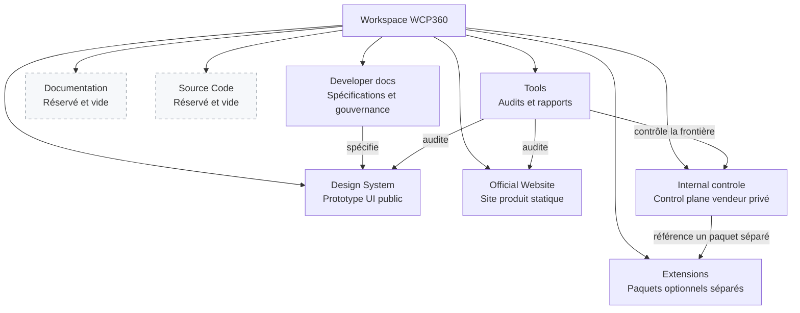

Le diagramme représente les relations documentées, pas des dépendances de compilation : il n'existe actuellement aucun build produit dans `WCP360_Core/`.

### `WCP360_Prototype/` — référence UI du produit

Ce dossier regroupe le prototype HTML du panneau. Sa racine est volontairement plate : **259 fichiers** y sont placés directement et le seul sous-dossier, `assets/`, en contient **92**.

| Type | Nombre | Utilisation |
| --- | --- | --- |
| HTML | 232 | Écrans, parcours, états, validations et surfaces canoniques. |
| JavaScript | 60 | Navigation, comportements de démonstration et contrôleurs spécialisés. |
| CSS | 32 | Shell visuel, composants et styles par domaine fonctionnel. |
| Markdown | 25 | Gouvernance, couverture, écarts, sécurité et règles de baseline. |
| ICO | 1 | Favicon du prototype. |
| PowerShell | 1 | Serveur HTTP local du prototype. |
| **Total** | **351** | Prototype navigable et documentation locale. |

Les points d'entrée sont [`index.html`](WCP360_Prototype/index.html), `login.html`, `mfa.html` et `components.html`. Les six pages `canonical-*` couvrent les tableaux de bord ADMIN et USER ainsi que les vues serveur, site, DNS et sécurité. La baseline active déclarée dans [`STYLE_LOCK.md`](WCP360_Prototype/STYLE_LOCK.md) est **V2.5.3.12**.

Les 232 pages couvrent notamment les rôles `ROOT`, `RESELLER` et `USER`, les comptes et quotas, les sites, domaines, DNS et certificats, les fichiers et transferts, les bases de données, le mail, les applications et runtimes, les serveurs et clusters, la supervision, les incidents, la sauvegarde, la restauration, la sécurité, l'automatisation, les API, les webhooks et le cycle de vie des extensions. Huit pages `validation-*` traitent spécifiquement l'accessibilité, le contraste, le responsive, le clavier, le lecteur d'écran, le RTL et la réduction des animations.

Les ressources de `assets/` comprennent le shell partagé (`reference-ui.css`, `reference-ui.js`), la couche historique (`styles.css`, `app.js`) et des couples CSS/JavaScript spécialisés pour l'identité, les runtimes, le mail, les certificats, les applications, les transferts, le DNS, les logiciels, les paramètres, les licences, les bases de données, les fichiers, les sites et les contrôles ROOT/RESELLER.

Les documents `01` à `06` suivent la couverture fonctionnelle, les écarts, les dépendances, les permissions, les états d'erreur et les gates de gel. Les documents [`07-scope-route-ownership.md`](WCP360_Prototype/07-scope-route-ownership.md), [`08-core-extension-architecture.md`](WCP360_Prototype/08-core-extension-architecture.md) et [`09-internal-public-distribution-architecture.md`](WCP360_Prototype/09-internal-public-distribution-architecture.md) fixent respectivement la propriété des routes, la frontière noyau/extensions et la séparation public/privé.

### `WCP360_Developper/` — spécifications et gouvernance

Ce corpus contient **1 803 fichiers** : 1 801 Markdown, un fichier texte et un registre CSV. Il décrit le produit attendu, mais ne constitue pas une implémentation.

| Zone | Fichiers | Rôle |
|---|---:|---|
| Racine du dossier | 302 | Index, matrices maîtresses et spécifications numérotées. |
| `WCP-Design-System-Spec-v4.0.21.23-global-canonical-registry-consolidation/` | 1 458 | Archive documentaire complète de la baseline V4.0.21.23. |
| `WCP360_CONSOLIDATED_MD_2026-09-27/` | 43 | Snapshot compact de gouvernance, domaines, registres et sources préservées. |
| **Total** | **1 803** | Corpus documentaire de référence. |

Le [`README.md`](WCP360_Developper/README.md) et l'[`INDEX.md`](WCP360_Developper/INDEX.md) organisent les spécifications par bandes : produit et gouvernance (`00–09`), fondations (`10–19`), composants (`20–29`), patterns transverses (`30–39`), portails USER (`40–49`) et ADMIN (`50–59`), automatisation et observabilité (`60–69`), inventaires et delivery (`70–79`), puis contrats frontend, backend et extensions (`80–89`). Des séries ultérieures détaillent les sous-systèmes techniques jusqu'aux numéros 600.

Les six matrices `MASTER-*` centralisent les capacités, fonctions, dépendances, adaptateurs backend, gates opérationnels et critères de complétude. Elles servent d'index de traçabilité ; elles ne prouvent pas que les fonctions sont codées.

Le snapshot consolidé se répartit ainsi :

- `domains/` : sécurité, API/IPC, données, reprise, DevOps, observabilité, performance, modules, QA et impacts Design System ;
- `governance/` : statut de baseline, autorités, décisions structurelles et gates de readiness ;
- `registries/` : permissions, états, opérations daemon et contrats action/permission ;
- `sources/` : preuves documentaires préservées sur les permissions, le système de fichiers, les identités Unix, les sockets et les registres canoniques.

Son état déclaré est : baseline documentaire **V4.0.21.23**, baseline Design candidate **V2.5.3.36.4**, baseline code **NONE** et readiness d'implémentation **NO-GO**. Ces statuts expliquent pourquoi le dossier source reste vide.

### `WCP360_Documentation/` et `WCP360_Core/` — espaces réservés

| Dossier | Contenu actuel | Destination prévue |
|---|---|---|
| `WCP360_Documentation/` | Vide | Documentation officielle destinée à être publiée et maintenue séparément des spécifications internes. |
| `WCP360_Core/` | 1 README | Emplacement réservé ; le README conserve le dossier dans Git sans fournir une implémentation produit. |

Il n'existe donc actuellement dans ces deux dossiers ni application backend, ni agent système, ni manifeste de dépendances, ni chaîne de build ou de déploiement.

### `WCP360_Official_Website/` — site produit public

Le site officiel contient **443 fichiers** : 21 à la racine, 8 dans `api/` et 414 dans `assets/`. Les **15 pages HTML** présentent l'accueil, les fonctionnalités, les éditions, les plugins, l'installation, l'installateur d'applications, la documentation, le statut, la sécurité, les mentions légales, le contact, le forum, la page À propos et l'erreur 404.

| Zone | Contenu observé |
|---|---|
| Racine | Pages HTML, favicon, manifeste web, `robots.txt`, `sitemap.xml`, `.htaccess` et `README-WCP360.md` (référence historique hors Standalone). |
| `api/` | Bootstrap et configuration PHP, jeton CSRF, formulaires de contact et de devis. |
| `assets/` | CSS/JavaScript du site, icônes, 6 logos clients, 336 photos et 16 médias de réalisations. Le dossier `photos/` comprend notamment `responsive/` (213 fichiers) et `zones-libres/` (50 fichiers). |

Ce dossier est un site vitrine statique avec des prototypes d'endpoints PHP, pas un installateur de production. Les domaines `wcp360.example` sont réservés à la démonstration. Une partie des médias et styles `NETTOYAGE360` est conservée comme contenu historique orphelin : elle n'est reliée ni à la navigation WCP360 ni au sitemap et ne doit pas être supprimée sans décision explicite d'archivage.

### `WCP360_Internal_Management/` — control plane vendeur privé

Ce dossier contient **9 fichiers** : `index.html`, `internal-distribution.html`, `README.md` (référence historique hors Standalone), `private.manifest.json` (référence historique hors Standalone) et cinq ressources CSS/JavaScript dans `assets/`.

Il modélise un produit interne séparé de WCP-ADMIN et des privilèges Linux `root`. Le manifeste exige une identité workforce, SSO avec FIDO2, mTLS pour les workloads et des sessions de 15 minutes ; les identités clientes n'y sont pas admises. La publication publique repose sur une allowlist positive issue du Design System, afin que les artefacts internes ne soient jamais embarqués par défaut.

Le connecteur Insights y est référencé comme artefact signé séparé, sans exécution distante et sans consentement implicite. Le domaine d'autorité `internal.example.com` reste un placeholder.

### `WCP360_Plugins/` — extensions distribuées séparément

Le dossier contient **73 fichiers hors dépendances** : deux modules distincts et quatre archives ZIP de distribution du File Manager.

| Dossier | Fichiers comptés | État observé |
| --- | --- | --- |
| `wcp360-insights-connector/` | 8 | Prototype de connecteur optionnel et manifeste. |
| `wcp360-file-manager-xampp/` | 61 | Application autonome PHP/Symfony ; intégration WCP360 non active. |
| `WCP360-File-Manager/` | 4 | Archives ZIP des versions distribuées pour test. |

Les dépendances présentes dans `wcp360-file-manager-xampp/vendor/` sont exclues du comptage.

#### Insights Connector

Le [manifeste](WCP360_Plugins/wcp360-insights-connector/manifest.json) déclare `com.wcp360.insights-connector` en version 1.0.0, compatible avec WCP360 `>=2.5 <3.0` et l’API `insights/v1`. Il prévoit un artefact signé séparé, amovible, non intégré au noyau et désactivé par défaut ; cette déclaration ne constitue pas une vérification de signature du prototype.

Les capacités autorisées sont limitées à la lecture d’inventaires et de résumés de santé, à la génération de constats d’audit et à la création de rapports de support. Sont explicitement interdits l’exécution shell, l’usurpation `root`, la lecture du contenu des fichiers, des lignes de base de données ou des messages, l’export de secrets et la remédiation distante. La file locale doit être chiffrée, aucun contenu client ne doit être collecté et la rétention déclarée est de 30 jours.

#### File Manager autonome

Le [README du module](WCP360_Plugins/wcp360-file-manager-xampp/README.md) décrit la version **0.3.0-alpha-pro**, une application autonome et un paquet Symfony. Le [manifeste](WCP360_Plugins/wcp360-file-manager-xampp/extension.json) précise que le mode autonome est implémenté pour un stockage local privé à propriétaire unique. Le mode Symfony nécessite un adaptateur hôte ; le mode WCP360 est `blocked-pending-contracts-and-adapter` et `official_wcp360_baseline` vaut `false`.

Ce module effectue des opérations réelles sur son stockage privé ; il reste séparé du prototype HTML simulé du panel. Il ne fournit pas encore de connexion au daemon WCP360 et ne doit pas être présenté comme le gestionnaire de fichiers intégré du Core. Les limites d’usage, les conditions de test Windows/PHP et les [résultats de validation](WCP360_Plugins/wcp360-file-manager-xampp/docs/VALIDATION.md) sont documentés dans le module.

### `tools/` — audits, réparation et historique

Le dossier est plat et contient **24 fichiers** : 19 scripts Node.js `.mjs`, un script Python, un script PowerShell et trois rapports JSON.

| Groupe | Outils | Fonction |
| --- | --- | --- |
| Audit de structure | `audit_wcp360_design_system.mjs`, `audit_system_settings_layout.mjs` | Références locales, structure HTML et mise en page des paramètres. |
| Intégration globale | `audit_wcp360_integration.mjs` | Inventaire du Design System, scripts, références et redirections. |
| Comportements partagés | `audit_wcp360_foundation.mjs` et suites métier `audit_wcp360_*.mjs` | Composants communs et parcours simulés : comptes, fichiers, revendeur, protection, DNS/TLS, livraison, applications, observabilité et règles web/mail. |
| Audits runtime | `runtime_audit_wcp360.mjs`, `runtime_audit_private_boundary.mjs`, `runtime_audit_extension_lifecycle.mjs` | Parcours navigateur, séparation public/privé et cycle de vie des extensions. |
| Audit du site | `runtime_audit_official_website.mjs`, `runtime_audit_official_website_additions.mjs` | Pages, navigation, interactions et responsive du site public. |
| Maintenance | `repair_wcp360_encoding.py` | Détection ou réparation idempotente du mojibake ; `--check` n’écrit rien. |
| Contrôle historique | `test-project.ps1` | Vérifications de l’ancienne structure ; les chemins attendus ne correspondent plus tous au workspace. |
| Rapports | `wcp360-audit.json`, `wcp360-runtime-audit.json`, `wcp360-integration-coverage.json` | Photographies datées à distinguer de l’inventaire courant. |

`wcp360-audit.json` et `wcp360-runtime-audit.json` enregistrent encore **196 pages**, contre 232 actuellement. `wcp360-integration-coverage.json` conserve le bilan initial ; les migrations suivantes sont indiquées dans les [notes de couverture](WCP360_Prototype/20-integration-coverage-audit.md) et de [cycle de vie](WCP360_Prototype/22-resource-lifecycle-migration.md).

L’archive `wcp360-design-system-before-consolidation.zip`, mentionnée dans les anciens inventaires, n’est pas présente dans ce workspace. Les quatre archives ZIP actuelles se trouvent dans `WCP360_Plugins/WCP360-File-Manager/`.

### Fichiers à la racine

- `README.md` : point d'entrée maintenu et inventaire courant du workspace ;
- [`README_GITHUB.md`](README_GITHUB.md) : présentation du projet pour GitHub et état des branches du dépôt distant ;
- [`ARCHITECTURE.md`](ARCHITECTURE.md) : architecture en anglais, responsabilités, flux, isolation, extensions et déploiement cible ;
- [`PLUGIN_CATALOG.md`](PLUGIN_CATALOG.md) : catalogue détaillé en anglais des 149 entrées, contrats par famille, permissions, dépendances et paquets locaux ;
- [`PROJECT_AUDIT.md`](PROJECT_AUDIT.md) : audit historique daté du 27 septembre 2026, utile comme trace, mais pas comme description exacte des noms et volumes actuels.

### Écarts d'alignement détectés

| Sujet | État observé | Interprétation correcte |
|---|---|---|
| Baseline Design | `STYLE_LOCK.md` déclare V2.5.3.12, tandis que le snapshot consolidé mentionne V2.5.3.36.4 comme candidate. | V2.5.3.12 reste la baseline active du prototype ; la version plus récente n'est pas présentée comme approuvée. |
| Chemins des audits | Plusieurs valeurs par défaut utilisent encore `WCP360 Design System`, `WCP360 Official Website`, `WCP360 Internal` ou `WCP360 Extensions`. | Les dossiers réels utilisent les underscores et `WCP360_Internal_controle` ; les arguments explicites sont requis et le script de frontière privée doit être réaligné. |
| Audit PowerShell | `test-project.ps1` attend encore `docs/`, `dashboard-html-css-javascript/` et d'autres anciens chemins. | Ce script est historique et n'est pas la validation de référence de la structure actuelle. |
| Rapports générés | Les rapports statique et runtime historiques indiquent 196 pages ; le registre de couverture est aussi une photographie datée. | L’inventaire courant fait foi : 232 HTML et 60 JavaScript dans le Design System. Les bilans de migration précisent le périmètre effectivement vérifié. |
| Chemin du connecteur privé | `private.manifest.json` utilise encore `../WCP360 Extensions/wcp360-insights-connector`. | Le chemin physique actuel est `../WCP360_Plugins/wcp360-insights-connector`. |
| Audit racine | `PROJECT_AUDIT.md` conserve d'anciens noms et états. | Le document reste historique ; le présent inventaire décrit l'état courant. |
| Médias du site | Des assets NETTOYAGE360 subsistent dans le site officiel. | Ils sont orphelins et non publiés par la navigation WCP360, mais conservés volontairement. |

## Références principales

- [README du Design System](WCP360_Prototype/README.md)
- [verrouillage de la baseline visuelle](WCP360_Prototype/STYLE_LOCK.md)
- [audit consolidé du Design System](WCP360_Prototype/AUDIT-CONSOLIDATION.md)
- [registre des écarts](WCP360_Prototype/02-gap-register.md)
- [architecture noyau/extensions](WCP360_Prototype/08-core-extension-architecture.md)
- [bilan de couverture du prototype](WCP360_Prototype/20-integration-coverage-audit.md)
- [cycle de vie Sites/Comptes et limites vérifiées](WCP360_Prototype/22-resource-lifecycle-migration.md)
- [File Manager autonome et conditions d’intégration](WCP360_Plugins/wcp360-file-manager-xampp/README.md)
- [séparation public/privé](WCP360_Prototype/09-internal-public-distribution-architecture.md)
- [index de la documentation développeur](WCP360_Developper/INDEX.md)
- [snapshot documentaire consolidé](WCP360_Developper/WCP360_CONSOLIDATED_MD_2026-09-27/README.md)
- [audit historique du workspace](PROJECT_AUDIT.md)

La baseline visuelle active déclarée par le Design System est **V2.5.3.12**. Les fichiers `canonical-*.html` représentent les surfaces de référence ; les pages `v2.*` et les anciens README versionnés sont des références historiques hors de la baseline active.

## Validation

Les contrôles statiques et les suites de simulation nécessitent **Node.js** et s’exécutent depuis la racine du workspace :

```powershell
node tools/audit_wcp360_design_system.mjs "WCP360_Prototype"
node tools/audit_wcp360_integration.mjs
node tools/audit_wcp360_foundation.mjs
node tools/audit_wcp360_hosting.mjs
node tools/audit_wcp360_workspace.mjs
node tools/audit_wcp360_protection.mjs
node tools/audit_wcp360_dns_tls.mjs
node tools/audit_wcp360_delivery.mjs
node tools/audit_wcp360_applications.mjs
node tools/audit_wcp360_observability.mjs
node tools/audit_wcp360_web_rules.mjs
node tools/audit_wcp360_mail_rules.mjs
node tools/audit_wcp360_resource_lifecycle.mjs
```

L’audit statique du 31 octobre 2026 porte sur **232 pages HTML**, sans constat et avec un code de sortie 0. Il vérifie la structure et les références locales, pas l’achèvement fonctionnel des domaines. Les derniers résultats métier et leurs limites sont consignés dans le [bilan de cycle de vie](WCP360_Prototype/22-resource-lifecycle-migration.md) ; ils restent des résultats de simulation datés.

Les contrôles navigateur nécessitent Chrome ou Chromium et un serveur local. Pour le rendu général et la page System Settings :

```powershell
node tools/runtime_audit_wcp360.mjs "WCP360_Prototype"
node tools/audit_system_settings_layout.mjs "WCP360_Prototype"
```

`runtime_audit_private_boundary.mjs` conserve des chemins internes historiques ; son résultat n’est pas autoritatif avant réalignement. Ce script et l’audit de layout partagent les ports `8767/9232` et doivent être lancés séquentiellement. Les autres audits runtime sont recensés dans [tools](#tools--audits-réparation-et-historique).

Pour vérifier la syntaxe d’un fichier JavaScript modifié :

```powershell
node --check "chemin/du/fichier.js"
```

Le script historique `tools/test-project.ps1` cible encore d’anciens noms de dossiers (`docs/`, `dashboard-html-css-javascript/`, `WCP360 Official html website/`) et ne constitue plus la validation de référence tant qu’il n’a pas été réaligné.

## Frontières du projet

- Les maquettes et simulations du panel sont des références de conception. Le File Manager autonome reste un module alpha séparé, avec ses propres limites d’utilisation.
- `WCP360_Internal_Management/` doit rester privé et ne doit jamais être inclus dans un artefact public.
- Le connecteur Insights est optionnel, désactivé par défaut et distribué séparément du noyau.
- Les domaines, téléchargements et canaux de divulgation utilisant `wcp360.example` sont des placeholders non destinés à la production.
- `WCP360_Documentation/` et `WCP360_Core/` sont actuellement des emplacements réservés.
- Les déplacements massifs et le démarrage du code produit restent soumis aux décisions de baseline et de readiness décrites dans le corpus documentaire.

## Lecture recommandée

Commencez par le [README du Design System](WCP360_Prototype/README.md) pour explorer le prototype, puis consultez le [snapshot consolidé](WCP360_Developper/WCP360_CONSOLIDATED_MD_2026-09-27/README.md) pour l'historique de gouvernance et les décisions encore ouvertes.

## Charte de mission WCP360

<details>
<summary>Sommaire</summary>

- [Finalité de la mission](#finalité-de-la-mission)
- [Périmètre des six projets produit](#périmètre-des-six-projets-produit)
- [Règles impératives](#règles-impératives)
- [Classification de référence](#classification-de-référence)
- [Technologies observées et technologies cibles](#technologies-observées-et-technologies-cibles)
- [Modèle Open Core et continuité de service](#modèle-open-core-et-continuité-de-service)
- [Garde-fous de l'architecture cible](#garde-fous-de-larchitecture-cible)
- [Programme d'audit vérifiable](#programme-daudit-vérifiable)
- [Documentation maître cible](#documentation-maître-cible)
- [README des projets](#readme-des-projets)
- [Documents de synthèse attendus](#documents-de-synthèse-attendus)
- [Couverture des diagrammes demandés](#couverture-des-diagrammes-demandés)
- [Couverture attendue du README maître](#couverture-attendue-du-readme-maître)
- [Qualité documentaire et source de vérité](#qualité-documentaire-et-source-de-vérité)
- [Critères de clôture d'un lot d'audit](#critères-de-clôture-dun-lot-daudit)

</details>

> **Nature de cette section :** cadre directeur intégré à partir de la mission « Audit complet, inventaire, architecture et documentation maître WCP360 ». Elle fixe la méthode et la cible documentaire ; elle ne transforme pas une exigence future en fonctionnalité existante.

### Finalité de la mission

WCP360 doit évoluer vers un panneau de contrôle d'hébergement web autonome, téléchargeable et installable sur Debian. Il doit permettre aux administrateurs, hébergeurs, revendeurs et clients de gérer des sites, domaines, serveurs, bases de données, runtimes PHP, certificats TLS, comptes e-mail, sauvegardes et services associés.

La mission documentaire consiste à :

1. analyser l'intégralité du workspace sans repartir de zéro ;
2. inventorier les preuves réellement présentes dans les fichiers ;
3. séparer systématiquement l'existant, les prototypes, le partiel et la cible ;
4. cartographier les dépendances et les responsabilités ;
5. documenter l'architecture observée puis l'architecture cible ;
6. préparer une trajectoire réaliste vers un produit professionnel, sécurisé, testable et distribuable.

Les compétences mobilisées couvrent l'architecture logicielle, Linux Debian et l'hébergement web, PHP/Symfony, Go, Python, le frontend, les API et systèmes distribués, la cybersécurité, les extensions, le packaging Debian, les licences, les bases de données, la QA et la rédaction technique.

### Périmètre des six projets produit

Les noms de la mission initiale sont normalisés ci-dessous vers les **chemins réellement présents**. Les dossiers `WCP360_Developper_docs/` et `tools/` constituent deux zones de support supplémentaires.

| Projet logique | Chemin réel | Preuve actuelle | Statut global |
|---|---|---|---|
| Site officiel | `WCP360_Official_Website/` (référence historique hors Standalone) | Site statique, 15 pages HTML, assets et endpoints PHP de prototype. | **PROTOTYPE** |
| Design System | [`WCP360_Prototype/`](WCP360_Prototype/) | Prototype UI avancé de 232 pages et documentation de gouvernance. | **PROTOTYPE** |
| Plateforme interne | `WCP360_Internal_controle/` (référence historique hors Standalone) | Deux surfaces HTML, manifeste privé et assets dédiés. | **PROTOTYPE** |
| Extensions | [`WCP360_Extensions/`](WCP360_Plugins/) | Insights démonstratif, File Manager autonome PHP/Symfony et archives de distribution ; intégration Core non livrée. | **PROTOTYPE / PARTIEL** |
| Code source produit | `WCP360_Source_Code/` | Dossier vide. | **PRÉVU** |
| Documentation publiée | `WCP360_Documentation/` | Dossier vide. | **PRÉVU** |
| Spécifications de support | [`WCP360_Developper_docs/`](WCP360_Developper/) | Corpus documentaire vérifié de 1 803 fichiers. | **EXISTANT — documentation** |
| Outillage de support | [`tools/`](tools/) | Audits, contrôles de comportement, réparation d’encodage et rapports datés. | **EXISTANT — outillage** |

Le statut **EXISTANT** signifie uniquement qu'un artefact a été observé. Il ne garantit ni son niveau de test, ni sa sécurité, ni son aptitude à la production.

### Règles impératives

- Analyser les chemins et fichiers accessibles avant de conclure.
- Exiger une preuve locale avant d'annoncer qu'une fonctionnalité existe.
- Ne jamais présenter une interface HTML ou une donnée fictive comme un backend opérationnel.
- Préserver les fichiers, leurs chemins, leur casse et leurs fautes éventuelles ; aucun déplacement, renommage ou effacement sans autorisation explicite.
- Ne pas réécrire le code fonctionnel, modifier le système, lancer un installateur, publier, committer ou pousser pendant un audit documentaire.
- Conserver les informations utiles des README existants et fusionner les améliorations.
- Ne jamais reproduire de secret, mot de passe, jeton, clé privée ou donnée confidentielle.
- Écarter des inventaires détaillés les dépendances, caches et artefacts générés tels que `node_modules/` et `vendor/`, sauf nécessité démontrée.
- Distinguer l'architecture observée de l'architecture proposée.
- Employer explicitement **NON VÉRIFIÉ** lorsqu'une preuve manque.
- Donner les chemins justificatifs pour les constats importants.
- Ne pas annoncer la fin d'un audit si une zone importante n'a pas été couverte.

### Classification de référence

| Statut | Définition |
|---|---|
| **EXISTANT** | Artefact ou implémentation observé dans les fichiers ; préciser séparément s'il a été exécuté ou testé. |
| **PROTOTYPE** | Interface, démonstration ou simulation présente sans chaîne produit complète prouvée. |
| **PARTIEL** | Implémentation commencée, mais incomplète ou non intégrée de bout en bout. |
| **PRÉVU** | Fonctionnalité explicitement documentée, mais non développée. |
| **PROPOSÉ** | Recommandation architecturale nouvelle ou structure cible à valider. |
| **NON VÉRIFIÉ** | Preuves insuffisantes, inaccessibles ou contradictoires. |

### Technologies observées et technologies cibles

| Domaine | Observé dans le workspace | Cible documentée |
|---|---|---|
| Interface | HTML, CSS et JavaScript de prototype. | Frontend web industrialisé à partir du Design System. |
| Backend | Endpoints PHP du site public et File Manager autonome PHP/Symfony ; aucun Core produit. | PHP avec Symfony et API REST/JSON versionnées. |
| Agent système | Aucun agent produit dans le dossier source. | Agent Go à opérations strictement autorisées. |
| Automatisation | Réparation d’encodage et scripts Python de test du File Manager. | Automatisation et maintenance Python contrôlées. |
| Données | Fixtures du panel, stockage local privé du File Manager et contrats documentaires ; aucune base du Core produit. | PostgreSQL, migrations et modèle de données versionné. |
| Exécution web | Non implémentée dans le code produit. | Nginx et pools PHP-FPM isolés. |
| Asynchrone | Workflows documentés, sans runtime produit observé. | Symfony Messenger ou mécanisme équivalent. |
| Distribution | Prototypes et ZIP de test du File Manager ; aucun paquet Debian du Core. | Paquets Debian signés et installateur guidé. |
| Extensions | Insights Connector et File Manager autonome avec manifestes ; intégration WCP360 du File Manager bloquée. | Modules indépendants, signés, versionnés et testables séparément. |

### Modèle Open Core et continuité de service

La mission fixe le modèle produit suivant, à formaliser juridiquement et techniquement :

- Core open source, gratuit et utilisable sans connexion permanente aux services centraux ;
- fonctions essentielles d’hébergement disponibles gratuitement ;
- extensions officielles gratuites, extensions communautaires et extensions avancées commerciales.

Les [éditions et droits](#éditions-et-droits) et le [License Manager](#license-manager) regroupent les durées, la validation hors ligne et les garanties de continuité de service.

### Garde-fous de l'architecture cible

**Communications.** Les flux à spécifier couvrent navigateur → Symfony, Symfony → PostgreSQL, Symfony → file de tâches, workers → Agent Go, Agent Go → services Linux, Core → services centraux, Core → catalogue d'extensions, License Client → License Server et Support Connector → WCP360 Internal. Chaque flux doit être classé comme obligatoire ou facultatif. Le Core gratuit doit rester autonome sans liaison centrale permanente.

**Sécurité Linux.** L'architecture doit appliquer le moindre privilège, l'isolation des utilisateurs, des pools PHP-FPM séparés, des permissions de fichiers strictes, des quotas, la validation des paramètres, une authentification interservices, la protection des secrets, l'audit, les sauvegardes et la reprise après échec. L'Agent Go doit exposer une allowlist d'opérations typées ; aucune API ne doit exécuter une commande système arbitraire fournie par l'utilisateur.

**Extensions.** Le contrat d’extension couvre manifeste, API publiques, hooks, événements, permissions, dépendances, compatibilité, migrations, signature et cycle de vie. Les workers d’extension s’exécutent hors du processus Core avec une identité et des permissions limitées ; ils accèdent aux ressources par les API et jobs versionnés. Un paquet PHP/Symfony autonome ne constitue pas, à lui seul, une extension intégrée conforme à ce contrat.

**Licences.** Le License Client local doit valider des licences signées, gérer activation en ligne et hors ligne, renouvellement, transfert, révocation contractuelle et période de grâce, tout en protégeant les données clientes et la continuité des services.

**Installation et mises à jour.** La cible prévoit Debian, contrôle des prérequis, packaging signé, configuration du système, installation du Core et choix facultatif des extensions, assistant de première connexion, activation facultative pour le Core gratuit, sauvegarde préalable, mise à jour sécurisée, rollback et désinstallation contrôlée.

### Programme d'audit vérifiable

Pour chaque projet, l'audit doit relever le chemin exact, l'objectif apparent, les fichiers et sous-dossiers, les technologies et langages observés, les dépendances déclarées, les scripts, pages, styles, composants, médias, API, données fictives, configurations, tests, documents, références croisées, éléments incomplets, fichiers potentiellement orphelins, duplications, incohérences de nommage et risques structurels.

Les statistiques attendues sont le nombre de dossiers et fichiers, la répartition par type, les pages HTML, scripts JavaScript, composants, modules, tests, documents et dépôts Git détectés. Les inventaires volumineux doivent être placés dans un document dédié puis reliés au README ; ils ne doivent pas rendre le point d'entrée illisible.

Le scan courant couvre **2 714 fichiers hors dépendances**, dont les cinq fichiers racine, et ne détecte **aucun dépôt Git** dans ce périmètre. `vendor/`, `node_modules/` et `.git/` sont exclus du comptage ; les archives ZIP présentes comptent chacune pour un fichier.

| Zone | Sous-dossiers récursifs hors dépendances | Fichiers |
| --- | --- | --- |
| `WCP360_Prototype/` | 1 | 351 |
| `WCP360_Developper_docs/` | 6 | 1 803 |
| `WCP360_Documentation/` | 0 | 0 |
| `WCP360_Extensions/` | 22 | 73 |
| `WCP360_Internal_controle/` | 1 | 9 |
| `WCP360_Official_Website/` | 7 | 443 |
| `WCP360_Source_Code/` | 0 | 0 |
| `tools/` | 0 | 24 |

| Phase | Travail attendu | Sortie |
|---|---|---|
| A — Découverte | Résoudre les chemins réels et le périmètre des six projets. | Arborescence vérifiée. |
| B — Audit | Examiner récursivement prototypes, composants, dépendances et limites. | Constats sourcés et anomalies. |
| C — Inventaire | Classer fonctionnalités et artefacts avec les six statuts. | Inventaire technique et fonctionnel. |
| D — Architecture | Comparer l'observé à la cible et tracer les écarts. | Cartographies, décisions et risques. |
| E — Documentation | Améliorer les README et documents utiles sans créer de coquilles vides. | Documentation reliée et navigable. |
| F — Vérification | Contrôler liens, statuts, chiffres, tableaux et diagrammes. | Rapport de validation reproductible. |
| G — Rapport final | Résumer couverture, limites, problèmes, décisions. | Handoff précis et travaux restants. |

<details>
<summary><strong>Champs obligatoires du catalogue des modules</strong></summary>

Pour chaque module : identifiant, nom, projet propriétaire, description, fonctions, fichiers et interfaces existants, statut réel, dépendances, API nécessaires, tables éventuelles, opérations Linux, permissions, risques, tests à créer et critères d'acceptation.

Les fonctions essentielles de sécurité, récupération, installation et hébergement restent dans le Core gratuit. Elles continuent de fonctionner lorsque les extensions sont désactivées.

</details>

### Documentation maître cible

`WCP360_Documentation/` est vide au moment de l'inventaire. L'arborescence suivante est donc **PROPOSÉE — NON CRÉÉE**. Elle doit être validée avant toute création et alimentée uniquement avec des documents utiles ; aucun lot de fichiers vides ne doit être généré.

<details>
<summary><strong>Afficher l'arborescence documentaire candidate</strong></summary>

```text
WCP360_Documentation/
├── README.md
├── 01-PROJECT/
│   ├── project-overview.md
│   ├── existing-inventory.md
│   ├── project-status.md
│   └── terminology.md
├── 02-ARCHITECTURE/
│   ├── system-architecture.md
│   ├── component-map.md
│   ├── communication-flows.md
│   ├── core-architecture.md
│   └── target-architecture.md
├── 03-MODULES/
│   ├── modules-catalog.md
│   ├── core-modules.md
│   ├── extensions-catalog.md
│   └── dependencies.md
├── 04-API/
│   ├── api-overview.md
│   ├── rest-api.md
│   ├── agent-go-contract.md
│   └── extension-api.md
├── 05-DATABASE/
│   ├── data-model.md
│   ├── entities.md
│   └── migrations.md
├── 06-LINUX/
│   ├── debian-support.md
│   ├── nginx.md
│   ├── php-fpm.md
│   ├── system-agent.md
│   └── isolation.md
├── 07-EXTENSIONS/
│   ├── extension-lifecycle.md
│   ├── extension-manifest.md
│   ├── permissions.md
│   ├── compatibility.md
│   └── marketplace.md
├── 08-LICENSING/
│   ├── licensing-model.md
│   ├── trial.md
│   ├── subscriptions.md
│   ├── perpetual.md
│   └── offline-activation.md
├── 09-INSTALLATION/
│   ├── installer.md
│   ├── first-run-wizard.md
│   ├── prerequisites.md
│   ├── updater.md
│   └── recovery.md
├── 10-SECURITY/
│   ├── security-architecture.md
│   ├── threat-model.md
│   ├── access-control.md
│   ├── secrets.md
│   └── auditing.md
├── 11-TESTING/
│   ├── test-strategy.md
│   ├── unit-tests.md
│   ├── integration-tests.md
│   ├── end-to-end-tests.md
│   └── security-tests.md
└── 13-DECISIONS/
    ├── decisions-register.md
    └── open-questions.md
```

</details>

Cette structure candidate regroupe la documentation technique ; les [guides publiés](#documentation-publiée-et-guides) en précisent les publics et les sujets. Tant qu’une décision n’est pas enregistrée, cette organisation reste proposée.

### README des projets

| Projet | Documentation locale observée | Besoin issu de la mission |
|---|---|---|
| Site officiel | README-WCP360.md (référence historique hors Standalone) | Conserver ce vrai chemin ; décider ultérieurement s'il faut également un README standard. |
| Design System | [README.md](WCP360_Prototype/README.md) | Maintenir objectif, baseline, navigation, limites et validation. |
| Plateforme interne | README.md (référence historique hors Standalone) | Maintenir la frontière privée, l'identité workforce et la distribution. |
| Extensions | [wcp360-insights-connector/README.md](WCP360_Plugins/wcp360-insights-connector/README.md) | Un README parent reste **PRÉVU** pour le catalogue et le SDK. |
| Code source | Aucun fichier. | Un README de cadrage est **PRÉVU**, sans prétendre qu'un Core existe. |
| Documentation | Aucun fichier. | Le README maître de cette zone est **PRÉVU** après validation de l'arborescence. |

Chaque README de projet doit documenter son objectif, sa structure actuelle, ses fonctions détectées, ses composants, les technologies observées, les instructions de lancement vérifiables, les dépendances, l'état, la cible, les relations, les limites et les liens techniques.

### Documents de synthèse attendus

Les livrables documentaires souhaités sont :

- **existing-inventory.md** : inventaire vérifié ;
- **project-status.md** : état réel des six projets ;
- **system-architecture.md** et **component-map.md** : architecture et relations ;
- **modules-catalog.md** et **extensions-catalog.md** : fonctions, responsabilités et dépendances ;
- **licensing-model.md** : Trial, abonnements, perpétuel et hors ligne ;
- **security-architecture.md** : frontières de confiance et modèle de menace ;
- **decisions-register.md** et **open-questions.md** : arbitrages et points non résolus.

Ces fichiers restent **PRÉVUS** tant qu'ils ne sont pas réellement créés. Le README courant en consolide déjà une partie, mais ne remplace pas automatiquement les futurs documents spécialisés.

### Couverture des diagrammes demandés

| Cartographie demandée | Couverture dans ce README | Statut |
|---|---|---|
| Écosystème des six projets | Carte actuelle et diagramme « Organisation de l'écosystème WCP360 ». | **EXISTANT** |
| Architecture Core / Extensions | Gestionnaire, familles d'extensions et contrats décrits dans la charte et les documents de conception. | **PARTIEL** |
| Communication Core / WCP360 Internal | Diagramme Internal, API centrale, connecteur et installation locale. | **EXISTANT — CIBLE** |
| Installation Debian | Deux parcours d'installation détaillés. | **EXISTANT — CIBLE** |
| Wizard de première configuration | [Assistant de première configuration](#assistant-de-première-configuration). | **PROPOSÉ** |
| Activation des licences | Trial, Free, clé signée et validation locale. | **EXISTANT — CIBLE** |
| Cycle de vie des extensions | [Cycle de vie d’une extension](#cycle-de-vie-dune-extension). | **PROPOSÉ** |
| Création d'un site | Chaîne demande, validation, stockage, file, Agent Go et résultat. | **EXISTANT — CIBLE** |
| Opération asynchrone | File de tâches, worker, agent et retour d'état. | **EXISTANT — CIBLE** |
| Publication et mise à jour | [Circuit de publication et de mise à jour](#circuit-de-publication-et-de-mise-à-jour). | **PROPOSÉ** |

Les mentions « EXISTANT — CIBLE » signifient que le diagramme existe dans la documentation, mais que le runtime correspondant n'est pas encore présent dans le dossier source.

### Couverture attendue du README maître

| Exigence | Couverture actuelle |
|---|---|
| Présentation, vision, objectifs et état réel | Présents dans l'introduction, l'inventaire et la présente charte. |
| Architecture globale et technologies | Architecture observée/cible séparée ici et développée dans les documents de conception. |
| Six projets, arborescence et composants | Inventaire vérifié, carte des artefacts et documentation locale reliée. |
| Modules et avancement | Couverture fonctionnelle existante, mais catalogue spécialisé encore **PRÉVU**. |
| Open Core, licences et extensions Premium | Règles intégrées dans la charte et détaillées plus bas. |
| WCP360 Internal et communications | Frontière privée, connecteur et flux documentés. |
| Debian, Wizard et mises à jour | Architecture cible et diagrammes documentés. |
| Sécurité, développement, tests | Exigences intégrées et plans détaillés conservés. |
| Risques et décisions ouvertes | Écarts d'alignement présents ; registre dédié encore **PRÉVU**. |
| Contribution, liens utiles et glossaire | Liens principaux présents ; guide de contribution et glossaire encore **PRÉVUS**. |

### Qualité documentaire et source de vérité

Les documents doivent être rédigés en français professionnel, lisibles dans GitHub et VS Code, reliés par des liens relatifs, structurés sans répétitions inutiles et compréhensibles à la fois par un débutant et un architecte. Les versions installées doivent provenir de fichiers de configuration réels ; une version suggérée ne doit jamais être présentée comme installée.

En cas de contradiction, appliquer cet ordre de confiance :

1. fichiers et chemins réellement présents ;
2. inventaire vérifié en tête de ce README ;
3. manifestes, règles de baseline et snapshot consolidé ;
4. présente charte pour la méthode et les décisions produit explicites ;
5. documents de conception historiques pour les recommandations encore à arbitrer.

Une vérification externe sensible aux versions doit privilégier les documentations officielles lorsqu'un accès Internet est autorisé. Sinon, le point reste **NON VÉRIFIÉ**.

### Critères de clôture d'un lot d'audit

Un lot n'est terminé que si sa couverture et ses limites sont explicites. Le rapport doit fournir le nombre de fichiers analysés, les projets explorés, les fonctions détectées, les artefacts développés, les prototypes, les manques, les README modifiés, les documents créés, les problèmes, les décisions proposées, les risques.

Si l'analyse dépasse une session, elle doit être découpée en lots cohérents avec une trace d'avancement et une liste exacte du travail restant.

---

## Documents de conception

Les sections suivantes décrivent l’architecture et l’organisation cibles. L’arborescence réellement disponible reste celle inventoriée dans l’[organisation du workspace](#organisation-du-workspace).

### Architecture technique

<details>
<summary>Sommaire</summary>

- [Vision et objectifs du projet](#vision-et-objectifs-du-projet)
- [Technologies et versions de référence](#technologies-et-versions-de-référence)
- [Architecture générale](#architecture-générale)
- [Structure cible des projets](#structure-cible-des-projets)
- [Modules fonctionnels](#modules-fonctionnels)
- [Modèle de base de données PostgreSQL](#modèle-de-base-de-données-postgresql)
- [API REST de WCP360](#api-rest-de-wcp360)
- [Architecture des tâches asynchrones](#architecture-des-tâches-asynchrones)
- [Architecture de sécurité Linux](#architecture-de-sécurité-linux)
- [Stratégie de développement du prototype](#stratégie-de-développement-du-prototype)
- [Environnement de développement et de test](#environnement-de-développement-et-de-test)
- [Plan de tests](#plan-de-tests)
- [Risques techniques et décisions à prendre](#risques-techniques-et-décisions-à-prendre)
- [Critères de sortie : quand WCP360 sera-t-il réellement prêt ?](#critères-de-sortie--quand-wcp360-sera-t-il-réellement-prêt-)
- [Documentation officielle à conserver](#documentation-officielle-à-conserver)

</details>

#### Vision et objectifs du projet

L'objectif est de construire un panneau d'hébergement professionnel inspiré de cPanel et Plesk, mais avec une architecture maîtrisée et évolutive.

WCP360 devra permettre à un administrateur de gérer un ou plusieurs serveurs Linux et à ses clients de gérer leurs propres hébergements depuis une interface web.

##### Objectifs fonctionnels

Le périmètre est détaillé dans le [catalogue des 21 modules](#modules-fonctionnels). Il couvre l’administration multi-serveurs et les interfaces administrateur, revendeur et client.

##### Philosophie de développement

Je recommande de suivre quatre principes :

1. Prototype avant production : simuler les fonctionnalités avant de développer leur exécution réelle.
2. Architecture modulaire : chaque fonctionnalité doit être indépendante autant que possible.
3. Séparation des responsabilités : Symfony décide, Go exécute les opérations système autorisées, Python automatise.
4. Sécurité dès le départ : ne jamais considérer la sécurité comme une amélioration facultative.

##### Les deux versions du projet

###### WCP360 Prototype

**Phase de conception**

- Interface HTML/CSS/JavaScript.
- Données fictives.
- Fonctionnalités simulées.
- Scénarios de test.
- Aucun accès aux commandes Linux.

###### WCP360 Production

**Objectif final**

- Backend Symfony.
- Base PostgreSQL.
- Agent système Go.
- Outils Python.
- Infrastructure Linux réelle.
- Sécurité et supervision opérationnelles.

Le but n'est pas de reproduire immédiatement toutes les fonctionnalités de cPanel. Le but est de construire progressivement un système cohérent, sécurisé et évolutif, dont tu maîtrises chaque composant.

#### Technologies et versions de référence

Les choix ci-dessous décrivent la cible documentée au 30 octobre 2026. Les technologies réellement observées sont distinguées dans la [charte](#technologies-observées-et-technologies-cibles).

| Composant | Technologie | Rôle |
| --- | --- | --- |
| Interface prototype | HTML, CSS, JavaScript | Simuler toutes les fonctions |
| Interface finale | JavaScript moderne | Tableau de bord |
| Backend | Symfony 7.4 LTS | API et logique métier |
| Langage backend | PHP 8.4 | Développement Symfony |
| Base de données | PostgreSQL — branche maintenue | Données locales et centrales |
| Agent système | Go 1.27.3 | Actions Linux sécurisées |
| Automatisation | Python 3.14.x | Diagnostics et tâches spécialisées |
| Serveur Web | Nginx | Sites et panel |
| Traitement asynchrone | Symfony Messenger | Exécution des opérations |
| Installation | Debian packages / scripts | Déploiement |
| Licences | Ed25519 | Vérification cryptographique |
| Tests | PHPUnit, Go test, pytest, Playwright | Qualité et sécurité |

Symfony 7.4 bénéficie de corrections de sécurité jusqu'en novembre 2029, tandis que Symfony 8.1 est la branche stable courante mais a un horizon de maintenance plus court. Pour un projet de longue durée, je privilégie donc Symfony 7.4 LTS.
symfony.com+1

Go 1.27.3 est la version stable publiée le 19 octobre 2026. Python 3.14 est un choix prudent pour les bibliothèques d'automatisation, même si Python 3.15 est désormais disponible. PHP 8.4 est compatible avec Symfony 7.4 et bénéficie encore de correctifs de sécurité.
The Go Programming Language+3

Règle de gestion : verrouiller les versions dans les fichiers de dépendances et les images de développement. Vérifier les mises à jour de sécurité avant chaque mise en production plutôt que d'utiliser automatiquement la toute dernière version.

##### Système d'exploitation

###### Debian 13 – Trixie

Cible recommandée
Debian stable, architecture initiale amd64

Debian 13 est actuellement la branche stable. Son cycle de support annoncé va jusqu'en 2030 avec la période LTS.
Debian+1

Les systèmes ciblés sont Debian 12 et 13, ainsi qu’Ubuntu 22.04, 24.04 et 26.04 LTS sur amd64. Le Core conserve ses exigences PHP 8.4 et PostgreSQL 17 : les versions natives diffèrent selon la distribution. Le [catalogue des plateformes](documentation/development/SUPPORTED-PLATFORMS.md) distingue la reconnaissance du système, les tests de paquets et la validation complète de l’installation et de la récupération. ARM64 nécessite une qualification séparée.

#### Architecture générale

Voici le modèle cible. Il s'agit d'une architecture logique : au début, plusieurs composants pourront fonctionner sur une seule machine de développement, puis être séparés.

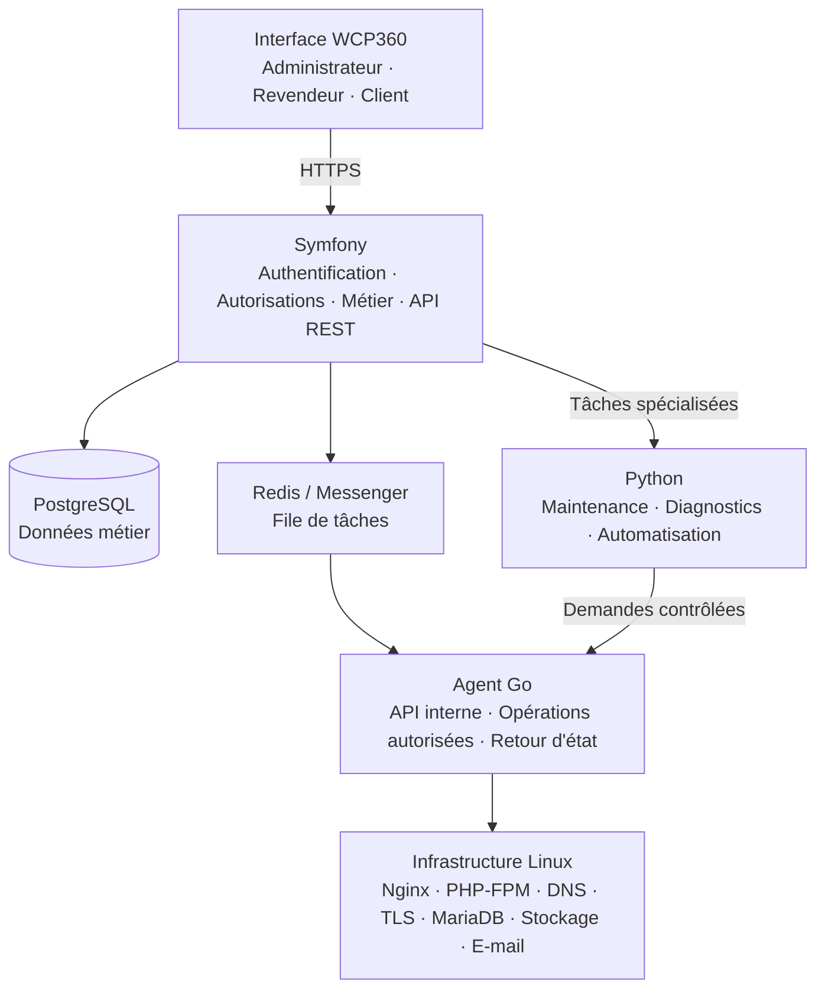

##### Responsabilités de chaque composant

| Composant | Responsabilité |
| --- | --- |
| Frontend | Affichage, navigation, formulaires, graphiques |
| Symfony | Logique métier, utilisateurs, autorisations, API |
| PostgreSQL | Données persistantes et relations |
| Redis | Transport de tâches asynchrones, si nécessaire |
| Go | Opérations système contrôlées |
| Python | Diagnostics et automatisations spécialisées |
| Nginx | Serveur web et reverse proxy |
| PHP-FPM | Exécution isolée des applications PHP hébergées |

**Architecture retenue :** monolithe modulaire Symfony avec agent distribué. Il ne faut pas créer immédiatement dix microservices indépendants. Cela ajouterait beaucoup de complexité à la supervision et au déploiement.

##### Communication entre composants

- Le navigateur communique avec Symfony en HTTPS.
- Symfony utilise PostgreSQL pour les données métier.
- Symfony place les opérations longues dans une file de tâches.
- Un worker Symfony traite les tâches.
- Symfony transmet une demande structurée à l'agent Go.
- Go exécute uniquement une opération autorisée et retourne son résultat.
- Python intervient sur des tâches précises, via un worker contrôlé ou un outil interne.

Il faut prévoir des délais d'expiration, des identifiants de corrélation et des mécanismes de reprise. Une opération ne doit jamais être considérée comme réussie simplement parce que la requête HTTP a été envoyée.

#### Structure cible des projets

**PROPOSÉE — NON CRÉÉE.** Cette arborescence rassemble les composants des anciennes propositions sous les noms réels des projets. L’[arborescence actuelle](#arborescence-actuelle) décrit les fichiers présents ; l’organisation interne ci-dessous reste à valider.

```text
WCP360/
├── WCP360_Prototype/
│   ├── pages/
│   ├── assets/
│   │   ├── css/
│   │   ├── js/
│   │   ├── images/
│   │   └── fonts/
│   ├── components/
│   ├── tokens/
│   ├── mock-data/
│   ├── simulation/
│   └── tests/
├── WCP360_Developper_docs/
├── WCP360_Documentation/
├── WCP360_Extensions/
│   ├── sdk/
│   ├── official/
│   └── premium/
├── WCP360_Internal_controle/
│   └── license-platform/
│       ├── backend/
│       ├── database/
│       ├── api/
│       ├── billing/
│       ├── activation/
│       ├── signing/
│       └── customer-portal/
├── WCP360_Official_Website/
├── WCP360_Source_Code/
│   ├── core/
│   │   ├── backend/
│   │   │   ├── src/
│   │   │   │   ├── Controller/
│   │   │   │   ├── Entity/
│   │   │   │   ├── Repository/
│   │   │   │   ├── Service/
│   │   │   │   ├── Security/
│   │   │   │   ├── Message/
│   │   │   │   ├── MessageHandler/
│   │   │   │   └── Dto/
│   │   │   ├── config/
│   │   │   ├── migrations/
│   │   │   ├── public/
│   │   │   ├── tests/
│   │   │   └── composer.json
│   │   ├── frontend/
│   │   ├── api/
│   │   ├── security/
│   │   ├── users/
│   │   ├── permissions/
│   │   ├── validation/
│   │   ├── workflows/
│   │   ├── jobs/
│   │   ├── events/
│   │   ├── logging/
│   │   ├── settings/
│   │   ├── extension-manager/
│   │   ├── license-client/
│   │   │   ├── validator/
│   │   │   ├── activation/
│   │   │   ├── offline/
│   │   │   └── entitlements/
│   │   ├── platform-connector/
│   │   └── operation-manager/
│   ├── agent-go/
│   │   ├── cmd/
│   │   │   └── wcp-agent/
│   │   ├── internal/
│   │   │   ├── api/
│   │   │   ├── operations/
│   │   │   ├── authorization/
│   │   │   ├── executor/
│   │   │   ├── validation/
│   │   │   └── audit/
│   │   ├── configs/
│   │   ├── tests/
│   │   └── go.mod
│   ├── automation-python/
│   │   ├── wcp_automation/
│   │   ├── diagnostics/
│   │   ├── maintenance/
│   │   ├── scripts/
│   │   ├── tests/
│   │   └── pyproject.toml
│   ├── installer/
│   │   ├── debian/
│   │   ├── scripts/
│   │   ├── packages/
│   │   ├── wizard/
│   │   └── tests/
│   ├── update-manager/
│   │   ├── updater/
│   │   ├── release-manifest/
│   │   ├── signature/
│   │   └── rollback/
│   ├── database/
│   │   ├── migrations/
│   │   └── seeds/
│   ├── infrastructure/
│   │   ├── docker/
│   │   ├── nginx/
│   │   ├── systemd/
│   │   ├── provisioning/
│   │   └── monitoring/
│   ├── tests/
│   ├── config/
│   └── build/
├── docker-compose.yml
├── .gitignore
└── README.md
```

L’application locale Symfony et la plateforme commerciale centrale partagent éventuellement des bibliothèques, mais possèdent des bases de données et des responsabilités séparées. La plateforme de licences relève de l’espace privé `WCP360_Internal_controle/`.

Les anciens exemples `system-agent/go/` et `updater/` désignaient respectivement l’agent Go et le gestionnaire de mises à jour, regroupés ici sous `agent-go/` et `update-manager/`.

Important : ne crée pas tous ces fichiers manuellement. Symfony, Composer et Go généreront leurs structures de départ. Cette arborescence représente l’organisation cible.

##### Règles d'organisation

- Un module métier doit contenir ses propres services et règles.
- Les contrôleurs HTTP ne doivent pas contenir toute la logique métier.
- Les appels à Go doivent passer par un client dédié.
- Les scripts Python doivent avoir des entrées et sorties documentées.
- Les secrets ne doivent jamais être stockés dans Git.
- Les migrations de base de données doivent être versionnées.

#### Modules fonctionnels

Le catalogue décrit 21 domaines fonctionnels cibles. Les états ci-dessous distinguent les parcours simulés du panel, les composants autonomes et le produit non implémenté. Ils s’appuient sur le [bilan de couverture](WCP360_Prototype/20-integration-coverage-audit.md), son suivi [mail](WCP360_Prototype/21-mail-rules-consolidation.md), le [cycle de vie Sites/Comptes](WCP360_Prototype/22-resource-lifecycle-migration.md) et les manifestes des modules séparés.

Le dernier bilan documente **109 pages encore à intégrer** (90 statiques et 19 génériques), ainsi que **26 centres partiels**. Un scénario de simulation testé ne certifie ni l’achèvement du domaine, ni son rendu visuel, ni une implémentation du Core produit.

| Code | Module | État observé |
| --- | --- | --- |
| M01 | Tableau de bord | Maquettes présentes ; intégration aux états partagés à terminer. |
| M02 | Utilisateurs et rôles | Centre IAM partiel ; persistance et permissions de démonstration incomplètes. |
| M03 | Clients et comptes | Cycle de vie simulé testé sur les parcours décrits ; centre partiel. |
| M04 | Formules et quotas | Offres et capacité simulées ; liaison complète des politiques IAM à terminer. |
| M05 | Serveurs | Maquettes et centres partiels ; aucun agent système produit. |
| M06 | Sites Web et hébergement | Création et cycle de vie simulés testés ; centre partiel. |
| M07 | Domaines et sous-domaines | Sous-ensemble DNS/TLS simulé testé ; autres pages à intégrer. |
| M08 | Bases de données | Parcours simulés testés ; centre partiel, sans provisionnement SQL réel. |
| M09 | Versions PHP | Centre ROOT de démonstration partiel ; aucun moteur Linux piloté. |
| M10 | Certificats SSL/TLS | Cycles DNS/TLS simulés testés ; intégration partielle. |
| M11 | Fichiers et SFTP | Simulations du panel ; File Manager autonome séparé, sans intégration Core. |
| M12 | Courrier électronique | Boîtes et règles simulées ; infrastructure mail partielle. |
| M13 | Sauvegardes et restaurations | Parcours simulés testés ; aucune restauration réelle d’octets dans le panel. |
| M14 | Monitoring et sécurité | Journaux échantillonnés ; autres fonctions partielles ou statiques. |
| M15 | Facturation et revendeurs | Offres revendeur simulées ; facturation produit non implémentée. |
| M16 | Installateur Debian | Prévu ; aucun installateur Debian du Core. |
| M17 | License Manager local | Maquettes et contrats ; client cryptographique du Core non implémenté. |
| M18 | License Server central | Prévu ; INTERNAL reste un prototype, sans serveur de licences produit. |
| M19 | Gestionnaire de mises à jour | Maquettes et contrats ; aucun gestionnaire de mises à jour du Core produit. |
| M20 | Portail client | Pages et maquettes ; aucun portail commercial produit intégré. |
| M21 | Paiements et abonnements | Prévu ; aucun paiement ou abonnement produit intégré. |

Un module décrit un périmètre fonctionnel ; son classement dans le Core, un adaptateur ou un service séparé est précisé dans [Frontière entre Core et extensions](#frontière-entre-core-et-extensions).

##### Description des modules

###### M01 — Tableau de bord

- Nombre de sites actifs.
- Nombre de clients.
- Nombre de domaines.
- Espace disque consommé.
- Utilisation CPU et RAM.
- Alertes et tâches en attente.
- État des serveurs.

###### M02 et M03 — Utilisateurs et clients

- Administrateurs.
- Revendeurs.
- Clients.
- Utilisateurs secondaires.
- Réinitialisation des mots de passe.
- Suspension et réactivation.
- Historique des connexions.

###### M04 — Offres et quotas

- Espace disque.
- Nombre de domaines.
- Nombre de bases de données.
- Nombre de boîtes e-mail.
- Limites de trafic.
- Versions PHP autorisées.
- Nombre de sites.

###### M05 — Serveurs

- Nom et adresse du serveur.
- État de connexion.
- Version du système.
- Capacité disponible.
- Agent Go installé.
- Dernière communication.
- Alertes de disponibilité.

###### M06 et M07 — Sites et domaines

- Ajouter un site.
- Supprimer ou suspendre un site.
- Créer un sous-domaine.
- Choisir une version PHP.
- Configurer le document root.
- Modifier les paramètres du site.
- Gérer les redirections.
- Configurer les DNS.

###### M08 à M10 — Services web

- Création de bases et utilisateurs.
- Gestion des permissions SQL.
- Activation de versions PHP.
- Pools PHP-FPM isolés.
- Demande de certificats.
- Renouvellement et révocation TLS.

###### M11 et M12 — Fichiers et e-mails

- Gestionnaire de fichiers.
- Accès SFTP.
- Comptes e-mail.
- Alias et redirections.
- Quotas de boîtes.
- État du service de messagerie.

Pour la messagerie, je recommande de commencer par un module dédié à la configuration et à l'administration, puis de valider séparément la délivrabilité, les antispams, le DNS et la sécurité avant de présenter cette fonction comme un service de messagerie prêt pour la production.

###### M13 et M14 — Exploitation

- Sauvegardes automatiques.
- Restauration.
- Journaux.
- Alertes.
- Supervision des services.
- Historique des opérations.

###### M15 — Gestion commerciale

- Tarifs et abonnements.
- Revendeurs.
- Factures.
- Statuts de paiement.
- Suspension en cas d'impayé selon une politique définie.

Il est important de distinguer le renouvellement d'un certificat TLS du renouvellement d'un nom de domaine : ce sont deux opérations différentes.

###### M16 — Installateur Debian

Installation et désinstallation automatisées.

###### M17 — License Manager local

Activation et validation.

###### M18 — License Server central

Gestion centrale des licences.

###### M19 — Gestionnaire de mises à jour

Mises à jour et versions.

###### M20 — Portail client

Compte client, téléchargement, factures.

###### M21 — Paiements et abonnements

Paiement, renouvellement et facturation.

#### Modèle de base de données PostgreSQL

Je recommande PostgreSQL pour la base centrale de WCP360. Elle devra stocker les informations commerciales, les comptes, les ressources, les opérations et les relations entre les clients et les serveurs.

Il faut éviter de mélanger les informations de configuration Linux et les informations commerciales dans une même table.

##### Tables principales

| Table | Contenu |
| --- | --- |
| users | Utilisateurs et administrateurs |
| roles | Rôles et niveaux d'accès |
| user_roles | Relations utilisateurs/rôles |
| customers | Clients hébergés |
| resellers | Revendeurs |
| hosting_plans | Offres d'hébergement |
| subscriptions | Abonnements |
| servers | Serveurs Linux |
| server_agents | Agents Go installés |
| websites | Sites hébergés |
| domains | Domaines et sous-domaines |
| dns_zones | Zones DNS |
| dns_records | Enregistrements DNS |
| databases | Bases de données hébergées |
| database_users | Utilisateurs SQL |
| php_versions | Versions PHP disponibles |
| ssl_certificates | Certificats TLS |
| email_accounts | Comptes e-mail |
| backups | Sauvegardes |
| scheduled_tasks | Tâches planifiées |
| operations | Opérations système |
| operation_logs | Historique des opérations |
| audit_logs | Journaux de sécurité |
| server_metrics | Mesures de ressources |
| invoices | Factures |
| payments | Paiements |

##### Relations principales

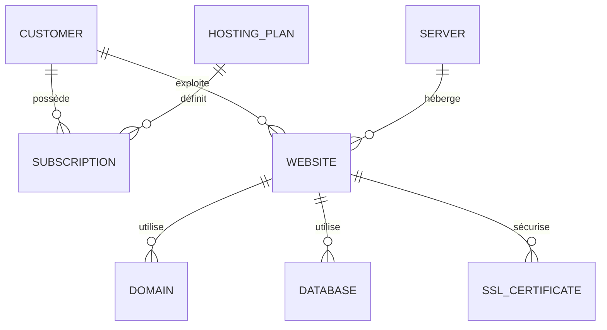

Schéma conceptuel simplifié : un site et ses ressources sont rattachés à un serveur, avec des relations métier supplémentaires.

##### Champs importants

Exemple pour la table websites :

| Champ | Type | Utilité |
| --- | --- | --- |
| id | UUID | Identifiant |
| customer_id | UUID | Propriétaire |
| server_id | UUID | Serveur cible |
| domain | VARCHAR | Domaine principal |
| document_root | VARCHAR | Répertoire du site |
| php_version_id | UUID | Version PHP |
| status | VARCHAR | État métier |
| created_at | TIMESTAMP | Création |
| updated_at | TIMESTAMP | Modification |

Autres règles :

- Tous les identifiants doivent être uniques.
- Les relations doivent utiliser des clés étrangères.
- Les domaines doivent avoir une contrainte d'unicité adaptée à leur portée.
- Les ressources supprimées doivent avoir une politique de conservation explicite.
- Les opérations doivent être historisées.
- Les quotas doivent être vérifiés côté backend, jamais seulement dans le navigateur.
- Les secrets et mots de passe ne doivent jamais être stockés en clair.

##### Prévoir le multi-serveur dès la conception

Même si tu commences avec un seul serveur Linux, prévois une table servers.

Exemple :

| Serveur | Rôle | Statut |
| --- | --- | --- |
| WCP-NODE-01 | Hébergement web | Actif |
| WCP-NODE-02 | Hébergement web | Actif |
| WCP-MAIL-01 | Messagerie | À intégrer |
| WCP-BACKUP-01 | Sauvegardes | À intégrer |

Cela évitera de devoir reconstruire tout le modèle de données lorsque tu voudras administrer plusieurs machines.

#### API REST de WCP360

L'API doit être la porte d'entrée principale entre l'interface et Symfony.

Je recommande une version initiale :

```text
/api/v1/
```

##### Organisation des routes

| Méthode | Route | Fonction |
| --- | --- | --- |
| GET | /api/v1/dashboard | Tableau de bord |
| GET | /api/v1/users | Liste des utilisateurs |
| POST | /api/v1/users | Création d'utilisateur |
| GET | /api/v1/customers | Liste des clients |
| POST | /api/v1/customers | Création de client |
| GET | /api/v1/plans | Liste des offres |
| POST | /api/v1/plans | Création d'offre |
| GET | /api/v1/servers | Liste des serveurs |
| POST | /api/v1/websites | Création d'un site |
| GET | /api/v1/websites/{id} | Détail d'un site |
| PATCH | /api/v1/websites/{id} | Modification |
| DELETE | /api/v1/websites/{id} | Suppression |
| POST | /api/v1/domains | Ajout de domaine |
| POST | /api/v1/databases | Création de base |
| POST | /api/v1/ssl/issue | Demande de certificat |
| GET | /api/v1/operations/{id} | État d'une opération |
| GET | /api/v1/audit-logs | Historique de sécurité |

Il faudra ajouter des routes pour les sauvegardes, e-mails, tâches planifiées, quotas, revendeurs et mesures serveur.

##### Exemple de création de site

Requête :

```http
POST /api/v1/websites
Authorization: Bearer <token>
Content-Type: application/json
```

Corps de la requête :

```json
{
  "customer_id": "UUID",
  "server_id": "UUID",
  "domain": "example.com",
  "php_version": "8.4"
}
```

Réponse possible :

```json
{
  "success": true,
  "website_id": "UUID",
  "operation_id": "UUID",
  "status": "pending",
  "message": "Website creation queued"
}
```

Le statut pending signifie que la demande est enregistrée, pas que le site est déjà fonctionnel.

##### Contrat entre Symfony et Go

Il est préférable d'avoir un contrat technique documenté et versionné, indépendant des implémentations.

Je recommande :

- JSON pour les données.
- HTTPS avec authentification mutuelle TLS (mTLS) entre les services.
- OpenAPI pour documenter les API HTTP.
- Validation stricte des paramètres.
- Identifiant unique pour chaque opération.
- Réponse normalisée en cas d'erreur.

Exemple de demande interne :

```json
{
  "operation_id": "UUID",
  "action": "website.create",
  "resource_id": "UUID",
  "server_id": "UUID",
  "parameters": {
    "domain": "example.com",
    "php_version": "8.4",
    "plan_id": "UUID"
  },
  "requested_at": "2026-10-30T10:00:00Z"
}
```

Réponse :

```json
{
  "operation_id": "UUID",
  "status": "completed",
  "result": {
    "website_id": "UUID",
    "webserver_config": "validated"
  },
  "error": null
}
```

Le nom de l'action, par exemple website.create, doit correspondre à une opération connue du programme Go. Il ne doit jamais être interprété comme une commande Linux.

À retenir : Symfony décide qu'un site peut être créé, vérifie le client et ses quotas, puis demande à Go d'exécuter l'opération. Go vérifie encore les paramètres et les autorisations avant de modifier Linux.

#### Architecture des tâches asynchrones

Certaines opérations peuvent prendre plusieurs secondes ou plusieurs minutes :

- Création d'un site.
- Installation d'un certificat TLS.
- Configuration DNS.
- Création d'une sauvegarde.
- Restauration d'un site.
- Redémarrage d'un service.
- Installation d'une version PHP.

Elles ne doivent pas bloquer une requête web.
Cycle d'une opération :

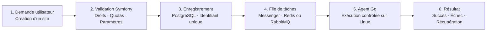

##### États à prévoir

| État | Signification |
| --- | --- |
| pending | En attente |
| queued | Dans la file |
| running | En cours |
| completed | Terminée |
| failed | Échouée |
| cancelled | Annulée |
| retrying | Nouvelle tentative |
| rollback_required | Récupération nécessaire |

##### Garanties indispensables

- Les opérations importantes doivent être idempotentes : une répétition ne doit pas créer des ressources en double.
- Prévoir des délais maximums.
- Limiter le nombre de tentatives.
- Enregistrer chaque changement d'état.
- Ne jamais masquer un échec système.
- Prévoir un mécanisme de compensation ou de restauration lorsqu'une opération partiellement réalisée échoue.

Pour éviter une incohérence entre l'enregistrement en base et la publication d'une tâche, étudie le modèle Transactional Outbox.

Pour le premier MVP, Symfony Messenger avec un transport simple peut suffire. Redis pourra être introduit lorsque les besoins de traitement le justifieront.

#### Architecture de sécurité Linux

**Exigence critique**

C'est la partie la plus importante du projet.

WCP360 aura potentiellement la capacité de créer des comptes, de modifier des configurations de serveurs et de gérer les fichiers de plusieurs clients. Une vulnérabilité dans le panneau pourrait compromettre l'ensemble de la machine.

##### Séparer les privilèges

Ne lance jamais Symfony ou Nginx en tant que root pour faciliter les opérations.

Prévois plusieurs niveaux :

| Composant | Permissions |
| --- | --- |
| Symfony | Utilisateur applicatif non privilégié |
| Worker Symfony | Utilisateur applicatif dédié |
| Agent Go | Service isolé avec privilèges minimaux |
| Sites clients | Comptes système séparés |
| PHP-FPM | Pools isolés par compte ou site |
| Python | Compte d'exécution limité |

L'agent Go peut être un service indépendant avec une petite interface d'opérations autorisées.

##### Liste blanche des opérations

L'agent Go ne doit accepter que des actions prédéfinies :

```text
website.create
website.delete
website.suspend
website.enable

domain.add
domain.remove

database.create
database.delete

ssl.issue
ssl.renew

service.status
backup.create
backup.restore


```

Cette liste est indicative. Chaque opération doit avoir ses propres règles, paramètres autorisés et contrôles de permissions.

Il ne faut jamais proposer une API du genre :

```json
{
  "command": "commande Linux libre"
}
```

C'est une conception dangereuse.

##### Isolation des clients

Chaque client doit être isolé des autres :

- Comptes système distincts.
- Répertoires avec permissions strictes.
- Pools PHP-FPM séparés.
- Accès SQL limités à leurs propres bases.
- Aucun accès aux fichiers d'un autre client.
- Limites de ressources CPU, RAM et disque lorsque possible.

##### Authentification et communications

- HTTPS obligatoire.
- MFA pour les administrateurs.
- Hashage des mots de passe avec Argon2id lorsque disponible.
- Jetons à durée de vie limitée.
- mTLS entre Symfony et les agents.
- Rotation des certificats et des secrets.
- Protection CSRF pour les sessions web.
- Contrôle des permissions à chaque opération.
- Limitation des tentatives de connexion.

##### Journalisation

Enregistrer :

- Qui a effectué l'action.
- Quand elle a été effectuée.
- Sur quel serveur.
- Quelle ressource était concernée.
- Quelle opération a été demandée.
- Quel résultat a été obtenu.
- Quel utilisateur ou service a exécuté l'opération.

Les journaux sensibles doivent être protégés contre la modification et ne doivent pas contenir les mots de passe, clés privées ou jetons.

##### Sauvegardes

Prévoir :

- Sauvegardes quotidiennes.
- Rétention configurable.
- Copie hors du serveur principal.
- Chiffrement des sauvegardes.
- Vérification de leur intégrité.
- Tests de restauration réguliers.
- Documentation de récupération après incident.

Une sauvegarde non restaurée au moins une fois dans un environnement de test ne doit pas être considérée comme fiable.

#### Stratégie de développement du prototype

C'est ici que tu peux gagner beaucoup de temps.

Cette section concerne le prototype HTML simulé du panel. Elle reste distincte du File Manager autonome PHP, qui manipule un stockage local privé.

##### Les technologies du prototype

| Technologie | Utilisation |
| --- | --- |
| HTML5 | Structure des pages |
| CSS3 | Design |
| Bootstrap 5 | Composants et responsive |
| JavaScript | Interactions et simulations |
| Chart.js | Graphiques |
| JSON | Données fictives |
| LocalStorage | Conservation temporaire des données de démonstration |

Tu peux éventuellement utiliser IndexedDB si tu souhaites simuler des données plus volumineuses. Ne conserve jamais de véritables secrets dans LocalStorage.

##### Les fonctionnalités à simuler

Le prototype doit simuler les opérations suivantes :

| Fonction | Simulation attendue |
| --- | --- |
| Créer un client | Ajouter un client fictif |
| Créer une offre | Ajouter une offre et ses quotas |
| Créer un site | Ajouter un site à la liste |
| Créer un domaine | Ajouter un domaine fictif |
| Créer une base | Générer un identifiant fictif |
| Activer SSL | Changer l'état du certificat |
| Créer un compte e-mail | Ajouter une boîte fictive |
| Suspendre un compte | Modifier son état |
| Faire une sauvegarde | Générer une opération simulée |
| Restaurer un site | Simuler une restauration |
| Superviser le serveur | Afficher des mesures fictives |
| Consulter les journaux | Afficher un historique simulé |

##### Interfaces à simuler

Le panel installé chez le client couvre les modules d’hébergement et l’état de licence du [catalogue fonctionnel](#modules-fonctionnels). Le portail commercial central simule :

- Inscription des clients.
- Téléchargement de WCP360.
- Création d'une licence Trial.
- Choix de l’édition Free.
- Achat d'une licence.
- Historique des paiements.
- Renouvellement.
- Transfert de licence.
- Téléchargement des mises à jour.

Le prototype simule les communications entre ces deux interfaces avec des données fictives, sans exécution de commandes Linux.

##### Architecture du simulateur

Ne mets pas les données fictives directement dans toutes les pages HTML.

Crée une couche d'accès aux données indépendante :

```text
WCP360_Prototype/
│
├── assets/
│   └── js/
│       ├── app.js
│       ├── router.js
│       ├── api/
│       │   └── hosting-api.js
│       ├── services/
│       │   ├── client-service.js
│       │   ├── website-service.js
│       │   └── domain-service.js
│       ├── simulation/
│       │   └── mock-api.js
│       └── components/
│
└── mock-data/
    ├── customers.json
    ├── websites.json
    ├── domains.json
    └── servers.json
```

Exemple simplifié :

```javascript
const HostingApi = {
  async getWebsites() {
    return MockApi.getWebsites();
  },

  async createWebsite(data) {
    return MockApi.createWebsite(data);
  }
};
```

Dans la version réelle, tu conserveras les mêmes méthodes publiques, mais tu remplaceras leur implémentation par des requêtes vers Symfony.

##### Le critère de réussite du prototype

Le prototype HTML simulé du panel est considéré comme terminé lorsque :

- Toutes les pages principales sont navigables.
- Tous les formulaires fonctionnent.
- Les données fictives sont cohérentes entre les modules.
- Les erreurs sont simulées.
- Les droits des trois catégories d'utilisateurs sont simulés.
- Les opérations asynchrones sont représentées.
- Les données peuvent être réinitialisées.
- Les parcours principaux sont testés sur ordinateur et mobile.
- Aucune opération réelle sur Linux n'est possible.

#### Environnement de développement et de test

Pour débuter, je recommande de développer sur ton PC Windows 11, puis de tester l'infrastructure Linux dans une machine virtuelle.

##### Environnement de développement

###### Sur ton PC Windows 11

| Composant | Utilisation |
| --- | --- |
| Visual Studio Code | Éditeur de code |
| Git | Gestion des versions |
| Docker Desktop + WSL2 | Environnement backend reproductible |
| Terminal | PowerShell et Ubuntu sous WSL2 (développement) |

###### Sur une machine virtuelle Debian

| Composant | Utilisation |
| --- | --- |
| Debian 13 amd64 | Serveur de test |
| Nginx + PHP-FPM | Infrastructure web |
| PostgreSQL | Base de données |

##### Organisation des environnements

| Environnement | Objectif |
| --- | --- |
| DEV | Développement quotidien |
| TEST | Tests automatisés |
| STAGING | Simulation proche de la production |
| PRODUCTION | Serveurs clients réels |

Le prototype HTML peut fonctionner sans Docker. N'introduis Docker que lorsque tu commenceras à développer le backend.

Attention : Docker Desktop sous Windows est pratique pour développer, mais ne reproduit pas exactement toutes les permissions, comportements systemd et configurations d'un serveur Linux. Les opérations de provisionnement doivent être testées sur une véritable machine virtuelle Linux.

#### Plan de tests

La qualité du panneau doit être vérifiée à plusieurs niveaux.

##### Tests unitaires

| Composant | Outils | Exemples |
| --- | --- | --- |
| Symfony | PHPUnit ou PHPUnit via Symfony | Validation des quotas |
| Go | go test | Validation des opérations |
| Python | pytest | Tests des scripts |
| JavaScript | Vitest | Tests des simulations |

##### Tests d'intégration

Exemples :

- Symfony peut-il enregistrer un nouveau site ?
- Une opération peut-elle être envoyée à Go ?
- L'agent peut-il recevoir et valider une demande ?
- Une erreur Linux est-elle correctement renvoyée ?
- Le statut de l'opération est-il mis à jour dans PostgreSQL ?
- Un client peut-il uniquement consulter ses ressources ?

##### Tests de bout en bout

Utilise Playwright pour reproduire les actions d'un utilisateur dans le navigateur.

Scénario de test :

1. Se connecter comme administrateur.
2. Créer un client.
3. Lui attribuer une offre.
4. Ajouter un domaine.
5. Créer un site.
6. Demander un certificat TLS.
7. Consulter l'état de l'opération.
8. Se connecter avec le compte client.
9. Vérifier que le client voit uniquement ses propres ressources.

##### Tests de sécurité

Les scénarios indispensables sont :

- Tentative d'accès à un autre client.
- Modification d'un identifiant dans une URL.
- Injection SQL.
- Injection de commande.
- Traversée de répertoire.
- Téléversement de fichiers malveillants.
- Vol ou réutilisation de session.
- Accès à l'API interne sans authentification.
- Falsification des demandes destinées à Go.
- Épuisement des quotas et des ressources.
- Tentative d'accès aux fichiers système.

##### Critères de validation

| Domaine | Critère |
| --- | --- |
| Fonctionnel | Tous les parcours réussissent |
| Sécurité | Aucun problème critique ou élevé non corrigé |
| Données | Pas de doublons ni de corruption |
| Isolation | Un client ne peut pas accéder aux ressources d'un autre |
| Opérations | Les échecs sont détectés et journalisés |
| Sauvegardes | Une restauration réelle est validée |
| Performance | Temps de réponse et capacité mesurés sur une charge définie |
| Exploitation | Installation, mise à jour et récupération documentées |

Ne te contente pas d'un test qui affiche « succès ». Il faut vérifier le résultat réel sur Linux : fichier créé, configuration valide, service opérationnel et site accessible.

##### Tests de distribution et de licences

Voici les tests spécifiques à tes décisions :

| Test | Résultat attendu |
| --- | --- |
| Installation Trial | Licence active 60 jours |
| Expiration Trial | Passage en Free sans perte de données |
| Installation Free | Fonctionne sans serveur central |
| Licence abonnement | Activation et renouvellement |
| Licence perpétuelle | Pas d'expiration du droit d'utilisation |
| Mode hors ligne | Validation locale pendant 90 jours |
| Panne License Server | Panel local toujours accessible |
| Réinstallation | Récupération des données et licence selon règles |
| Transfert de licence | Ancienne installation désactivée selon procédure |
| Mise à jour | Vérification signature avant installation |
| Échec de mise à jour | Retour à un état fonctionnel |
| Fin d'abonnement | Pas de suppression ni de blocage des sites |

Je recommande aussi des tests d'intrusion et d'isolation : accès d'un client aux fichiers d'un autre, injection SQL, traversée de répertoires, abus de l'API, escalade de privilèges, manipulation de licence et modification de l'horloge système.

#### Risques techniques et décisions à prendre

Avant de commencer le développement complet, il faut identifier les principaux risques.

| Risque | Conséquence | Prévention |
| --- | --- | --- |
| Trop de langages | Complexité de maintenance | Limiter les responsabilités |
| Agent Go trop privilégié | Compromission du serveur | Moindre privilège et liste blanche |
| Mauvaise isolation clients | Fuite de données | Comptes et processus séparés |
| Mauvaise gestion DNS | Sites inaccessibles | Tests et validation des zones |
| Échec de sauvegarde | Perte de données | Tests de restauration |
| Opérations répétées | Ressources dupliquées | Idempotence |
| Trop de microservices | Maintenance difficile | Monolithe modulaire initial |
| Développement trop rapide | Failles de sécurité | Tests et audits réguliers |

##### Références de conception

Les choix sont réunis dans [Technologies et versions de référence](#technologies-et-versions-de-référence), [Architecture générale](#architecture-générale), [Sécurité Linux](#architecture-de-sécurité-linux) et [Licences](#éditions-et-droits). Le déploiement distingue Docker pour le développement et les services Linux pour la production.

##### Un point important : les fonctionnalités commerciales

Je te conseille de distinguer trois interfaces dès la conception :

1. WCP360 Admin : administration globale des serveurs et clients.
2. WCP360 Reseller : gestion des clients et des offres d'un revendeur.
3. WCP360 Client : gestion des sites, domaines, bases, e-mails et sauvegardes.

Les trois interfaces pourront utiliser le même backend Symfony, mais avec des permissions différentes.

#### Critères de sortie : quand WCP360 sera-t-il réellement prêt ?

Il ne faut pas confondre un prototype réussi et un produit commercialisable.

##### Niveau 1 — Prototype validé

Objectif initial

- Toutes les pages principales fonctionnent.
- Les opérations sont simulées.
- Les parcours sont cohérents.
- Les rôles sont représentés.

##### Niveau 2 — MVP technique

- Backend Symfony opérationnel.
- Base de données persistante.
- API documentée.
- Agent Go intégré sur une machine virtuelle.
- Création et suppression de sites testées.

##### Niveau 3 — Version bêta

- Plusieurs serveurs administrables.
- Isolation des clients validée.
- DNS, TLS et bases de données opérationnels.
- Sauvegardes et restaurations testées.
- Tests de sécurité réalisés.

##### Niveau 4 — Version commerciale

- Installation reproductible.
- Mises à jour sécurisées.
- Surveillance et alertes.
- Documentation utilisateur.
- Procédures de support et de récupération.
- Audit de sécurité indépendant.

#### Documentation officielle à conserver

Voici les ressources de référence pour développer WCP360 :

- Symfony : Documentation Symfony 7.4.
- PHP : Documentation PHP.
- Go : Documentation officielle Go.
- Python : Documentation Python.
- PostgreSQL : Documentation PostgreSQL.
- Nginx : Documentation Nginx.
- Docker : Documentation Docker.
- OWASP : Application Security Verification Standard.

### Fondations WCP360

<details>
<summary>Sommaire</summary>

- [Trois fondations partagées](#trois-fondations-partagées)
- [Exemple d'architecture réutilisable](#exemple-darchitecture-réutilisable)
- [Les composants indispensables](#les-composants-indispensables)
- [Les services indispensables côté Symfony / PHP](#les-services-indispensables-côté-symfony--php)
- [Les moteurs spécifiques à un Web Hosting Control Panel](#les-moteurs-spécifiques-à-un-web-hosting-control-panel)
- [Les composants propres à ton architecture d'extensions](#les-composants-propres-à-ton-architecture-dextensions)
- [Standardiser les réponses API](#standardiser-les-réponses-api)

</details>

Pour développer WCP360, un Web Hosting Control Panel comparable à cPanel ou Plesk, tu as effectivement besoin de beaucoup plus que des tableaux, de la pagination et d'un ORM.

Je te recommande de créer une bibliothèque de composants réutilisables et de services fondamentaux, utilisable par WCP360 Core, WCP360 Internal et les extensions.

L'idée est simple : au lieu de développer 20 fois un tableau, un formulaire, une recherche ou un système de permissions, tu développes chaque mécanisme une seule fois, puis tous les modules peuvent le réutiliser.

#### Trois fondations partagées

Je te conseille d'organiser le développement autour de trois fondations :

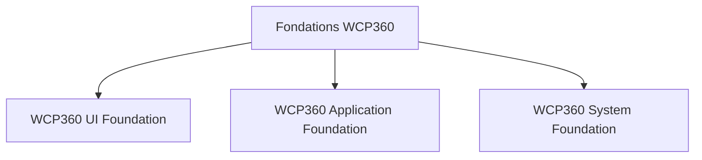

**WCP360 UI Foundation** — DataGrid, pagination, recherche, filtres, formulaires, modales, notifications et graphiques. Ce socle pourra être partagé entre le panel, WCP360 Internal et les extensions.

**WCP360 Application Foundation** — ORM, API, authentification, permissions, transactions, tâches, événements, audit et gestion des licences. Il sera principalement développé en Symfony.

**WCP360 System Foundation** — Agent Go, provisionnement, configuration Linux, isolation, supervision, sauvegardes et récupération.

Ensuite, les extensions pourront utiliser ces fondations plutôt que de réimplémenter leurs propres systèmes.

Le plus important pour ton Design System actuel : ne te limite pas à concevoir des pages. Commence aussi à définir les composants réutilisables, leurs états, leurs contrats de données et leurs comportements. C'est ce qui permettra de transformer ton prototype HTML en une plateforme extensible et maintenable.

#### Exemple d'architecture réutilisable

Pour éviter les duplications entre tes projets, je créerais une partie « Shared Foundation ».

```text
WCP360_Prototype/
├── components/
│   ├── datagrid/
│   ├── pagination/
│   ├── filters/
│   ├── forms/
│   ├── modals/
│   ├── notifications/
│   ├── charts/
│   ├── file-uploader/
│   ├── status-badges/
│   └── loading-states/
└── tokens/
```

La structure cible complète des projets figure dans [Structure cible des projets](#structure-cible-des-projets). Les composants partagés devraient être publiés comme bibliothèques versionnées plutôt que copiés dans chaque projet.

#### Les composants indispensables

##### Interface utilisateur et gestion des données

| Composant | Utilité pour WCP360 |
| --- | --- |
| DataTable / DataGrid | Afficher domaines, sites, clients, bases, licences |
| Pagination | Parcourir de grandes quantités de données |
| Tri multicritère | Trier par statut, date, nom, utilisation |
| Filtres avancés | Combiner plusieurs conditions |
| Recherche | Rechercher un domaine, compte ou serveur |
| Form Builder | Générer des formulaires réutilisables |
| Validation des formulaires | Contrôler les données saisies |
| Modales / Dialogues | Confirmation, édition et suppression |
| Notifications / Toasts | Informer du résultat d'une opération |
| Actions groupées | Suspendre ou modifier plusieurs comptes |
| Export CSV / JSON | Exporter les tableaux et rapports |
| Colonnes personnalisables | Afficher, masquer et réordonner les colonnes |
| Vues enregistrées | Sauvegarder des filtres personnalisés |
| Command Palette | Accéder rapidement aux fonctions du panel |
| Thèmes / Dark Mode | Personnaliser l'interface |
| Accessibilité | Navigation clavier, lecteurs d'écran, contrastes |
| Responsive | Utilisation sur ordinateur, tablette et mobile |

###### Le DataGrid doit être particulièrement puissant

Un exemple avec la gestion des sites :

**Sites Web**

6 résultats

Tous les statuts

Trier : Domaine

| Domaine | Client | État |
| --- | --- | --- |
| example.com<br>PHP 8.4 | Client A | Actif |
| portal.example.net<br>PHP 8.3 | Client D | En attente |
| shop.example.net<br>PHP 8.3 | Client B | Actif |

Page 2 sur 2

Exemple interactif avec des données fictives. Dans le véritable WCP360, le tri, les filtres et la pagination devront être traités côté serveur pour les grandes listes.
C'est ce type de composant que tu dois créer une seule fois dans ton Design System et utiliser partout.

#### Les services indispensables côté Symfony / PHP

Ce sont les fondations que tous les modules doivent pouvoir utiliser.

| Service | Rôle |
| --- | --- |
| ORM | Manipuler les entités et relations en base |
| Repository / Query Builder | Requêtes, filtres, recherche et pagination |
| Database Migrations | Faire évoluer les tables sans perdre les données |
| Transactions | Garantir la cohérence des modifications |
| Authentication | Connexion et gestion des sessions |
| RBAC / Permissions | Droits administrateur, revendeur, client |
| Resource Ownership | Vérifier à quel client appartient chaque ressource |
| Validation Engine | Validation serveur des données |
| Serializer / DTO | Transformer et contrôler les données API |
| API REST | Communication frontend/backend |
| Error Handler | Gestion centralisée des erreurs |
| Audit Logger | Historique des opérations sensibles |
| Job Queue | Traitements asynchrones |
| Workflow / State Machine | Gestion des changements d'état |
| Lock Manager | Éviter deux opérations concurrentes incompatibles |
| Idempotency Manager | Éviter les opérations en double |
| Notification Center | Notifications internes et événements |
| Cache Manager | Optimisation des lectures |
| Rate Limiter | Limitation des requêtes et tentatives |
| Event Dispatcher | Communication entre modules |
| Scheduler | Tâches planifiées et maintenance |
| Import / Export | Importer et exporter des données |
| Settings Manager | Configuration globale et par module |
| Feature / Entitlement Manager | Droits liés aux extensions et licences |

Pour Symfony, tu n'as pas besoin de reconstruire tous ces moteurs.

Doctrine ORM gère les entités, les relations et les migrations. Symfony Messenger fournit les messages et traitements asynchrones. Symfony Workflow gère les états et transitions. Les composants Security, Validator et RateLimiter couvrent également une partie importante du socle.
symfony.com+5

Autre possibilité intéressante : API Platform peut fournir une partie des fonctionnalités CRUD, pagination, filtres, tri, validation et documentation d'API au-dessus de Symfony et Doctrine. Ce n'est pas obligatoire, mais cela peut réduire le code répétitif.
The API Platform Core Library+1

#### Les moteurs spécifiques à un Web Hosting Control Panel

C'est ici que WCP360 se différencie d'une application de gestion classique.

| Moteur | Responsabilités |
| --- | --- |
| Provisioning Engine | Création et configuration des sites et comptes |
| Server Inventory | Inventaire des serveurs et capacités |
| Service Manager | Vérification et configuration des services Linux |
| Quota Engine | Limites de stockage, sites, bases et ressources |
| Resource Allocation | Attribution des ressources serveur |
| DNS Manager | Gestion des zones et enregistrements |
| PHP Runtime Manager | Versions et pools PHP-FPM |
| SSL/TLS Manager | Émission et renouvellement des certificats |
| Database Provisioning | Création de bases et utilisateurs SQL |
| File Manager Engine | Fichiers, transferts, permissions et stockage |
| Backup / Restore Engine | Sauvegarde, rétention et restauration |
| Monitoring Engine | CPU, RAM, stockage et état des services |
| Configuration Engine | Génération, validation et application des configurations |
| Reconciliation Engine | Comparaison entre état attendu et état réel |
| Recovery Engine | Récupération après opérations échouées |

Je considère notamment le Reconciliation Engine comme très important.

Exemple : Symfony indique qu'un site doit être actif, mais Nginx ne possède pas sa configuration. Le moteur détecte cette différence et propose une réparation contrôlée.

Ces moteurs ne doivent pas tous être de simples appels directs à des commandes Linux : ils doivent produire des opérations structurées, validées, exécutées par l'agent Go, avec suivi et audit.

#### Les composants propres à ton architecture d'extensions

Comme tu veux avancer extension par extension, il te faudra aussi un véritable SDK WCP360.

| Composant du SDK | Ce qu'il permet |
| --- | --- |
| Extension Registry | Enregistrer une extension |
| Manifest Validator | Valider son manifeste |
| Dependency Resolver | Vérifier les dépendances |
| Compatibility Checker | Vérifier la version du Core |
| Permission Registry | Déclarer les permissions |
| Menu Registry | Ajouter une entrée au menu |
| Page Registry | Déclarer les pages |
| Route Registry | Déclarer les routes API |
| Event Hooks | Réagir à des événements |
| Settings Schema | Déclarer les paramètres |
| Migration Manager | Versionner les changements de données |
| License Entitlements | Vérifier les droits commerciaux |
| Extension Updater | Gérer les mises à jour |
| Health Checker | Vérifier la santé d'une extension |

Un point de conception important : le SDK doit exposer des interfaces stables, sans donner librement accès aux mécanismes internes de Symfony ou aux privilèges de Go.

#### Standardiser les réponses API

Par exemple, tous les tableaux de WCP360 devraient pouvoir consommer un contrat de données cohérent.

```http
GET /api/v1/websites?page=1&limit=25&sort=domain&order=asc
```

Réponse :

```json
{
  "data": [
    {
      "id": "site-001",
      "domain": "example.com",
      "status": "active",
      "php_version": "8.4"
    }
  ],
  "pagination": {
    "page": 1,
    "limit": 25,
    "total": 142,
    "total_pages": 6
  }
}

```

Ce contrat est une proposition pour WCP360. Avec API Platform, tu peux également adopter son format de collection plutôt que d'inventer une réponse personnalisée.

L'essentiel est d'avoir une convention unique. Le backend doit toujours appliquer les permissions du client connecté avant de retourner les données paginées. Pour les journaux et les historiques volumineux, privilégie aussi la pagination par curseur.

### Organisation de l’écosystème WCP360

<details>
<summary>Sommaire</summary>

- [Architecture générale de ton écosystème](#architecture-générale-de-ton-écosystème)
- [WCP360 Internal : je recommande une application indépendante](#wcp360-internal--je-recommande-une-application-indépendante)
- [Que faut-il ajouter à WCP360 Internal ?](#que-faut-il-ajouter-à-wcp360-internal-)
- [Comment connecter Internal au WCP360 installé chez les clients ?](#comment-connecter-internal-au-wcp360-installé-chez-les-clients-)
- [WCP360 Extensions : le cœur de ta stratégie de développement](#wcp360-extensions--le-cœur-de-ta-stratégie-de-développement)
- [Code source et composants du Core](#code-source-et-composants-du-core)
- [Documentation publiée et guides](#documentation-publiée-et-guides)
- [WCP360 Official Website](#wcp360-official-website)
- [Organisation Git et versions](#organisation-git-et-versions)

</details>

#### Architecture générale de ton écosystème

Je conserverais tes six dossiers, avec quelques renommages et une séparation plus nette.

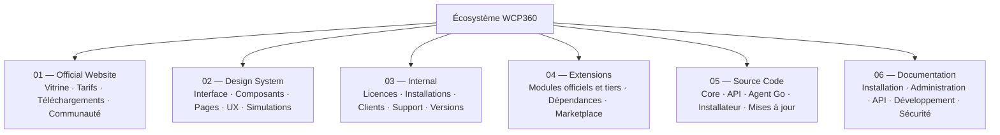

Je garderais exactement cette logique. Les six dossiers représentent six responsabilités différentes, mais ils devront communiquer entre eux avec des interfaces clairement définies.

##### Panel local et services centraux

WCP360 aura deux composantes commerciales distinctes :

- Le logiciel WCP360 : installé et exploité chez le client, sur son propre serveur Debian.
- Les services centraux WCP360 : portail de téléchargement, gestion des licences, paiements, mises à jour et compte client.

Le fonctionnement du panel ne devra pas dépendre en permanence de tes services centraux. Si ton infrastructure commerciale est temporairement indisponible, les sites hébergés par tes clients doivent continuer à fonctionner.

##### Déploiement en trois niveaux

Je recommande une architecture en trois niveaux.

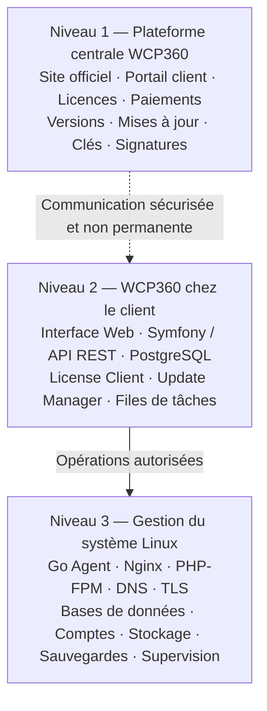

Principe fondamental : le niveau 2 doit fonctionner même si le niveau 1 est inaccessible. Le client doit pouvoir administrer son serveur localement, sans dépendance à ton site commercial.

#### WCP360 Internal : je recommande une application indépendante

C'est ici que je ferais le changement le plus important.

Tu envisages de connecter WCP360 Internal au panel installé chez le client à travers une extension par défaut. Je ne recommande pas d'en faire une extension du panel.

Pourquoi ?

Parce que WCP360 Internal est ton outil d'administration commerciale et technique, tandis que le panel WCP360 est le logiciel que tes clients utilisent.

Il ne faut pas que :

- Un client puisse accéder à ton administration centrale.
- Une désinstallation d'extension supprime les fonctions de support ou de licence.
- Une panne du panel client empêche ton équipe de gérer les licences.
- L'administration commerciale dépende de l'état d'un serveur client.

Je recommande plutôt trois composants :

1. WCP360 Internal : application indépendante, hébergée sur ton infrastructure.
2. WCP360 Core : contient un petit client de communication avec les services centraux.
3. WCP360 Support Connector : extension facultative permettant au client d'envoyer des rapports, diagnostics et demandes d'assistance.

Le License Client doit rester dans le Core : il ne doit pas être désinstallable comme une extension ordinaire.

#### Que faut-il ajouter à WCP360 Internal ?

Je le transformerais progressivement en véritable centre de gestion de l'écosystème WCP360.

Il ne doit pas uniquement gérer les licences : il doit te permettre de suivre tout ce qui se passe autour du produit.

##### Modules recommandés

###### Gestion commerciale

- Tableau de bord général.
- Comptes clients et entreprises.
- Licences Trial, Free, Pro Subscription et Pro Perpetual.
- Abonnements et licences perpétuelles.
- Paiements, factures et renouvellements.
- Historique des commandes.

###### Gestion des installations

- Nombre total de machines installées.
- Nombre de machines actives et inactives.
- Identifiant unique de chaque installation.
- Version de WCP360 installée.
- Version de Debian.
- Type de licence.
- Dernière communication avec le serveur central.
- Historique des activations et transferts.

###### Bugs et rapports d'erreurs

- Signalement de bugs.
- Rapports d'erreurs automatiques.
- Gravité : critique, élevée, moyenne, faible.
- Capture d'écran facultative.
- Journaux techniques.
- Version du Core et des extensions concernées.
- Statut : nouveau, à analyser, confirmé, corrigé, publié.
- Attribution à un développeur.

###### Support technique

- Tickets d'assistance.
- Discussions entre client et support.
- Pièces jointes.
- Délais de réponse.
- Historique des interventions.
- Demande de diagnostic à distance, avec autorisation du client.
- Base de connaissances.

###### Gestion des versions

- Versions du Core.
- Versions de l'installateur.
- Versions des extensions.
- Versions stables et bêta.
- Notes de version.
- Correctifs de sécurité.
- Historique des publications.

###### Gestion des extensions

- Catalogue des extensions.
- Extensions officielles et tierces.
- Versions disponibles.
- Nombre d'installations.
- Compatibilité avec les versions du Core.
- Dépendances.
- Signature des extensions.
- Publication, suspension et retrait.

###### Communauté

- Gestion des comptes développeurs.
- Gestion des contributions GitHub.
- Forum et discussions.
- Demandes de fonctionnalités.
- Votes et suggestions.
- Programme de bêta-test.

##### Tableau de bord Internal

Voici les indicateurs que je mettrais sur la première page :

| Indicateur | Valeur | Nature |
| --- | --- | --- |
| Installations enregistrées | 1 284 | Exemple de donnée fictive |
| Licences actives | 846 | Exemple de donnée fictive |
| Tickets ouverts | 23 | Exemple de donnée fictive |
| Extensions publiées | 18 | Exemple de donnée fictive |

Ces chiffres sont uniquement une illustration de l'interface, pas des données réelles.

##### Une fonction particulièrement intéressante : le diagnostic automatique

Lorsqu'un client rencontre un problème, WCP360 pourrait lui proposer :

1. Ouvrir un rapport de diagnostic.
2. Vérifier les services Nginx, PHP-FPM et PostgreSQL.
3. Vérifier les erreurs récentes.
4. Identifier les extensions concernées.
5. Générer un rapport technique anonymisable.
6. Envoyer ce rapport à WCP360 Internal avec l'accord du client.

Il faut prévoir une sélection des informations envoyées : les mots de passe, clés privées, jetons, données personnelles et contenus des sites ne doivent jamais être transmis automatiquement.

#### Comment connecter Internal au WCP360 installé chez les clients ?

Voici l'architecture que je recommande.

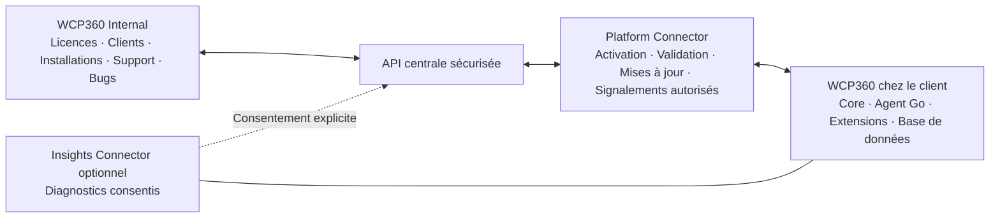

##### Mon choix : un connecteur intégré au Core et une extension facultative

| Fonction | Emplacement |
| --- | --- |
| Activation de licence | Core |
| Validation de licence | Core |
| Vérification des mises à jour | Core |
| Identification de l'installation | Core |
| Rapport de bug | Extension ou interface intégrée |
| Support technique | Extension facultative |
| Diagnostic avancé | Extension facultative |
| Assistance à distance | Extension facultative avec autorisation |
| Accès à Internal | Jamais directement |

Le Core peut envoyer les informations strictement nécessaires à l'activation et à la gestion des licences. Les autres données de télémétrie et de diagnostic doivent faire l'objet d'un contrôle explicite.

Important : WCP360 Internal ne doit jamais disposer d'un accès SSH permanent à tous les serveurs clients. Pour une intervention à distance, il faudra un mécanisme temporaire, authentifié, limité dans le temps et autorisé par le propriétaire du serveur.

#### WCP360 Extensions : le cœur de ta stratégie de développement

C'est probablement l'une des meilleures décisions de ton architecture.

Je recommande de construire WCP360 comme une plateforme modulaire : le Core fournit les fondations, et les fonctionnalités supplémentaires sont développées sous forme d'extensions indépendantes.

Les domaines du Core conservent leurs responsabilités propres ; les extensions ajoutent des adaptateurs ou des workflows sans devenir des dépendances du socle d’hébergement.

##### Frontière entre Core et extensions

La répartition suit la [référence d’architecture Core/extensions](WCP360_Prototype/08-core-extension-architecture.md). Le Core doit rester opérationnel lorsque toutes les extensions sont désactivées ou indisponibles. Les capacités de base de l’hébergement ne sont pas déléguées à des extensions obligatoires.

| Composant | Propriétaire et frontière |
| --- | --- |
| Utilisateurs, permissions et isolation | Core. |
| Gestionnaire d’extensions | Core ; installation, confiance, permissions et cycle de vie. |
| License Client et clients des services centraux | Core ; validation locale et autonomie lors d’une panne centrale. Les autorités privées restent dans INTERNAL. |
| Jobs et réconciliation | Core ; verrous, idempotence, reprise et audit. |
| Comptes, plans, quotas et délégation revendeur | Core ; propriété des ressources et limites effectives. |
| Sites, domaines, DNS autoritatif et SSL/TLS | Core ; publication locale et cycle de vie des ressources. |
| Bases de données et gestion PHP | Core ; ressources, permissions et moteurs d’exécution de base. |
| Messagerie | Core ; domaines, boîtes et cycle SMTP/IMAP. Les clients Webmail et relais externes peuvent être des adaptateurs remplaçables. |
| Fichiers et transferts sécurisés | Core ; gestionnaire de fichiers, SFTP de base, isolation et quotas. |
| Sauvegarde et restauration locales | Core ; récupération disponible sans connecteur distant. |
| Supervision locale, audit et notifications | Core ; alertes intégrées et fallback e-mail ROOT indépendant des connecteurs. |
| Services, pare-feu, réseau et mises à jour signées | Core ; opérations système de base. |
| Installer d’applications, CI/CD, HA/DR avancée, gouvernance de confidentialité et analyses avancées | Extensions optionnelles ; les ressources hébergées existantes continuent de fonctionner en leur absence. |
| Fournisseurs DNS, registrars, stockage distant, identité et notification externes | Adaptateurs/extensions ; le contrat générique et le fallback restent dans le Core. |
| Facturation et intégrations commerciales | Extensions ou services centraux séparés selon leur périmètre. |
| Insights Connector | Extension détachable, désactivée par défaut, rapports consentis et aucune administration distante. |

Chaque capacité possède un seul propriétaire d’écriture. Une extension utilise les API et jobs versionnés du Core, gère ses propres données et ne remplace ni l’autorisation, ni l’inventaire canonique, ni une fonction essentielle de récupération.

##### Les fonctionnalités du gestionnaire d'extensions

Le gestionnaire doit permettre :

- Installer une extension.
- Activer et désactiver.
- Mettre à jour.
- Désinstaller.
- Consulter les dépendances.
- Vérifier la compatibilité.
- Afficher la version.
- Consulter les permissions demandées.
- Revenir à une version précédente lorsque c'est possible.
- Consulter les journaux d'installation et d'erreurs.

docs-v4.strapi.io

##### Cycle de vie d’une extension

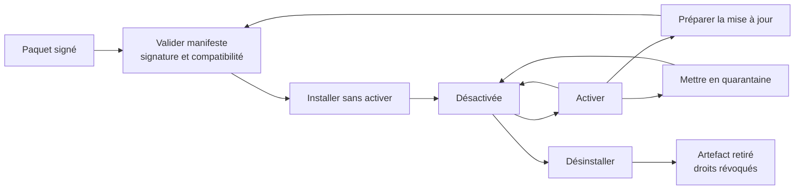

##### Architecture d'une extension

Chaque extension doit suivre une structure normalisée.

```text
wcp360-extension-example/
│
├── extension.json
├── README.md
├── LICENSE
│
├── backend/
│   ├── src/
│   ├── Controller/
│   ├── Service/
│   └── Entity/
│
├── frontend/
│   ├── pages/
│   ├── components/
│   ├── css/
│   └── js/
│
├── migrations/
├── assets/
├── translations/
├── tests/
│
├── install.php
├── uninstall.php
└── upgrade.php
```

Le fichier extension.json contiendra les métadonnées de l'extension.

Exemple :

```json
{
  "id": "wcp360-database",
  "name": "Database Manager",
  "version": "1.0.0",
  "type": "official",
  "minimum_core_version": "1.0.0",
  "dependencies": [],
  "permissions": [
    "database.read",
    "database.create",
    "database.delete"
  ],
  "entrypoint": "backend/src/Extension.php"
}
```

Il faudra définir un véritable contrat technique : points d'entrée, événements, API, migrations, permissions, dépendances et cycle de vie.

##### Attention à la sécurité des extensions

Il ne faut pas considérer une extension comme un simple dossier PHP que l'on autorise à exécuter librement.

Une extension peut potentiellement accéder aux données et aux privilèges du serveur. Il faut donc :

- Signer les paquets officiels.
- Vérifier leur signature avant installation.
- Contrôler les permissions demandées.
- Interdire les téléchargements non vérifiés.
- Vérifier les dépendances et les versions.
- Isoler autant que possible les traitements sensibles.
- Journaliser les installations et mises à jour.
- Prévoir un mode de récupération si une extension empêche le panel de démarrer.

Une désactivation ne doit jamais supprimer les données de l'extension. La désinstallation doit être une opération distincte, avec sauvegarde et confirmation.

##### Organiser les extensions en catégories

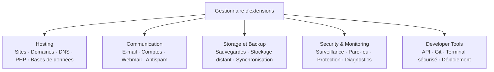

À terme, tu pourras même proposer un dépôt public d'extensions, comme un écosystème de plugins, avec des développeurs externes.

#### Code source et composants du Core

Les composants du Core, de l’agent Go, de l’installateur et du gestionnaire de mises à jour sont regroupés dans [Structure cible des projets](#structure-cible-des-projets). Ils restent des cibles documentaires ; `WCP360_Source_Code/` est vide dans l’inventaire observé.

Le Core regroupe le [socle d’hébergement obligatoire](#frontière-entre-core-et-extensions), dont les utilisateurs, la sécurité, les comptes, les services et la récupération. Les extensions officielles et tierces sont distribuées séparément.

#### Documentation publiée et guides

La [documentation maître cible](#documentation-maître-cible) fournit l’arborescence documentaire proposée. Les guides destinés aux utilisateurs et contributeurs couvrent les sujets suivants :

| Guide | Contenu |
| --- | --- |
| Prise en main | Introduction, prérequis et installation Debian. |
| Utilisation | Tableau de bord, sites, domaines, bases, sauvegardes et utilisateurs. |
| Administration | Serveurs, sécurité, licences et mises à jour. |
| Développement | Architecture, API, Core, agent Go et base de données. |
| Extensions | Système d’extensions, manifeste, API, permissions et publication. |
| Licences | Trial, Free, abonnement, perpétuel et validation hors ligne. |
| Installation | Installateur, Wizard, mise à jour et récupération. |
| Sécurité | Modèle de menace, cryptographie, isolation et audit. |
| Contribution | Environnement de développement, conventions de code et guide de contribution. |

Je te recommande de générer ensuite un site documentaire avec MkDocs ou Docusaurus. La documentation interne et la documentation publique pourront partager une partie de leur contenu.

#### WCP360 Official Website

Ton site officiel doit devenir la porte d'entrée de l'écosystème.

Je recommande cette navigation :

| Page | Contenu |
| --- | --- |
| Accueil | Présentation et démonstration |
| Fonctionnalités | Toutes les capacités du panel |
| Extensions | Catalogue et marketplace |
| Tarifs | Trial, Free, Pro Subscription, Pro Perpetual |
| Téléchargement | Installateur Debian |
| Documentation | Guide utilisateur et développeur |
| Communauté | Forum et discussions |
| Développeurs | API, GitHub, contributions |
| Support | Tickets et assistance |
| Connexion | Portail client |

Il faut aussi prévoir un espace développeur avec les règles de contribution et les conditions de publication des extensions.

#### Organisation Git et versions

Les projets conservent les chemins présentés dans l’[organisation du workspace](#organisation-du-workspace). Un dépôt principal peut regrouper le développement initial ; les composants restent séparables en dépôts indépendants selon la visibilité suivante :

| Dépôt GitHub | Visibilité recommandée |
| --- | --- |
| wcp360-website | Public |
| wcp360-design-system | Privé au départ |
| wcp360-internal | Privé |
| wcp360-extensions | Public pour le catalogue et les extensions ouvertes |
| wcp360-core | Selon ta stratégie open source/commerciale |
| wcp360-documentation | Public |

Tu peux garder un dépôt privé pour les composants commerciaux et les clés de signature. Il ne faut évidemment jamais publier les secrets de production, les données clients ou les clés privées.

Autre conseil : utilise des numéros de version cohérents entre le Core, les extensions, l'installateur et les API. Par exemple, une extension doit déclarer les versions du Core avec lesquelles elle est compatible.

### Distribution, installation et licences

<details>
<summary>Sommaire</summary>

- [Deux modes de distribution](#deux-modes-de-distribution)
- [Éditions et droits](#éditions-et-droits)
- [License Manager](#license-manager)
- [Installateur autonome Debian](#installateur-autonome-debian)
- [Mises à jour et publication](#mises-à-jour-et-publication)

</details>

Il faut intégrer cette exigence dès la conception : WCP360 ne doit pas être seulement un logiciel hébergé sur un serveur central, mais un véritable produit autonome, téléchargeable et installable sur les machines des clients.

Je te conseille de concevoir WCP360 comme une plateforme distribuable, avec un système de licences intégré dès le départ. Cela change plusieurs éléments de l’architecture, notamment l’installation, les mises à jour, l’activation des licences et la gestion des fonctionnalités selon l’offre.

#### Deux modes de distribution

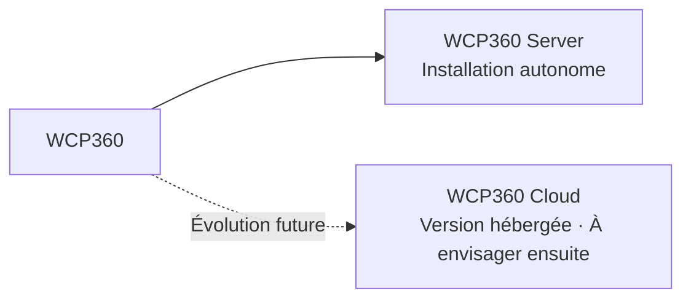

- **WCP360 Server – installation autonome :** le client télécharge le logiciel et l'installe sur son propre serveur Linux. Il conserve le contrôle de ses données, de ses comptes et de son infrastructure.
- **WCP360 Cloud – version hébergée :** à envisager ensuite ; tu héberges WCP360 et le client paie un abonnement pour accéder au panel sans gérer l'installation.

#### Éditions et droits

| Édition | Durée | Fonctionnement proposé |
| --- | --- | --- |
| Trial | 60 jours | Découverte des fonctionnalités payantes |
| Free | Illimitée | Version complète de base, sans abonnement |
| Pro Subscription | Mensuel/annuel | Fonctions professionnelles et services associés |
| Pro Perpetual | Perpétuelle | Droit d'utilisation permanent de l'édition achetée |

La Trial passe en Free à son expiration, sans perte de données ni arrêt des services essentiels.

Aucune expiration ou indisponibilité du serveur de licences ne doit supprimer un site, détruire des données ou arrêter brutalement les services hébergés.

##### Fonctions gratuites et services commerciaux

Il faut distinguer deux choses :

1. Fonctionnalités essentielles du panel : gestion des sites, domaines, DNS, bases de données, certificats SSL, comptes FTP/SFTP, sauvegardes, tâches cron, monitoring et utilisateurs. Elles doivent rester accessibles en Free.
2. Services et avantages commerciaux : support, gestion centralisée de plusieurs installations, outils avancés pour revendeurs, assistance à la migration, services hébergés et mises à jour commerciales spécifiques.

La version Free reste complète ; les éditions payantes se différencient par les services, le support et les prestations associées.

Version Free : je recommande de la rendre réellement utilisable pour héberger des sites, sans limitation artificielle. Elle pourra aussi servir de moyen d'acquisition : un hébergeur commence gratuitement, puis achète des services professionnels quand ses besoins augmentent.

#### License Manager

##### Les deux composants

###### License Server

Installé sur ton infrastructure centrale. Il gère :

- Les licences créées.
- Les clients et leurs installations.
- Les clés d'activation.
- Les dates de début et de fin.
- Les abonnements et paiements.
- Les transferts et révocations.
- Les droits associés à chaque édition.

###### License Client

Installé sur chaque serveur WCP360. Il gère :

- La saisie de la clé.
- L'activation.
- La validation de la signature.
- Le stockage sécurisé de la licence.
- Le contrôle des droits.
- Le mode hors ligne.
- Les alertes de renouvellement.

##### Activation et transfert

- Activation en ligne classique.
- Activation hors ligne par fichier de licence.
- Possibilité de transférer une licence vers un nouveau serveur.
- Une période de grâce en cas de panne du serveur de licences.

##### Cycle de vie d'une licence

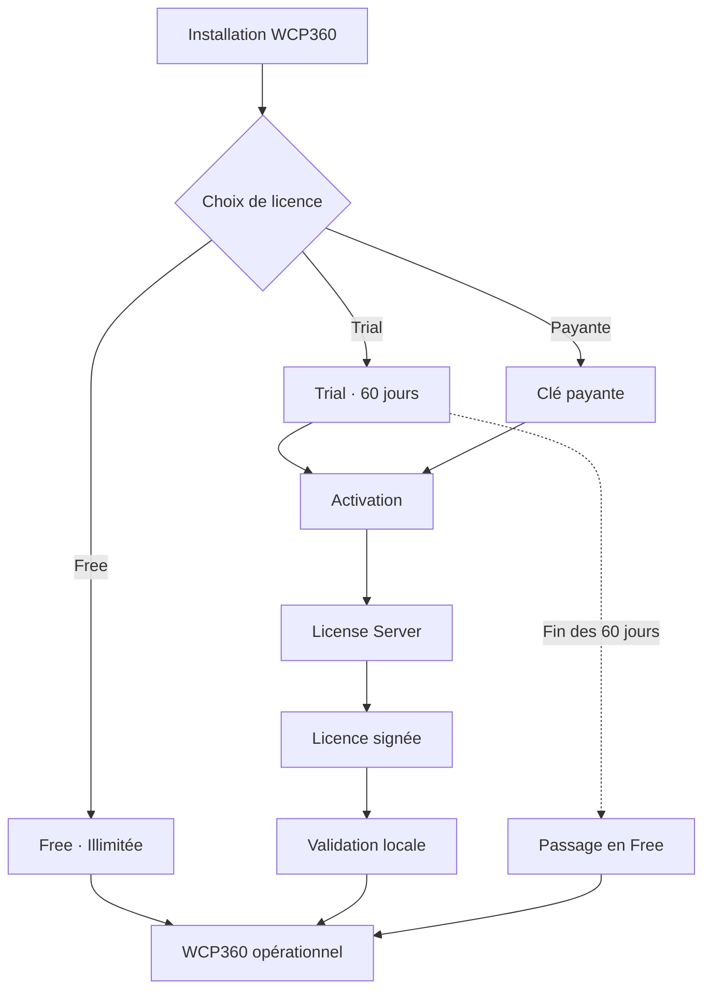

##### Règles du mode hors ligne de 90 jours

Je te recommande les règles suivantes :

- La Free fonctionne sans connexion et sans expiration.
- La Trial démarre à l’activation.
- Les licences par abonnement disposent d'un bail de validation de 90 jours.
- Une licence perpétuelle conserve son droit d'utilisation, mais les droits aux mises à jour et au support dépendent du contrat acheté.
- Une alerte apparaît avant la fin des 90 jours.
- En cas de dépassement, les fonctionnalités commerciales nécessitant une validation peuvent être suspendues, mais les sites hébergés, les données et les fonctions essentielles ne doivent pas être brutalement bloqués.

Attention : le délai de 90 jours est une période maximale de fonctionnement sans renouvellement de validation pour les licences concernées, pas une expiration de la licence perpétuelle elle-même.

##### Sécurité cryptographique

Le fonctionnement recommandé :

- Clé privée Ed25519 : conservée exclusivement sur ton infrastructure centrale, idéalement dans un environnement de signature isolé.
- Clé publique : intégrée au License Client.
- Licence : document signé contenant les droits, les dates, l'identifiant de l'installation et la version du format.
- Le client vérifie la signature localement.

La licence ne doit jamais contenir de secret permettant de fabriquer une nouvelle licence valide.

##### Structure des données

Prévoir ces tables dans la base centrale :

| Table | Fonction |
| --- | --- |
| license_products | Éditions et offres |
| licenses | Licences émises |
| license_activations | Machines activées |
| license_features | Droits fonctionnels |
| license_events | Historique des événements |
| subscriptions | Abonnements |
| payments | Paiements |
| license_transfers | Transferts |
| license_signing_keys | Références des clés de signature |
| software_releases | Versions disponibles |

Et côté installation locale :

- installation_id
- license_id
- license_type
- edition
- issued_at
- valid_until
- offline_until
- features
- signature

Il faudra aussi prévoir un mécanisme anti-retour arrière de l'horloge, sans le considérer comme une protection absolue : aucun contrôle local ne peut être totalement inviolable sur une machine administrée par son propriétaire.

##### Droits d’utilisation, de mise à jour et de support

Licence perpétuelle : il faut distinguer trois droits dans le contrat :

- Le droit d'utiliser la version achetée.
- Le droit de recevoir les mises à jour.
- Le droit au support technique.

Par exemple, tu peux proposer une licence perpétuelle avec 12 mois de mises à jour inclus, puis un renouvellement facultatif. Le client conserve sa version acquise même s'il ne renouvelle pas.

#### Installateur autonome Debian

Le client ne doit pas avoir besoin de connaissances avancées en Linux pour installer WCP360.

Je recommande deux modes :

1. Installation guidée : une commande d'installation officielle, puis un assistant Web de configuration.
2. Installation avancée : installation par paquets Debian, configuration manuelle et fichier de paramètres.

##### Parcours d'installation

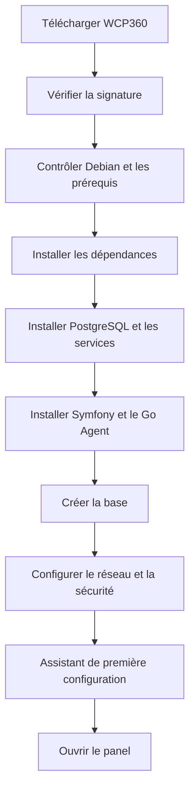

L'installateur devra contrôler :

- La version de Debian et l'architecture.
- La mémoire disponible, le stockage et les ports nécessaires.
- Les conflits éventuels avec Nginx, Apache, PHP-FPM ou une base déjà installée.
- Les permissions et les comptes système.
- La configuration du pare-feu.
- La disponibilité du nom de domaine et du certificat TLS si le panel doit être exposé publiquement.

Attention : un serveur déjà en production ne doit pas être reconfiguré automatiquement sans avertissement et sauvegarde préalable.

##### Distribution logicielle

Je recommande :

- Un dépôt APT officiel WCP360.
- Des paquets .deb signés.
- Un installateur initial qui vérifie la provenance des paquets.
- Un canal stable pour les clients et un canal beta pour les testeurs.
- Un mécanisme de désinstallation qui ne supprime jamais les données sans confirmation.

Tu pourras ainsi publier les versions et correctifs sans obliger les clients à télécharger manuellement toute l'application à chaque mise à jour.

##### Assistant de première configuration


Je recommande ces étapes :

1. Bienvenue et vérification du serveur.
2. Création du compte administrateur.
3. Configuration du nom du serveur.
4. Configuration du domaine du panel.
5. Configuration du certificat HTTPS.
6. Choix de l’édition Free ou activation de la licence.
7. Vérification du Core et des extensions optionnelles choisies.
8. Configuration des sauvegardes.
9. Vérification finale.
10. Accès au tableau de bord.

L'installateur doit également pouvoir être exécuté en mode non interactif pour les administrateurs expérimentés.

#### Mises à jour et publication

La distribution autonome impose de prévoir un cycle de mises à jour fiable.

| Canal | Public | Règle |
| --- | --- | --- |
| Stable | Clients | Versions testées |
| Beta | Testeurs volontaires | Fonctionnalités en validation |
| Development | Développeurs | Versions de travail |

Chaque version et son processus de mise à jour doivent prévoir :

- Vérification des nouvelles versions.
- Téléchargement sécurisé.
- Vérification de la signature des paquets.
- Un numéro de version.
- Un manifeste signé.
- Les sommes de contrôle des paquets.
- Les notes de version.
- Les prérequis de mise à jour.
- Sauvegarde vérifiée avant mise à jour.
- Une procédure de restauration et de retour à la version précédente en cas d’échec.
- Historique des versions et possibilité de mise à jour manuelle.

Je recommande aussi de prévoir une stratégie de migration de base de données réversible lorsque c'est possible, et des sauvegardes vérifiées avant les migrations irréversibles.

Le système de mises à jour devra rester indépendant de la licence : une mise à jour de sécurité critique ne devrait pas être empêchée par une simple expiration d'abonnement.

##### Circuit de publication et de mise à jour

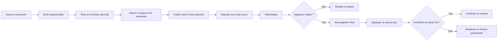
