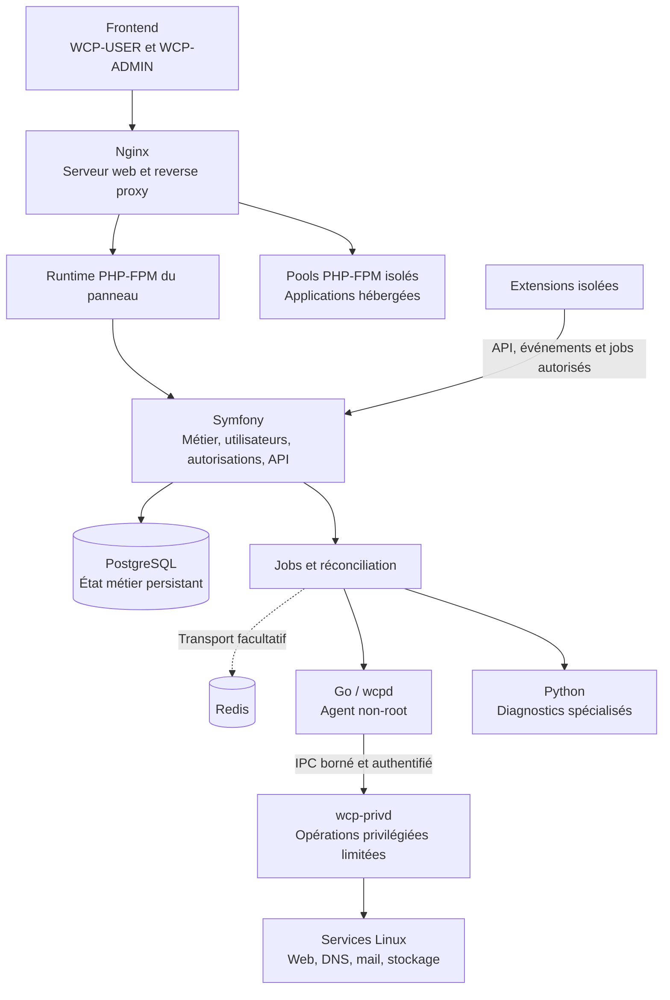

# WCP360 — Web Control Panel 360

**Un panneau d’hébergement web modulaire et évolutif, conçu pour administrer des serveurs, des services et des comptes depuis une interface unifiée.**

WCP360 vise un périmètre comparable à cPanel ou Plesk : gérer les utilisateurs, sites, domaines, DNS, certificats, messagerie, bases de données, fichiers, sauvegardes et services système. Son architecture associe un **Core autonome**, des **modules métier** et des **extensions facultatives**.

La stack cible repose sur **un frontend web, Symfony, PostgreSQL, Redis lorsque nécessaire, Go, Python, Nginx et PHP-FPM**. Chaque composant possède une responsabilité précise, afin de faire évoluer l’interface, la logique métier et les opérations système séparément.

> **Projet en développement — état documenté au 31 octobre 2026.** Ce README présente le produit cible et son organisation. Les prototypes, sources candidates et composants consultables sont distingués dans [État actuel du projet](#état-actuel-du-projet). Le [manifeste courant](https://github.com/yyogas/wcp360/blob/main/manifests/WCP360-BM-0001.md) décrit le périmètre de développement autorisé.

## Sommaire

- [Le projet, son rôle et son public](#le-projet-son-rôle-et-son-public)
- [Pourquoi WCP360](#pourquoi-wcp360)
- [Un projet modulaire et évolutif](#un-projet-modulaire-et-évolutif)
- [Stack technique et responsabilités](#stack-technique-et-responsabilités)
- [Architecture et circulation des opérations](#architecture-et-circulation-des-opérations)
- [Fonctionnalités nécessaires au panneau](#fonctionnalités-nécessaires-au-panneau)
- [Composants et services réutilisables](#composants-et-services-réutilisables)
- [Extensions et plugins possibles et à prévoir](#extensions-et-plugins-possibles-et-à-prévoir)
- [Prérequis techniques](#prérequis-techniques)
- [État actuel du projet](#état-actuel-du-projet)
- [Explorer et démarrer](#explorer-et-démarrer)
- [Organisation du dépôt](#organisation-du-dépôt)
- [Branches GitHub](#branches-github)
- [Documentation et contribution](#documentation-et-contribution)

## Le projet, son rôle et son public

WCP360 a pour rôle de simplifier les opérations quotidiennes d’un hébergement : créer un compte, lui attribuer une offre, publier un site, configurer un domaine, créer une boîte mail, restaurer une sauvegarde ou diagnostiquer un service.

Le panneau doit présenter les ressources, les droits et l’état réel des opérations de manière cohérente. Les tâches longues sont suivies ; les actions sensibles sont autorisées et journalisées ; les réglages communs sont réutilisés par les différents modules.

| Public | Utilisation |
| :--- | :--- |
| Administrateurs système | Installer, configurer, surveiller et maintenir les services du serveur. |
| Hébergeurs | Gérer les comptes, offres, quotas, ressources et services de leurs clients. |
| Revendeurs et agences web | Administrer plusieurs clients et sites dans le périmètre qui leur est délégué. |
| Clients d’hébergement | Gérer leurs sites, domaines, fichiers, bases de données, messagerie et sauvegardes. |
| Développeurs et intégrateurs | Créer des extensions, connecter des services et automatiser les opérations autorisées. |

| Ensemble | Responsabilité |
| :--- | :--- |
| **WCP360 Core** | Noyau installé sur le serveur, fonctions essentielles d’hébergement et services communs. |
| **WCP-USER** | Interface des clients et revendeurs, limitée aux ressources et capacités qui leur sont attribuées. |
| **WCP-ADMIN** | Interface d’administration du serveur, des services et des politiques globales. |
| **WCP360 Internal** | Services privés de l’éditeur : licences, catalogue, construction, distribution et support. Ensemble séparé du produit installé chez le client. |
| **Extensions et adaptateurs** | Capacités facultatives, connecteurs fournisseurs et intégrations spécialisées. |

Les niveaux ROOT, RESELLER et USER désignent des périmètres du panneau. Le rôle ROOT du panneau n’accorde pas automatiquement un accès général au compte `root` Linux.

## Pourquoi WCP360

Le projet cherche à réunir dans un même panneau les opérations d’hébergement habituellement réparties entre plusieurs outils, tout en gardant une séparation claire entre les comptes et les responsabilités techniques.

Sa conception répond à cinq besoins :

- **Centraliser les opérations** : retrouver les ressources, paramètres, tâches et journaux depuis une navigation organisée.
- **Réutiliser les mécanismes communs** : développer une fois les formulaires, tableaux, permissions, notifications et traitements.
- **Conserver l’autonomie du serveur** : les fonctions essentielles continuent lorsque les intégrations facultatives sont indisponibles.
- **Étendre le produit** : ajouter des fonctionnalités et fournisseurs au moyen de contrats documentés.
- **Accompagner l’évolution** : faire évoluer les modules, données et interfaces avec des versions, migrations et procédures de retour maîtrisées.

## Un projet modulaire et évolutif

### Trois niveaux de modularité

| Niveau | Contenu | Règle |
| :--- | :--- | :--- |
| **Fondations communes** | Identité, permissions, configuration, données, API, jobs, événements, audit et composants UI. | Tous les modules utilisent les mêmes mécanismes transverses. |
| **Modules métier du Core** | Comptes, sites, domaines, DNS, TLS, mail, bases, fichiers, sauvegardes locales et exploitation système. | Chaque domaine possède ses données de référence, ses actions et ses responsabilités. |
| **Extensions facultatives** | Automatisation avancée, fournisseurs externes, services commerciaux et outils spécialisés. | Elles peuvent être désactivées sans interrompre les fonctions essentielles du Core. |

**Modulaire** signifie qu’une fonctionnalité possède une frontière identifiable : un contrat, des permissions, des données, des opérations et une interface. Un module métier du Core reste indispensable au produit ; une extension reste facultative.

**Évolutif** signifie que ces frontières permettent d’ajouter une capacité, remplacer un adaptateur ou faire évoluer une implémentation sans réécrire l’ensemble du panneau. Le versionnement des API, les migrations de données, les contrôles de compatibilité et les tests de contrats doivent accompagner ces changements.

### Principes d’organisation

- Une ressource possède un propriétaire métier et un point d’édition de référence. Les tableaux de bord et réglages globaux y renvoient.
- WCP-USER et WCP-ADMIN partagent les contrats et composants communs, avec des routes, sessions et autorisations adaptées à leur surface.
- Les fournisseurs sont reliés par des adaptateurs : un changement de fournisseur ne doit pas changer la logique métier du Core.
- Les extensions possèdent leurs données et leurs traitements isolés. Elles utilisent les API et jobs autorisés pour agir sur les ressources du Core.
- Une extension indisponible retire ses routes et ses nouvelles tâches ; le Core et les services d’hébergement existants restent utilisables.
- Les services privés WCP360 Internal ne sont pas des plugins installables sur les serveurs clients.

## Stack technique et responsabilités

La répartition suivante définit la **stack cible du projet**.

| Composant | Responsabilité |
| :--------- | :----------------------------------------------- |
| Frontend | Affichage, navigation, formulaires, graphiques |
| Symfony | Logique métier, utilisateurs, autorisations, API |
| PostgreSQL | Données persistantes et relations |
| Redis | Transport de tâches asynchrones, si nécessaire |
| Go | Opérations système contrôlées |
| Python | Diagnostics et automatisations spécialisées |
| Nginx | Serveur web et reverse proxy |
| PHP-FPM | Exécution isolée des applications PHP hébergées |

### Rôle des composants dans WCP360

| Composant | Utilisation dans le panneau |
| :--- | :--- |
| **Frontend** | Présenter WCP-USER et WCP-ADMIN, les composants du Design System, les états des opérations et les graphiques de consommation. Le prototype utilise HTML, CSS et JavaScript. |
| **Symfony** | Recevoir les requêtes, valider les données, appliquer les règles métier et permissions, exposer les API et coordonner les traitements. L’architecture métier reste organisée en domaines réutilisables. |
| **PostgreSQL** | Conserver l’état métier du Core : comptes, offres, ressources, relations, politiques et suivi des opérations. Les bases hébergées des clients constituent un domaine distinct. |
| **Redis** | Fournir un transport de messages lorsque les besoins le justifient. Redis reste facultatif : le mécanisme de jobs doit disposer d’un transport durable alternatif. Les données métier de référence restent dans PostgreSQL. |
| **Go** | Porter les agents système et les opérations définies par contrat : validation, état des services, application contrôlée de configurations et remontée de résultats. |
| **Python** | Porter des diagnostics ou automatisations spécialisés exécutés comme tâches identifiées, avec entrées validées, limites et résultats exploitables. Python ne reçoit pas un accès général privilégié au serveur. |
| **Nginx** | Servir les ressources web, terminer les connexions HTTPS selon la configuration et diriger les requêtes vers les services autorisés. |
| **PHP-FPM** | Exécuter les applications PHP des comptes dans des pools isolés. Le runtime du panneau dispose de son propre périmètre, distinct des applications hébergées. |

Symfony porte la décision métier ; Go applique les opérations système autorisées ; Python intervient pour les traitements spécialisés. Le frontend n’exécute pas directement ces opérations sur le serveur.

## Architecture et circulation des opérations

Ce schéma décrit l’architecture cible, avec Redis et les traitements Python utilisés selon les besoins.



Une opération suit un parcours explicite :

1. L’utilisateur effectue une action depuis le frontend.
2. Symfony valide la requête, les droits et les règles métier du domaine.
3. L’état demandé est enregistré ; une opération longue reçoit un identifiant de job.
4. Le traitement est confié au service approprié : logique applicative, agent Go ou diagnostic Python.
5. Les éventuels effets privilégiés passent par des primitives limitées du broker, après contrôle.
6. Le résultat est journalisé, rapproché de l’état réel et présenté dans l’interface.

Les tâches doivent pouvoir signaler leur progression, leurs erreurs et les possibilités de reprise. Les nouvelles tentatives ne doivent pas produire plusieurs fois le même effet.

Le diagramme ne décrit pas un assemblage déjà livré : le daemon actuellement autorisé reste une CLI inerte, sans listener ni opérations privilégiées.

## Fonctionnalités nécessaires au panneau

Le catalogue suivant détaille **233 capacités fonctionnelles réparties en 21 domaines**. Il décrit le périmètre à couvrir, pas un état de livraison. Les fonctions avancées facultatives sont développées dans le [catalogue des extensions](#extensions-et-plugins-possibles-et-à-prévoir).

Pour chaque domaine, WCP-ADMIN administre les politiques et ressources du serveur ; WCP-USER ne voit que les ressources et actions qui lui sont attribuées. Les variantes dépendent des capacités effectivement détectées. Une action doit être autorisée côté backend, produire un résultat vérifié et rejoindre le centre de tâches lorsqu’elle est longue.

| Domaine fonctionnel | Capacités décrites |
| :--- | :--- |
| [Authentification et protection des accès](#authentification-et-protection-des-accès) | 10 |
| [Permissions, délégation et séparation des comptes](#permissions-délégation-et-séparation-des-comptes) | 10 |
| [Clients, revendeurs et cycle de vie des comptes](#clients-revendeurs-et-cycle-de-vie-des-comptes) | 10 |
| [Offres, quotas et mesure des consommations](#offres-quotas-et-mesure-des-consommations) | 10 |
| [Sites web, hôtes virtuels et routage HTTP](#sites-web-hôtes-virtuels-et-routage-http) | 12 |
| [Domaines, DNS faisant autorité et résolution](#domaines-dns-faisant-autorité-et-résolution) | 13 |
| [Certificats, ACME et politiques TLS](#certificats-acme-et-politiques-tls) | 10 |
| [PHP, PHP-FPM et dépendances des sites](#php-php-fpm-et-dépendances-des-sites) | 11 |
| [Bases de données et accès aux moteurs](#bases-de-données-et-accès-aux-moteurs) | 13 |
| [Messagerie et délivrabilité](#messagerie-et-délivrabilité) | 18 |
| [Gestion des fichiers et transferts web](#gestion-des-fichiers-et-transferts-web) | 13 |
| [SSH, SFTP et accès techniques](#ssh-sftp-et-accès-techniques) | 9 |
| [Sauvegardes locales, restauration et rétention](#sauvegardes-locales-restauration-et-rétention) | 12 |
| [Migration et transfert entre instances](#migration-et-transfert-entre-instances) | 10 |
| [Système, services, paquets et stockage local](#système-services-paquets-et-stockage-local) | 12 |
| [Réseau, adresses IP et pare-feu](#réseau-adresses-ip-et-pare-feu) | 10 |
| [Sécurité, secrets et conformité du socle](#sécurité-secrets-et-conformité-du-socle) | 10 |
| [Métriques, alertes, incidents et diagnostics](#métriques-alertes-incidents-et-diagnostics) | 10 |
| [Jobs, réconciliation et opérations longues](#jobs-réconciliation-et-opérations-longues) | 10 |
| [Configuration, API et échanges applicatifs](#configuration-api-et-échanges-applicatifs) | 10 |
| [Installation, mises à jour et autonomie du panneau](#installation-mises-à-jour-et-autonomie-du-panneau) | 10 |

### Authentification et protection des accès

| Capacité | Opérations à couvrir |
| :--- | :--- |
| Connexion et déconnexion | Authentifier le compte, expliquer les échecs sans révéler l’existence d’autres utilisateurs et terminer la session. |
| Authentification multifacteur | Enrôler, vérifier et révoquer les facteurs ; appliquer les exigences liées au rôle. |
| Passkeys / WebAuthn | Prévoir un mécanisme de connexion supplémentaire lorsque le backend et la politique le permettent. |
| Récupération d’accès | Gérer les codes de secours et procédures de récupération sans contourner les contrôles du compte. |
| Gestion des sessions | Lister les sessions, leur activité et leur origine ; révoquer une session ou les autres sessions. |
| Réauthentification sensible | Exiger une vérification supplémentaire avant changement d’identité, révélation de secret ou destruction importante. |
| Protection contre les abus | Limiter les tentatives, appliquer les délais et journaliser les blocages temporaires. |
| Mots de passe | Modifier ou réinitialiser les secrets de connexion avec expiration et révocation adaptées. |
| Historique de connexion | Consulter les succès, échecs et changements de facteurs dans le périmètre autorisé. |
| Accès de récupération local | Conserver une procédure documentée utilisable lorsqu’un fournisseur externe ou une extension est indisponible. |

### Permissions, délégation et séparation des comptes

| Capacité | Opérations à couvrir |
| :--- | :--- |
| Rôles ROOT / RESELLER / USER | Définir les responsabilités de chaque rôle sans confondre rôle applicatif et identité Linux. |
| Permissions par action | Séparer lecture, création, modification, suppression, export et opérations sensibles. |
| Contrôle des propriétaires | Vérifier l’appartenance du compte, du domaine et de chaque ressource à chaque requête. |
| Délégation revendeur | Limiter un revendeur à ses clients et au plafond fixé par l’administrateur. |
| Héritage des politiques | Résoudre les contraintes serveur, offre, revendeur, compte et ressource dans un ordre explicite. |
| Permissions effectives | Afficher pourquoi une action est autorisée, interdite ou limitée. |
| Isolation des données | Empêcher les accès directs ou indirects aux fichiers, bases, journaux et tâches d’un autre compte. |
| Mode support / impersonation | Conserver l’initiateur réel, la cible et le périmètre ; afficher un bandeau et une sortie immédiate. |
| Comptes de service | Attribuer une identité machine, des droits limités, une expiration et des identifiants révocables. |
| Révocation et changement de rôle | Retirer les droits effectifs et invalider les accès concernés sans laisser de permission implicite. |

### Clients, revendeurs et cycle de vie des comptes

| Capacité | Opérations à couvrir |
| :--- | :--- |
| Création d’un compte | Vérifier identifiants, propriétaire, offre, domaine initial et capacité avant le provisionnement. |
| Onboarding | Suivre les étapes nécessaires à l’ouverture de l’hébergement et les ressources effectivement créées. |
| Fiche client | Centraliser identité de contact, langue, fuseau, ressources rattachées et historique autorisé. |
| Inventaire des ressources | Retrouver sites, domaines, bases, boîtes, accès, sauvegardes et tâches d’un compte. |
| Suspension ciblée | Définir les services affectés, le motif et les ressources conservées. |
| Réactivation | Contrôler les prérequis et remettre en service les capacités autorisées. |
| Fermeture et suppression | Présenter dépendances, données concernées, sauvegardes et règles de conservation avant retrait. |
| Transfert de propriétaire | Vérifier droits, quotas, conflits et ressources dépendantes lors d’un changement d’affectation. |
| Comptes de démonstration | Utiliser des données et actions simulées sans produire d’effets réels sur les services. |
| Comptes d’essai | Prévoir expiration, limites et conversion sans suppression silencieuse des données. |

### Offres, quotas et mesure des consommations

| Capacité | Opérations à couvrir |
| :--- | :--- |
| Catalogue d’offres | Créer, versionner et affecter des ensembles cohérents de capacités d’hébergement. |
| Limites de ressources | Gérer nombres de sites, domaines, bases, boîtes, comptes techniques et tâches autorisés. |
| Stockage et inodes | Distinguer espace alloué, occupation, nombre de fichiers et limites effectives. |
| Bande passante | Suivre volumes, périodes de mesure, seuils et remise à zéro selon la politique. |
| CPU, RAM et processus | Exposer les plafonds réellement applicables et la consommation collectée par le backend. |
| I/O et connexions | Gérer les limites prises en charge, sans annoncer une isolation non fournie par le système. |
| Surclassement et exceptions | Appliquer une dérogation autorisée, sa justification et son retour à l’héritage. |
| Dépassements | Distinguer proximité de limite, dépassement, limitation effective et suspension. |
| Historique de consommation | Conserver intervalle, unité, source et fraîcheur pour chaque mesure. |
| Export d’usage | Produire des relevés exploitables par un connecteur commercial ; distinguer consommation et facturation. |

### Sites web, hôtes virtuels et routage HTTP

| Capacité | Opérations à couvrir |
| :--- | :--- |
| Provisionnement d’un site | Créer les ressources, vérifier le domaine, la racine, le runtime et les droits avant publication. |
| Racines documentaires | Valider les chemins et empêcher la sortie du périmètre du compte. |
| Sites statiques et PHP | Configurer le traitement adapté au type de site et au runtime attribué. |
| Configuration Nginx | Générer des configurations structurées, vérifier leur syntaxe puis appliquer les changements. |
| Sous-domaines et alias web | Rattacher les noms autorisés sans doublon ni collision entre comptes. |
| Redirections | Gérer destinations, codes et passage à HTTPS avec contrôle des boucles et de la portée. |
| Reverse proxy | Définir destinations autorisées, upstreams, délais et contrôles de disponibilité pris en charge. |
| Règles par site | Encadrer index, pages d’erreur, limites de requête et paramètres autorisés. |
| Accès aux répertoires | Prévoir protections d’accès et restrictions de publication selon les capacités du moteur. |
| Cache et compression | Configurer les fonctions disponibles, purger le cache du site et afficher les mesures collectées. |
| Journaux HTTP | Consulter erreurs et accès du site avec filtres, rétention et masquage appropriés. |
| Application et retour de configuration | Présenter le diff, valider, recharger puis conserver une configuration de récupération lorsque possible. |

### Domaines, DNS faisant autorité et résolution

| Capacité | Opérations à couvrir |
| :--- | :--- |
| Inventaire des domaines | Conserver propriétaire, rattachements, état local et observations externes séparément. |
| Validation des noms | Normaliser les noms, prendre en compte les domaines internationalisés et détecter les collisions. |
| Zones et enregistrements | Gérer A, AAAA, CNAME, MX, TXT, SRV, NS, CAA et PTR selon le type de zone. |
| SOA, TTL et numéros de série | Valider les valeurs et suivre la version de zone effectivement publiée. |
| Modèles de zones | Appliquer des modèles à la création et montrer les modifications sans écraser les exceptions. |
| Import et export de zones | Valider les données, détecter les conflits et conserver un résultat par enregistrement. |
| DNSSEC | Gérer les capacités de signature, clés et informations DS avec suivi des changements. |
| Serveurs de noms et glue | Vérifier délégations, adresses des nameservers et éléments à transmettre au registrar. |
| DNS primaire et secondaire | Suivre publication, notifications et transferts autorisés AXFR/IXFR/TSIG. |
| Diagnostic de résolution | Comparer observations, propagation et état publié avec source et horodatage. |
| Reverse DNS | Suivre les PTR et indiquer si la modification dépend d’un fournisseur externe. |
| CAA, TLSA et DANE | Valider les enregistrements et dépendances de sécurité lorsque ces capacités sont prises en charge. |
| Dérive de configuration DNS | Détecter un écart entre état demandé et état observé puis proposer une réconciliation contrôlée. |

### Certificats, ACME et politiques TLS

| Capacité | Opérations à couvrir |
| :--- | :--- |
| Inventaire des certificats | Lister noms couverts, émetteur, validité, empreinte et services affectés. |
| Comptes et autorités ACME | Configurer les comptes et autorités compatibles sans dépendre d’un fournisseur unique. |
| Demandes et challenges | Suivre commandes, étapes HTTP-01 ou DNS-01 et erreurs de validation. |
| Certificats wildcard | Vérifier qu’un mécanisme de validation compatible est disponible. |
| Renouvellement | Planifier les tentatives, signaler les échecs et éviter les boucles de renouvellement. |
| Import et CSR | Importer certificats et chaînes ou générer une demande avec gestion encadrée des clés. |
| Déploiement multi-service | Affecter un certificat au web, au mail ou au panneau et vérifier son activation. |
| Profils TLS | Appliquer des profils de protocoles et paramètres supportés, avec contrôle de compatibilité. |
| Expiration et rotation | Alerter, remplacer les éléments arrivant à échéance et suivre les références encore utilisées. |
| Vérification après application | Confirmer chaîne et service présentés ; distinguer certificat stocké et certificat réellement déployé. |

### PHP, PHP-FPM et dépendances des sites

| Capacité | Opérations à couvrir |
| :--- | :--- |
| Versions de PHP | Inventorier les versions disponibles, leurs sources et les applications qui en dépendent. |
| Affectation par site | Choisir un runtime autorisé et vérifier les incompatibilités avant changement. |
| Pools PHP-FPM | Gérer identité, socket, mode de processus, capacité et limites propres au compte. |
| Paramètres PHP | Éditer les directives permises : mémoire, temps, uploads et autres paramètres validés par schéma. |
| Configuration effective | Afficher valeur héritée, surcharge locale et rechargement requis. |
| Extensions PHP | Lister, activer ou retirer les modules autorisés selon version, dépendances et impact. |
| OPcache et diagnostic | Exposer les paramètres et mesures disponibles sans mélanger plusieurs pools ou comptes. |
| PHP en ligne de commande | Associer la version CLI aux tâches autorisées sans la confondre avec le runtime web. |
| Composer | Installer les dépendances d’un projet dans son identité et son répertoire, avec journal de résultat. |
| Démarrage et santé | Vérifier état du pool, échecs, saturation, erreurs et besoin de redémarrage. |
| Changement de version | Préparer le contrôle de compatibilité et le retour lorsque l’application et le backend le permettent. |

### Bases de données et accès aux moteurs

| Capacité | Opérations à couvrir |
| :--- | :--- |
| Inventaire des moteurs | Détecter version, état et capacités réellement installées. |
| Création de bases | Affecter propriétaire, moteur, options compatibles et limites de l’offre. |
| Utilisateurs et identifiants | Créer, renouveler ou révoquer les accès sans exposer les mots de passe dans les journaux. |
| Privilèges | Gérer les droits par base et distinguer droits d’usage et administration du moteur. |
| Accès distants | Encadrer adresses autorisées, chiffrement et règles d’accès réseau. |
| Import de données | Vérifier format, taille, espace disponible et résultat de l’import. |
| Export de données | Produire un export cohérent, protégé et soumis aux droits du propriétaire. |
| Sauvegarde et restauration | Coordonner les opérations avec le moteur et les points de reprise du compte. |
| Connexions et verrous | Exposer les diagnostics disponibles et limiter les actions de terminaison aux droits prévus. |
| Requêtes lentes | Présenter mesures et requêtes filtrées avec source et masquage des données sensibles. |
| Extensions PostgreSQL | Gérer les modules disponibles par base avec contrôle des dépendances et privilèges. |
| Suppression et dépendances | Identifier utilisateurs, applications et sauvegardes concernés avant destruction. |
| Séparation des données du panneau | Isoler la base PostgreSQL du Core des bases hébergées pour les clients. |

### Messagerie et délivrabilité

| Capacité | Opérations à couvrir |
| :--- | :--- |
| Domaines mail | Activer ou désactiver l’hébergement mail et vérifier les prérequis DNS. |
| Boîtes mail | Créer, modifier, suspendre, supprimer et suivre la consommation des boîtes. |
| Quotas et limites d’envoi | Définir stockage et plafonds d’usage selon compte, domaine ou boîte. |
| Alias et listes de destinataires | Valider les adresses et les relations sans exposer d’autres comptes. |
| Redirections et catch-all | Contrôler destinations, boucles et politique de transfert externe. |
| Répondeurs d’absence | Définir période, texte et fréquence selon le moteur. |
| Filtres Sieve | Construire des règles ordonnées et validées pour classement, redirection et autres actions permises. |
| SMTP, IMAP et authentification | Présenter paramètres clients, état des services et configuration sécurisée. |
| Autoconfig et Autodiscover | Préparer les informations de configuration compatibles pour les clients mail. |
| Accès webmail | Créer un parcours d’accès autorisé vers le client configuré sans exposer un mot de passe général. |
| File d’attente | Filtrer les messages différés, comprendre les motifs et effectuer les actions autorisées. |
| SPF, DKIM et DMARC | Vérifier la configuration, publier les éléments requis et suivre les problèmes par domaine. |
| Rotation des clés DKIM | Préparer et vérifier le changement de sélecteur et les enregistrements associés. |
| Protection mail de base | Appliquer les règles antispam, contrôle des abus et protections disponibles dans le socle choisi. |
| Abus et réputation sortante | Relier anomalies d’envoi à leurs comptes ; limiter ou suspendre selon la politique. |
| MTA-STS et TLS-RPT | Gérer les politiques et observations lorsque les services compatibles sont activés. |
| Diagnostic de délivrabilité | Corréler PTR, DNS, TLS, rejets et observations externes sans promettre la livraison. |
| Journaux mail | Autoriser la consultation du périmètre prévu et masquer les données sensibles. |

### Gestion des fichiers et transferts web

| Capacité | Opérations à couvrir |
| :--- | :--- |
| Explorateur | Afficher arborescence, fil d’Ariane, métadonnées, fichiers cachés autorisés et navigation contextualisée. |
| Création et renommage | Créer fichiers et dossiers, renommer et vérifier les conflits. |
| Copie et déplacement | Contrôler espace, destination, droits et résultat de chaque élément. |
| Téléversement | Gérer progression, collisions, limites et résultat par fichier ; reprise uniquement si le backend la fournit. |
| Téléchargement | Contrôler la ressource, la portée du transfert et la durée des liens éventuels. |
| Éditeur de texte | Prévoir coloration, recherche/remplacement, encodage, état modifié et sauvegarde. |
| Conflits d’édition | Détecter les changements concurrents et éviter l’écrasement silencieux d’une version. |
| Archives | Créer ou extraire les formats supportés avec limites de taille, nombre de fichiers et chemins. |
| Permissions de fichiers | Éditer modes et identités autorisés sans contourner l’isolation du compte. |
| Suppression et corbeille | Distinguer suppression réversible et définitive selon le stockage. |
| Recherche et calcul d’espace | Rechercher dans les limites autorisées et produire les opérations coûteuses comme tâches suivies. |
| Protection des chemins | Contrôler liens symboliques, traversées de répertoire et chemins d’archives côté serveur. |
| Historique des opérations | Retrouver acteur, cible, résultat et éventuel point de récupération. |

### SSH, SFTP et accès techniques

| Capacité | Opérations à couvrir |
| :--- | :--- |
| Configuration SSH du serveur | Gérer paramètres autorisés, écoute et politiques d’authentification. |
| Clés utilisateurs | Importer, affecter, révoquer et tracer les clés du propriétaire. |
| Comptes SFTP | Définir identité, racine accessible, droits et restrictions. |
| Accès shell délégué | Distinguer compte SFTP seul et shell autorisé ; appliquer le périmètre de l’offre. |
| Restrictions d’accès | Définir utilisateurs/groupes autorisés et contraintes prises en charge. |
| Anti-verrouillage administratif | Valider la configuration avant rechargement et conserver un chemin de récupération. |
| Clés d’hôte SSH | Inventorier empreintes, échéances éventuelles et procédure de rotation. |
| Sessions et journaux | Suivre les connexions autorisées et révoquer les accès selon les capacités. |
| Rotation des identifiants | Retirer les anciens accès et vérifier les dépendances des automatismes. |

### Sauvegardes locales, restauration et rétention

| Capacité | Opérations à couvrir |
| :--- | :--- |
| Politiques de sauvegarde | Choisir ressources, horaires, rétention, propriétaire et contraintes de capacité. |
| Sauvegarde par ressource | Couvrir fichiers, bases, mail, DNS et configuration selon le périmètre sélectionné. |
| Points de reprise | Conserver identifiant, date, contenu, moteur, emplacement et état de vérification. |
| Exécution et progression | Suivre étapes, erreurs partielles, durée et espace consommé. |
| Cohérence des données | Coordonner les mécanismes propres aux bases et services concernés. |
| Chiffrement | Gérer les références de clés et procédures de récupération selon les capacités du moteur. |
| Vérification | Contrôler intégrité et lisibilité ; distinguer sauvegarde produite et sauvegarde vérifiée. |
| Rétention et purge | Présenter les points conservés ou supprimés avant changement de politique. |
| Restauration ciblée | Choisir fichiers, bases, boîtes ou compte entier avec contrôle des conflits. |
| Préparation de restauration | Vérifier droits, capacité, dépendances et effet sur les données existantes. |
| Résultat de restauration | Confirmer les ressources rétablies et signaler les éléments nécessitant une intervention. |
| Accès autonome à la reprise | Conserver les sauvegardes et restaurations locales utilisables sans connecteur distant. |

### Migration et transfert entre instances

| Capacité | Opérations à couvrir |
| :--- | :--- |
| Inventaire de la source | Découvrir comptes, domaines, fichiers, bases, mail, DNS, certificats et tâches. |
| Contrôle de compatibilité | Identifier versions, fonctions absentes et éléments non transférables. |
| Correspondance des ressources | Associer comptes, offres, chemins, IP et moteurs de destination. |
| Capacité de destination | Vérifier espace, quotas, ressources et collisions avant transfert. |
| Transfert suivi | Exécuter des tâches avec progression et résultat par ressource. |
| Synchronisation finale | Prévoir le rattrapage des changements lorsque le protocole de transfert le permet. |
| Préparation de bascule | Documenter DNS, interruption éventuelle et vérifications avant mise en service. |
| Validation après transfert | Comparer éléments importés et services ; produire un rapport de contrôle. |
| Reprise et nettoyage | Distinguer transfert incomplet, retour possible et suppression finale des données temporaires. |
| Formats externes | Utiliser des importateurs spécialisés pour les autres panneaux ; ne pas supposer leurs formats compatibles. |

### Système, services, paquets et stockage local

| Capacité | Opérations à couvrir |
| :--- | :--- |
| Identité du serveur | Afficher OS, architecture, noyau, hostname, FQDN, fuseau et état de l’horloge. |
| Utilisateurs et groupes système | Gérer les identités nécessaires aux services et comptes par des opérations limitées. |
| Services | Lire l’état et effectuer start, stop, reload, restart ou activation au démarrage selon les droits. |
| Dépendances des services | Identifier les ressources affectées avant arrêt ou changement de configuration. |
| Processus | Afficher propriétaire, consommation et actions autorisées sans exposer de secrets dans les arguments. |
| Paquets et dépôts | Lister versions et sources ; exécuter des transactions de paquets validées et suivies. |
| Mises à jour de sécurité | Identifier les avis applicables et le besoin de redémarrage avec preuve de la source. |
| Planification système | Administrer les tâches et timers autorisés, leurs propriétaires et leur historique. |
| Volumes et montages | Afficher capacité, système de fichiers, options et dépendances avant démontage. |
| Capacité et santé disque | Surveiller espace, inodes, erreurs I/O et signaux SMART lorsqu’ils sont disponibles. |
| Journaux système | Filtrer journal et fichiers, appliquer rétention et accès selon le rôle. |
| Maintenance et redémarrage | Préparer l’impact sur les services, conserver les moyens de reprise et vérifier le retour de santé. |

### Réseau, adresses IP et pare-feu

| Capacité | Opérations à couvrir |
| :--- | :--- |
| Inventaire des interfaces | Exposer liens, état, adresses, MTU et backend de configuration détecté. |
| IPv4 et IPv6 | Administrer adresses et préfixes avec validation de format, propriétaire et usage. |
| Pools IP et réservations | Allouer, réserver et libérer les adresses sans collision. |
| Routes et passerelles | Contrôler les modifications et leurs effets sur la connectivité du panneau. |
| Résolveurs et nommage local | Administrer les paramètres pris en charge sans confondre résolveur et serveur DNS faisant autorité. |
| Ports et sockets | Identifier écoute, service et exposition réseau autorisée. |
| Règles de pare-feu | Gérer règles, profils, source active et vérification après application. |
| Blocages et exceptions | Consulter restrictions, expiration et déblocages autorisés. |
| Diagnostic réseau | Exposer tests de résolution, connectivité et chemin réseau avec cibles validées. |
| Changements réseau sensibles | Prévoir validation, contrôle d’accès restant et récupération en cas de perte de connexion. |

### Sécurité, secrets et conformité du socle

| Capacité | Opérations à couvrir |
| :--- | :--- |
| Centre de sécurité | Agréger les constats en conservant source, preuve, périmètre et date. |
| Durcissement de base | Contrôler les paramètres requis et proposer des changements compatibles avec le serveur. |
| Prévention des attaques de connexion | Piloter les protections retenues et leurs exceptions sans second inventaire divergent. |
| Intégration des protections installées | Détecter moteur antispam, scanner ou contrôle MAC ; annoncer seulement les fonctions disponibles. |
| Secrets applicatifs | Référencer et protéger les identifiants des services, fournisseurs et comptes techniques. |
| Masquage des données sensibles | Filtrer secrets et contenu sensible dans logs, audit, erreurs, exports et diagnostics. |
| Clés et certificats internes | Gérer portée, rotation et révocation des identités techniques du panneau. |
| Validation des requêtes | Contrôler entrées, pièces jointes, sessions, origines et opérations sensibles côté serveur. |
| Audit des changements | Conserver acteur réel, délégation éventuelle, ressource, action et résultat. |
| Conservation des preuves | Encadrer accès, rétention, export et modification des politiques d’audit. |

### Métriques, alertes, incidents et diagnostics

| Capacité | Opérations à couvrir |
| :--- | :--- |
| Santé du serveur | Distinguer sain, dégradé, indisponible et inconnu à partir des contrôles réellement collectés. |
| Métriques système | Suivre CPU, RAM, stockage, réseau et saturation avec unités et période de mesure. |
| Métriques par compte | Restreindre les données aux ressources possédées et aux droits délégués. |
| Historique et tendances | Comparer périodes et distinguer mesure récente, retardée ou manquante. |
| Vérifications de services | Contrôler disponibilité et état applicatif des services activés. |
| Règles d’alerte | Définir seuils, fenêtres, destinataires et déduplication des événements. |
| Centre de notifications | Consulter, filtrer et acquitter les événements selon le rôle. |
| Relais d’alerte local | Maintenir notifications du panneau et adresse ROOT vérifiée sans extension externe. |
| Gestion des incidents | Relier symptômes, ressources, tâches correctives et événements de maintenance. |
| Dossiers de diagnostic | Collecter les éléments nécessaires à une intervention, avec filtrage et partage explicite. |

### Jobs, réconciliation et opérations longues

| Capacité | Opérations à couvrir |
| :--- | :--- |
| Centre de tâches | Lister opérations, propriétaire, ressource, étape, progression et résultat. |
| Persistance des tâches | Conserver l’état et les tentatives malgré une interruption du worker. |
| Idempotence | Reconnaître une demande répétée et éviter de reproduire un effet système. |
| Verrous et concurrence | Empêcher les modifications incompatibles d’une même ressource. |
| Préconditions | Contrôler capacité, dépendances et droits avant application. |
| Étapes et checkpoints | Suivre les opérations partielles et les points de reprise. |
| Reprise et nouvelles tentatives | Limiter les répétitions et distinguer erreur transitoire et intervention nécessaire. |
| Annulation et compensation | Exposer les actions possibles selon l’étape et la sécurité technique de l’opération. |
| Délais et budgets de ressources | Limiter durée, consommation et appels vers les services dépendants. |
| Réconciliation | Comparer état demandé et état observé puis résoudre les écarts par opérations autorisées. |

### Configuration, API et échanges applicatifs

| Capacité | Opérations à couvrir |
| :--- | :--- |
| Configuration hiérarchique | Afficher valeur effective, origine, surcharge et retour à l’héritage. |
| Validation de configuration | Vérifier schéma, contraintes et dépendances avant sauvegarde. |
| Diff et application | Distinguer modification préparée, application en attente et état réellement actif. |
| API REST | Exposer les opérations de domaine avec pagination, filtres, erreurs et contrats cohérents. |
| Identifiants et corrélation | Relier requêtes, jobs, événements et effets sur les ressources. |
| Jetons et restrictions | Gérer portée, expiration, dernière utilisation et contraintes réseau prises en charge. |
| Webhooks sortants | Signer les événements, suivre livraisons et reprises, protéger les secrets. |
| Webhooks entrants | Vérifier source, authenticité, rejeu et droits de l’action déclenchée. |
| Import et export structurés | Valider les formats, traiter les erreurs par élément et respecter les droits sur les données. |
| Détection des capacités | Adapter API et interface aux moteurs, versions et fonctions effectivement disponibles. |

### Installation, mises à jour et autonomie du panneau

| Capacité | Opérations à couvrir |
| :--- | :--- |
| Contrôle des prérequis | Vérifier environnement, accès, réseau, stockage et composants avant installation. |
| État d’installation | Présenter étapes accomplies, erreurs et procédure de reprise. |
| Configuration initiale | Créer l’accès administratif, les paramètres locaux et les moyens de récupération. |
| Vérification des mises à jour | Contrôler signature, intégrité, compatibilité et provenance des artefacts. |
| Migrations du panneau | Préparer les changements de schéma et les vérifications nécessaires à leur application. |
| Maintenance contrôlée | Informer des opérations en cours et préserver les fonctions de diagnostic et de récupération. |
| Retour de version | Documenter les possibilités réelles de retour du code et des données, sans promettre un rollback universel. |
| État des droits de licence | Afficher état et échéance des capacités commerciales sans exposer les clés. |
| Indépendance des extensions | Conserver connexion, hébergement existant, export et récupération lorsque les modules facultatifs sont arrêtés. |
| Disponibilité des services privés | Limiter l’impact d’une indisponibilité du catalogue, des licences ou du support aux opérations qui en dépendent. |

## Composants et services réutilisables

WCP360 Core, les interfaces et les extensions doivent consommer des contrats et composants partagés. Les règles sensibles restent appliquées côté serveur, y compris lorsque le frontend masque une action.

### Bibliothèque d’interface

| Composant | Usage |
| :--- | :--- |
| DataTable / DataGrid | Listes de comptes, sites, domaines, bases, services et extensions. |
| Pagination et tri multicritère | Parcours des listes et tri par nom, état, date ou consommation. |
| Recherche et filtres avancés | Recherche globale ou contextuelle et combinaison de critères. |
| Form Builder et validation | Champs cohérents, formulaires réutilisables et erreurs compréhensibles. |
| Modales et confirmations | Création, édition et confirmation des opérations sensibles. |
| Notifications et toasts | Résultat d’une action, avertissements utiles et accès au suivi des tâches. |
| Actions groupées | Opérations sur plusieurs ressources avec permissions et résultat par élément. |
| Exports CSV / JSON | Export des données autorisées et des rapports. |
| Colonnes et vues enregistrées | Colonnes visibles, ordre d’affichage, filtres et préférences de consultation. |
| Graphiques et indicateurs | Consommation, historique, disponibilité et progression des opérations. |
| Palette de commandes | Accès rapide aux pages et actions disponibles pour l’utilisateur. |
| Thèmes et traductions | Mode clair/sombre, préférences, terminologie commune et internationalisation. |
| Accessibilité et responsive | Navigation clavier, focus, lecteurs d’écran, contrastes et adaptation mobile/tablette. |
| États d’interface | Chargement, liste vide, erreur, accès refusé, traitement en cours et service indisponible. |

### Services applicatifs communs

| Service | Responsabilité |
| :--- | :--- |
| API et contrats de données | Entrées/sorties validées, pagination, erreurs cohérentes et versionnement des interfaces. |
| Accès aux données | Repositories, transactions, relations, migrations et séparation des données par propriétaire. |
| Résolution des politiques | Calcul des droits et limites entre politique serveur, offre, revendeur et compte. |
| Jobs durables | Verrous, idempotence, nouvelles tentatives limitées, délais, progression, reprise et annulation lorsque possible. |
| Événements et webhooks | Diffusion contrôlée des changements, signatures, suivi et gestion des échecs de livraison. |
| Configuration | Valeurs par défaut, paramètres par périmètre et validation des changements. |
| Audit et observabilité | Corrélation des requêtes, tâches et effets système ; masquage des données sensibles. |
| Gestion des extensions | Manifeste, compatibilité, permissions, installation, activation, santé, mise à jour et désinstallation. |
| SDK et conformité | Contrats réutilisables et vérifications de compatibilité pour les développeurs d’extensions. |

## Extensions et plugins possibles et à prévoir

Le catalogue ci-dessous regroupe **149 entrées dans 21 familles** : 142 modules, connecteurs, recettes ou adaptateurs de capacités facultatives, et 7 entrées d’adaptateurs de moteurs du Core. Une entrée peut désigner un pack de pilotes ou de recettes ; ce nombre ne correspond pas à des plugins déjà publiés.

Ces éléments constituent un périmètre de conception et des pistes d’intégration. Les noms de produits illustrent les cibles possibles ; les versions, licences, fonctions et compatibilités restent à qualifier pour chaque intégration. Les composants déjà présents sont indiqués dans [État actuel du projet](#état-actuel-du-projet).

### Nature des extensions et frontières du Core

| Nature | Responsabilité |
| :--- | :--- |
| Module | Ajoute un parcours ou une fonction facultative, avec ses propres données, routes et traitements. |
| Connecteur | Relie le panneau à un fournisseur ou à un système externe par un contrat limité. |
| Adaptateur | Traduit les commandes et états d’un moteur ; il déclare ses capacités réelles. |
| Recettes | Décrivent des paramètres, dépendances et étapes pour un installateur commun ; chaque application ne nécessite pas un nouvel installateur. |
| Pack UI | Apporte présentation ou traductions via les composants et points d’extension autorisés. |
| Adaptateur Core | Implémente un service indispensable avec un moteur remplaçable ; il ne rend pas ce service facultatif. |

Le Core conserve authentification, autorisation, comptes, quotas, sites, DNS, TLS, mail de base, bases, fichiers/SFTP, sauvegardes locales, jobs, audit et exploitation essentielle. **Désactiver une extension de gestion ne doit ni supprimer ses ressources ni interrompre les services d’hébergement existants.**

Un moteur utilisé par des sites, boîtes, bases ou volumes ne peut pas être retiré comme un simple module d’interface : son remplacement exige une migration et la vérification des dépendances. Une fonction ne devient pas facultative parce que son implémentation passe par un adaptateur.

| Famille | Entrées décrites |
| :--- | :--- |
| [Applications, CMS et outils de sites](#applications-cms-et-outils-de-sites) | 7 |
| [Runtimes, dépendances et workers applicatifs](#runtimes-dépendances-et-workers-applicatifs) | 9 |
| [Git, CI/CD et chaîne de livraison](#git-cicd-et-chaîne-de-livraison) | 8 |
| [Domaines, DNS externes et certificats spécialisés](#domaines-dns-externes-et-certificats-spécialisés) | 10 |
| [Messagerie avancée et clients webmail](#messagerie-avancée-et-clients-webmail) | 9 |
| [Outils de bases de données et données avancées](#outils-de-bases-de-données-et-données-avancées) | 8 |
| [Sauvegardes distantes, moteurs et assurance de reprise](#sauvegardes-distantes-moteurs-et-assurance-de-reprise) | 9 |
| [Protection avancée, scanners et investigation](#protection-avancée-scanners-et-investigation) | 10 |
| [Identité d’entreprise et coffres de secrets](#identité-dentreprise-et-coffres-de-secrets) | 5 |
| [Observabilité et supervision externe](#observabilité-et-supervision-externe) | 7 |
| [Notifications, communication et astreinte](#notifications-communication-et-astreinte) | 4 |
| [Stockage partagé et moteurs spécialisés](#stockage-partagé-et-moteurs-spécialisés) | 7 |
| [Virtualisation, conteneurs et clusters](#virtualisation-conteneurs-et-clusters) | 8 |
| [Réseau avancé, équilibrage et disponibilité](#réseau-avancé-équilibrage-et-disponibilité) | 7 |
| [Datacenter et matériel](#datacenter-et-matériel) | 4 |
| [Facturation, commerce et licences tierces](#facturation-commerce-et-licences-tierces) | 7 |
| [Support, portail client et diagnostics consentis](#support-portail-client-et-diagnostics-consentis) | 5 |
| [Données personnelles, conservation et gouvernance](#données-personnelles-conservation-et-gouvernance) | 5 |
| [Automatisation, infrastructure déclarative et assistance IA](#automatisation-infrastructure-déclarative-et-assistance-ia) | 8 |
| [Personnalisation et productivité](#personnalisation-et-productivité) | 5 |
| [Adaptateurs de moteurs alternatifs du Core](#adaptateurs-de-moteurs-alternatifs-du-core) | 7 |

### Applications, CMS et outils de sites

| Module, connecteur ou adaptateur | Fonctions à prévoir | Nature |
| :--- | :--- | :--- |
| Installateur d’applications | Catalogue de recettes, versions compatibles, dépendances, installation, mise à jour, retrait et rapport par instance. | Module |
| WordPress Toolkit | Inventaire multi-sites, cœur/plugins/thèmes, mises à jour contrôlées, maintenance, durcissement et suivi des vulnérabilités. | Module |
| Recettes CMS et e-commerce | Paquets d’intégration pour WordPress, Drupal, Joomla, PrestaShop ou autres applications, avec paramètres et vérifications propres à chaque recette. | Recettes |
| Recettes d’applications métier | Déploiements guidés d’applications collaboratives, analytiques ou métier ; ressources, dépendances et procédures de mise à jour déclarées. | Recettes |
| Staging et clones de sites | Copie fichiers/base, changement d’URL, isolation des environnements et comparaison avant promotion. | Module |
| Mises à jour applicatives vérifiées | Sauvegarde préalable, tests en environnement isolé et validation avant promotion lorsque le moteur applicatif le permet. | Module |
| Gestion de parc applicatif | Vues croisées de versions, dépendances, état et actions groupées sur les applications autorisées. | Module |

### Runtimes, dépendances et workers applicatifs

| Module, connecteur ou adaptateur | Fonctions à prévoir | Nature |
| :--- | :--- | :--- |
| Applications Node.js | Versions, entrypoint, variables, installation de dépendances, processus, redémarrage et journaux. | Adaptateur |
| Applications Python WSGI/ASGI | Environnement isolé, dépendances, module d’entrée, serveur applicatif, santé et journaux. | Adaptateur |
| Applications Ruby / Passenger | Versions, bundles, environnement, intégration au moteur web et commandes de cycle de vie autorisées. | Adaptateur |
| Applications Go hébergées | Déploiement de binaires, environnement, ports internes, supervision et contrôles de disponibilité. | Adaptateur |
| Gestionnaires de dépendances | Adaptateurs Composer, npm, pip ou Bundler, exécutés dans l’identité du projet avec résultats et contraintes de ressources. | Pack d’adaptateurs |
| Workers des applications clientes | Processus de fond dédiés, supervision, concurrence, redémarrage et journaux ; séparés des workers internes du panneau. | Module |
| Services Redis pour clients | Instances ou espaces d’accès, identifiants, limites mémoire, métriques et opérations autorisées. | Adaptateur |
| Services Memcached pour clients | Affectations, mémoire, connexions, état et purge limitée au périmètre réellement isolable. | Adaptateur |
| Messagerie RabbitMQ | Vhosts, utilisateurs, droits, files et observabilité selon le backend ; service facultatif distinct du transport interne des jobs. | Adaptateur |

### Git, CI/CD et chaîne de livraison

| Module, connecteur ou adaptateur | Fonctions à prévoir | Nature |
| :--- | :--- | :--- |
| Dépôts Git | Connexions, branches autorisées, clés de déploiement, synchronisation et historique par projet. | Module |
| Connecteurs GitHub / GitLab / Bitbucket | Authentification fournisseur, webhooks vérifiés, dépôts accessibles et déclencheurs de livraison. | Pack de connecteurs |
| Pipelines de déploiement | Étapes versionnées, préconditions, artefacts, validations, promotion et retour de version supporté. | Module |
| Runners isolés | Identités dédiées, ressources limitées, secrets injectés par référence et nettoyage des environnements de travail. | Module |
| Registres d’artefacts et d’images | Récupération d’artefacts autorisés, provenance, empreintes et suivi de la version déployée. | Connecteur |
| Environnements de prévisualisation | Création temporaire par branche, limites, expiration et nettoyage contrôlé des ressources. | Module |
| Analyse des dépendances | Inventaire, versions, licences déclarées et avis de vulnérabilité issus de sources configurées. | Module |
| Secrets de déploiement externes | Connexion à un coffre de secrets, portée par projet, rotation et absence de valeurs en clair dans les journaux. | Connecteur |

### Domaines, DNS externes et certificats spécialisés

| Module, connecteur ou adaptateur | Fonctions à prévoir | Nature |
| :--- | :--- | :--- |
| DNS Cloudflare | Gestion déléguée des zones, enregistrements, synchronisation, conflits et journal des appels. | Connecteur |
| DNS Route 53 | Adaptation des zones et autorisations fournisseur au modèle de domaine du panneau. | Connecteur |
| Autres fournisseurs DNS | Contrat commun et pilotes spécifiques ; découverte des capacités, limites et état de synchronisation. | Pack de connecteurs |
| Registrars de domaines | Enregistrement, transfert, renouvellement, contacts et nameservers selon l’API ; pilotes Dynadot, Spaceship ou ResellerClub possibles. | Pack de connecteurs |
| RDAP / WHOIS | Observations de registre, échéances et statuts avec source et date, distincts de l’état local du domaine. | Connecteur |
| CDN et edge | Rattachement d’origine, cache, purge, règles et contrôle de propagation selon le fournisseur. | Connecteur |
| Routage global | Règles géographiques, pondération et contrôles de santé externes au routage local du serveur. | Module |
| Challenges DNS-01 fournisseurs | Automatisation des challenges ACME avec identifiants restreints aux zones autorisées. | Pack d’adaptateurs |
| Autorités ACME supplémentaires | Configuration d’autorités compatibles, comptes, politiques et suivi des demandes ; le socle TLS reste dans le Core. | Adaptateur |
| Surveillance des domaines | Regroupement des échéances, changements observés de délégation et contrôles externes de cohérence. | Module |

### Messagerie avancée et clients webmail

| Module, connecteur ou adaptateur | Fonctions à prévoir | Nature |
| :--- | :--- | :--- |
| Roundcube | Installation ou raccordement, accès sécurisé, configuration et suivi de santé du client. | Adaptateur |
| SnappyMail | Intégration du client, lancement autorisé, compatibilité et cycle de mise à jour indépendant. | Adaptateur |
| SOGo | Connexion à une suite collaborative, accès aux fonctions exposées et configuration selon les capacités retenues. | Adaptateur |
| Relais SMTP externes | Pilotes fournisseurs, règles d’acheminement, identifiants limités et retours de livraison ; Brevo est une piste de connecteur. | Pack de connecteurs |
| Analyse des rapports DMARC | Ingestion de rapports, agrégation par domaine, sources d’envoi et tendances ; distincte de la publication DMARC du Core. | Module |
| BIMI et identité de marque mail | Vérifications DNS et prérequis du mécanisme ; aucune garantie d’affichage ou de délivrabilité. | Module |
| Listes de diffusion | Raccordement à un moteur de listes, abonnements et modération sans utiliser les alias comme substitut implicite. | Adaptateur |
| Passerelles MailGuard / sécurité mail | Filtres tiers, quarantaine, règles et observations en complément des protections mail locales. | Connecteur |
| Migration de boîtes externes | Correspondance des comptes, transfert des messages, reprise, contrôles de volumes et rapport par boîte. | Module |

### Outils de bases de données et données avancées

| Module, connecteur ou adaptateur | Fonctions à prévoir | Nature |
| :--- | :--- | :--- |
| phpMyAdmin / Adminer | Accès éphémère limité aux bases autorisées, versions et restrictions de publication. | Pack d’adaptateurs |
| pgAdmin | Raccordement et accès contrôlé aux bases PostgreSQL sans exposer la base du Core. | Adaptateur |
| SQLite par compte | Fichiers de base, permissions, WAL selon capacités, quotas et sauvegardes. | Adaptateur |
| Réplication de bases | Topologie, retard, état, initialisation et bascule seulement si l’adaptateur fournit une procédure sûre. | Module |
| Analyse de performance SQL | Connexions, verrous, requêtes lentes et recommandations explicables sans modification automatique des schémas. | Module |
| Catalogue d’extensions PostgreSQL | Métadonnées, versions et politiques d’autorisation des extensions ; leur activation reste contrôlée par le domaine base de données. | Module |
| Bases de données externes | Raccordement à un moteur distant ou géré, accès, observations et sauvegardes selon les contrats réellement exposés. | Connecteur |
| Anonymisation de données de staging | Règles de transformation, vérification et rapport avant mise à disposition d’une copie de base. | Module |

### Sauvegardes distantes, moteurs et assurance de reprise

| Module, connecteur ou adaptateur | Fonctions à prévoir | Nature |
| :--- | :--- | :--- |
| Destination SFTP | Identité distante limitée, répertoire, disponibilité et transferts des artefacts de sauvegarde. | Connecteur |
| Destination compatible S3 | Buckets, identifiants restreints, stockage, rétention et vérification des capacités effectives. | Connecteur |
| Destination NFS | Répertoire autorisé, disponibilité, capacité et règles d’accès adaptées aux sauvegardes. | Connecteur |
| Moteur Restic | Dépôts, politiques, progression, vérification, restauration et gestion des clés selon son contrat. | Adaptateur |
| Moteur Borg | Dépôts et opérations propres au moteur, avec compatibilité, rétention et récupération documentées. | Adaptateur |
| Transferts rclone / rsync | Profils de transfert, périmètre, simulation lorsque disponible et résultat par opération. | Pack d’adaptateurs |
| Stockage immuable | Détection et utilisation des mécanismes de verrouillage réellement fournis par la destination. | Connecteur |
| Tests de restauration isolés | Recréer un environnement de contrôle, vérifier données et services puis produire une preuve de récupérabilité. | Module |
| Orchestration de reprise après incident | Ordre des ressources, objectifs RPO/RTO, exercices, dépendances et validation de retour en service. | Module |

### Protection avancée, scanners et investigation

| Module, connecteur ou adaptateur | Fonctions à prévoir | Nature |
| :--- | :--- | :--- |
| ClamAV | Scans ciblés ou planifiés, signatures, résultats et gestion contrôlée des éléments détectés. | Adaptateur |
| Maldet | Pilotage des analyses, exclusions et résultats propres au moteur de détection. | Adaptateur |
| Imunify360 | Intégration des fonctions réellement licenciées, événements et actions disponibles sans remplacer les permissions du Core. | Connecteur |
| CrowdSec | Décisions, scénarios et intégrations de blocage selon les capacités ; complément au socle de protection. | Adaptateur |
| WAF / ModSecurity | Profils, règles, exclusions et analyse des événements en complément de la sécurité applicative du panneau. | Adaptateur |
| Intégrité des fichiers | Références, détection de changement, comparaison et alertes sans assimiler tout changement à une compromission. | Module |
| Threat Intelligence | Flux de renseignements configurés, correspondances expliquées et décisions séparées des observations. | Connecteur |
| Forensics Lab | Collecte ciblée de preuves, chronologie, environnement d’analyse isolé et export contrôlé. | Module |
| Export SIEM | Transmission filtrée, format des événements, authentification, reprise et suivi de livraison. | Connecteur |
| Avis de vulnérabilité externes | Sources, correspondances, exceptions et preuve de l’applicabilité aux composants observés. | Connecteur |

### Identité d’entreprise et coffres de secrets

| Module, connecteur ou adaptateur | Fonctions à prévoir | Nature |
| :--- | :--- | :--- |
| OIDC / OAuth | Connexion fédérée, correspondance des identités et rôles, cycle de session et révocation selon le fournisseur. | Connecteur |
| SAML | Fédération, métadonnées, certificats, correspondance des attributs et procédure de récupération locale. | Connecteur |
| LDAP / Active Directory | Recherche des utilisateurs/groupes, restrictions, synchronisation et traitement des indisponibilités. | Connecteur |
| SCIM | Provisionnement et retrait des identités, correspondance des groupes et historique des synchronisations. | Connecteur |
| Coffres de secrets / KMS | Références externes, droits de lecture limités, rotation et gestion des erreurs sans exporter le contenu du coffre. | Connecteur |

### Observabilité et supervision externe

| Module, connecteur ou adaptateur | Fonctions à prévoir | Nature |
| :--- | :--- | :--- |
| Prometheus | Exposition ou transmission des métriques autorisées, labels, périmètre et contrôle d’accès. | Connecteur |
| OpenTelemetry | Transmission des traces et métriques retenues, corrélation et filtrage des données sensibles. | Connecteur |
| Loki et journaux centralisés | Envoi des journaux autorisés, labels, rétention et suivi des pertes ou retards. | Connecteur |
| Syslog distant | Transport configuré, format, destination et surveillance des erreurs de livraison. | Connecteur |
| Grafana | Raccordement de tableaux et sources de données avec droits cohérents avec les comptes du panneau. | Connecteur |
| SNMP / supervision existante | Inventaire et remontée des métriques prises en charge vers une supervision externe. | Connecteur |
| Tests synthétiques externes | Scénarios de disponibilité et comparaison entre observation extérieure et état local du service. | Module |

### Notifications, communication et astreinte

| Module, connecteur ou adaptateur | Fonctions à prévoir | Nature |
| :--- | :--- | :--- |
| SMS | Fournisseurs, numéros vérifiés, modèles, limites d’envoi et suivi des échecs. | Connecteur |
| Messageries d’équipe | Destinations, règles de routage et messages filtrés vers les plateformes configurées. | Pack de connecteurs |
| Astreinte et incidents | Déclenchement, acquittement et synchronisation des incidents avec une plateforme spécialisée. | Connecteur |
| Notifications push | Enrôlement de destinations, choix des événements et révocation par utilisateur. | Connecteur |

### Stockage partagé et moteurs spécialisés

| Module, connecteur ou adaptateur | Fonctions à prévoir | Nature |
| :--- | :--- | :--- |
| ZFS | Inventaire datasets/pools, santé, snapshots et opérations explicitement prises en charge. | Adaptateur |
| Ceph | Santé du cluster, pools, capacité et opérations propres au backend sans masquer son modèle distribué. | Adaptateur |
| GlusterFS | Volumes, pairs, santé et synchronisation selon les capacités de l’adaptateur. | Adaptateur |
| NFS | Montages, options validées, dépendances et diagnostic ; démontage interdit tant que des ressources en dépendent. | Adaptateur |
| SMB / Samba | Partages autorisés, identités, accès et contraintes de publication selon le système. | Adaptateur |
| Stockage objet applicatif | Espaces, accès et usages clients du stockage objet ; distinct des destinations de sauvegarde. | Connecteur |
| Gestion RAID / LVM avancée | Inventaire et santé ; mutations uniquement par workflows dédiés avec contrôle des dépendances et récupération. | Module |

### Virtualisation, conteneurs et clusters

| Module, connecteur ou adaptateur | Fonctions à prévoir | Nature |
| :--- | :--- | :--- |
| Proxmox | Connexion, inventaire des ressources, images, offres VM et actions permises par l’API. | Connecteur |
| KVM / QEMU / libvirt | Création et gestion des VM, ressources, stockage et réseau selon le contrat du moteur. | Adaptateur |
| Conteneurs LXC | Modèles, limites, cycle de vie et accès encadrés des conteneurs. | Adaptateur |
| Docker / Podman | Images, conteneurs, volumes, limites et journaux sans exposer un contrôle privilégié général. | Pack d’adaptateurs |
| Kubernetes / K3s | Namespaces, workloads, services, ingress et journaux avec identité de cluster à portée limitée. | Connecteur |
| Catalogue d’images | Images approuvées, versions, provenance et compatibilité des modèles de machines ou conteneurs. | Module |
| Gestion de groupes de nœuds | Inventaire, santé, capacité, adhésion et maintenance des nœuds gérés. | Module |
| Placement et opérations progressives | Contraintes de placement, drainage et maintenance par étapes selon les mécanismes réellement disponibles. | Module |

### Réseau avancé, équilibrage et disponibilité

| Module, connecteur ou adaptateur | Fonctions à prévoir | Nature |
| :--- | :--- | :--- |
| HAProxy | Frontends, backends, état des cibles, règles et rechargement validé. | Adaptateur |
| Traefik | Routes, services, configuration dynamique et contrôle des points d’entrée autorisés. | Adaptateur |
| VRRP / adresses flottantes | Propriétaires des VIP, état, bascule et contrôles préalables selon le moteur. | Adaptateur |
| WireGuard / VPN | Pairs, plages, clés et accès de management limités ; séparation des réseaux hébergés. | Adaptateur |
| VLAN, bonding et bridges | Relations entre interfaces, paramètres compatibles et dépendances avant modification. | Module |
| SDN | Connexion à un contrôleur réseau et traduction limitée des segments, règles et affectations autorisées. | Connecteur |
| Haute disponibilité de services | Surveillance, quorum/fencing si nécessaire, bascule, réintégration et exercices adaptés au service. | Module |

### Datacenter et matériel

| Module, connecteur ou adaptateur | Fonctions à prévoir | Nature |
| :--- | :--- | :--- |
| Redfish / IPMI | Inventaire matériel, capteurs, état électrique et commandes autorisées par un accès de management dédié. | Pack d’adaptateurs |
| Provisionnement PXE | Profils, images, bootstrap réseau, tâches d’installation et inscription du nœud après vérification. | Module |
| Inventaire datacenter | Emplacements, équipements et dépendances physiques rattachés aux ressources techniques. | Module |
| Sondes environnementales | Mesures de température, énergie et autres capteurs disponibles avec origine et date. | Connecteur |

### Facturation, commerce et licences tierces

| Module, connecteur ou adaptateur | Fonctions à prévoir | Nature |
| :--- | :--- | :--- |
| WHMCS | Correspondance produits/offres, comptes de service, demandes de provisionnement, suspension et retours d’état. | Connecteur |
| Blesta | Synchronisation des ressources techniques avec les opérations commerciales via API autorisées. | Connecteur |
| FOSSBilling | Adaptation des offres, clients et changements de cycle commercial aux commandes du Core. | Connecteur |
| HostBill | Raccordement du catalogue commercial et suivi des opérations de provisionnement. | Connecteur |
| Export de consommation facturable | Transformation explicite des mesures en relevés commerciaux, unités, périodes et contrôles de rapprochement. | Module |
| Paiement / comptabilité / CRM | Connexions possibles aux outils commerciaux retenus, sans déplacer leurs données sensibles dans le Core. | Pack de connecteurs |
| Licences de produits tiers | Suivi des droits LiteSpeed, CloudLinux, Imunify360 ou autres produits ; comportement conforme aux capacités déclarées de chaque intégration. | Pack de connecteurs |

### Support, portail client et diagnostics consentis

| Module, connecteur ou adaptateur | Fonctions à prévoir | Nature |
| :--- | :--- | :--- |
| Ticketing / helpdesk | Tickets, conversations, pièces jointes, affectation, notes internes et liens vers les ressources concernées. | Connecteur ou module |
| Base de connaissances | Articles contextualisés, recherche et aide liée au module consulté. | Module |
| Page de statut | Publication des incidents et maintenances avec informations adaptées au public visé. | Module |
| Insights Connector | Collecte sélectionnée, consentement, masquage, revue et transmission de rapports de diagnostic sans administration distante générale. | Connecteur |
| Rapports d’exploitation | Rapports périodiques de santé, capacité, sauvegardes et actions suivies dans le périmètre du destinataire. | Module |

### Données personnelles, conservation et gouvernance

| Module, connecteur ou adaptateur | Fonctions à prévoir | Nature |
| :--- | :--- | :--- |
| Demandes sur les données | Inventaire, collecte, revue et export des données du périmètre demandé. | Module |
| Effacement et anonymisation | Plan des ressources concernées, exceptions, validation et preuve des opérations effectuées. | Module |
| Conservation et gels de suppression | Politiques, dépendances, échéances et blocage explicite des purges incompatibles. | Module |
| Résidence et circulation des données | Affectations, restrictions de destination et contrôle des exportations selon la politique configurée. | Module |
| Archivage d’audit renforcé | Export, vérification d’intégrité et stockages d’archive adaptés au besoin, au-delà de l’audit local obligatoire. | Module |

### Automatisation, infrastructure déclarative et assistance IA

| Module, connecteur ou adaptateur | Fonctions à prévoir | Nature |
| :--- | :--- | :--- |
| Playbooks | Étapes versionnées, paramètres, préconditions, simulation fiable, résultats et reprise encadrée. | Module |
| Règles événementielles | Déclencheurs, conditions, actions autorisées, limites et prévention des boucles. | Module |
| Terraform / OpenTofu | Provider utilisant les API publiques, correspondance d’état, plans et gestion des changements concurrents. | Connecteur |
| Collection Ansible | Modules et rôles utilisant les contrats autorisés, résultats structurés et gestion des identifiants machine. | Connecteur |
| Assistance IA en lecture | Explication de journaux et diagnostics, données consultées identifiables et résultats séparés des faits mesurés. | Module |
| Missions IA avec validation | Plan d’action, périmètre, autorisations, validation humaine des mutations et résultat audité ; aucun shell privilégié implicite. | Module |
| ChatOps | Commandes bornées via un canal authentifié, confirmation des effets et corrélation avec les tâches du panneau. | Connecteur |
| Optimisation énergétique | Déplacement des tâches flexibles selon contraintes de capacité et disponibilité, avec explication des décisions. | Module |

### Personnalisation et productivité

| Module, connecteur ou adaptateur | Fonctions à prévoir | Nature |
| :--- | :--- | :--- |
| Marque blanche revendeur | Identité visuelle et messages dans le périmètre du revendeur, sans modifier les frontières de sécurité. | Module |
| Packs de thèmes | Déclinaisons compatibles avec les tokens et composants, contrôle d’accessibilité et retour au thème standard. | Pack UI |
| Traductions et terminologie | Packs de langues, validation des clés, formats locaux et adaptation RTL lorsque prévue. | Pack UI |
| Tableaux de bord personnalisés | Widgets autorisés et vues adaptées aux rôles, sans second point d’écriture des ressources. | Module |
| Terminal web optionnel | Session limitée à une identité et un périmètre explicitement autorisés, expiration et métadonnées d’audit filtrées. | Module |

### Adaptateurs de moteurs alternatifs du Core

Ces adaptateurs appartiennent à l’implémentation des services du Core. Le choix d’un moteur est remplaçable ; la fonction d’hébergement reste nécessaire.

| Module, connecteur ou adaptateur | Fonctions à prévoir | Nature |
| :--- | :--- | :--- |
| Apache | Adapter le modèle de site, les hôtes virtuels et paramètres autorisés à un autre moteur web. | Adaptateur Core |
| LiteSpeed / OpenLiteSpeed | Versions, configuration et fonctions compatibles ; la licence éventuelle appartient au produit tiers. | Adaptateur Core |
| BIND / PowerDNS / Knot / NSD | Traduire le modèle DNS du Core vers le moteur sélectionné, avec validation des capacités propres à chacun. | Adaptateur Core |
| Postfix / Exim / Dovecot | Pilotes des services SMTP/IMAP retenus, configuration, files, identité et état des opérations. | Adaptateur Core |
| nftables / firewalld | Piloter le backend de pare-feu effectivement actif sans entretenir deux configurations concurrentes. | Adaptateur Core |
| AppArmor / SELinux | Lecture des états et contrôles disponibles ; conserver les modèles de politiques propres à chaque système. | Adaptateur Core |
| Isolation native / chroot / LVE / CageFS | Associer capacités, limites et contraintes réelles au moteur retenu, sans promettre une isolation identique. | Adaptateur Core |

### Extensions PHP et PostgreSQL administrées

Les plugins WCP360 sont distincts des extensions de langage ou de moteur de base. Le panneau doit aussi gérer ces dernières par des adaptateurs et politiques explicites. Les exemples suivants sont des éléments de catalogue à évaluer, pas les dépendances minimales du panneau ni des modules déjà disponibles sur tout serveur.

| Famille technique | Exemples de capacités | Gestion attendue |
| :--- | :--- | :--- |
| PHP — accès aux bases | PDO et pilotes PostgreSQL / MySQL, mysqli selon les applications | Lister les modules par version PHP et vérifier les dépendances du site. |
| PHP — réseau et échanges | cURL, OpenSSL, SOAP | Exposer la disponibilité et les contraintes du runtime, sans ouvrir de destinations interdites. |
| PHP — texte et données | intl, mbstring, XML, bcmath | Gérer les besoins applicatifs et contrôler la compatibilité avec la version attribuée. |
| PHP — images et médias | GD, Imagick | Vérifier bibliothèques, limites de traitement et consommation autorisée. |
| PHP — fichiers et archives | fileinfo, ZIP | Relier les capacités aux opérations de fichiers autorisées et aux limites de taille. |
| PHP — cache et performance | OPcache, APCu, client Redis | Distinguer cache d’opcodes, cache applicatif et accès à un service Redis. |
| PostgreSQL — observation | pg_stat_statements et autres modules disponibles | Gérer disponibilité, permissions et impact sur le moteur avant activation. |
| PostgreSQL — fonctions applicatives | pgcrypto, uuid-ossp ou extensions proposées par le moteur | Vérifier compatibilité, dépendances et besoin de privilèges par base. |
| PostgreSQL — données spécialisées | PostGIS ou autres extensions métier | Prévoir un catalogue contrôlé ; installation soumise au backend et à la politique de la plateforme. |

La liste disponible provient du moteur et des paquets détectés. Une activation peut nécessiter un rechargement, des privilèges ou une migration ; l’interface ne doit pas annoncer une désactivation dynamique lorsque le backend ne la permet pas.

### Contrat attendu pour un plugin WCP360

| Élément du contrat | Informations à déclarer |
| :--- | :--- |
| Identité et provenance | Identifiant stable, type, éditeur, version, source et description. |
| Compatibilité | Versions de Core, API et runtimes acceptées ; dépendances et incompatibilités. |
| Permissions | Actions et ressources demandées ; différence visible lors d’une mise à jour. |
| Interface | Routes, éléments de navigation, traductions, composants et ressources UI déclarés. |
| Commandes et jobs | Opérations permises, paramètres, limites, progression et stratégie de reprise. |
| Événements | Événements consommés ou émis et garanties de livraison attendues. |
| Données et migrations | Namespace propre, schémas possédés, sauvegarde et stratégie de migration. |
| Identité et exécution | Processus dédié, quotas de ressources, durée et isolation. |
| Réseau et secrets | Destinations nécessaires, références de secrets et identifiants à portée limitée. |
| Santé et défaillance | Contrôles, délais, arrêt des appels en échec et comportement lorsque le module est indisponible. |
| Chaîne de confiance | Signature, intégrité, provenance, inventaire des dépendances et révocation. |
| Cycle de retrait | Drainage, conservation/export des données et conditions d’un retour de version sûr. |

### Gestion et cycle de vie des extensions

Le gestionnaire **Software & Extensions** doit présenter les extensions disponibles, installées, actives, arrêtées, indisponibles ou mises en quarantaine. Un catalogue peut distribuer des extensions intégrées ou tierces sans devenir nécessaire au fonctionnement des sites existants.

| Étape | Contrôle attendu |
| :--- | :--- |
| Découverte | Éditeur, version, description, compatibilité, dépendances et capacités demandées. |
| Installation | Signature, intégrité, provenance, permissions et migrations propres à l’extension. |
| Activation | Vérification de santé, publication des routes et démarrage de traitements isolés. |
| Exécution | Identité dédiée, ressources limitées, accès réseau maîtrisé et journalisation. |
| Mise à jour | Compatibilité des contrats, changements de permissions, migration et possibilité de retour. |
| Désactivation | Retrait des routes, refus des nouvelles tâches et drainage des traitements en cours. |
| Quarantaine | Blocage des accès de l’extension et conservation des éléments de diagnostic. |
| Désinstallation | Vérification des dépendances et choix explicite d’export, conservation ou suppression des données de l’extension. |

Une extension ne remplace pas les contrôles d’autorisation, n’écrit pas directement dans les tables du Core et ne dispose pas d’un shell privilégié arbitraire. Son retrait doit préserver les sites, domaines, boîtes mail, bases et sauvegardes locales existants.


## Prérequis techniques

### Environnement cible du panneau complet

Ces exigences décrivent l’environnement à assembler et qualifier pour le produit cible ; elles ne constituent pas une procédure de déploiement déjà disponible.

| Besoin | Prérequis |
| :--- | :--- |
| Système | Serveur Linux/Debian pris en charge, gestion des services, du réseau, des utilisateurs et du stockage. |
| Accès web | Nginx, configuration HTTPS, nom d’accès au panneau et résolution DNS adaptée. |
| Backend | PHP compatible avec la version Symfony retenue, Composer et extensions PHP requises par les manifests du composant. |
| Exécution PHP | PHP-FPM, avec séparation du panneau et des pools des applications clientes. |
| Données du Core | PostgreSQL, identités de base dédiées, sauvegardes et procédure de migration. |
| Traitements asynchrones | Workers supervisés et transport durable ; Redis seulement lorsqu’il est retenu pour ce transport. |
| Agent système | Binaire Go construit avec la toolchain et les contrats validés pour la version distribuée. |
| Diagnostics spécialisés | Python et dépendances isolées uniquement pour les traitements qui en ont besoin. |
| Services d’hébergement | Moteurs DNS, mail et bases clientes compatibles avec les adaptateurs activés. |
| Exploitation | Espace de stockage pour les données, journaux et sauvegardes ; politique de rétention et accès de récupération. |

Les versions et dépendances doivent être verrouillées dans les manifests de chaque composant. **Aucun minimum de CPU, RAM ou disque pour le panneau complet en production n’est encore qualifié.**

### Prérequis des composants consultables

| Usage actuel | Nécessaire |
| :--- | :--- |
| Lire ou cloner le dépôt | Navigateur, accès au dépôt et Git pour les sources. |
| Explorer le prototype HTML local | Navigateur avec JavaScript et stockage local ; serveur HTTP. Le workspace fournit un lanceur PowerShell Windows. |
| Étudier le noyau candidat | PHP 8.4 et README de la branche concernée ; ce candidat ne constitue pas l’assemblage Symfony complet décrit plus haut. |
| Exécuter le File Manager depuis GitHub | PHP `^8.2`, extensions `json` et `fileinfo`, Composer et dépendances Symfony `^7.4`. L’extension PHP `zip` est requise pour les fonctions ZIP. |
| Construire le daemon inerte | Environnement canonique Debian 13.7 / linux/amd64, Go 1.27.3, image et toolchain épinglées, construction sous UID/GID 10001 selon son README. |

Node.js sert aux outils d’audit du prototype ; il n’est pas nécessaire pour afficher ses pages HTML.

## État actuel du projet

La stack et le catalogue précédents expriment la cible. Ils ne doivent pas être confondus avec l’état de livraison de chaque composant.

| Élément | État documenté |
| :--- | :--- |
| Spécifications, contrats et gouvernance | Présents dans `main`, avec suivi des décisions et preuves. |
| Prototype du panneau | HTML/CSS/JavaScript dans le workspace de conception, avec interactions et données de démonstration locales. |
| Noyau applicatif et interface | Sources candidates dans `source/full-platform-candidate`, dont un noyau PHP 8.4 indépendant d’un framework et une interface statique. |
| Daemon `wcpd` | Fondation CLI Go inerte : aide, version et vérifications locales ; aucun listener ni effet privilégié. |
| File Manager 0.3.0 alpha Pro | Application autonome PHP/Symfony dans une branche dédiée ; intégration WCP360 bloquée dans l’attente des contrats et de l’adaptateur. |
| Insights Connector | Prototype facultatif du workspace de conception, désactivé par défaut ; sa présence locale ne constitue pas une publication dans `main`. |
| Plateforme complète | Assemblage Symfony/PostgreSQL, transports, agents et services d’hébergement à intégrer et qualifier ; aucune livraison de production annoncée ici. |

Le File Manager autonome actuel utilise un **stockage privé à propriétaire unique, modifié exclusivement par ce module**. Ce mode ne constitue pas un backend multi-tenant pour des répertoires modifiés simultanément par SSH, FTP ou les applications des clients.

## Explorer et démarrer


### Cloner le dépôt

L’accès au dépôt est requis. Depuis un terminal disposant de Git :

```sh
git clone https://github.com/yyogas/wcp360.git
cd wcp360
git branch --all
```

Commencez par le [manifeste courant](https://github.com/yyogas/wcp360/blob/main/manifests/WCP360-BM-0001.md), puis consultez la branche du composant à étudier. `main` n’est pas un installateur du panneau complet.

### Installer les dépendances du File Manager autonome

Depuis la racine du clone, dans PowerShell, lors de la première récupération de cette branche :

```powershell
git switch --track origin/extensions/file-manager-v0.3.0-import
Set-Location WCP360_Extensions/WCP360-File-Manager
composer install --no-dev --prefer-dist
```

Lisez ensuite le [README du File Manager](https://github.com/yyogas/wcp360/blob/extensions/file-manager-v0.3.0-import/WCP360_Extensions/WCP360-File-Manager/README.md) pour configurer son stockage et utiliser le lanceur adapté. Les sources GitHub n’incluent pas `vendor/`. Pour développer et exécuter les tests du module, utilisez `composer install` avec les dépendances de développement.

### Ouvrir le prototype du workspace de conception

Cette procédure concerne le **workspace local contenant `WCP360_Design_System/`**, dont l’arborescence diffère du dépôt GitHub. Le clone de `main` seul ne fournit pas ce dossier.

Depuis la racine de ce workspace, sous Windows :

```powershell
powershell.exe -NoProfile -ExecutionPolicy Bypass -File ".\WCP360_Design_System\serve-prototype.ps1"
```

Ouvrez <http://127.0.0.1:8790/>. Conservez le même hôte et le même port pour partager l’état de démonstration entre les pages. `Ctrl+C` arrête le serveur. Les actions de cette interface simulent le panneau ; elles ne configurent pas les services Linux du serveur.

## Organisation du dépôt

Arborescence observée à la racine de `main` :

```text
wcp360/
├── .github/
├── .gitignore
├── README.md
├── CONTRIBUTING.md
├── SECURITY.md
├── archive/
├── contracts/
├── documentation/
├── governance/
├── manifests/
├── specifications/
└── src/
```

Les sources candidates sont distribuées dans leurs branches. Leur présence n’implique pas leur intégration dans `main` :

| Emplacement | Branche de référence |
| --- | --- |
| `SOURCE/platform/`, `SOURCE/ui/`, `SOURCE/daemon/` | `source/full-platform-candidate` |
| `SOURCE/daemon/` — fondation CLI inerte | `source/sc-m01-inert-daemon` |
| `WCP360_Extensions/WCP360-File-Manager/` | `extensions/file-manager-v0.3.0-import` |

## Branches GitHub


Branches constatées le **31 octobre 2026**. `main` est la branche par défaut ; les préfixes regroupent les travaux par nature. Leur existence ne prouve ni une fusion, ni une validation indépendante, ni une publication de version.

| Branche | Contenu ou rôle |
| --- | --- |
| [`main`](https://github.com/yyogas/wcp360/tree/main) | Référentiel par défaut : spécifications, contrats, gouvernance et documentation. |
| [`audit/closure-matrix-refresh-2026-10-03`](https://github.com/yyogas/wcp360/tree/audit/closure-matrix-refresh-2026-10-03) | Suivi de la matrice de clôture des constats d’audit. |
| [`design-system/import-v2.5.3.36.4-markdown`](https://github.com/yyogas/wcp360/tree/design-system/import-v2.5.3.36.4-markdown) | Import des documents Markdown du Design System V2.5.3.36.4. |
| [`extensions/file-manager-v0.3.0-import`](https://github.com/yyogas/wcp360/tree/extensions/file-manager-v0.3.0-import) | Sources du File Manager autonome 0.3.0 alpha, publiées pour revue. |
| [`integration/sc-m01-owner-readiness-20261026`](https://github.com/yyogas/wcp360/tree/integration/sc-m01-owner-readiness-20261026) | Travaux d’intégration et de préparation interdomaines SC-M01. |
| [`maintenance/sc-m01-repository-guardrails`](https://github.com/yyogas/wcp360/tree/maintenance/sc-m01-repository-guardrails) | Maintenance des contrôles du dépôt et de publication. |
| [`research/sc-m01-control-protocol-options-20261026`](https://github.com/yyogas/wcp360/tree/research/sc-m01-control-protocol-options-20261026) | Recherche sur le protocole de contrôle backend–wcpd. |
| [`research/sc-m01-ipcb-go-framing-20261027`](https://github.com/yyogas/wcp360/tree/research/sc-m01-ipcb-go-framing-20261027) | Recherche sur le framing et le parsing IPC-B en Go. |
| [`source/full-platform-candidate`](https://github.com/yyogas/wcp360/tree/source/full-platform-candidate) | Noyau PHP 8.4, interface statique et daemon inerte : candidats hors production. |
| [`source/sc-m01-domain-foundation`](https://github.com/yyogas/wcp360/tree/source/sc-m01-domain-foundation) | Travaux de fondation des domaines applicatifs SC-M01. |
| [`source/sc-m01-inert-daemon`](https://github.com/yyogas/wcp360/tree/source/sc-m01-inert-daemon) | Fondation CLI Go de wcpd, sans listener, base de données ni action privilégiée. |
| [`test/sc-m01-cli-process-contract`](https://github.com/yyogas/wcp360/tree/test/sc-m01-cli-process-contract) | Travaux de test du contrat CLI et du comportement des processus. |
| [`tooling/sc-m01-contract-traceability-20261026`](https://github.com/yyogas/wcp360/tree/tooling/sc-m01-contract-traceability-20261026) | Outillage de traçabilité et de cohérence des contrats. |
| [`tooling/sc-m01-preflight-checks-20261026`](https://github.com/yyogas/wcp360/tree/tooling/sc-m01-preflight-checks-20261026) | Contrôles préalables de présence et d’intégrité des artefacts. |

Pour suivre un composant, consultez son README et les décisions de gouvernance applicables avant d’utiliser ses sources. Les travaux de recherche, d’intégration et d’outillage ne sont pas des versions installables du panneau.

## Documentation et contribution


| Besoin | Référence |
| --- | --- |
| Comprendre l’état autorisé du projet | [Manifeste de baseline](https://github.com/yyogas/wcp360/blob/main/manifests/WCP360-BM-0001.md) et [état du projet](https://github.com/yyogas/wcp360/blob/main/governance/PROJECT-STATUS.md). |
| Lire les exigences et la documentation | [Spécifications](https://github.com/yyogas/wcp360/tree/main/specifications), [contrats](https://github.com/yyogas/wcp360/tree/main/contracts) et [documentation](https://github.com/yyogas/wcp360/tree/main/documentation). |
| Étudier le candidat applicatif | [Présentation du candidat complet](https://github.com/yyogas/wcp360/blob/source/full-platform-candidate/SOURCE/FULL-PLATFORM-CANDIDATE.md) et [README du noyau PHP](https://github.com/yyogas/wcp360/blob/source/full-platform-candidate/SOURCE/platform/README.md). |
| Étudier le daemon | [README de la fondation inerte](https://github.com/yyogas/wcp360/blob/source/sc-m01-inert-daemon/SOURCE/daemon/README.md), notamment son environnement de construction canonique. |
| Étudier le File Manager | [README du module](https://github.com/yyogas/wcp360/blob/extensions/file-manager-v0.3.0-import/WCP360_Extensions/WCP360-File-Manager/README.md). |
| Proposer une contribution | [CONTRIBUTING.md](https://github.com/yyogas/wcp360/blob/main/CONTRIBUTING.md), à lire avec le manifeste courant pour le périmètre autorisé. |
| Signaler un problème de sécurité | [SECURITY.md](https://github.com/yyogas/wcp360/blob/main/SECURITY.md). |

Les contributions doivent préciser le composant concerné, son contrat et les vérifications effectuées. Une interface fonctionnelle, un test local réussi ou une branche de sources ne remplace pas la validation et la promotion prévues par la gouvernance du projet.
