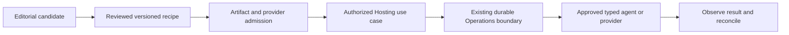

# Core integration boundary

**Status: candidate design and a bounded read-only catalogue interface. This is not an accepted production deployment/API contract.**

WCP360 App Deploy contributes public editorial metadata and reviewed recipe definitions. It does not own the installed panel, application inventory or an independent privileged execution bus.

## Ownership

| Concern | Owner |
| :--- | :--- |
| Editorial catalogue, recipe versions and compatibility/evidence | This workspace. |
| Application identity, desired/observed state, topology, ingress and dependencies | [Core Hosting](../../WCP360_Core/src/Module/Hosting/design/applications/README.md). |
| Provider, runtime, node, image/network/volume admission | [Core Platform](../../WCP360_Core/src/Module/Platform/design/containers/README.md). |
| Durable jobs, idempotency, attempts, fencing, approvals and reconciliation | [Core Operations](../../WCP360_Core/src/Module/Operations/design/distributed-execution/README.md). |
| Current actor/tenant/resource permissions | Core IdentityAccess; an editorial access label is not a grant. |
| Commercial rights | [Core Tenancy](../../WCP360_Core/src/Module/Tenancy/design/licensing/README.md), separately from package trust and permissions. |
| Hosted databases, files and verified recovery | Core Data, Files and BackupRestore. |
| Optional package/contribution admission | Core ExtensionManagement; no automatic PHP/bundle loading. |

Keep Core's thirteen owners. The workspace adds no duplicate application database, queue, permission registry, license server or system agent.

## Candidate read-only source

The CSV is the canonical editorial input. Core's Hosting boundary uses these candidate source locations:

- Domain: ApplicationCatalogueEntry, with typed query/snapshot value objects where required.
- Application: ApplicationCatalogueSource and ListApplicationCandidates.
- Infrastructure: CsvApplicationCatalogueSource.
- Console: ApplicationCatalogueCommand, under Hosting/UI/Console.

These names identify the candidate implementation; they do not define new canonical resource/action identifiers. Source wiring selects the fixed CSV through dependency injection. Callers cannot supply a path, URL, manifest or executable. The sixteen-profile JSON mapping and draft recipe descriptors are not loaded by that CSV reader.

The command is **wcp:candidate:apps:catalogue**, restricted to the existing worker/setup candidate contexts. Its catalogue filters are --category and --app-profile (Symfony reserves --profile for profiling), its accepted page sizes are 25, 50 or 100, and offset is bounded to 0–2048. Symfony's framework options remain separate from these domain inputs.

Example inspection from WCP360_Core, on an already prepared candidate:

```sh
WCP_CONTEXT=worker php bin/console wcp:candidate:apps:catalogue --app-profile=PHP --limit=25 --offset=0
WCP_CONTEXT=setup php bin/console wcp:candidate:apps:catalogue --category="Forums modernes" --limit=25 --offset=0
```

These are documented invocations, not commands executed for this change. An environment context is not Linux identity proof or authorization to perform effects.

A missing source is nonfatal to Core boot and is reported as not_configured when inspected. Invalid/unreadable catalogue data produces a generic failed result without private paths, raw parser diagnostics or partial admission. No row becomes installable, even if Qualification or Source vérifiée is changed to claim acceptance. The command writes no site, job, audit business event, configuration or provider state and exposes no HTTP installation action.

## Future recipe-to-operation path



A future contract must bind immutable recipe/application/provider versions, artifact hashes, owner and tenant, target/architecture, expected resource revision, permissions, commercial rights where applicable, secrets by reference and recovery evidence. Both submission and execution recheck current policy. Approval, a catalogue name or a valid signature is insufficient effect authority.

Do not include this workspace as a Core Composer dependency, import its PHP into Symfony or scan its folders to execute hooks. Public recipes do not contain production secrets, publisher private keys or private commercial services. Existing candidate plan/1–3 and application-plan/1 retain their meanings; the target Nginx → Apache event → FPM topology needs its own implemented and qualified path.

Refer to [selected contracts](../../documentation/contracts/README.md), [lifecycle](LIFECYCLE.md) and [qualification](QUALIFICATION.md) before implementing mutation support.
