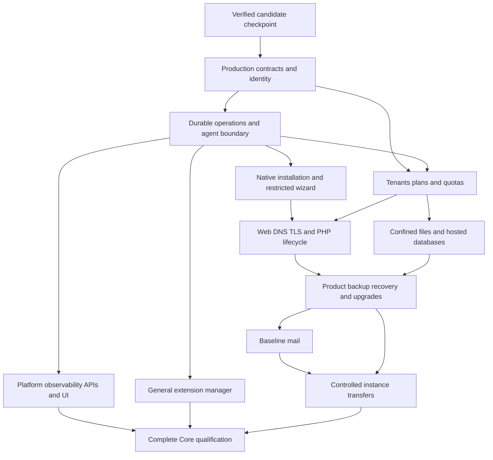

# WCP360 Core delivery roadmap

**Assessment date: 2026-11-01. Estimated completion: approximately 20%; approximately 80% remains. Confidence range: 15–25% complete, or 75–85% remaining. Production release eligibility: not achieved.**

This assessment covers a complete, operable hosting Core: the [233 capabilities in 21 functional domains](CAPABILITY-MAP.md), its thirteen module owners, installation/recovery, essential interfaces, the built-in extension manager and qualification on Debian 12/13 and Ubuntu 22.04/24.04/26.04 LTS. It excludes implementation of the 149 proposed catalog entries, the public website and vendor/internal applications. Optional plugin implementations are separate products; Core must remain operable with none installed.

The estimate is engineering judgment based on inspected source, executable evidence and unfinished work. It measures approximate delivery maturity, including integration and hardening. It is **not** the percentage of capability rows accepted, tests passed, files created, elapsed time or security certification. Scope or weighting changes must be recorded rather than silently increasing progress.

## Evidence and interpretation

The initial runtime assessment below is bound to [source 61adf46](https://github.com/yyogas/wcp360/commit/61adf46e3e29a666c3c0fc462591b7fbd639a85a), on the existing `implementation/core-executable-foundation-20261031` branch, and [workflow 41289487783](https://github.com/yyogas/wcp360/actions/runs/41289487783). Later implementation slices are listed separately; their executed outcomes must be tied to their own source/workflow.

| Evidence | Verified scope | Limit |
| :--- | :--- | :--- |
| 14/14 workflow jobs passed | Five native-package probes, five source-runtime Core journeys, matrix discovery, Panther, FrankenPHP and the Debian integration job. | A green workflow proves its assertions on its exact source; it does not implement absent modules. |
| 133 PHPUnit tests / 805 assertions on each source-runtime target, no skips | Existing candidate application and installer regressions on all five Linux userspaces, using PHP 8.4 and PostgreSQL 17. | Tests are not a count of delivered product capabilities. |
| Native-package probes | Distribution identity, distribution PHP-family admission/refusal and isolated Nginx/FPM behavior. | Distinct from the source-built PHP 8.4 Core path and full host installation. |
| Actual Debian 13 VM reboot | Candidate agent/broker supervision, injected child crashes, recovery, sessions and private hosted application state. | Privileged VM qualification remains Debian 13-specific; no equivalent result is inherited by the other four OS targets. |
| Windows development checks | PHPStan level 8 with Symfony rule regressions, 133 tests / 712 assertions, container/YAML/Twig checks. | Seventeen PostgreSQL, POSIX and terminal cases are skipped locally and exercised in Linux. |

Documentation changes after this assessed runtime revision do not create a new runtime qualification result. Source, test definitions and executed outcomes must stay distinguishable.

Three different states matter:

| Layer | Current state |
| :--- | :--- |
| Executable development foundation | Real Symfony/Twig application, persistent candidate state, controlled Go experiments and automated verification. |
| Complete hosting product | A few implemented vertical paths; most resource lifecycle, policy and operational workflows remain incomplete. |
| Production qualification | Open. The Kernel explicitly refuses production boot; canonical production integration and applicable independent acceptance remain outstanding. |

The current `CODE-BASELINE` remains `NONE`. This planning snapshot does not promote the candidate or replace the applicable Engineering/Security/QA handoffs.

Folders, README files, service-resource reservations and the capability ownership map receive no functional-completion credit by themselves. In particular, the Data, Mail, Files, BackupRestore, Transfers and Observability module directories currently contain ownership documentation rather than their complete business implementations. Candidate backup/audit/health helpers elsewhere are credited only to their narrow demonstrated scope.

## How the percentage is estimated

The workstream weights sum to 100. For each row, its estimated contribution is `weight × maturity / 100`. The sum rounds to approximately 20% when reported in five-point increments. Both weights and maturity values are estimates; the 15–25% range is more informative than a decimal result.

Security, failure handling and integration are part of each workstream's unfinished work. The final qualification row adds cross-product evidence; it is not the only place where testing or security work is counted.

| Workstream | Weight | Estimated maturity | Present evidence | Major unfinished work |
| :--- | ---: | ---: | :--- | :--- |
| Runtime architecture, bootstrap and toolchain | 8% | 70% | Kernel, locked dependencies, HTTP/CLI entry points, runtime contexts and static/build checks. | Accepted production integration, service ownership, packaging and deployment topology. |
| IdentityAccess | 9% | 20% | Candidate login/logout, mandatory administrator TOTP, one-time backup codes, fresh-MFA gates, Argon2id, shared current-authority checks and audited tenant access blocks. | Production MFA/recovery integration, password recovery, passkeys, inline sensitive-action reauthentication, canonical policy composition, complete roles/delegation and token/session administration. |
| Tenancy | 7% | 10% | Enrollment creates distinct account/tenant identities and one scoped membership. | Customer/reseller lifecycle, plans, entitlements, metering and enforceable quotas. |
| Hosting: web, DNS, TLS and PHP | 15% | 20% | Typed `.test` plans, Go rendering, FPM/Worker selection and bounded real hosting experiments. | General site lifecycle, real domains, DNS, ACME/TLS, hosted PHP versions/extensions and safe runtime changes. |
| Mail | 8% | 0% | Ownership and service-resource locations. | Mail domains/mailboxes, SMTP/IMAP, policy, quotas, signing, abuse protection, delivery and diagnostics. |
| Data: hosted databases | 7% | 0% | Control-plane PostgreSQL verification is infrastructure, not hosted database management. | Tenant engines, databases, users/grants, quotas, import/export and revocation. |
| Files | 7% | 0% | Ownership location; agent confinement is not a File Manager. | Confined file operations, uploads/editor/archives/trash, concurrency and authorization. |
| Operations | 8% | 30% | Durable candidate jobs, PostgreSQL claims, idempotency, current-authority rechecks and explicit uncertain outcomes. | General scheduler/outbox, leases/fencing, bounded retries, cancellation, compensation and reconciliation. |
| BackupRestore | 5% | 15% | Restricted candidate PostgreSQL backup/restore and selected logical-state comparison. | Product backup jobs, file/configuration coverage, encryption, retention, selective restore and independent recovery. |
| Transfers | 3% | 0% | Ownership location. | Inventory, compatibility, mapping, synchronization, cutover, recovery and supported external formats. |
| Observability | 4% | 10% | Candidate append-only audit and database health check. | Authorized audit/log queries, metrics/history, alerts, local fallback, incidents and diagnostic bundles. |
| Platform and controlled system integration | 5% | 20% | Strict target/runtime discovery, one revisioned setting and guarded agent/broker experiments. | Production node/service/package/storage/network/SSH/firewall adapters and target-specific qualification. |
| ExtensionManagement | 4% | 20% | Fixed reference-package lifecycle and detached authorized summary; Core survives removal. | General trusted package registry, signatures, dependencies, compatibility, upgrades, supervision and failure containment. |
| Setup, installer and upgrades | 5% | 30% | Read-only host checks, offline candidate artifact verification, private configuration bootstrap, enrollment and restartable checkout preparation. | Native artifact installation, service setup, restricted graphical wizard, supported upgrades and recovery. |
| Integrated product qualification | 5% | 20% | CI, browser/runtime probes and a bounded Debian VM recovery journey. | Full-scope acceptance, independent security review, load/endurance, all-target VM lifecycle and qualified artifact evidence. |
| **Total scope weight** | **100%** | **Approximately 20% overall** | **Verified candidate foundation** | **Approximately 80% of complete-Core delivery remains** |

The candidate status columns in [CAPABILITY-MAP.md](CAPABILITY-MAP.md#capability-by-capability-ownership) provide row-level traceability. A demonstrated candidate row can still require production integration. Do not convert the number of demonstrated or partial rows into this weighted percentage.

## What is already demonstrated

| Delivered candidate path | Source and evidence | Remaining boundary |
| :--- | :--- | :--- |
| Symfony frontend/backend foundation | [Kernel](src/Kernel.php), [configuration](config/README.md), [Twig](templates/README.md), [assets](assets/README.md), locked Composer graph and browser tests. | The complete component library, accessibility/localization and production administration surfaces are unfinished. |
| Local authentication and tenant authorization | [IdentityAccess](src/Module/IdentityAccess/README.md), [session boundaries](src/Shared/Security/SessionBoundary.php), [authorization boundary](src/Module/IdentityAccess/Application/CandidateAuthorization.php) and delegated [store](src/Module/Operations/Infrastructure/WorkbenchStore.php). | Only candidate contexts, one tenant permission, explicit blocks and supported forms/routes are covered. |
| Durable plan execution | [Operations](src/Module/Operations/README.md), [hosting use cases](src/Module/Hosting/README.md), fixed Go plan renderer. | Not a general production task engine or authorization model. |
| Guarded hosted PHP | [Agent sources](agents/README.md), [application-server selection](src/Module/Hosting/Application/ApplicationServerPolicy.php), candidate templates and systemd units. | Synthetic applications and explicit disposable-container/VM admission; arbitrary customer deployment is absent. |
| Reference plugin independence | [PluginRegistry](src/Module/ExtensionManagement/Application/PluginRegistry.php), [lifecycle tests](tests/Lifecycle/PluginLifecycleTest.php). | One fixed package, version and candidate capability; no general marketplace installer. |
| Restartable checkout installation | [Recipes](installer/recipes/README.md), [Setup](src/Module/Setup/README.md), [recovery rules](installer/recovery/README.md). | Existing trusted checkout and existing runtimes; no native package/service provisioning. |
| Database recovery rehearsal | [Backup helper](installer/recovery/candidate-backup.sh), [restore helper](installer/recovery/candidate-restore-test.sh), five-target logical restore checks. | Selected candidate database state, not a complete tenant/server backup product. |
| Cross-platform application verification | [Target catalogue](config/platforms/targets.json), [runtime profile](config/platforms/runtime-providers.json), linked workflow. | Five userspaces do not imply five qualified privileged host installers. |

### Native installation preparation after the initial checkpoint

The next executable slice adds [LinuxHostInventory](src/Shared/Platform/LinuxHostInventory.php), [NativeInstallationPlan](src/Module/Setup/Application/NativeInstallationPlan.php) and a [standalone CLI](installer/preflight/native-plan.php). It observes the live OS/architecture, process identity, available memory, free space on `/var`, current-namespace IPv4/IPv6 TCP/UDP bindings and canonical product paths. Optional operator requirements are diagnostic inputs, not production defaults. Known conflicts fail; incomplete observations stay unknown; omitted requirements stay unchecked.

The report remains a candidate handoff with `native_apply_allowed: false`. It provides no canonical execution plan, trusted native runtime provider, artifact-verification chain or registered installation effects. Cgroup budgets, other filesystems, host network topology, DNS/time and service ownership/health remain unchecked. Existing paths are never overwritten. The checkout installer exposes this read-only path through `--host-check`, before journaling or mutations.

[Deterministic plan tests](tests/Unit/NativeInstallationPlanTest.php), [standalone checkout tests](tests/Integration/NativeInstallationPlanTest.php), [parser regressions](tests/Unit/LinuxHostInventoryTest.php) and [real Linux TCP/UDP tests](tests/Integration/LinuxHostInventoryTest.php) define this slice's evidence. Current-source CI outcomes belong to the existing draft PR; the historical numbers above remain the initial checkpoint. This bounded preparation leaves M3 open and does not change the approximately 20% overall estimate or the capability-status counts.

### Offline candidate artifact verification

[CandidateArtifactVerifier](src/Module/Setup/Application/CandidateArtifactVerifier.php), [ArtifactInput](src/Module/Setup/Infrastructure/ArtifactInput.php) and the [standalone artifact command](installer/preflight/artifact.php) add real detached Ed25519 verification over bounded exact manifest bytes. An independently supplied operator key pin and expected component/version/target are mandatory; payload size and SHA-256 are checked through guarded local file handles and streaming reads. The reader rejects unsafe file types, links and Linux ownership/permission conditions without extracting, copying, downloading or installing a package.

This is a candidate metadata format and cryptographic primitive, not an approved release signing scheme or publisher trust chain. No trusted publisher key, revocation/freshness policy, provenance, compatibility decision, archive-content validation or immutable staging/application mechanism is supplied. Verification success does not approve native installation or guarantee later consumption of a path; the native artifact-trust blocker remains closed. Windows checks do not qualify Linux permissions or Windows ACLs.

[Reader tests](tests/Unit/ArtifactInputTest.php), [signature/identity regressions](tests/Unit/CandidateArtifactVerifierTest.php) and [standalone CLI tests](tests/Integration/CandidateArtifactVerifierTest.php) cover this slice. Update verification becomes Partial: **5 demonstrated / 68 partial / 160 planned** capabilities still total 233. M3 and M7 remain open, and the approximately 20% overall estimate is unchanged. Current-source executed outcomes are recorded in the existing PR separately from the initial runtime checkpoint.

### Administrator MFA and second-factor recovery candidate

[IdentityAccess](src/Module/IdentityAccess/README.md#administrator-mfa-candidate) adds mandatory administrator TOTP at every login, first-time enrollment, encrypted seeds, durable replay/attempt controls, ten single-use backup codes and password-confirmed factor reset. Rights remain withheld until confirmation; completion rotates the session, and recovery/reset revisions invalidate other sessions' older proofs. Administrator mutations require exact Origin, CSRF-protected forms and an MFA proof less than five minutes old. The current freshness flow requires signing in again. A fresh checkout generates an independent private MFA encryption key; existing operator configuration is preserved and requires the key to be added explicitly.

[Service tests](tests/Integration/CandidateMfaTest.php) and [HTTP journeys](tests/Integration/MfaJourneyTest.php) define this slice's positive/refusal coverage. Current-source CI is tracked in [draft PR #116](https://github.com/yyogas/wcp360/pull/116); this entry makes no unexecuted passing-results claim and leaves the initial checkpoint figures intact. Multifactor authentication, Access recovery and Sensitive-action reauthentication now have Partial status: **5 demonstrated / 71 partial / 157 planned**, still 233 capabilities. The approximately 20% overall estimate is unchanged.

This is second-factor recovery after password authentication, not forgotten-password recovery or an emergency key-loss bypass. Canonical production contracts, complete permissions, Unix identities, PostgreSQL grants, passkeys and the full sensitive-action reauthentication flow remain open. **M1 is not complete.**

### Shared candidate authorization and administrator access blocks

[CandidateAuthorization](src/Module/IdentityAccess/Application/CandidateAuthorization.php) centralizes current authority for the existing `candidate.hosting.plan` permission. Visibility, submission/API checks and worker execution require an active USER account, the exact tenant membership and no matching denial. Other permission names fail closed; an ADMIN context does not imply tenant access. [WorkbenchStore](src/Module/Operations/Infrastructure/WorkbenchStore.php) retains its existing facade and delegates these decisions, so callers do not maintain a second policy.

[CandidatePermissionAdministration](src/Module/IdentityAccess/Application/CandidatePermissionAdministration.php) provides bounded membership listing and idempotent, transactional access blocks, with audit records for actual transitions. Blocks persist independently of membership deletion/regrant. Removing a block does not create a membership or restore an inactive account. The administrator [HTTP surface](src/Module/IdentityAccess/UI/Http/PermissionController.php) requires completed MFA, with fresh MFA, exact Origin and an actor/tenant-bound CSRF token for changes. The [CLI check](src/Module/IdentityAccess/UI/Console/CheckAccessCommand.php) is read-only and limited to worker/setup contexts.

Older checkouts must apply [Version20261101000200](migrations/Version20261101000200.php) before the new checks: the migration creates candidate-only denial persistence. [Service regressions](tests/Integration/CandidateAuthorizationTest.php) and [HTTP journeys](tests/Integration/PermissionAdministrationTest.php) define current-state, cross-tenant, block/regrant, audit rollback and browser-boundary coverage. Full current-source CI remains to be executed and recorded in [draft PR #116](https://github.com/yyogas/wcp360/pull/116); neither these test definitions nor the historical checkpoint imply that result.

Action-level permissions, Effective permissions and Revocation and role changes remain **Partial**. Counts stay **5 demonstrated / 71 partial / 157 planned**, totaling 233, and the overall estimate stays approximately 20%. This slice does not implement or grant any of the 82 canonical permissions, positive overrides, role/delegation composition or service-account authority. [AUDIT-WCP-0118](../documentation/governance/audits/AUDIT-WCP-0100/CLOSURE-MATRIX.md#audit-wcp-0118--permission-priority-vs-security-intersection) remains open; its owner decisions and accepted contracts remain authoritative. Canonical production integration and Unix/PostgreSQL identity separation are still required. **M1 remains open.**

## Ordered delivery plan

Milestone numbers express dependency order, not dates, release versions, approval grants or promised completion percentages. All remain open unless explicitly marked as the achieved candidate checkpoint. An implementation may proceed in parallel when its prerequisite contracts and failure boundaries are settled.

### M0 — Preserve the verified candidate checkpoint

**Achieved within its bounded scope.** Retain the exact source/CI references above, the existing one-branch workflow and executable regression suites. Keep candidate schemas/routes and disposable host guards separate from production contracts. Maintain this roadmap and the single capability register when behavior changes.

Exit evidence already available: all five candidate application journeys, plugin removal without Core interruption, installer interruption/refusal tests, logical restore and the Debian crash/reboot rehearsal. This does not mark M1–M12 complete.

### M1 — Establish production foundations and acceptance contracts

Owners: IdentityAccess, Tenancy, Platform, Operations and shared foundations.

- Reconcile the candidate with the accepted API, database, permission, agent and event contracts; identify exact migration/handoff boundaries. The roadmap introduces no public identifiers or new privilege grants.
- Define the first supported engine/provider combination, resource ownership and ADMIN/USER/worker/agent/broker identities, origins, cookies, database grants and secret references.
- Qualify the candidate administrator MFA/enrollment/backup-code recovery against the production contracts; complete password recovery, credential lifecycle, current-authority checks, session administration and sensitive-action reauthentication.
- Define account/tenant identity, resource revision and policy evaluation used by all resource owners. Reserve reseller delegation for its explicitly tested implementation.
- Retain the shared candidate current-authority boundary and access-block semantics while the canonical permission composition is resolved; qualify revocation races and production integration against the accepted contracts without treating candidate blocks as general grants.
- Establish reusable server validation, error/audit/correlation conventions and UI contracts; do not duplicate business policy in controllers or plugins.

**Acceptance:** positive and negative HTTP/CLI tests demonstrate current authorization, MFA/recovery, context separation and tenant isolation; approved production integration can be traced to exact contracts and source. Existing candidate approvals are not silently reassigned.

### M2 — Generalize durable operations and controlled agent execution

Owners: Operations, Platform and the agent/broker boundary. Depends on M1.

- General operation lifecycle, durable intent/outbox, resource revision checks, bounded scheduling, leases/fencing and idempotent effect handling.
- Explicit timeout/cancellation/retry policy, compensation only where reversible, and reconciliation for uncertain results.
- Typed, authenticated, bounded agent requests and a minimal approved privileged primitive set; no PHP/plugin/Python root shell.
- Supervision, backpressure, resource budgets, peer identity, configuration validation and recovery after process crash or machine reboot.
- Verify installer lock behavior with surviving subprocesses, torn writes and injected filesystem failures before claiming stronger host/power-loss guarantees.

**Acceptance:** crash at each effect boundary, lose acknowledgements, revoke the actor, race workers and replay messages; observe no unauthorized or duplicate destructive effect. Uncertain outcomes remain explicit and recoverable through reviewed procedures.

### M3 — Deliver native installation and restricted graphical setup

Owners: Setup and Platform, consuming M1/M2 boundaries.

- Verify prepared artifact identity, compatibility and selected runtime-provider trust before applying an installation plan. Production hosts do not compile Go or resolve arbitrary frontend dependencies.
- Preflight capacity, architecture, hostname/DNS/time, ports, existing services and actual runtime prerequisites; distinguish fresh install, resume, repair and upgrade.
- Create approved identities/directories/services and isolated configuration/secret boundaries; verify actual service health after changes.
- Extend durable installation state beyond checkout preparation to observed host/package/service state; never infer success solely from a checkpoint.
- Open a restricted, expiring, one-time bootstrap flow. Protect origin/CSRF/rate limits and concurrent enrollment; establish the administrator and recovery safely, then close bootstrap access.
- Implement wizard preflight, topology, administrator, node/services, recovery/notifications, apply/verify and completion screens, with equivalent safe unattended inputs.
- Prove the first native target end to end, then qualify each additional declared target independently.

**Acceptance:** a fresh disposable host becomes an operable panel using qualified providers; interrupt every installation phase, resume only after current-state checks, reject takeover/replay and verify bootstrap closure. The five-target userspace matrix alone does not meet this milestone.

### M4 — Complete customer, tenant, plan and quota lifecycle

Owner: Tenancy with IdentityAccess, Operations and resource owners. Depends on M1/M2; integrates with M3.

- Customer/reseller profiles, onboarding, resource inventory, suspension/reactivation, closure, ownership transfer and trial/demo policy.
- Plans, subscriptions/entitlements, delegated limits and policy inheritance with current effective permissions.
- Storage/inodes, bandwidth, CPU/RAM/processes, I/O/connections, usage history/export, exceptions and limit violations.
- Enforce limits in authorized resource operations and system adapters, including concurrency and deletion/recovery behavior.

**Acceptance:** account/tenant/resource identities remain distinct; lifecycle and quota changes work through HTTP/CLI/jobs, reject cross-tenant access and remain effective after restart. An active flag or a UI counter is insufficient.

### M5 — Complete web hosting, DNS, TLS and PHP lifecycle

Owner: Hosting with Files, Platform, Operations, Tenancy and Observability. Depends on M1–M4.

- Sites/document roots, real public-domain validation, aliases/subdomains, redirects, reverse proxy, directory/per-site rules, cache/compression and log access.
- Authoritative zones/records, SOA/TTL/serials, templates/import/export, delegation, primary/secondary DNS, DNSSEC, reverse DNS and diagnostics/drift detection.
- Certificate inventory, ACME accounts/orders/challenges, wildcard/import/CSR, renewal/rotation, cross-service deployment, TLS policy and post-apply verification.
- Hosted PHP versions/extensions, per-site assignment, FPM pools/directives, effective settings, OPcache/CLI/Composer tasks and safe version changes under the tenant identity.
- Keep PHP-FPM as default; qualify opt-in FrankenPHP Worker compatibility, isolation, recycling and state cleanup. Runtime changes preserve the previous observed state on failure or expose a reconciliation requirement.

**Acceptance:** create, modify, suspend, restore and delete a real-domain site with DNS and TLS; serve the expected application under the expected UID; renew a certificate and recover failed configuration changes without disrupting unrelated tenants. Exercise each claimed engine/profile explicitly.

### M6 — Deliver confined files and hosted databases

Owners: Files and Data, sharing M1/M2/M4 foundations. May develop in parallel with M5.

- Files: explorer, create/rename/copy/move, bounded uploads/downloads, editor with conflict handling, archives, permissions, trash/restore, search/size and operation history.
- Enforce path confinement, link/race protection, quota/ownership, archive extraction policy, authorization and concurrency at execution time.
- Data: selected hosted engine adapters, databases, users/credential rotation, grants, network access, import/export, resource limits, connections/locks, slow-query and extension policy, dependency-aware deletion.
- Keep hosted application data/grants separate from control-plane storage and administration.

**Acceptance:** full workflows use real files/engines, reject cross-tenant traversal and revocation races, preserve limits and recover interrupted operations. The panel's own PostgreSQL schema is not a hosted database service.

### M7 — Productize backup, recovery and upgrades

Owners: BackupRestore and Setup with resource owners. Depends on M2 and the implemented M4–M6 resources.

- Scheduled/per-resource backup jobs, consistent recovery points, encryption/key references, progress, integrity verification and retention/pruning.
- Selective/full restoration of files, databases and configuration with capacity/conflict checks and observed results.
- Recovery access that remains usable when the ordinary UI or optional services/plugins fail.
- Trusted update admission, compatibility/migration checks, maintenance/drain, rehearsed supported upgrades and rollback only for explicitly reversible changes.

**Acceptance:** recover a tenant and the control plane after a destructive test; compare application/data/permission results, restore into a clean destination, test invalid backups and rehearse upgrade failure. A successful SQL dump alone does not meet this milestone.

### M8 — Deliver baseline mail and deliverability

Owner: Mail with Hosting, Data, Tenancy, Files, Operations and Observability. Depends on the relevant M1–M7 foundations.

- Domains, mailboxes, quotas/send limits, aliases/groups, forwarding/catch-all, vacation replies and Sieve.
- Qualified SMTP/IMAP authentication and TLS, autoconfiguration, webmail integration boundary and mail queue administration.
- SPF/DKIM/DMARC, DKIM rotation, baseline spam/abuse controls, reputation diagnostics, MTA-STS/TLS-RPT and authorized logs.
- Include mail state in backup/restore and tenant suspension/deletion/recovery policy.

**Acceptance:** real send/receive/authentication, policy and quota/refusal tests, signing/rotation, safe suspension and mailbox restoration. A Postfix/Dovecot/Rspamd folder does not count as mail delivery.

### M9 — Complete platform operations, APIs and the operator interface

Owners: Platform, Observability, IdentityAccess, Operations and each resource owner. Develop throughout M1–M8.

- Node/users/groups, service dependencies/processes, packages/repositories/security updates, cron/scheduling, volumes/mounts, capacity, system logs and controlled maintenance/reboot.
- Interface/IP inventory, pools/routes/resolvers, ports/sockets, firewall/block policy, diagnostics and safe management-network changes with lockout prevention.
- SSH/SFTP identities, keys, restrictions, delegation, host keys, sessions and rotation.
- Consultable audit and retention, server/account metrics/history, service checks, alert rules, local notification fallback, incidents and bounded/redacted diagnostics.
- Hierarchical configuration, validated diff/apply, versioned authorized APIs, tokens/scopes, correlation, inbound/outbound webhooks, import/export and capability discovery.
- Reusable tables/search/filter/sort/pagination/bulk/export, validated forms, dialogs/toasts, charts, navigation, themes, responsive behavior, keyboard/accessibility and localization. UI controls invoke the same server-side use cases as CLI/API/jobs.

**Acceptance:** normal operator tasks are complete and accessible; unauthorized data/actions, webhook replay, network lockout and secret leakage are refused. Alerts and local recovery remain useful without a vendor backend.

### M10 — Deliver the general built-in extension manager

Owner: ExtensionManagement with all approved contribution owners. Depends on M1/M2 and stable resource/API boundaries; may develop alongside M5–M9.

- Package inventory/catalog protocol, publisher/trust identity, signatures/digests/provenance, revocation and bounded staging/path validation.
- Version/API compatibility, dependencies/cycles/conflicts and explicit capability grants/diffs.
- Install/enable/disable/upgrade/uninstall with durable lifecycle, owned migrations, safe activation publication and retention/export/purge policy.
- Detached process identity, supervision/health, bounded logs/resources, crash quarantine and failure containment.
- Drain/fence/revoke jobs, subscriptions, credentials and contributions during changes; do not load plugin PHP into the Core Composer/Symfony graph.

**Acceptance:** multiple synthetic packages exercise dependency/conflict/update/failure paths. Remove or crash them and verify Core login, local administration, existing hosting, backups and recovery continue. The fixed reference package is the starting proof, not completion.

### M11 — Deliver controlled transfers between instances

Owner: Transfers coordinating existing resource owners. Depends on the applicable M4–M8 resource and backup workflows.

- Source inventory, compatibility/permissions, resource mapping, destination capacity and supported external formats.
- Initial transfer, tracked progress, final synchronization, cutover preparation and post-transfer checks.
- Explicit credential/ownership handling, interruption/resume, source preservation, recovery and cleanup.

**Acceptance:** migrate a representative tenant with files, databases, DNS/TLS and mail as supported; verify the resulting service and isolation, inject failure and recover without unreviewed data loss or source deletion.

### M12 — Qualify the complete Core and its release inputs

Owners: the Core resource owners with the applicable QA, Security and build/release owners. Depends on the selected full scope above.

- Trace all 233 capability rows and the extension-manager/shared UI requirements to applicable positive/negative tests and their recorded outcomes.
- Execute fresh native installation, setup, upgrade, failure/recovery, backup/restore and reboot on each claimed OS/architecture/provider combination.
- Run full authorization/tenant/surface/agent/supply-chain review, load/endurance/resource-exhaustion, accessibility and end-to-end operator journeys.
- Verify assembled artifact contents, dependency inventory, reproducible build inputs, trust/signatures, secret exclusions and operator/recovery documentation.
- Complete the applicable owner handoffs and genuine independent acceptance for the exact candidate/artifacts. No stable channel/tag is created from a prototype or passing subset.

**Acceptance:** the complete declared scope has retained evidence, no unresolved release-blocking failures, a rehearsed recovery path and the required approvals. Production eligibility is a gate, not an average percentage.

## Dependency view

Cross-domain security, monitoring, UI and recovery tests are developed with each slice; the diagram does not postpone them until their final consolidation milestone. Mail additionally consumes domain/TLS, quota and data foundations. Transfer and qualification checks cover only engines/resource types actually implemented and claimed.

## Next concrete Core work

1. Complete the M1 production integration boundaries against the existing accepted contracts: canonical permission composition, credential/session lifecycle and explicit Unix/PostgreSQL identities. Retain the bounded candidate authorization and access-block behavior until replacement is explicitly accepted; AUDIT-WCP-0118 remains open.
2. Extend read-only host inspection and candidate artifact verification with reviewed native providers, accepted publisher/key/revocation/freshness policy, protected artifact staging, minimum sizing and service/identity ownership. Bind verified immutable bytes to typed journaled effects rather than adding a universal shell runner. The current candidate handoff is not that execution contract.
3. Implement and qualify one reviewed native installation slice on a disposable reference target, including refusal/interruption/recovery cases, then extend the remaining targets independently.
4. Build the restricted wizard on the shared enrollment/authorization use cases, with single-use bootstrap closure and MFA/recovery. Do not expose an unrestricted first-admin form.

The immediate work remains M1 foundations and their acceptance evidence. Installer/wizard preparation can continue where independent; privileged activation depends on the necessary M1/M2 interfaces and tests. This roadmap is not permission to bypass those prerequisites.

## Keeping progress honest

- Update the [single capability register](CAPABILITY-MAP.md), affected module README and this snapshot together; retain source/test links and distinguish a helper/probe from a product workflow.
- Move a row out of Planned only when actual Core behavior exists. Demonstrated applies only to the documented candidate slice; production acceptance is recorded separately.
- Re-estimate each workstream after its acceptance evidence changes. Keep the same scope/weights, or explain the scope change. Passing more assertions alone does not increase product completion.
- Keep current writes under `WCP360_Core` and continue on the existing branch. Build, SDK and release owners may supply required external contracts/evidence; their directories are outside the current editing scope.
- Do not infer a calendar delivery date from 20%. Schedule estimates require an agreed initial release scope, team capacity and measured delivery rates from representative completed slices.

Related sources: [Core overview](README.md), [navigation](NAVIGATION.md), [capability status register](CAPABILITY-MAP.md), [installer](installer/README.md), [production acceptance guide](../documentation/development/CORE-ENGINE.md), [release qualification](../documentation/development/DELIVERY-AND-RELEASES.md).
