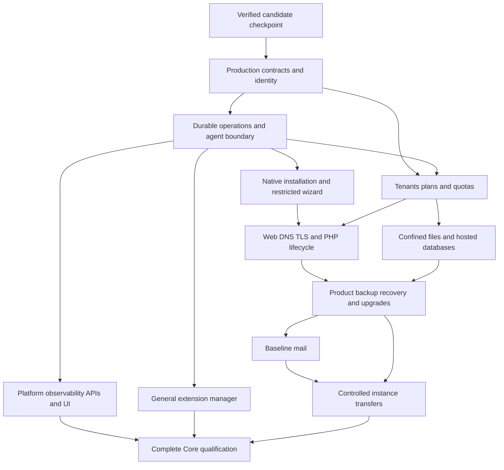

# WCP360 Core delivery roadmap

**Assessment date: 2026-11-01. Estimated completion: approximately 20%; approximately 80% remains. Confidence range: 15–25% complete, or 75–85% remaining. Production release eligibility: not achieved.**

This assessment covers a complete, operable hosting Core: the [233 capabilities in 21 functional domains](CAPABILITY-MAP.md), its thirteen module owners, installation/recovery, essential interfaces, the built-in extension manager and qualification on Debian 12/13 and Ubuntu 22.04/24.04/26.04 LTS. It excludes implementation of the 149 proposed catalog entries, the public website and vendor/internal applications. Optional plugin implementations are separate products; Core must remain operable with none installed.

The estimate is engineering judgment based on inspected source, executable evidence and unfinished work. It measures approximate delivery maturity, including integration and hardening. It is **not** the percentage of capability rows accepted, tests passed, files created, elapsed time or security certification. Scope or weighting changes must be recorded rather than silently increasing progress.

## Evidence and interpretation

The initial runtime assessment below is bound to [source 61adf46](https://github.com/yyogas/wcp360/commit/61adf46e3e29a666c3c0fc462591b7fbd639a85a), on the existing `implementation/core-executable-foundation-20261031` branch, and [workflow 41289487783](https://github.com/yyogas/wcp360/actions/runs/41289487783). Later implementation slices are listed separately; their executed outcomes must be tied to their own source/workflow.

| Evidence | Verified scope | Limit |
| :--- | :--- | :--- |
| 14/14 workflow jobs passed | Five native-package probes, five source-runtime Core journeys, matrix discovery, Panther, FrankenPHP and the Debian integration job. | A green workflow proves its assertions on its exact source; it does not implement absent modules. |
| 133 PHPUnit tests / 805 assertions on each source-runtime target, no skips | Existing candidate application and installer regressions on all five Linux userspaces, using PHP 8.4 and PostgreSQL 17. | Tests are not a count of delivered product capabilities. |
| Native-package probes | Distribution identity, distribution PHP-family admission/refusal and isolated Nginx/FPM behavior. | Distinct from the source-built PHP 8.4 Core path and full host installation. |
| Actual Debian 13 VM reboot | Candidate agent/broker supervision, injected child crashes, recovery, sessions and private hosted application state. | Privileged VM qualification remains Debian 13-specific; no equivalent result is inherited by the other four OS targets. |
| Windows development checks | PHPStan level 8 with Symfony rule regressions, 133 tests / 712 assertions, container/YAML/Twig checks. | Seventeen PostgreSQL, POSIX and terminal cases are skipped locally and exercised in Linux. |

Documentation changes after this assessed runtime revision do not create a new runtime qualification result. Source, test definitions and executed outcomes must stay distinguishable.

Three different states matter:

| Layer | Current state |
| :--- | :--- |
| Executable development foundation | Real Symfony/Twig application, persistent candidate state, controlled Go experiments and automated verification. |
| Complete hosting product | A few implemented vertical paths; most resource lifecycle, policy and operational workflows remain incomplete. |
| Production qualification | Open. The Kernel explicitly refuses production boot; canonical production integration and applicable independent acceptance remain outstanding. |

The current `CODE-BASELINE` remains `NONE`. This planning snapshot does not promote the candidate or replace the applicable Engineering/Security/QA handoffs.

Folders, README files, service-resource reservations and the capability ownership map receive no functional-completion credit by themselves. In particular, the Data, Mail, Files, BackupRestore and Transfers module directories currently contain ownership documentation rather than their complete business implementations. Candidate backup/audit/health helpers elsewhere are credited only to their narrow demonstrated scope.

## How the percentage is estimated

The workstream weights sum to 100. For each row, its estimated contribution is `weight × maturity / 100`. The sum rounds to approximately 20% when reported in five-point increments. Both weights and maturity values are estimates; the 15–25% range is more informative than a decimal result.

Security, failure handling and integration are part of each workstream's unfinished work. The final qualification row adds cross-product evidence; it is not the only place where testing or security work is counted.

| Workstream | Weight | Estimated maturity | Present evidence | Major unfinished work |
| :--- | ---: | ---: | :--- | :--- |
| Runtime architecture, bootstrap and toolchain | 8% | 70% | Kernel, locked dependencies, HTTP/CLI entry points, runtime contexts and static/build checks. | Accepted production integration, service ownership, packaging and deployment topology. |
| IdentityAccess | 9% | 20% | Candidate username login/logout with separate contact email and migrated accounts, optional per-account administrator TOTP, one-time backup codes, fresh-MFA gates, password/MFA reconfirmation, Argon2id, shared current-authority checks, audited tenant access blocks and own-account durable session revocation. | Production MFA/recovery/session integration, password recovery, passkeys, action-bound production reauthentication, canonical policy composition, complete roles/delegation and token lifecycle. |
| Tenancy | 7% | 10% | Enrollment creates distinct account/tenant identities and one scoped membership. | Customer/reseller lifecycle, plans, entitlements, metering and enforceable quotas. |
| Hosting: web, DNS, TLS and PHP | 15% | 20% | Typed `.test` plans, Go rendering, FPM/Worker selection and bounded real hosting experiments. | General site lifecycle, real domains, DNS, ACME/TLS, hosted PHP versions/extensions and safe runtime changes. |
| Mail | 8% | 0% | Ownership and service-resource locations. | Mail domains/mailboxes, SMTP/IMAP, policy, quotas, signing, abuse protection, delivery and diagnostics. |
| Data: hosted databases | 7% | 0% | Control-plane PostgreSQL verification is infrastructure, not hosted database management. | Tenant engines, databases, users/grants, quotas, import/export and revocation. |
| Files | 7% | 0% | Ownership location; agent confinement is not a File Manager. | Confined file operations, uploads/editor/archives/trash, concurrency and authorization. |
| Operations | 8% | 30% | Durable candidate jobs, PostgreSQL claims, idempotency, current-authority rechecks and explicit uncertain outcomes. | General scheduler/outbox, leases/fencing, bounded retries, cancellation, compensation and reconciliation. |
| BackupRestore | 5% | 15% | Restricted candidate PostgreSQL backup/restore and selected logical-state comparison. | Product backup jobs, file/configuration coverage, encryption, retention, selective restore and independent recovery. |
| Transfers | 3% | 0% | Ownership location. | Inventory, compatibility, mapping, synchronization, cutover, recovery and supported external formats. |
| Observability | 4% | 10% | Candidate append-only audit, bounded current-ADMIN metadata inspection and database health check. | Production audit policy/query integration and retention, log queries, metrics/history, alerts, local fallback, incidents and diagnostic bundles. |
| Platform and controlled system integration | 5% | 20% | Strict target/runtime discovery, one revisioned setting and guarded agent/broker experiments. | Production node/service/package/storage/network/SSH/firewall adapters and target-specific qualification. |
| ExtensionManagement | 4% | 20% | Fixed reference-package lifecycle and detached authorized summary; Core survives removal. | General trusted package registry, signatures, dependencies, compatibility, upgrades, supervision and failure containment. |
| Setup, installer and upgrades | 5% | 30% | Read-only host checks, offline candidate artifact verification, private configuration bootstrap, enrollment and restartable checkout preparation. | Native artifact installation, service setup, restricted graphical wizard, supported upgrades and recovery. |
| Integrated product qualification | 5% | 20% | CI, browser/runtime probes and a bounded Debian VM recovery journey. | Full-scope acceptance, independent security review, load/endurance, all-target VM lifecycle and qualified artifact evidence. |
| **Total scope weight** | **100%** | **Approximately 20% overall** | **Verified candidate foundation** | **Approximately 80% of complete-Core delivery remains** |

The candidate status columns in [CAPABILITY-MAP.md](CAPABILITY-MAP.md#capability-by-capability-ownership) provide row-level traceability. A demonstrated candidate row can still require production integration. Do not convert the number of demonstrated or partial rows into this weighted percentage.

## What is already demonstrated

| Delivered candidate path | Source and evidence | Remaining boundary |
| :--- | :--- | :--- |
| Symfony frontend/backend foundation | [Kernel](src/Kernel.php), [configuration](config/README.md), [Twig](templates/README.md), [assets](assets/README.md), locked Composer graph and browser tests. | The complete component library, accessibility/localization and production administration surfaces are unfinished. |
| Local authentication, sessions and tenant authorization | [IdentityAccess](src/Module/IdentityAccess/README.md), [session boundaries](src/Shared/Security/SessionBoundary.php), [session registry](src/Module/IdentityAccess/Application/CandidateSessions.php), [authorization boundary](src/Module/IdentityAccess/Application/CandidateAuthorization.php) and delegated [store](src/Module/Operations/Infrastructure/WorkbenchStore.php). | Only candidate contexts, own-account current-context session control, one tenant permission, explicit blocks and supported forms/routes are covered. |
| Durable plan execution | [Operations](src/Module/Operations/README.md), [hosting use cases](src/Module/Hosting/README.md), fixed Go plan renderer. | Not a general production task engine or authorization model. |
| Guarded hosted PHP | [Agent sources](agents/README.md), [application-server selection](src/Module/Hosting/Application/ApplicationServerPolicy.php), candidate templates and systemd units. | Synthetic applications and explicit disposable-container/VM admission; arbitrary customer deployment is absent. |
| Reference plugin independence | [PluginRegistry](src/Module/ExtensionManagement/Application/PluginRegistry.php), [lifecycle tests](tests/Lifecycle/PluginLifecycleTest.php). | One fixed package, version and candidate capability; no general marketplace installer. |
| Restartable checkout installation | [Recipes](installer/recipes/README.md), [Setup](src/Module/Setup/README.md), [recovery rules](installer/recovery/README.md). | Existing trusted checkout and existing runtimes; no native package/service provisioning. |
| Database recovery rehearsal | [Backup helper](installer/recovery/candidate-backup.sh), [restore helper](installer/recovery/candidate-restore-test.sh), five-target logical restore checks. | Selected candidate database state, not a complete tenant/server backup product. |
| Cross-platform application verification | [Target catalogue](config/platforms/targets.json), [runtime profile](config/platforms/runtime-providers.json), linked workflow. | Five userspaces do not imply five qualified privileged host installers. |

### Native installation preparation after the initial checkpoint

The next executable slice adds [LinuxHostInventory](src/Shared/Platform/LinuxHostInventory.php), [NativeInstallationPlan](src/Module/Setup/Application/NativeInstallationPlan.php) and a [standalone CLI](installer/preflight/native-plan.php). It observes the live OS/architecture, process identity, available memory, free space on `/var`, current-namespace IPv4/IPv6 TCP/UDP bindings and canonical product paths. Optional operator requirements are diagnostic inputs, not production defaults. Known conflicts fail; incomplete observations stay unknown; omitted requirements stay unchecked.

The report remains a candidate handoff with `native_apply_allowed: false`. It provides no canonical execution plan, trusted native runtime provider, artifact-verification chain or registered installation effects. Cgroup budgets, other filesystems, host network topology, DNS/time and service ownership/health remain unchecked. Existing paths are never overwritten. The checkout installer exposes this read-only path through `--host-check`, before journaling or mutations.

[Deterministic plan tests](tests/Unit/NativeInstallationPlanTest.php), [standalone checkout tests](tests/Integration/NativeInstallationPlanTest.php), [parser regressions](tests/Unit/LinuxHostInventoryTest.php) and [real Linux TCP/UDP tests](tests/Integration/LinuxHostInventoryTest.php) define this slice's evidence. Current-source CI outcomes belong to the existing draft PR; the historical numbers above remain the initial checkpoint. This bounded preparation leaves M3 open and does not change the approximately 20% overall estimate or the capability-status counts.

### Offline candidate artifact verification

[CandidateArtifactVerifier](src/Module/Setup/Application/CandidateArtifactVerifier.php), [ArtifactInput](src/Module/Setup/Infrastructure/ArtifactInput.php) and the [standalone artifact command](installer/preflight/artifact.php) add real detached Ed25519 verification over bounded exact manifest bytes. An independently supplied operator key pin and expected component/version/target are mandatory; payload size and SHA-256 are checked through guarded local file handles and streaming reads. The reader rejects unsafe file types, links and Linux ownership/permission conditions without extracting, copying, downloading or installing a package.

This is a candidate metadata format and cryptographic primitive, not an approved release signing scheme or publisher trust chain. No trusted publisher key, revocation/freshness policy, provenance, compatibility decision, archive-content validation or immutable staging/application mechanism is supplied. Verification success does not approve native installation or guarantee later consumption of a path; the native artifact-trust blocker remains closed. Windows checks do not qualify Linux permissions or Windows ACLs.

[Reader tests](tests/Unit/ArtifactInputTest.php), [signature/identity regressions](tests/Unit/CandidateArtifactVerifierTest.php) and [standalone CLI tests](tests/Integration/CandidateArtifactVerifierTest.php) cover this slice. Update verification becomes Partial: **5 demonstrated / 68 partial / 160 planned** capabilities still total 233. M3 and M7 remain open, and the approximately 20% overall estimate is unchanged. Current-source executed outcomes are recorded in the existing PR separately from the initial runtime checkpoint.

### Administrator MFA and second-factor recovery candidate

[IdentityAccess](src/Module/IdentityAccess/README.md#administrator-mfa-candidate) supplies optional per-account TOTP, voluntary enrollment, encrypted seeds, durable replay/attempt controls, ten single-use backup codes and password-confirmed disablement. Password-only accounts can use the Core by default; once MFA is enabled, roles remain withheld until the factor completes. Completion rotates the session and factor revision changes invalidate older proofs. Administrator mutations require exact Origin, CSRF and recent authentication: password when MFA is off, completed MFA when enabled. Identity confirmation repeats the existing login without manual logout. A fresh checkout generates an independent private MFA encryption key; existing operator configuration is preserved and requires the key to be added explicitly.

[Service tests](tests/Integration/CandidateMfaTest.php) and [HTTP journeys](tests/Integration/MfaJourneyTest.php) define this slice's positive/refusal coverage. Current-source CI is tracked in [draft PR #116](https://github.com/yyogas/wcp360/pull/116); this entry makes no unexecuted passing-results claim and leaves the initial checkpoint figures intact. Multifactor authentication, Access recovery and Sensitive-action reauthentication now have Partial status: **5 demonstrated / 71 partial / 157 planned**, still 233 capabilities. The approximately 20% overall estimate is unchanged.

This is second-factor recovery after password authentication, not forgotten-password recovery or an emergency key-loss bypass. Canonical production contracts, complete permissions, Unix identities, PostgreSQL grants, passkeys and the full sensitive-action reauthentication flow remain open. **M1 is not complete.**

### Shared candidate authorization and administrator access blocks

[CandidateAuthorization](src/Module/IdentityAccess/Application/CandidateAuthorization.php) centralizes current authority for the existing `candidate.hosting.plan` permission. Visibility, submission/API checks and worker execution require an active USER account, the exact tenant membership and no matching denial. Other permission names fail closed; an ADMIN context does not imply tenant access. [WorkbenchStore](src/Module/Operations/Infrastructure/WorkbenchStore.php) retains its existing facade and delegates these decisions, so callers do not maintain a second policy.

[CandidatePermissionAdministration](src/Module/IdentityAccess/Application/CandidatePermissionAdministration.php) provides bounded membership listing and idempotent, transactional access blocks, with audit records for actual transitions. Blocks persist independently of membership deletion/regrant. Removing a block does not create a membership or restore an inactive account. The administrator [HTTP surface](src/Module/IdentityAccess/UI/Http/PermissionController.php) requires completed account authentication, with a recent password proof or enabled-MFA proof, exact Origin and an actor/tenant-bound CSRF token for changes. The [CLI check](src/Module/IdentityAccess/UI/Console/CheckAccessCommand.php) is read-only and limited to worker/setup contexts.

Older checkouts must apply [Version20261101000200](migrations/Version20261101000200.php) before the new checks: the migration creates candidate-only denial persistence. [Service regressions](tests/Integration/CandidateAuthorizationTest.php) and [HTTP journeys](tests/Integration/PermissionAdministrationTest.php) define current-state, cross-tenant, block/regrant, audit rollback and browser-boundary coverage. Full current-source CI remains to be executed and recorded in [draft PR #116](https://github.com/yyogas/wcp360/pull/116); neither these test definitions nor the historical checkpoint imply that result.

Action-level permissions, Effective permissions and Revocation and role changes remain **Partial**. Counts stay **5 demonstrated / 71 partial / 157 planned**, totaling 233, and the overall estimate stays approximately 20%. This slice does not implement or grant any of the 82 canonical permissions, positive overrides, role/delegation composition or service-account authority. [AUDIT-WCP-0118](../documentation/governance/audits/AUDIT-WCP-0100/CLOSURE-MATRIX.md#audit-wcp-0118--permission-priority-vs-security-intersection) remains open; its owner decisions and accepted contracts remain authoritative. Canonical production integration and Unix/PostgreSQL identity separation are still required. **M1 remains open.**

### Own-account candidate session inventory and durable revocation

[CandidateSessions](src/Module/IdentityAccess/Application/CandidateSessions.php) and [SessionBoundary](src/Shared/Security/SessionBoundary.php) add separate durable USER/ADMIN registries. Each registration binds the actual final rotated Symfony session identifier through a SHA-256 value; the database, audit and views never receive the raw identifier. Symfony's native server-side files still hold the session payload. This is a candidate revocation registry, not canonical `wcp_iam` session storage or separate production database grants.

Primary authentication registers only an active account in the correct context. Password-only ADMIN is active at strength 1 while MFA is off. Enabled-factor login and voluntary enrollment remain pending at strength 1 until MFA upgrades the same row to strength 2 using compare-and-swap after rotation. Its original absolute deadline is preserved. The existing lifetime policy is unchanged: USER idle/absolute limits are 30 minutes/12 hours; ADMIN limits are 15 minutes/8 hours. Registry checks run before the firewall, before unsafe controller execution and before MFA attempts; POST logout durably retires the bound registration before local session clearing.

The [session page](src/Module/IdentityAccess/UI/Http/SessionController.php) lists only the account's current-context sessions, 100 per page with pages bounded to 1–10,000. Single/all-session revocation requires exact Origin, a target-specific CSRF intent and current-password confirmation; administrators also require recent password authentication, or completed fresh MFA when enabled. A durable per-session budget allows five total password confirmations in 15 minutes, consumed before hashing; the sixth request returns 429. MFA rotation retains that budget. Changes and audit records commit atomically, and concurrent activity/revocation keeps timestamps monotonic. Revocation gates subsequent requests and the implemented mutation/MFA boundaries; it does not stop work already dispatched or supply general channel/effect fencing.

Older checkouts must apply [Version20261101000300](migrations/Version20261101000300.php) before use, then **sign in again**. Existing cookies are deliberately not adopted. [Service regressions](tests/Integration/CandidateSessionsTest.php) and [HTTP journeys](tests/Integration/SessionJourneyTest.php) define positive/refusal, owner/context, lifetime, concurrent timestamp, revocation, logout and restart coverage. Exact-source execution for this slice remains to be recorded in [draft PR #116](https://github.com/yyogas/wcp360/pull/116); historical totals above are unchanged.

Session management and Revocation and role changes remain **Partial**. Counts stay **5 demonstrated / 71 partial / 157 planned**, totaling 233; the overall estimate remains approximately 20%. Canonical roles/permissions and session contracts, password recovery, passkeys, service accounts, Unix identities, PostgreSQL grants and production qualification remain outstanding. **M1 remains open and `CODE-BASELINE` remains `NONE`.**

### Session inventory authentication details and persistence boundary

The own-account session page now shows the factors actually completed for each session: password or password plus MFA. Its active/pending display uses the current administrator account setting, resolved by the authenticated [HTTP controller](src/Module/IdentityAccess/UI/Http/SessionController.php). A query parameter cannot select a weaker display policy. Revoked/expired states retain precedence, and the admission boundary independently enforces the account's actual required strength.

The generic [session registry](src/Module/IdentityAccess/Application/CandidateSessions.php) reads only account/session data; it no longer reads MFA secrets. This corrects the PostgreSQL permission failure exposed by [workflow 41329513630](https://github.com/yyogas/wcp360/actions/runs/41329513630) on source `5600b0b`. The [PostgreSQL regression](tests/Integration/CandidatePostgresGrantsTest.php) explicitly denies the session-only role MFA-table reads, while checking listing under both display policies; its grants are unchanged. [HTTP journeys](tests/Integration/SessionJourneyTest.php) cover password-only, completed-MFA and pending displays without disclosing raw session identifiers or verifiers. [Panther](tests/Browser/AdministratorIdentityJourneyTest.php) checks the rendered factors in the real browser.

Exact-source test results must be recorded in [draft PR #116](https://github.com/yyogas/wcp360/pull/116). Windows skips do not qualify PostgreSQL grants. This incremental session improvement leaves M1 open, `CODE-BASELINE` at `NONE`, the estimate at approximately 20% and the capability counts at **5 demonstrated / 71 partial / 157 planned**.

### Read-only runtime identity inspection

[RuntimeIdentity](src/Shared/Platform/RuntimeIdentity.php) and its [standalone preflight](installer/preflight/README.md#runtime-identity-inspection) compare actual Linux calling-thread credentials with the fixed identity names from Security section 4. All real/effective/saved/filesystem UID/GID values, actual supplementary groups, canonical mapping separation and recognized no-login service accounts are checked. Conservative process checks require `NoNewPrivs=1` and empty active/potential capability sets for non-root profiles; the bounding set and root broker capability confinement are not qualified.

The diagnostic is read-only and independent of Symfony configuration. Missing mappings, wrong identities and incomplete kernel data cannot pass. Matching a profile grants no authority: runtime admission, service-context validation, filesystem access, PostgreSQL grants and minimal-root qualification remain explicitly unverified. It creates no Unix account, starts no service, changes no grant and does not bypass production boot refusal. Positive policy fixtures do not prove that canonical identities are installed on the five CI targets.

[Unit](tests/Unit/RuntimeIdentityTest.php) and [standalone/live Linux](tests/Integration/RuntimeIdentityTest.php) tests define the scope; current-source results belong to [draft PR #116](https://github.com/yyogas/wcp360/pull/116). Next, implement and qualify explicit runtime packaging and separate PostgreSQL credentials with negative cross-surface privilege tests. Accepted permission-composition decisions remain prerequisites for the general evaluator; AUDIT-WCP-0118 stays open. **M1 remains open**, `CODE-BASELINE` remains `NONE`, and the approximately 20% estimate and **5 demonstrated / 71 partial / 157 planned** capability counts remain unchanged.

### Candidate database profiles and session-grant admission

The project name remains **WCP360**; **WCP360 Standalone** identifies the hosting panel installed on the server, and **WCP360 Core** identifies its engine. This terminology does not change namespaces or directory ownership.

The opt-in [database profiles](config/contexts/DATABASE-PROFILES.md) select one context-specific PostgreSQL URL without reading other runtime credentials or falling back to `DATABASE_URL`. A [DBAL middleware](src/Shared/Security/CandidateDatabaseMiddleware.php) checks new USER/ADMIN/worker connections before application queries. Effective privilege checks require own-session CRUD for web contexts, prohibit all direct table/column access to the opposite session registry, and prohibit both registries for workers. Elevated roles, role memberships, public-schema creation, non-PostgreSQL-17 connections and missing session tables are rejected. Opposite-table MAINTAIN is included, and an explicit final `pg_temp` search-path entry prevents temporary objects from shadowing public identity/session tables. Setup uses a separate maintenance URL and deliberately bypasses the application-role gate.

[Configuration and middleware regressions](tests/Unit/CandidateDatabaseMiddlewareTest.php), [actual Symfony wiring](tests/Integration/CandidateDatabaseConfigurationTest.php) and [real PostgreSQL role tests](tests/Integration/CandidatePostgresGrantsTest.php) define this slice. Exact-source results must be recorded in [draft PR #116](https://github.com/yyogas/wcp360/pull/116); definitions alone do not establish passing outcomes.

The default shared development profile is unchanged. No native role/grant provisioning, canonical `wcp_iam` integration, full non-session grant policy, security-definer/view audit, live-connection privilege-drift fence or Unix/filesystem admission is implemented by this slice. Those remain production prerequisites. **M1 remains open**, `CODE-BASELINE` remains `NONE`, and the approximately 20% estimate and **5 demonstrated / 71 partial / 157 planned** capability counts remain unchanged.

### Fresh candidate PostgreSQL role provisioning

The [setup-only role recipe](installer/recipes/CANDIDATE-DATABASE-ROLES.md) adds a read-only plan and explicitly enabled one-time creation for the two reviewed disposable development databases. A [single policy](src/Module/Setup/Infrastructure/CandidateDatabasePolicy.php) describes direct grants over 16 current candidate tables. USER and ADMIN keep separate session registries; only ADMIN receives MFA persistence, only workers publish job outcomes, and all runtime audit grants are INSERT-only. This is candidate service-role policy, not canonical permissions or one database login per human user.

[Version20261101000400](migrations/Version20261101000400.php) adds immutable-zero row-lock markers to users, tenants and sites. UPDATE on those constrained markers permits existing PostgreSQL row-locking reads without UPDATE on identity, password or active-state columns. The [provider](src/Module/Setup/Infrastructure/CandidateDatabaseRoles.php) requires the validated constraints, a complete owned candidate schema and fresh role names. It refuses canonical/reserved schemas, unknown relations, existing caller transactions, concurrent provisioning and unexpected effective privileges, including PUBLIC column grants.

Explicit application creates SCRAM-protected NOLOGIN roles, grants and checks rights, enables LOGIN and appends a credential-free audit event in one transaction. Pre-commit failures roll back; uncertain commit/rollback invalidates the connection and requires inspection rather than automatic retry or role repair. Private passwords/verifiers are absent from command JSON and application SQL profiling. Server-side logging, cross-database PUBLIC privileges and HBA confinement remain independent requirements.

[Unit/CLI regressions](tests/Unit/CandidateDatabasePolicyTest.php), [RFC authentication-vector tests](tests/Unit/PostgresScramTest.php) and [real PostgreSQL journeys](tests/Integration/CandidateDatabaseRolesTest.php) define this slice. Exact-source execution results must be retained in [PR #116](https://github.com/yyogas/wcp360/pull/116); test definitions alone are not passing evidence. Native identity/role provisioning, secret distribution, production IAM and permission composition, password recovery, maintenance retirement and full effect/drift fencing remain unfinished. **M1 remains open**; `CODE-BASELINE=NONE`, the approximately **20%** estimate and **5 Demonstrated / 71 Partial / 157 Planned** capability counts are unchanged.

### Administrator identity reconfirmation

The [confirmation form](src/Module/IdentityAccess/UI/Http/ReauthenticationController.php) reuses the existing Symfony password authenticator and account-enabled MFA provider. Fully authenticated administrators can reach it from navigation or account security after their fresh proof expires, without first logging out. A GET never renews the proof. Wrong credentials produce generic accessible feedback while preserving the old session; valid credentials retire it and create a fresh password-only registration when MFA is off, or an MFA-pending registration when enabled. MFA completion requires a new accepted factor, rotates the session and retains that pending registration's original deadline.

[HTTP regressions](tests/Integration/MfaJourneyTest.php) cover anonymous, pending-admin and USER refusal, no renewal on GET, wrong password/CSRF/Origin, TOTP replay, revoked-pending refusal and explicit retry after completed MFA. The [actual PostgreSQL role journey](tests/Integration/CandidateDatabaseRolesTest.php) also exercises reconfirmation with the provisioned ADMIN credentials; it remains a Linux/PostgreSQL check, not a local SQLite result. Exact-source execution is tracked in [PR #116](https://github.com/yyogas/wcp360/pull/116).

Real-browser verification also covers Turbo form submission with the unchanged `no-referrer` and exact-Origin requirements. Enrollment and one-time recovery-code responses use the shared authentication frame; full login/logout and account mutations use the full-page target. No submitted action or arbitrary return URL is replayed. This candidate full sign-in replacement leaves forgotten-password recovery, action-bound production confirmation and canonical identity/session acceptance open. **M1 remains open**, `CODE-BASELINE=NONE`, the approximately **20%** estimate and **5 Demonstrated / 71 Partial / 157 Planned** capability counts are unchanged.

### Optional MFA and shared password confirmation

The current product decision makes MFA optional per administrator account and disabled by default. Password-only accounts retain full authorized Core use with a recent-password gate; account security offers voluntary setup and confirmed disablement. Enabled factors still require their second factor at login. Interrupted or cancelled setup never activates a factor, and missing encryption configuration cannot bypass an enabled one.

[CurrentPasswordConfirmation](src/Module/IdentityAccess/Infrastructure/CurrentPasswordConfirmation.php) now shares Origin, CSRF, current-password verification and the durable five-attempt budget across MFA settings and own-session revocation. [HTTP journeys](tests/Integration/MfaJourneyTest.php) and [Panther](tests/Browser/AdministratorIdentityJourneyTest.php) cover both authentication modes and the optional lifecycle. No schema migration or new dependency is introduced.

The external canonical baseline still describes mandatory ADMIN MFA. Reconciliation with this explicit product decision remains M1 work; canonical documents and production acceptance are not silently changed. **M1 remains open**, the approximately **20%** estimate and **5 Demonstrated / 71 Partial / 157 Planned** capability counts remain unchanged.

### Authenticated own-account password changes

The [password-change service](src/Module/IdentityAccess/Application/ChangeOwnPassword.php) and [USER/ADMIN form](templates/identity/password.html.twig) add authenticated credential replacement in the shared-database candidate. They reuse current-password confirmation and its durable budget, check exact Origin/CSRF, compare the previously confirmed verifier against current state and recheck session/factor authority under the account lock. Password replacement, all own-context session revocations and audit commit together. Enabled MFA remains enabled. [Service](tests/Integration/ChangeOwnPasswordTest.php) and [HTTP](tests/Integration/PasswordJourneyTest.php) regressions cover stale state, rollback, cross-account isolation and refusal paths; exact-source outcomes remain in the draft PR.

The isolated PostgreSQL candidate now uses two fixed, surface-bound password operations with atomic revocation/audit; direct credential writes remain denied. Fresh role creation and an explicit existing-role capability upgrade verify code, owner, configuration and ACLs before granting the matching operation. Roles and table grants remain unchanged by an upgrade. [Real PostgreSQL regressions](tests/Integration/CandidateDatabaseRolesTest.php) define isolation, refusal, rollback and upgrade evidence. Canonical acceptance of this credential boundary, forgotten-password recovery, token lifecycle and production integration remain unfinished. **M1 remains open**; the approximately **20%** estimate and **5 Demonstrated / 71 Partial / 157 Planned** capability counts are unchanged.

### Operator-assisted account recovery

The [setup recovery command](installer/recovery/ACCOUNT-PASSWORD.md) adds a read-only account plan and explicitly enabled interactive password reset for an active USER or ADMIN account. The inspected ID/username/surface are bound across prompts, a conditional write refuses concurrent credential changes, and replacement, own-context session revocation and audit commit together. The command preserves MFA and backup codes; it does not reactivate accounts or supply an MFA bypass. Real runtime PostgreSQL identities cannot masquerade as maintenance by changing the application context.

[Service and CLI regressions](tests/Integration/RecoverAccountPasswordTest.php) and [PostgreSQL refusals](tests/Integration/CandidateDatabaseRolesTest.php) are prepared for the existing GitHub CI. Exact-source results are pending CI; earlier passing results are not inherited. Self-service email/token recovery and production identity/operator integration remain open. **M1 remains open**, with the approximately **20%** estimate and **5 Demonstrated / 71 Partial / 157 Planned** counts unchanged.

### Short-lived recovery codes and owner redemption

The [recovery-code candidate](installer/recovery/RECOVERY-CODES.md) adds explicitly confirmed setup issuance and a USER/ADMIN `/reset-password` page in the shared database profile. Independent per-surface keys bind codes to current account state for fifteen minutes. Password replacement, old-session revocation and audit commit together; the verifier change invalidates all codes from the previous credential state. The owner then uses normal login and any enabled MFA. The maintenance guard is shared with direct operator recovery.

[Unit, service and HTTP sources](installer/recovery/RECOVERY-CODES.md#verification-and-remaining-work) define the current CI scope; no local executable verification is claimed. Email request/delivery and notifications, per-code inventory/revocation, isolated redemption and accepted production contracts remain unfinished. **M1 remains open**; the approximately **20%** estimate and **5 Demonstrated / 71 Partial / 157 Planned** counts are unchanged.

### MFA backup-code renewal

The [backup-code renewal candidate](src/Module/IdentityAccess/README.md#renewing-mfa-backup-codes) adds a password-confirmed action for an enabled administrator factor. Fresh MFA and a bound strength-two session are rechecked under the current account lock. Ten replacement code HMACs, an incremented factor revision, all own ADMIN session revocations and mandatory audit commit together; the authenticator and replay/attempt budgets are preserved. The one-time response is returned only after commit and signs the browser out. Existing session-isolated ADMIN grants suffice.

Service, HTTP and real PostgreSQL definitions cover expiry, stale credentials/revision, caller transactions, rollback, Origin/CSRF, confirmation throttling and disclosure boundaries. Executed outcomes belong to their exact source/workflow in draft PR #116; no local executable tests are run. **M1 remains open**, overall completion stays approximately **20%**, and capability counts remain **5 demonstrated / 71 partial / 157 planned**.

### Shared request references and safe HTTP errors — 2026-11-02

The [shared HTTP boundary](src/Shared/Http/README.md) adds a fresh server-generated request reference, fixed error-code/message mapping, a consistent error envelope for existing workbench APIs and branded browser error pages. Browser login/challenge redirects stay browser flows; anonymous, revoked and pending-factor API requests receive JSON refusals after the existing security boundary. Typed idempotency conflicts preserve their meaning without parsing arbitrary exception messages. The credential-specific listener delegates to the same responder, and template/logging failures have bounded fallbacks.

No dependency, schema, database grant or authorization expansion is introduced. Tests define transport selection, reference isolation, safe headers, disclosure, authentication/surface/tenant/CSRF refusals, idempotency, audit rollback and pending-factor behavior. Exact-source execution belongs to draft PR #116; local executable checks remain stopped by user instruction. Full canonical API/permission/audit correlation, durable log routing, production integration and independent acceptance remain open. **M1 remains open; approximately 20% overall and capability counts are unchanged.**

### Filtered hosting-job history — 2026-11-02

The [Operations job inventory](src/Module/Operations/README.md#filtered-hosting-job-inventory) adds USER browser/API history with tenant, state and hostname filters, bounded page sizes and bidirectional keyset navigation. It reuses the current authorization rule in every row/pivot query and the legacy dashboard/plugin projection. Candidate read/UI validation advances M1 and the bounded M2 task-center slice; it does not implement a general scheduler, cancellation or production permission contracts.

Regression definitions cover tied timestamps, inserts between pages, history beyond 100 rows, filter/cursor rejection, tenant separation, revocation, escaping, minimal projections, unchanged business state and existing restricted PostgreSQL grants. Exact-source results belong to draft PR #116; no local executable tests run. **M1 remains open, approximately 20% overall; capability counts unchanged.**

### Durable request correlation for hosting-plan execution

[RequestId](src/Shared/Correlation/RequestId.php) shares bounded server-generated references between HTTP and the hosting-plan use case. The first accepted submission stores its reference with the job and queued audit occurrence in the same transaction. A reconstructed worker reads that durable origin for started, succeeded, failed and interrupted occurrences. Idempotent retries keep the first origin and do not append another queued occurrence; non-HTTP submissions generate a reference when omitted. References never grant resource authority.

[Version20261102000100](migrations/Version20261102000100.php) adds nullable, format-constrained job/audit metadata and an audit lookup index without rewriting historical rows or widening database grants. The authorized task detail displays the creation reference separately from the current HTTP response header. [Service](tests/Integration/PlanCorrelationTest.php), [HTTP](tests/Integration/PlanCorrelationJourneyTest.php), [schema-upgrade](tests/Integration/PlanCorrelationSchemaTest.php) and [restricted-role](tests/Integration/CandidateDatabaseRolesTest.php) definitions cover this slice; exact-source execution belongs to draft PR #116. Local executable tests remain stopped. This does not provide cross-resource correlation, an audit-query product, IPC propagation or a distributed trace. M1 remains open; approximately 20% overall and capability counts remain unchanged.

### Atomic hosting-plan transitions and bounded interruption recovery

[HostingPlanQueue](src/Module/Operations/Infrastructure/HostingPlanQueue.php) now owns the fixed candidate claim, publication and interruption transactions. [RunHostingPlan](src/Module/Operations/Application/RunHostingPlan.php) orchestrates authorization and Go rendering after the durable claim commits. Transactions supplied by a caller are refused rather than treating an uncommitted claim as durable intent.

Claims/recovery use PostgreSQL row locks with SKIP LOCKED; transitions and audit depend on an actual compare-and-set update. Recovery processes at most 100 running plans per call and returns the number changed. A stale publication cannot overwrite a terminal/uncertain state. Access revocation observed before publication discards the rendered result and commits a failed outcome; infrastructure/audit errors still roll back. This does not close the general in-flight revocation race or introduce leases, retries or privileged effects.

[Transition definitions](tests/Integration/HostingPlanQueueTest.php), [real overlapping PostgreSQL transactions](tests/Integration/HostingPlanQueueConcurrencyTest.php) and [restricted-role checks](tests/Integration/CandidateDatabaseRolesTest.php) cover the slice. Exact-source outcomes belong to draft PR #116; local executable tests remain stopped. Operators must stop all rendering workers before interruption maintenance; a zero count can still leave locked rows. M1/M2 remain open, approximately 20% overall, with unchanged capability counts.

### Prepared-site inventory and shared list components

[Prepared-site inventory](src/Module/Hosting/Application/ListPreparedSites.php) now provides USER browser/API reads with existing tenant authority, preparation/runtime/hostname filters, bounded bidirectional cursors and deterministic domain ordering. The page links each domain to its filtered task history and reuses the WCP360 layout. It reports prepared configuration, not deployed-service health.

[Shared list bounds](src/Shared/Http/TenantPageQuery.php) now serve both job/site queries, and a [shared pagination component](templates/components/data/cursor-pagination.html.twig) serves both views. Owner filters/projections remain explicit; no arbitrary SQL/query executor, new permission, grant, migration or dependency is added. [Service definitions](tests/Integration/ListPreparedSitesTest.php), [HTTP journeys](tests/Integration/SiteListJourneyTest.php) and [restricted-role checks](tests/Integration/CandidateDatabaseRolesTest.php) cover the new surface; existing job regressions cover compatibility. Exact-source results remain in draft PR #116 and local executable tests stay stopped.

Resource inventory remains Partial; general resource/domain/DNS lifecycle and production integration remain unfinished. M1/M4/M5 stay open; approximately 20% overall and 5 Demonstrated / 71 Partial / 157 Planned are unchanged.

### Prepared-plan file inspection and bounded downloads

[PreparedPlanDocument](src/Module/Hosting/Domain/PreparedPlanDocument.php) now centralizes the existing FPM/Worker document shape for both Go rendering and stored-plan inspection, with UTF-8/control/content/envelope bounds. [PreparedPlanFiles](src/Module/Hosting/Application/PreparedPlanFiles.php) rechecks current tenant authority and exposes only fixed artifacts from successful plans. The task detail shows escaped individual configuration previews and native attachment links; corrupt successful output is unavailable rather than displayed as raw JSON.

The download route accepts only nginx/php-fpm/caddy/systemd artifacts, uses fixed ASCII filenames and bounded in-memory text/plain responses with attachment/no-store/nosniff headers. No server file is read/written, no activation is dispatched and no syntax/trust/production qualification is inferred. Existing activation gates remain separate. [Document](tests/Unit/PreparedPlanDocumentTest.php), [service](tests/Integration/PreparedPlanFilesTest.php), [HTTP](tests/Integration/PlanDownloadJourneyTest.php) and [restricted-role](tests/Integration/CandidateDatabaseRolesTest.php) definitions cover this slice; source-bound execution belongs to draft PR #116. Local executable tests remain stopped.

M1/M5 stay open, approximately 20% overall and capability counts unchanged. General file management, configuration editing/apply, signing and hosted-service lifecycle remain unfinished.

### Administrator audit metadata inspection

[Observability](src/Module/Observability/README.md) now implements bounded current-ADMIN audit inspection, exact event/actor/tenant/resource/request/date filters, two-way cursor navigation and escaped WCP360 browser/API presentation. A shared cursor transport parser serves audit, job and site queries; the active-administrator predicate is shared with existing authorization. Every page/pivot/boundary read carries current admin scope and admission is rechecked before return. No account/configuration payload or arbitrary log query is exposed.

The default candidate PostgreSQL grants remain unchanged. A separate explicit setup-only `--audit-reads` action can add fixed ADMIN SELECT, with verified role/grant admission, the existing transaction/advisory/time limits, mandatory transition audit and rollback. USER/worker audit reads and audit mutation grants remain refused; existing credentials and role identities are preserved. Missing opt-in is unavailable, never a maintenance-credential fallback. [Query](tests/Unit/AuditListQueryTest.php), [repository](tests/Integration/ListAuditEventsTest.php), [HTTP](tests/Integration/AuditJourneyTest.php), [role](tests/Integration/CandidateDatabaseRolesTest.php) and [command](tests/Integration/CandidateDatabaseRolesCommandTest.php) definitions must be qualified on their own source in draft PR #116. Local executable tests stay stopped.

M1/M2/M9 remain open, approximately 20% overall and capability counts unchanged. Production audit permissions, retention, log access, indexing/large-volume qualification, metrics and alerts remain unfinished.

### Root server administration and read-only capacity view

The ADMIN surface is clarified as the [server root administrator](src/Module/IdentityAccess/README.md#server-root-administrator), presented as ROOT while retaining existing internal context/role/session identities. The current Core login credential remains separate from Linux root authentication; no PAM/SSH linkage, UID change, credential synchronization or automatic account rename is implemented.

The [server overview](src/Module/Platform/README.md#root-server-overview) adds authenticated browser/API inspection of recognized OS, architecture, nullable memory and `/var` capacity. Existing bounded inventory parsers are reused with network-table reads skipped; release/catalogue reads are bounded before parsing. Current ADMIN authority is checked before collection and before publication. USER accounts, including a username `root`, cannot read server observations. Windows/unavailable measurements stay unknown; the process-namespace view does not prove host capacity, cgroup budgets, service health or effect authority.

[Service](tests/Integration/ServerOverviewTest.php), [HTTP/MFA](tests/Integration/ServerJourneyTest.php), [restricted-role](tests/Integration/CandidateDatabaseRolesTest.php) and platform definitions cover refusal, racing revocation, optional/enabled MFA, projection, unknown/zero measurements, escaping, bounded files, methods and default grants. Exact-source CI belongs to draft PR #116. Local executable checks remain stopped. M1/M9 stay open; approximately 20% and capability counts unchanged.

### ROOT hosting account inventory and selected access workflow

[IdentityAccess](src/Module/IdentityAccess/README.md#root-hosting-account-inventory) now exposes a bounded ROOT-only USER login inventory through browser/API, with username fragment and active-flag filters, literal underscore matching, shared cursor transport, stable ASCII ordering and fixed credential-free projection. Current ROOT scope accompanies every read and is rechecked before publication. Inactive/membership-free identities remain visible; ADMIN identities and unauthorized USER callers remain excluded.

The account table opens the existing permission workflow for one selected USER. Selection survives membership pagination and block/unblock redirects. Invalid selection/navigation refuses before effects; fixed same-target navigation does not confer authority. Existing Origin/CSRF/fresh-proof/locked-transaction/audit gates and unfiltered behavior remain. No new privilege, schema, migration, dependency, account creation/activation/deletion or Unix identity change is added.

[Query](tests/Unit/UserListQueryTest.php), [repository](tests/Integration/ListHostingUsersTest.php), [HTTP workflow](tests/Integration/UserListJourneyTest.php) and [restricted-role](tests/Integration/CandidateDatabaseRolesTest.php) definitions cover refusal, current/racing revocation, projection, cursors, live changes, SQLite, selection and write navigation. Execution must be bound to the current source in draft PR #116; local executable checks stay stopped. M1/M4 remain open, approximately 20% overall and capability counts unchanged.

### Own-account revocation of other sessions — 2026-11-02

The [session page](src/Module/IdentityAccess/README.md#disconnecting-other-sessions) now offers a password-confirmed action for USER and ROOT that retains the current browser registration. It uses the existing Origin/CSRF/confirmation budget, rejects request-selected accounts/retained sessions/return URLs and rechecks the current credential snapshot, bound registration and optional-enabled MFA policy under the account lock. A single account-scoped update covers all other unrevoked registrations, including pending/expired rows beyond the displayed page; a mandatory aggregate audit event commits with it. No-op repeats create no extra mutation event, and subsequent logins remain possible.

The use case owns its transaction, bounds PostgreSQL lock/statement waits, refuses stale authority and returns redacted errors on audit/connection failure. Shared and session-isolated profiles use the existing grants; no schema, migration, dependency, opposite-surface access or Linux identity change is introduced. Single/global revocation behavior remains unchanged.

[Service](tests/Integration/RevokeOtherSessionsTest.php), [HTTP](tests/Integration/SessionJourneyTest.php) and [restricted-role](tests/Integration/CandidateDatabaseRolesTest.php) definitions cover optional/enabled MFA, privacy, retained/foreign/revoked/expired bindings, current-credential drift, shared confirmation budgets, audit rollback, restart persistence, SQLite and grants. Exact-source execution belongs to draft PR #116; local executable checks remain stopped. The preceding source `1a6dbd4` completed [workflow 41375595577](https://github.com/yyogas/wcp360/actions/runs/41375595577): 14 successful jobs, 810 tests / 8,972 assertions / two nonblocking PHPUnit notices and the actual Debian VM reboot. These are historical results for that source, not execution evidence for this increment. M1 remains open, `CODE-BASELINE=NONE`, approximately 20% overall and **5 Demonstrated / 71 Partial / 157 Planned** unchanged.

### ROOT global runtime settings workflow — 2026-11-02

The dedicated [runtime settings page](src/Module/Platform/README.md#root-global-runtime-settings) and cookie/CSRF-authenticated browser API reuse the existing application-server policy and one transactional writer. ROOT can inspect the stored PHP-FPM / FrankenPHP Worker default, revision and Worker-planning availability. Explicit browser feedback handles stale edits with HTTP 409 and current values; the previous dashboard route/CSRF/redirect remain compatible. The sidebar and command palette now link the dedicated page.

Both transports check current ROOT authority and preserve optional/enabled MFA and fresh-proof requirements. JSON/body/query/navigation input is bounded or allowlisted, and write audits carry the shared server-generated request reference. Existing sites and the panel runtime are unchanged. No schema, dependency, grant, privileged operation, service restart, automatic replay or general settings hierarchy is added.

[Service](tests/Integration/RuntimeSettingsTest.php), [HTTP](tests/Integration/RuntimeSettingsJourneyTest.php) and [restricted-role](tests/Integration/CandidateDatabaseRolesTest.php) definitions add 20 cases covering access/refusal, current/racing revocation, fixed projection, read privacy, Origin/CSRF, optional/enabled MFA, freshness, revisions, correlation, audit rollback, SQLite and unchanged grants. Existing dashboard/inheritance cases remain. Exact-source execution belongs to draft PR #116; local executable tests remain stopped. M1/M9 stay open, `CODE-BASELINE=NONE`, approximately 20% overall and **5 Demonstrated / 71 Partial / 157 Planned** unchanged.

### Explicit hosting-stack profiles — 2026-11-02

One [shared catalogue](src/Shared/Platform/WebStackCatalogue.php) now distinguishes Classic Nginx/PHP-FPM (default), standalone Modern Caddy/FrankenPHP Worker, Apache Legacy and Advanced reverse-proxy composition. Existing Worker rendering is correctly labelled Advanced Nginx → Caddy/FrankenPHP, preserving stored engines and plan/2. Modern/Legacy remain unavailable, and a planning opt-in cannot enable missing drivers. Complete multi-PHP, native stack installation and migration remain unimplemented.

Installer inspection, ROOT settings/API and the hosting form reuse the catalogue. Explicit CLI selection refuses unsupported/unknown profiles and missing Worker opt-in without fallback or host effects; no-argument runtime inspection remains compatible. Only existing engine values are submitted. ROOT/API authority, optional/enabled MFA, HEAD/no-store and strict query/method refusals remain. A future direct driver needs its own persisted/versioned plan, Go templates, listener/TLS ownership, isolated identities, drain, health and recovery, rather than treating Caddy features as already enabled.

[Catalogue/CLI](tests/Unit/WebStackCatalogueTest.php), [shell integration](tests/Integration/WebStackInstallerTest.php), [browser/API](tests/Integration/WebStackJourneyTest.php) and existing [restricted-role](tests/Integration/CandidateDatabaseRolesTest.php) definitions cover the increment; exact-source CI belongs to draft PR #116. Local executable checks stay stopped. Parent source `e37f216` completed [workflow 41379172595](https://github.com/yyogas/wcp360/actions/runs/41379172595) with 14 successful jobs, 849 tests / 9,452 assertions / two nonblocking PHPUnit notices and actual Debian VM reboot; these are parent results, not evidence for the new source. M1/M3/M5/M9 remain open, `CODE-BASELINE=NONE`, approximately 20% and capability counts unchanged.

## Standalone Modern preview — 2026-11-02

A separate Go driver emits `wcp360.candidate.plan/3`: explicit Modern/Worker markers, one Caddyfile and one non-root systemd unit, without Nginx or PHP-FPM. Existing plan/1 Classic and plan/2 Advanced contracts, stored engine values, consumers and exports retain their meaning; their decoder rejects plan/3. Shared envelope/string bounds avoid duplicating document validation, and a shared candidate hostname policy preserves the existing ASCII `.test` boundary.

ROOT settings now offer a browser form and `POST /workbench/v1/web-stacks/modern-preview`. Operator Worker-planning opt-in, application compatibility acknowledgement, current ROOT checks before/after rendering, fresh authentication, optional/enabled MFA, exact Origin and a dedicated CSRF intent guard this inert preview. Input cannot select an actor, tenant, real site, path, listener or apply action. A new synthetic UUIDv7 identifies each preview; fixed `127.0.0.1:8082` HTTP is explicitly unreserved and limited to one demonstrative site. The child process uses a fixed binary, scrubbed environment, five-second timeout and bounded output. Errors are redacted, output is escaped and responses are private/no-store.

No site, job, activation, default or audit row is written. Existing restricted ROOT identity-read grants suffice. The catalogue still refuses Modern as a durable hosting-plan choice and native installation; neither public TLS/ACME/HTTP3 nor multi-site listener allocation, persisted topology/revision, migration, deployment, drain, health or recovery is implemented. Apache Legacy and complete multi-PHP remain outstanding.

[Document bounds](tests/Unit/ModernPlanDocumentTest.php), [Go/service separation](tests/Integration/ModernPlanPreviewTest.php), [ROOT browser/API journeys](tests/Integration/ModernPreviewJourneyTest.php), [restricted PostgreSQL roles](tests/Integration/CandidateDatabaseRolesTest.php) and the [Go driver/CLI cases](agents/wcpd/candidate/planner/modern_test.go) define this increment's checks. Local executable tests remain stopped; current-source executed results belong to [draft PR #116](https://github.com/yyogas/wcp360/pull/116). Parent `947fee1` completed [workflow 41381712168](https://github.com/yyogas/wcp360/actions/runs/41381712168) with all 14 jobs successful, 876 tests / 9,987 assertions and two nonblocking PHPUnit notices, including the Debian VM/reboot journey. Those are parent results, not a passing claim for this increment. M1/M3/M5/M9 remain open, `CODE-BASELINE=NONE`, approximately 20% and capability counts unchanged.

## Persisted site topology prerequisite — 2026-11-02

[Version20261102000200](migrations/Version20261102000200.php) adds explicit `web_stack` and `stack_revision=1` metadata to candidate sites. It backfills PHP-FPM as Classic and existing Worker assignments as Advanced without rewriting jobs, results, fingerprints, audit, IDs or lifecycle revisions. PostgreSQL NOT NULL/CHECK constraints and SQLite validation triggers enforce the same supported pairs. There is no implicit stack default, table rebuild, foreign-key disabling, new table, grant or database routine. A lossy automatic down-migration is refused; apply through tracked setup maintenance with verified backup/recovery and writers stopped.

The [typed profile](src/Module/Hosting/Domain/SiteRuntimeProfile.php) is shared by submission, rendering, exports and isolated Classic activation. Submission derives supported metadata from the existing engine and rejects caller-owned profile/revision fields. Rendering captures the profile before Go; publication compares the current site under a row lock inside the existing transaction. Observed invalid/changed metadata discards output and commits the existing correlated FAILED outcome. Current authority checks and normal site lifecycle revisions remain; public API projections and plan/1–3 envelopes are unchanged.

This records the existing topology; it does not switch stacks, increment assignment revisions or create immutable per-job topology history. Future switching must snapshot/fence job intent and own listener/TLS allocation, compatibility, drain, deployment, health and recovery. Durable Modern selection, native activation, Apache Legacy and complete multi-PHP remain unavailable. The global default, opt-in policy, optional/enabled MFA and unrelated preview boundaries are unchanged.

[Typed boundary cases](tests/Unit/SiteRuntimeProfileTest.php), [PostgreSQL/SQLite migration preservation and rollback](tests/Integration/SiteRuntimeProfileSchemaTest.php), [worker/export/publication refusal journeys](tests/Integration/SiteRuntimeProfileWorkflowTest.php) and [actual restricted-role checks](tests/Integration/CandidateDatabaseRolesTest.php) define this increment. Local executable tests and migrations stay stopped. Exact-source executed outcomes belong to [draft PR #116](https://github.com/yyogas/wcp360/pull/116). Parent `9f55f2d` completed [workflow 41383707161](https://github.com/yyogas/wcp360/actions/runs/41383707161) with 14/14 jobs successful, 933 tests / 10,313 assertions and two existing nonblocking PHPUnit notices, including the bounded Debian VM/reboot journey. These parent results do not qualify this increment. M1/M3/M5/M9 remain open, `CODE-BASELINE=NONE`, approximately 20% and capability counts unchanged.

## Reusable application-profile configuration — 2026-11-02

The [application-profile engine](src/Module/Hosting/APPLICATION-PROFILES.md) separates routing/application needs from six Nginx/Apache/Caddy × PHP-FPM/FrankenPHP-classic combinations. Three profiles cover traditional scripts, front-controller frameworks and WordPress as a reference case. This follows the general compatibility requirement; it does not make WordPress the Core engine or promise every third-party application works without validation.

Go renders a separate bounded application-plan/1 document with explicit application/recipe/server/runtime markers and fixed artifacts. PHP shares envelope validation and process controls; ROOT browser/API previews share Origin/query/role/CSRF plumbing with Modern, retaining independent intents, current authority, fresh proof and optional/enabled MFA. Unsupported .htaccess requirements fail without fallback. Synthetic identities, unreserved loopback ports and generated text create no site/job/default/audit or service changes. Existing durable profiles, engine enum, global settings, old plan/1–3 and provisioning remain unchanged.

OPcache, per-site identities/pools/services, conservative resource bounds, standard static serving and recycling form the baseline. Dynamic page cache remains disabled until tenant ownership, authenticated/commerce exclusions, read/write bypass and invalidation are qualified. Throughput/TTFB/p95/p99/CPU/RAM/endurance benchmarks and representative CMS/framework acceptance are still required. New native Apache/Caddy/FrankenPHP configuration and actual application lifecycles are not qualified by the old generic Worker/FPM VM probes.

[Document matrix](tests/Unit/ApplicationPlanDocumentTest.php), [Go/service and native Nginx syntax](tests/Integration/ApplicationPlanPreviewTest.php), [ROOT browser/API refusals](tests/Integration/ApplicationPreviewJourneyTest.php) and [restricted-role checks](tests/Integration/CandidateDatabaseRolesTest.php) define this slice. Local executable tests stay stopped; exact-source executed outcomes belong to [draft PR #116](https://github.com/yyogas/wcp360/pull/116). Parent `86e8515` completed [workflow 41408216179](https://github.com/yyogas/wcp360/actions/runs/41408216179) with 14 successful jobs, 997 tests / 10,617 assertions and two existing nonblocking notices, including all five userspace targets and the bounded Debian13 VM/reboot. These are parent-only results. M1/M3/M5/M9 remain open, `CODE-BASELINE=NONE`, approximately 20% and capability counts unchanged.

## Optional generated-configuration syntax checks — 2026-11-02

ROOT application previews now accept an explicit `check_syntax` opt-in, off by default. The shared request boundary retains Origin, dedicated CSRF, current authority, fresh proof and optional/enabled MFA. The new internal syntax port only receives checked generated documents; no uploaded configuration, executable, path or argv is admitted. Default generation invokes no native parser. Authority is checked again after requested probes and before publication.

The [syntax report](src/Module/Hosting/Domain/ApplicationSyntaxReport.php) binds every ordered artifact to its exact SHA-256, stage and separate passed/failed/not_configured/not_run status. Coverage, runtime validation and activation authority remain false. Non-root fixed root-owned Linux parsers use five-second deadlines, scrubbed inherited/explicit environments, bounded captured stdout/stderr and stopped children. Partial/native diagnostics never reach the response; malformed evidence is redacted. Private Nginx files have bounded cleanup without recursive deletion or following links.

Nginx uses its actual parser; Caddy/FrankenPHP use adaptation to JSON only, never module provisioning. The current PHP CI providers do not include these Caddy adapters, and the old Worker image does not execute this new Core path, so actual new Caddy adaptation remains unqualified. FPM -t resolves NSS identities: synthetic pools are not substituted or installed to force a pass, and are explicitly not_run. Apache needs its controlled module harness; .htaccess HTTP behavior and systemd verification remain separate. No new site/job/default/audit/migration/grant/dependency/privileged operation is introduced.

[Report contracts](tests/Unit/ApplicationSyntaxReportTest.php), [real bounded child-process cases](tests/Unit/SyntaxProcessRunnerTest.php), [adapter refusal/command contracts](tests/Unit/CaddySyntaxProbeTest.php), [native Nginx matrix/cleanup](tests/Integration/NginxSyntaxProbeTest.php), [publication/refusal workflow](tests/Integration/ApplicationSyntaxWorkflowTest.php) and existing ROOT browser/API/restricted-role tests define this slice. The previous duplicate Nginx harness is replaced by the reusable probe suite without dropping its six generated variants. Local executable tests remain stopped. Exact-source outcomes belong to [draft PR #116](https://github.com/yyogas/wcp360/pull/116). Parent `e4a9292` completed [workflow 41419057112](https://github.com/yyogas/wcp360/actions/runs/41419057112) with 14 successful jobs and 1,056 tests /11,113 assertions /two existing nonblocking notices, including all five userspace targets and the bounded Debian VM/reboot. These are parent-only results. M1/M3/M5/M9 remain open, `CODE-BASELINE=NONE`, approximately 20% and capability counts unchanged.

## Ordered delivery plan

Milestone numbers express dependency order, not dates, release versions, approval grants or promised completion percentages. All remain open unless explicitly marked as the achieved candidate checkpoint. An implementation may proceed in parallel when its prerequisite contracts and failure boundaries are settled.

### M0 — Preserve the verified candidate checkpoint

**Achieved within its bounded scope.** Retain the exact source/CI references above, the existing one-branch workflow and executable regression suites. Keep candidate schemas/routes and disposable host guards separate from production contracts. Maintain this roadmap and the single capability register when behavior changes.

Exit evidence already available: all five candidate application journeys, plugin removal without Core interruption, installer interruption/refusal tests, logical restore and the Debian crash/reboot rehearsal. This does not mark M1–M12 complete.

### M1 — Establish production foundations and acceptance contracts

Owners: IdentityAccess, Tenancy, Platform, Operations and shared foundations.

- Reconcile the candidate with the accepted API, database, permission, agent and event contracts; identify exact migration/handoff boundaries. The roadmap introduces no public identifiers or new privilege grants.
- Define the first supported engine/provider combination, resource ownership and ADMIN/USER/worker/agent/broker identities, origins, cookies, database grants and secret references.
- Qualify candidate administrator MFA/enrollment/backup-code recovery and own-account session inventory/revocation against the production contracts; complete password recovery, credential/token lifecycle, production session administration and sensitive-action reauthentication.
- Define account/tenant identity, resource revision and policy evaluation used by all resource owners. Reserve reseller delegation for its explicitly tested implementation.
- Retain the shared candidate current-authority boundary and access-block semantics while the canonical permission composition is resolved; qualify revocation races and production integration against the accepted contracts without treating candidate blocks as general grants.
- Establish reusable server validation, error/audit/correlation conventions and UI contracts; do not duplicate business policy in controllers or plugins.

**Acceptance:** positive and negative HTTP/CLI tests demonstrate current authorization, MFA/recovery, context separation and tenant isolation; approved production integration can be traced to exact contracts and source. Existing candidate approvals are not silently reassigned.

### M2 — Generalize durable operations and controlled agent execution

Owners: Operations, Platform and the agent/broker boundary. Depends on M1.

- General operation lifecycle, durable intent/outbox, resource revision checks, bounded scheduling, leases/fencing and idempotent effect handling.
- Explicit timeout/cancellation/retry policy, compensation only where reversible, and reconciliation for uncertain results.
- Typed, authenticated, bounded agent requests and a minimal approved privileged primitive set; no PHP/plugin/Python root shell.
- Supervision, backpressure, resource budgets, peer identity, configuration validation and recovery after process crash or machine reboot.
- Verify installer lock behavior with surviving subprocesses, torn writes and injected filesystem failures before claiming stronger host/power-loss guarantees.

**Acceptance:** crash at each effect boundary, lose acknowledgements, revoke the actor, race workers and replay messages; observe no unauthorized or duplicate destructive effect. Uncertain outcomes remain explicit and recoverable through reviewed procedures.

### M3 — Deliver native installation and restricted graphical setup

Owners: Setup and Platform, consuming M1/M2 boundaries.

- Verify prepared artifact identity, compatibility and selected runtime-provider trust before applying an installation plan. Production hosts do not compile Go or resolve arbitrary frontend dependencies.
- Preflight capacity, architecture, hostname/DNS/time, ports, existing services and actual runtime prerequisites; distinguish fresh install, resume, repair and upgrade.
- Create approved identities/directories/services and isolated configuration/secret boundaries; verify actual service health after changes.
- Extend durable installation state beyond checkout preparation to observed host/package/service state; never infer success solely from a checkpoint.
- Open a restricted, expiring, one-time bootstrap flow. Protect origin/CSRF/rate limits and concurrent enrollment; establish the administrator and recovery safely, then close bootstrap access.
- Implement wizard preflight, topology, administrator, node/services, recovery/notifications, apply/verify and completion screens, with equivalent safe unattended inputs.
- Prove the first native target end to end, then qualify each additional declared target independently.

**Acceptance:** a fresh disposable host becomes an operable panel using qualified providers; interrupt every installation phase, resume only after current-state checks, reject takeover/replay and verify bootstrap closure. The five-target userspace matrix alone does not meet this milestone.

### M4 — Complete customer, tenant, plan and quota lifecycle

Owner: Tenancy with IdentityAccess, Operations and resource owners. Depends on M1/M2; integrates with M3.

- Customer/reseller profiles, onboarding, resource inventory, suspension/reactivation, closure, ownership transfer and trial/demo policy.
- Plans, subscriptions/entitlements, delegated limits and policy inheritance with current effective permissions.
- Storage/inodes, bandwidth, CPU/RAM/processes, I/O/connections, usage history/export, exceptions and limit violations.
- Enforce limits in authorized resource operations and system adapters, including concurrency and deletion/recovery behavior.

**Acceptance:** account/tenant/resource identities remain distinct; lifecycle and quota changes work through HTTP/CLI/jobs, reject cross-tenant access and remain effective after restart. An active flag or a UI counter is insufficient.

### M5 — Complete web hosting, DNS, TLS and PHP lifecycle

Owner: Hosting with Files, Platform, Operations, Tenancy and Observability. Depends on M1–M4.

- Sites/document roots, real public-domain validation, aliases/subdomains, redirects, reverse proxy, directory/per-site rules, cache/compression and log access.
- Authoritative zones/records, SOA/TTL/serials, templates/import/export, delegation, primary/secondary DNS, DNSSEC, reverse DNS and diagnostics/drift detection.
- Certificate inventory, ACME accounts/orders/challenges, wildcard/import/CSR, renewal/rotation, cross-service deployment, TLS policy and post-apply verification.
- Hosted PHP versions/extensions, per-site assignment, FPM pools/directives, effective settings, OPcache/CLI/Composer tasks and safe version changes under the tenant identity.
- Implement the [adopted web-server strategy](src/Module/Hosting/WEB-SERVER-STRATEGY.md) through the [ordered web-server roadmap](src/Module/Hosting/WEB-SERVER-ROADMAP.md): Nginx → Apache event → PHP-FPM is the target default for new qualified general-purpose installations. Keep the current Nginx/FPM candidate and all persisted profile/plan meanings intact until an explicit new versioned topology and installation path exist.
- Retain Nginx/FPM as an alternative; qualify isolated FrankenPHP classic before application-specific opt-in Worker, including identity separation, recycling and state cleanup. Runtime changes preserve the previous observed state on failure or expose a reconciliation requirement.
- Build registered native/container HTTP backends with Platform, Data and BackupRestore. Docker/Discourse need their own workload authority, networking, dependencies, upgrade and recovery evidence; a web proxy or development Docker environment is not an application manager.

**Acceptance:** create, modify, suspend, restore and delete a real-domain site with DNS and TLS; serve the expected application under the expected UID; renew a certificate and recover failed configuration changes without disrupting unrelated tenants. Exercise each claimed engine/profile explicitly.

### M6 — Deliver confined files and hosted databases

Owners: Files and Data, sharing M1/M2/M4 foundations. May develop in parallel with M5.

- Files: explorer, create/rename/copy/move, bounded uploads/downloads, editor with conflict handling, archives, permissions, trash/restore, search/size and operation history.
- Enforce path confinement, link/race protection, quota/ownership, archive extraction policy, authorization and concurrency at execution time.
- Data: selected hosted engine adapters, databases, users/credential rotation, grants, network access, import/export, resource limits, connections/locks, slow-query and extension policy, dependency-aware deletion.
- Keep hosted application data/grants separate from control-plane storage and administration.

**Acceptance:** full workflows use real files/engines, reject cross-tenant traversal and revocation races, preserve limits and recover interrupted operations. The panel's own PostgreSQL schema is not a hosted database service.

### M7 — Productize backup, recovery and upgrades

Owners: BackupRestore and Setup with resource owners. Depends on M2 and the implemented M4–M6 resources.

- Scheduled/per-resource backup jobs, consistent recovery points, encryption/key references, progress, integrity verification and retention/pruning.
- Selective/full restoration of files, databases and configuration with capacity/conflict checks and observed results.
- Recovery access that remains usable when the ordinary UI or optional services/plugins fail.
- Trusted update admission, compatibility/migration checks, maintenance/drain, rehearsed supported upgrades and rollback only for explicitly reversible changes.

**Acceptance:** recover a tenant and the control plane after a destructive test; compare application/data/permission results, restore into a clean destination, test invalid backups and rehearse upgrade failure. A successful SQL dump alone does not meet this milestone.

### M8 — Deliver baseline mail and deliverability

Owner: Mail with Hosting, Data, Tenancy, Files, Operations and Observability. Depends on the relevant M1–M7 foundations.

- Domains, mailboxes, quotas/send limits, aliases/groups, forwarding/catch-all, vacation replies and Sieve.
- Qualified SMTP/IMAP authentication and TLS, autoconfiguration, webmail integration boundary and mail queue administration.
- SPF/DKIM/DMARC, DKIM rotation, baseline spam/abuse controls, reputation diagnostics, MTA-STS/TLS-RPT and authorized logs.
- Include mail state in backup/restore and tenant suspension/deletion/recovery policy.

**Acceptance:** real send/receive/authentication, policy and quota/refusal tests, signing/rotation, safe suspension and mailbox restoration. A Postfix/Dovecot/Rspamd folder does not count as mail delivery.

### M9 — Complete platform operations, APIs and the operator interface

Owners: Platform, Observability, IdentityAccess, Operations and each resource owner. Develop throughout M1–M8.

- Node/users/groups, service dependencies/processes, packages/repositories/security updates, cron/scheduling, volumes/mounts, capacity, system logs and controlled maintenance/reboot.
- Interface/IP inventory, pools/routes/resolvers, ports/sockets, firewall/block policy, diagnostics and safe management-network changes with lockout prevention.
- SSH/SFTP identities, keys, restrictions, delegation, host keys, sessions and rotation.
- Consultable audit and retention, server/account metrics/history, service checks, alert rules, local notification fallback, incidents and bounded/redacted diagnostics.
- Hierarchical configuration, validated diff/apply, versioned authorized APIs, tokens/scopes, correlation, inbound/outbound webhooks, import/export and capability discovery.
- Reusable tables/search/filter/sort/pagination/bulk/export, validated forms, dialogs/toasts, charts, navigation, themes, responsive behavior, keyboard/accessibility and localization. UI controls invoke the same server-side use cases as CLI/API/jobs.

**Acceptance:** normal operator tasks are complete and accessible; unauthorized data/actions, webhook replay, network lockout and secret leakage are refused. Alerts and local recovery remain useful without a vendor backend.

### M10 — Deliver the general built-in extension manager

Owner: ExtensionManagement with all approved contribution owners. Depends on M1/M2 and stable resource/API boundaries; may develop alongside M5–M9.

- Package inventory/catalog protocol, publisher/trust identity, signatures/digests/provenance, revocation and bounded staging/path validation.
- Version/API compatibility, dependencies/cycles/conflicts and explicit capability grants/diffs.
- Install/enable/disable/upgrade/uninstall with durable lifecycle, owned migrations, safe activation publication and retention/export/purge policy.
- Detached process identity, supervision/health, bounded logs/resources, crash quarantine and failure containment.
- Drain/fence/revoke jobs, subscriptions, credentials and contributions during changes; do not load plugin PHP into the Core Composer/Symfony graph.

**Acceptance:** multiple synthetic packages exercise dependency/conflict/update/failure paths. Remove or crash them and verify Core login, local administration, existing hosting, backups and recovery continue. The fixed reference package is the starting proof, not completion.

### M11 — Deliver controlled transfers between instances

Owner: Transfers coordinating existing resource owners. Depends on the applicable M4–M8 resource and backup workflows.

- Source inventory, compatibility/permissions, resource mapping, destination capacity and supported external formats.
- Initial transfer, tracked progress, final synchronization, cutover preparation and post-transfer checks.
- Explicit credential/ownership handling, interruption/resume, source preservation, recovery and cleanup.

**Acceptance:** migrate a representative tenant with files, databases, DNS/TLS and mail as supported; verify the resulting service and isolation, inject failure and recover without unreviewed data loss or source deletion.

### M12 — Qualify the complete Core and its release inputs

Owners: the Core resource owners with the applicable QA, Security and build/release owners. Depends on the selected full scope above.

- Trace all 233 capability rows and the extension-manager/shared UI requirements to applicable positive/negative tests and their recorded outcomes.
- Execute fresh native installation, setup, upgrade, failure/recovery, backup/restore and reboot on each claimed OS/architecture/provider combination.
- Run full authorization/tenant/surface/agent/supply-chain review, load/endurance/resource-exhaustion, accessibility and end-to-end operator journeys.
- Verify assembled artifact contents, dependency inventory, reproducible build inputs, trust/signatures, secret exclusions and operator/recovery documentation.
- Complete the applicable owner handoffs and genuine independent acceptance for the exact candidate/artifacts. No stable channel/tag is created from a prototype or passing subset.

**Acceptance:** the complete declared scope has retained evidence, no unresolved release-blocking failures, a rehearsed recovery path and the required approvals. Production eligibility is a gate, not an average percentage.

## Dependency view

Cross-domain security, monitoring, UI and recovery tests are developed with each slice; the diagram does not postpone them until their final consolidation milestone. Mail additionally consumes domain/TLS, quota and data foundations. Transfer and qualification checks cover only engines/resource types actually implemented and claimed.

## Next concrete Core work

1. Complete the M1 production integration boundaries against the existing accepted contracts: canonical permission composition, credential/session lifecycle and explicit Unix/PostgreSQL identities. Retain bounded candidate authorization, access blocks and own-account durable session revocation until replacement is explicitly accepted; AUDIT-WCP-0118 remains open. The new registry does not replace canonical session storage/grants or general in-flight revocation fencing.
2. Extend read-only host inspection and candidate artifact verification with reviewed native providers, accepted publisher/key/revocation/freshness policy, protected artifact staging, minimum sizing and service/identity ownership. Bind verified immutable bytes to typed journaled effects rather than adding a universal shell runner. The current candidate handoff is not that execution contract.
3. Implement and qualify one reviewed native installation slice on a disposable reference target, including refusal/interruption/recovery cases, then extend the remaining targets independently.
4. Build the restricted wizard on the shared enrollment/authorization use cases, with single-use bootstrap closure and MFA/recovery. Do not expose an unrestricted first-admin form.

The immediate work remains M1 foundations and their acceptance evidence. Installer/wizard preparation can continue where independent; privileged activation depends on the necessary M1/M2 interfaces and tests. This roadmap is not permission to bypass those prerequisites.

## Keeping progress honest

- Update the [single capability register](CAPABILITY-MAP.md), affected module README and this snapshot together; retain source/test links and distinguish a helper/probe from a product workflow.
- Move a row out of Planned only when actual Core behavior exists. Demonstrated applies only to the documented candidate slice; production acceptance is recorded separately.
- Re-estimate each workstream after its acceptance evidence changes. Keep the same scope/weights, or explain the scope change. Passing more assertions alone does not increase product completion.
- Keep current writes under `WCP360_Core` and continue on the existing branch. Build, SDK and release owners may supply required external contracts/evidence; their directories are outside the current editing scope.
- Do not infer a calendar delivery date from 20%. Schedule estimates require an agreed initial release scope, team capacity and measured delivery rates from representative completed slices.

Related sources: [Core overview](README.md), [navigation](NAVIGATION.md), [capability status register](CAPABILITY-MAP.md), [installer](installer/README.md), [production acceptance guide](../documentation/development/CORE-ENGINE.md), [release qualification](../documentation/development/DELIVERY-AND-RELEASES.md).
