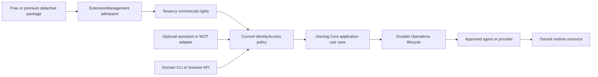

# Core structure, extensibility and growth

**Assessment: 2026-11-02. Repository preparation plus a bounded read-only application-catalogue candidate; production application deployment remains open.**

WCP360 Standalone is the panel installed on a server. Its Core must remain usable without optional plugins or a live vendor connection for essential hosting, local administration, security and recovery.

The existing **13 module owners** can accommodate the requested growth. The missing preparation is explicit ownership, implementation locations and delivery contracts, rather than duplicate Docker, AI, Licensing or Premium modules. This inventory complements the [Core roadmap](ROADMAP.md), [capability map](CAPABILITY-MAP.md), [web-server strategy](src/Module/Hosting/WEB-SERVER-STRATEGY.md) and [web-server roadmap](src/Module/Hosting/WEB-SERVER-ROADMAP.md).

Use the [working guide](WORKING-GUIDE.md) for development orientation and [STATUS](STATUS.md) for current implementation and qualification. [NAVIGATION](NAVIGATION.md) locates changes, this document assigns ownership, [CAPABILITY-MAP](CAPABILITY-MAP.md) records the 233 statuses and [ROADMAP](ROADMAP.md) defines delivery order.

## What the inspection found

| Area | Actual starting point | Preparation added |
| :--- | :--- | :--- |
| Business modules | 13 owners; several are README boundaries, others contain candidate code. | Named design locations and a cross-module responsibility map. |
| CLI | One Symfony entry and eight domain candidate commands; native preflight tools are separate. | [Command/context inventory](bin/COMMANDS.md) and a shared Console presentation reservation. |
| Linux resources | The original 17-family preparation was expanded to the current 24 families; most remain reservations, with external candidate Go templates and three disposable VM units. | Seven additional family READMEs and the current [service index](resources/services/README.md); implementation status remains in its linked register. |
| Applications and Docker | Seven inert PHP topology recipes and a read-only editorial catalogue; no general tenant container manager. | [AppDeploy workspace](../WCP360_App_Deploy/README.md), [Core catalogue bridge](src/Module/Hosting/APPLICATION-CATALOGUE.md) and application/provider contracts with explicit data, ingress and recovery ownership. |
| Premium and licenses | Fixed reference-plugin lifecycle; general package manager and license client unfinished. | Separate package admission, local entitlement and current-permission boundaries. |
| AI, models and MCP | No implemented Core assistant, model provider or MCP runtime. | Optional-integration resource/design anchors; no tool or privilege is enabled. |
| Scalability | Local candidate database queue and current authorization checks. | Ordered single-node hardening, bounded execution and future node-routing design. |
| Toolbox | Individual observations/diagnostics and developer tools. | Product diagnostic catalogue boundary; developer tooling remains separate. |

This is not a completeness certificate. Service templates, providers, contracts, applications and failure recovery still require implementation and qualification. Folder counts do not increase the [233-capability delivery status](CAPABILITY-MAP.md#delivery-snapshot).

## Repository locations

```text
WCP360_Core/
├── STRUCTURE.md                         # This ownership and gap index
├── bin/
│   ├── console                          # Existing Symfony entry point
│   └── COMMANDS.md                      # Current commands vs future CLI contract
├── src/
│   ├── Module/                          # The same 13 business owners
│   │   ├── Tenancy/design/licensing/    # Local commercial rights; no license server
│   │   ├── ExtensionManagement/design/packages/
│   │   ├── Hosting/design/applications/
│   │   ├── Platform/design/
│   │   │   ├── containers/
│   │   │   ├── scalability/
│   │   │   └── ai-mcp/
│   │   ├── Operations/design/distributed-execution/
│   │   └── Observability/design/toolbox/
│   └── Shared/Console/                  # Shared presentation reservation only
├── resources/
│   ├── services/                        # 24 documented service families
│   ├── applications/                    # Reviewed application recipe boundary
│   ├── extensions/                      # Contribution/package policy boundary
│   ├── host/                            # Host resources and ownership
│   ├── observability/                   # Health/metrics/logging resource boundary
│   ├── toolbox/                         # Approved diagnostic profiles
│   └── ai/
│       ├── providers/
│       ├── models/
│       ├── agents/                      # Assistant missions, not Go system agents
│       └── mcp/
├── agents/                              # Existing Go wcpd / wcp-privd architecture
├── diagnostics/                         # Reviewed specialized non-root tools
├── installer/                           # Existing Setup bootstrap/repair/recovery
├── config/                              # Symfony and accepted platform configuration
└── tools/                               # Developer checks; not the product Toolbox
```

The new locations contain reviewed README reservations. They contain no fake classes, empty executable manifests, installed engines or live configuration. Under an implemented module, Domain/Application/Infrastructure/UI remain the code layout; design/ records preparation without creating a second runtime layer or canonical protocol.

## Responsibility map

| Concern | Primary owner | Collaborators and boundary |
| :--- | :--- | :--- |
| Installation, wizard, repair and upgrade | [Setup](src/Module/Setup/README.md), installer/ | Each resource owner; no second installer inside a plugin. |
| Local licenses and commercial rights | [Tenancy licensing design](src/Module/Tenancy/design/licensing/README.md) | IdentityAccess permissions, Platform instance identity, ExtensionManagement package needs. Vendor issuance/billing stays external. |
| Free/premium package lifecycle | [ExtensionManagement package design](src/Module/ExtensionManagement/design/packages/README.md) | Setup, Tenancy, resource owners and Operations. Package trust, compatibility, entitlement and permission are distinct checks. |
| Hosted applications and Discourse | [Hosting application design](src/Module/Hosting/design/applications/README.md) | Data, Files, Tenancy, Platform, Operations and BackupRestore. One application inventory owns ingress and dependencies. |
| Docker/OCI and runtime providers | [Platform container design](src/Module/Platform/design/containers/README.md) | Hosting owns app intent; the provider implements admitted workload operations. No tenant Docker socket/API. |
| Nodes and capacity evolution | [Platform scalability design](src/Module/Platform/design/scalability/README.md) | Operations, IdentityAccess and Observability. Standalone remains the initial operational unit. |
| Durable execution and automation | [Operations execution design](src/Module/Operations/design/distributed-execution/README.md) | Resource owners retain business validation and effect semantics. No generic task executor. |
| Toolbox | [Observability Toolbox design](src/Module/Observability/design/toolbox/README.md) | Platform presents node tools; repairs stay with the owning resource use case. |
| AI providers, models, assistants and MCP | [Platform integration design](src/Module/Platform/design/ai-mcp/README.md) | Optional isolated integrations; IdentityAccess scopes data/tools and Operations executes admitted actions. |
| CLI | [Command inventory](bin/COMMANDS.md) | Domain Console adapters reuse the same use cases; [Shared Console](src/Shared/Console/README.md) supplies future common presentation. |
| Templates and declarative profiles | [Resources](resources/README.md) | One canonical renderer/template family; accepted agent operations alone apply owned files. |

An integration can be commercially optional without moving essential platform ownership into its package. A paid UI or advanced recipe never becomes the sole keeper of a running site's identity, configuration or recovery path.

## Modules, packages and runtime dependencies



The arrows show cooperating decisions, not a license-before-login requirement or a permission grant created by package installation. Essential Core paths do not depend on optional commercial/provider availability. Authorization must be current again when an effect is attempted.

Detached extension source belongs in WCP360_Plugins/<package>, outside this task's editing scope. Its own process, dependency graph, data, migrations and credentials remain separate from the Core. Package code is not injected into Symfony services, Twig or the Core Composer vendor directory. The public SDK/API is an integration boundary, not permission to write Core tables.

Keep Composer manifests/locks and generated vendor separate from Go modules and each specialized tool/plugin's dependency files. Do not add global functions/, dependencies/, vendor copies, an unrestricted Commands/ registry or a second Services/ business layer.

## Resource coverage and open decisions

| Resource family | Source anchor | Remaining qualification |
| :--- | :--- | :--- |
| Web and PHP | [Service index](resources/services/README.md), [application profiles](src/Module/Hosting/APPLICATION-PROFILES.md) | New Nginx/Apache/FPM default, native providers, managed multi-PHP and safe changes. |
| Containers and application recipes | [Docker](resources/services/docker/README.md), [applications](resources/applications/README.md) | Images/builds, ports, networks, volumes, limits, app data, lifecycle and restore. |
| Certificates, host policy and supervision | [ACME](resources/services/acme/README.md), [host](resources/host/README.md), systemd | Select providers, identities, confinement and safe recovery on each target. |
| Databases, mail, DNS and backup | Existing Data/Mail/Hosting/BackupRestore service anchors | Native service policy, tenant isolation, operational workflows and complete restore. |
| Health, logs and diagnostics | [Observability](resources/observability/README.md), [Toolbox](resources/toolbox/README.md) | Effective collection/redaction, bounded storage, local alerts and permission tests. |
| Extensions and optional AI | [Extensions](resources/extensions/README.md), [AI](resources/ai/README.md) | Trusted contributions, provider/model/tool admission, privacy, budgets and revocation. |

Core targets remain **Debian 12/13 and Ubuntu 22.04/24.04/26.04 LTS**. Each provider/application combination needs its own tested target/version/architecture matrix. No Kubernetes, cluster scheduler, shared root daemon or cloud dependency is implicitly selected by preparing these folders.

## Ordered implementation work

Commercial licensing is conditional on the selected product/package policy. It is not a prerequisite for the free Core, Docker providers or ordinary hosting; independent work below may proceed in parallel once its own authority/data/recovery contracts are settled.

1. Complete M1/M2 identity, permission and effect contracts; reconcile candidate service discovery and grants with the real contexts.
2. Deliver the next inert web topology slice and typed provider/operation boundaries, keeping existing persisted plans unchanged.
3. Implement local entitlement validation and general package admission independently; test vendor outage, expiry, package removal and retained-resource control.
4. Implement admitted container lifecycle and one restored application workload, then qualify Discourse with its upstream deployment.
5. Expand diagnostic catalogue and domain CLI coverage using stable results, scoped read paths and explicit repair operations.
6. Add optional AI read assistance, then reviewed action proposals and MCP adapters after their underlying operations are qualified.
7. Increase workers/capacity only with leases/fencing, fairness, observed budgets and recovery; qualify additional nodes and shared control-plane components as separate delivery scopes.

Every step carries current authorization, failure/refusal cases, audit and recovery evidence. Existing [Core milestones](ROADMAP.md), percentages and capability statuses remain unchanged by repository preparation.

## Maintaining the structure

- Use [NAVIGATION](NAVIGATION.md) for change locations and [src/Module](src/Module/README.md) for owner boundaries.
- Before adding a module, show an independent business authority and update its accepted ownership contracts; a technology or commercial label alone is insufficient.
- Add executable source, templates, schema or dependencies only with an implemented use case and appropriate checks. A design README is not deployment authority.
- Preserve one source for generated service configuration. The current Go candidate templates remain authoritative until an explicit handoff retires their old location.
- Record exact source/tool/provider revisions and passed/failed/not_run/not_configured/not_applicable outcomes; no local executable test is authorized by this document.
