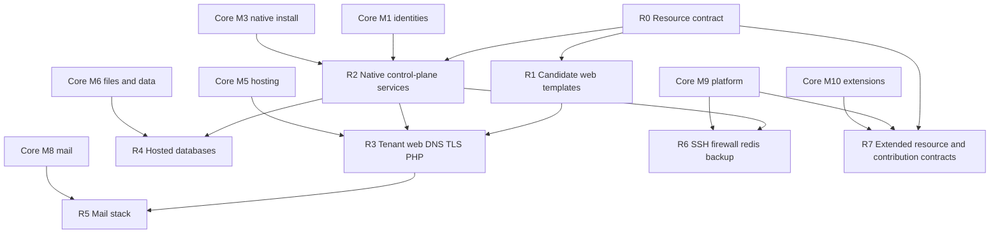

# Core resources delivery roadmap

**Assessment date: 2026-11-02. Resource-layer production maturity: approximately 0%. Candidate evidence exists outside this directory. This document does not change Core completion (~20%) or capability counts (5 demonstrated / 71 partial / 157 planned).**

`resources/` is the versioned source home for Linux-service templates, profiles and first-party supervision units. It is **not** Symfony configuration, Twig, live `/etc`, secrets or proof that an engine is installed. Product ownership stays in `src/Module/<Owner>/`. Privileged apply stays behind accepted agent primitives.

This roadmap is subordinate to the [Core delivery roadmap](../ROADMAP.md) and the [233-capability register](../CAPABILITY-MAP.md). Folders and README reservations receive **no functional-completion credit**. The requested preparation may add reviewed README-only reservations before a backend is selected; they are documentation, not implementation. Do not create empty `templates/` or `profiles/` trees; add executable/configuration files only with their reviewed source and consuming implementation.

## What this layer is for

| Concern | Lives here | Does not live here |
| :--- | :--- | :--- |
| Versioned Nginx/PHP-FPM/mail/database/unit text | `resources/services/<service>/` | PHP policy, HTTP controllers, Twig |
| Package/version-specific includes and drop-ins | same service directory, when implemented | Host `/etc` copies, operator overrides |
| Candidate disposable-VM units | [systemd/candidate](services/systemd/candidate/) | Production `wcpd` / `wcp-privd` units |
| Intended `/etc/wcp360`, `/var/lib/wcp360`, `/run/wcp360`, `/var/log/wcp360` conventions | documented in [README](README.md) | Actual machine state |

The candidate Nginx, PHP-FPM and FrankenPHP **text** is currently rendered from [Go planner templates](../agents/wcpd/candidate/planner/templates), not from this directory. FrankenPHP's README already forbids copying those templates here. Promoting them into `resources/services/` is a later, explicit handoff: one renderer, one source of truth, no duplicated validators.

## Current inventory

Twenty-four documented service locations exist under [services](services/README.md): the original seventeen plus Caddy, Docker, ACME, quotas, time-sync, confinement and journald. Inspected 2026-11-02. Additional [application](applications/README.md), [host](host/README.md), [observability](observability/README.md), [toolbox](toolbox/README.md), [extension](extensions/README.md) and [AI](ai/README.md) indexes are documentation reservations, outside this service count.

| State | Count | Evidence |
| :--- | ---: | :--- |
| README reservation only | 18 | postfix, dovecot, rspamd, postgresql, mysql, mariadb, redis, dns, ssh, firewall, logrotate, backup, docker, acme, quotas, time-sync, confinement, journald |
| README plus pointer to Go candidate templates | 5 | nginx, apache, php-fpm, frankenphp, caddy |
| README plus disposable-VM unit files | 1 | systemd (`candidate/*.service`) |

No service directory currently contains production `templates/` or `profiles/`. No resource file is an applied host configuration.

## Planned families with documentation reservations

The requested README reservations now locate these families without selecting their backends. No empty template/profile tree or fictitious configuration is needed. The first executable/configuration source still requires its reviewed contract and consuming implementation. None of these names creates an IPC operation, package selection or privilege grant.

| Missing resource family | Why it is implied | Owner | Core milestone | Decision still required |
| :--- | :--- | :--- | :--- | :--- |
| [ACME client profiles](services/acme/README.md) | Certificate inventory, orders, challenges, renewal, cross-service deploy | Hosting | [M5](../ROADMAP.md#m5) | Client binary, challenge types, key storage, Nginx/mail deploy order |
| [Filesystem quota profiles](services/quotas/README.md) | Storage/inodes limits enforced on the host | Tenancy with Platform | [M4](../ROADMAP.md#m4) | Backend (project quota, XFS, etc.), identity mapping, restore behavior |
| [Time synchronization](services/time-sync/README.md) | Native install preflight requires hostname/DNS/time | Setup / Platform | [M3](../ROADMAP.md#m3) | chrony vs systemd-timesyncd on each target |
| Production first-party units | Candidate units use fixture UIDs and `WCP_ISOLATED_TEST_VM=1` | Platform | [M2](../ROADMAP.md#m2) / [M3](../ROADMAP.md#m3) | Canonical identities, sockets, confinement, packaging paths |
| [AppArmor / equivalent confinement profiles](services/confinement/README.md) | Baseline hardening and worker/pool isolation | Platform | [M2](../ROADMAP.md#m2) | Debian/Ubuntu profile layout; SELinux remains out of current five-OS matrix |
| [journald / log identity drop-ins](services/journald/README.md) | System logs, redaction, diagnostic bundles | Observability | [M9](../ROADMAP.md#m9) | Overlap with logrotate; customer vs panel logs |

[Caddy](services/caddy/README.md) and [Docker](services/docker/README.md) now have their own bounded service reservations. The [AI family](ai/README.md) distinguishes providers, model metadata, assistant orchestration and MCP transport; it is optional and supplies no runtime or new permission. Go system agents remain separate.

Intentionally **not** duplicated Core resource implementations unless a later accepted contract says otherwise:

- Optional catalog engines (additional databases, extra spam stacks, vendor backup agents): plugins or qualified Core adapters, not 149 extra folders.
- Control-plane Symfony `config/` and Twig.
- Customer website roots, mail stores, PostgreSQL data directories.
- Fail2ban/CrowdSec-class extras until IdentityAccess/Platform choose a baseline vs plugin split.
- FTP daemons: current Files domain is confined web/SFTP-oriented file management.

## Ordered resource slices

Slice numbers are dependency order, not dates or permission to skip Core milestones. Each slice produces templates **and** the owning adapter/tests on a disposable target. Syntax-check-only success is insufficient.

### R0 — Freeze the resource contract

Depends on: documented [configuration lifecycle](services/README.md#configuration-change-lifecycle).

- Keep one owner per service; Platform coordinates apply mechanics only.
- Bind every future template to resource/tenant/service identity, observed revision, staged files, link/path refusal and post-reload health.
- Distinguish validation failure, no-op, applied and uncertain outcome.
- Continue to refuse `/etc` imports and secrets in Git.

**Acceptance:** new executable/configuration files land only under an existing service owner or an explicitly added family after backend selection. Requested reviewed README reservations may precede that selection. Navigation links resolve; no second renderer or allowlist is invented here.

### R1 — Candidate web-stack source of truth

Owners: Hosting, Platform. Depends on R0; aligns with [M2](../ROADMAP.md#m2)/[M5](../ROADMAP.md#m5) candidate work.

- Keep Go planner templates authoritative until an explicit reviewed source handoff. Existing Nginx, Apache, PHP-FPM, FrankenPHP and Caddy README pointers reference the same planner; do not copy candidate application/Modern templates into this tree.
- Document version/package pins for Debian 12/13 and Ubuntu 22.04/24.04/26.04 LTS without claiming Ubuntu privileged qualification.
- Preserve the current Nginx/PHP-FPM candidate default and existing assignments. The [adopted strategy](../src/Module/Hosting/WEB-SERVER-STRATEGY.md) targets Nginx -> Apache event -> PHP-FPM for new general-purpose installations only after versioned implementation and qualification. FrankenPHP classic and separately opted-in Worker remain distinct; previews grant no native activation.

**Acceptance:** a reviewer can name the single template source for Nginx, pool and worker units. Duplicating `Caddyfile.tmpl` into `resources/` without retiring the planner copy is a failure.

### R2 — Native control-plane services for first install

Owners: Setup, Platform, Data (control-plane PostgreSQL), Observability. Depends on [M1](../ROADMAP.md#m1) identities and [M3](../ROADMAP.md#m3).

First production-shaped templates, still not a qualified installer:

| Service | First contents | Explicit non-goals |
| :--- | :--- | :--- |
| systemd | Production-shaped `wcpd` / `wcp-privd` / worker units using canonical identities | Reusing `*-test` fixture users |
| postgresql | Control-plane cluster parameters, HBA, unix-socket policy | Hosted tenant clusters |
| nginx | Panel ADMIN/USER origin vhosts, separate from tenant sites | Customer site lifecycle |
| php-fpm | Panel pools only if the panel remains FPM-fronted; Core today is Symfony request-scoped | Tenant pools |
| logrotate | Panel `/var/log/wcp360` rotation | Customer log products |
| firewall | Management-plane inputs once a backend is selected | Locking out the operator |

**Acceptance:** on a disposable reference target, render, syntax-check, apply through the approved primitive, observe health, interrupt and resume without treating a journal checkpoint as success. `native_apply_allowed: false` remains until Setup's native provider exists.

### R3 — Tenant web, DNS, TLS and PHP resources

Owner: Hosting with Files, Tenancy, Operations. Depends on R2, [M4](../ROADMAP.md#m4), [M5](../ROADMAP.md#m5).

- Managed Nginx vhosts, aliases, redirects, upstreams, log paths.
- Per-version PHP-FPM pools, sockets, limits, extension/directive allowlists.
- Authoritative DNS backend templates after engine selection (this folder must not imply BIND vs PowerDNS).
- ACME client profiles and certificate deploy fragments for Nginx (mail deploy waits for R5).
- Add the target private Apache event compatibility backend through the [web-server roadmap](../src/Module/Hosting/WEB-SERVER-ROADMAP.md); all requests traverse Apache for that profile. Dedicated Apache/FPM remains an alternative. Listener/TLS ownership and new topology contracts must precede live effects.

**Acceptance:** create/modify/suspend/delete a real-domain site on the claimed engine; failed apply leaves a repairable previous observed state or an explicit uncertain outcome.

### R4 — Hosted database engines

Owner: Data. Depends on R2 and [M6](../ROADMAP.md#m6).

- Separate hosted PostgreSQL/MySQL/MariaDB profiles from the control-plane cluster.
- Users, grants, listen/socket policy, resource limits; no shared port/data dir between MySQL and MariaDB.
- Import/export and backup hooks owned with BackupRestore, not copied into engine READMEs.

**Acceptance:** tenant create/grant/revoke/delete on a selected engine; control-plane roles cannot manage tenant data through these templates.

### R5 — Mail stack

Owner: Mail. Depends on R3 TLS/DNS and [M8](../ROADMAP.md#m8).

- Postfix, Dovecot and Rspamd templates as one coordinated topology, not three independent products.
- TLS references reuse Hosting certificates; DKIM material stays out of Git.
- Open-relay refusal, queue, sieve and spam endpoints are domain rules first.

**Acceptance:** send/receive/auth on a disposable host with quota and policy refusals. A Postfix folder still does not count as mail delivery.

### R6 — Platform operations resources

Owners: Platform, Operations, BackupRestore, Observability. Depends on [M7](../ROADMAP.md#m7)/[M9](../ROADMAP.md#m9).

- OpenSSH host policy with verified administrator recovery path; SFTP/shell entitlements remain Tenancy/Files.
- Firewall backend + lockout prevention.
- Redis only where explicitly selected; isolate Core queues, sessions and application caches. Never expose it publicly. The current PostgreSQL-backed candidate job queue remains unchanged.
- Backup tool profiles that work without a vendor plugin.
- SSH/firewall/backup changes include rehearsal of recovery access when the panel UI is down.

**Acceptance:** authorized apply/refuse tests, no management-plane lockout, secrets absent from diffs/logs/fixtures.

### R7 - Additional resource families and optional integrations

Owners remain the existing modules; no new business-module or command registry is introduced.

- [Applications](applications/README.md) maps native/PHP/container recipes to Hosting; [Docker](services/docker/README.md) maps provider resources to Platform and durable jobs to Operations. Coordinate with Hosting WS6 and the applicable M6/M7 data/recovery work.
- [Host resources](host/README.md) gathers identities, mounts, network, time, quotas and confinement without duplicating service adapters. [Observability](observability/README.md) and [toolbox](toolbox/README.md) keep bounded local diagnostics and baseline alerts under M9.
- [Extensions](extensions/README.md) documents approved contributions under M10; disabling an optional recipe does not discard Core ownership or stop existing hosting.
- [AI](ai/README.md) documents optional provider/model/assistant/MCP boundaries. Model data and package code stay outside these indexes; applicable IdentityAccess/Operations contracts still govern all actions.

**Acceptance:** every reservation has an existing owner, explicit unavailable implementation status and canonical source links. A future provider must prove isolation, effective resource budgets, confidentiality and recovery on each claimed target. No folder, model response or discovered MCP tool grants execution authority.

## Mapping to Core milestones

Core [M1](../ROADMAP.md#m1) (contracts, Unix/PostgreSQL identities, permission composition) remains the prerequisite for any production-shaped unit or HBA template. Resource files must not invent identities.

## Next concrete resource work

1. Keep [services/ROADMAP.md](services/ROADMAP.md) as the per-service register; update it when a template actually lands.
2. Do not copy Go planner templates into `resources/` until Hosting retires the duplicate.
3. Select DNS, firewall, ACME, quota, time/confinement and backup backends in accepted contracts before adding executable/configuration files. The new README reservations document these open decisions.
4. First implementation slice after M1 identities: production-shaped systemd units and control-plane PostgreSQL/HBA **on a disposable host**, with negative path/link/ownership tests.

Related: [Core structure](../STRUCTURE.md), [resources README](README.md), [service index](services/README.md), [service roadmap](services/ROADMAP.md), [Core roadmap](../ROADMAP.md), [capability map](../CAPABILITY-MAP.md), [navigation](../NAVIGATION.md).
