# Linux-service source directory

The read-only [ROOT service inventory](../../src/Module/Platform/SERVICES.md) lives in Platform. Its fixed systemd lookups observe nine families without installing providers, validating service health or enabling control. They do not change the 24 resource-family counts or the implementation statuses below.

This index makes the service's template, owning PHP domain and target configuration boundary easy to locate. Entries identify source ownership. The candidate PHP-FPM and FrankenPHP renderers are explicitly linked; other entries remain documented source reservations. A directory is not evidence that an adapter is implemented, selected, installed or permitted to run.

The directory has **24 documented service locations**. Their README reservations prepare the requested layout; they do not install providers or create empty implementation trees. Each service README records its owner, current boundary and remaining work. The [Core roadmap](../../ROADMAP.md) and [structure index](../../STRUCTURE.md) organize the dependencies for future executable/configuration files. The current candidate default remains Nginx/FPM; the [target for new general-purpose installations](../../src/Module/Hosting/WEB-SERVER-STRATEGY.md) is Nginx -> Apache event -> FPM after explicit implementation and qualification. Existing assignments do not change.

The [per-service roadmap](ROADMAP.md) records status, first deliverable and open backend decisions. Layer order and families that must not receive empty folders yet are in the [resources roadmap](../ROADMAP.md).

| Service resources | Owner | Intended contents |
| :--- | :--- | :--- |
| [Nginx](nginx/README.md) | [Hosting](../../src/Module/Hosting/README.md) | Reverse proxy, managed virtual hosts, upstreams, TLS references and FastCGI integration. |
| [Apache HTTP Server](apache/README.md) | [Hosting](../../src/Module/Hosting/README.md) | Virtual hosts, approved modules, reverse-proxy integration and per-site policy. |
| [PHP-FPM](php-fpm/README.md) | [Hosting](../../src/Module/Hosting/README.md) | Per-version pool models, PHP directives, process limits and socket ownership. |
| [FrankenPHP](frankenphp/README.md) | [Hosting](../../src/Module/Hosting/README.md) | Classic and separately qualified Worker profiles, embedded Caddy, private endpoints and dedicated supervision. |
| [Standalone Caddy](caddy/README.md) | [Hosting](../../src/Module/Hosting/README.md) | Dedicated ingress, FPM/proxy profiles, explicit listener/TLS/admin ownership; distinct from embedded Caddy. |
| [Docker provider](docker/README.md) | [Platform](../../src/Module/Platform/README.md), Hosting / Operations | Admitted engine/workload resources, images/build provenance, networks, volumes, effective limits and recovery. |
| [Postfix](postfix/README.md) | [Mail](../../src/Module/Mail/README.md) | SMTP routing, relay policy, domain maps, queue integration and TLS references. |
| [Dovecot](dovecot/README.md) | [Mail](../../src/Module/Mail/README.md) | IMAP/POP service policy, authentication adapters, mailbox locations and TLS references. |
| [Rspamd](rspamd/README.md) | [Mail](../../src/Module/Mail/README.md) | Approved spam/antivirus integration, policy, learning endpoints and rate limits. |
| [PostgreSQL](postgresql/README.md) | [Data](../../src/Module/Data/README.md) | Reviewed PostgreSQL service profiles, connection/access policy and cluster parameters. |
| [MySQL](mysql/README.md) | [Data](../../src/Module/Data/README.md) | Hosted-engine profiles, service configuration, resource limits and connection policy. |
| [MariaDB](mariadb/README.md) | [Data](../../src/Module/Data/README.md) | Hosted-engine profiles, service configuration and engine-specific settings. |
| [Redis](redis/README.md) | [Operations](../../src/Module/Operations/README.md) | Optional async-transport/cache service profiles, connection isolation and persistence policy. |
| [Authoritative DNS](dns/README.md) | [Hosting](../../src/Module/Hosting/README.md) | Zone/record templates, selected backend resources and delegation/DNSSEC references. |
| [systemd supervision](systemd/README.md) | [Platform](../../src/Module/Platform/README.md) | First-party unit/drop-in templates, service identity, restart policy and resource confinement. |
| [OpenSSH](ssh/README.md) | [Platform](../../src/Module/Platform/README.md) | Host access policy and scoped file-transfer/shell service profiles. |
| [Host firewall](firewall/README.md) | [Platform](../../src/Module/Platform/README.md) | Reviewed policy inputs, management/service network rules and safe change plans. |
| [Log rotation](logrotate/README.md) | [Observability](../../src/Module/Observability/README.md) | Service log rotation, retention, identity and bounded reopen behavior. |
| [Backup tooling](backup/README.md) | [BackupRestore](../../src/Module/BackupRestore/README.md) | Local backup/restore tool profiles, scheduling inputs, retention and restore-verification resources. |
| [ACME and certificates](acme/README.md) | [Hosting](../../src/Module/Hosting/README.md) | Selected client/challenges, key references, renewal and coordinated deploy to consumers. |
| [Filesystem quotas](quotas/README.md) | [Tenancy](../../src/Module/Tenancy/README.md), Platform | Registered quota identities, space/inodes, observed enforcement and restore behavior. |
| [Time synchronization](time-sync/README.md) | [Platform](../../src/Module/Platform/README.md), Setup | Selected time provider, sources, drift observations and safe native qualification. |
| [Host confinement](confinement/README.md) | [Platform](../../src/Module/Platform/README.md) | Selected MAC/service profiles, explicit identity/path/IPC/network limits and observed enforcement. |
| [journald / system logs](journald/README.md) | [Observability](../../src/Module/Observability/README.md), Platform | Journal identity, retention/rate budgets, bounded access and export; distinct from durable business audit. |

[Applications](../applications/README.md), [host resources](../host/README.md), [observability](../observability/README.md), [toolbox](../toolbox/README.md), [extension contributions](../extensions/README.md) and [AI](../ai/README.md) are separate resource indexes, not additional Linux services. Follow the [Core structure](../../STRUCTURE.md). The 24-service count excludes these families.

## One owner for each concern

- The domain owns user-facing policy, authorization, configuration inputs and state transitions.
- Infrastructure implements the typed adapter for the selected engine/version.
- This directory owns reusable configuration text/profiles; it does not introduce another business service or a second command registry.
- Agent sources own accepted system operations. Installer bootstrap and ordinary runtime operations use the relevant approved interfaces; no public PHP/plugin-to-root shortcut is created.
- Tests/Fixtures owns synthetic examples. Do not duplicate fixtures, defaults or validators across templates, PHP, Go and UI code; share or generate from the accepted contract where appropriate.

## Configuration change lifecycle

```mermaid
flowchart LR
    Request[Authorized scoped request] --> Policy[Owning domain validates settings]
    Policy --> Plan[Durable operation and configuration plan]
    Plan --> Render[Render selected versioned template]
    Render --> Check[Bounded service syntax and policy checks]
    Check --> Apply[Approved privileged primitive applies owned files]
    Apply --> Health[Observe service health and intended result]
    Health --> Record[Record applied revision or reconcile failure]
```

Bind the plan to resource/tenant/service identity and the observed current revision. Check concurrent changes and file ownership, stage on the appropriate filesystem, preserve required metadata, reject unexpected links/paths and keep changes within the WCP-managed boundary. For multiple files, define the accepted ordering and failure strategy rather than claiming a single atomic transaction.

A syntax check alone is not success. Verify the effective configuration and service response after reload/restart. Distinguish validation failure, unchanged operation, applied state and uncertain outcome. Recovery/rollback is allowed only where the specific change is reversible; otherwise stop safely and expose a repair path. Keep secrets out of logs, diffs, fixtures and browser responses.

Exact operation IDs, argument schemas, capabilities, service names, file allowlists, template engine and privilege rules come from accepted specifications. This organization does not create them. Platform coordinates common service mechanics; Hosting, Mail, Data and BackupRestore retain their business ownership.

## Debian reference examples

The Nginx and PHP-FPM path examples were checked against the Debian 13 package inventories: [nginx-common](https://packages.debian.org/trixie/all/nginx-common/filelist), [php8.4-fpm](https://packages.debian.org/trixie/amd64/php8.4-fpm/filelist). Other paths are conventional navigation examples and require verification against the selected installed package before implementation.
