# Application catalogue bridge

**Status: read-only development candidate. Application installation, deployment, updates and removal remain unavailable.**

[WCP360_App_Deploy](../../../../WCP360_App_Deploy/README.md) owns the editorial catalogue and versioned recipe authoring. Hosting owns application instances and their intended ingress/dependencies; Platform owns runtime/container providers; Operations owns durable execution. This bridge makes the candidate catalogue inspectable without treating an entry as a deployment plan.

## Source and contract

The fixed local source is configured in [services.yaml](../../../config/services.yaml):

```text
%kernel.project_dir%/../WCP360_App_Deploy/WCP360_App_Catalogue_Candidat.csv
```

The caller cannot submit a filename, URL, command, recipe path or database selector. The service does not download software or inspect the host's applications. It is a checkout integration, not a production catalogue distribution/admission service.

| Component | Role |
| :--- | :--- |
| [ApplicationCatalogueEntry](Domain/ApplicationCatalogueEntry.php) | Typed bounded editorial row retaining all eleven source fields. |
| [ApplicationCatalogueSource](Application/ApplicationCatalogueSource.php) | Read-only port; no renderer, queue, database or provider authority. |
| [CsvApplicationCatalogueSource](Infrastructure/CsvApplicationCatalogueSource.php) | Fixed-source byte/CSV validation and snapshot fingerprint. |
| [ListApplicationCandidates](Application/ListApplicationCandidates.php) | Bounded filtering, metadata summaries and safe page projection. |
| [ApplicationCatalogueCommand](UI/Console/ApplicationCatalogueCommand.php) | Worker/setup-only JSON inspection adapter. |

The source may be absent. Constructing services and booting the Core must not depend on opening the optional workspace. A missing source is reported as not_configured when consulted; invalid/unreadable input produces a generic failed result. Neither case enables an installer or reports the software as installed.

The reader bounds the file at 1 MiB and the catalogue at 2,048 entries. It checks the exact eleven headers, UTF-8, row/field bounds, CSV quoting and duplicate names. Multiline narrative fields and escaped separators are data, not executable instructions. The SHA-256 describes the bytes actually consumed; it is not publisher trust or installation approval.

## Current catalogue

The supplied source contains **410 references, 70 categories, 17 natures and 16 proposed profiles**. Its MD view contains the same names and common fields but has a different order. Do not join the CSV, MD, recipe or workbook by line number.

The existing source has no stable application identifier or exact release field. Preserve its names/classification; draft recipes match the explicit name/category/nature/profile tuple. A future admitted recipe identity/version is separate from a Core tenant, application instance or operation ID.

All eleven columns remain editorial data, including proposed access, lot, qualification and source labels. A filled verified-source cell can point to third-party discovery material. It does not certify an upstream release or grant a user permission.

The CLI is a maintenance inspection surface and may show hidden/infrastructure/laboratory candidates to its admitted context. There is no new USER/browser catalogue route. A future customer App Center needs its own accepted current-permission and visibility policy.

## Inspection command

In an already configured development candidate, the Linux shell form is:

```sh
APP_ENV=dev WCP_CANDIDATE=1 WCP_CONTEXT=setup php bin/console wcp:candidate:apps:catalogue --limit=25
APP_ENV=dev WCP_CANDIDATE=1 WCP_CONTEXT=setup php bin/console wcp:candidate:apps:catalogue --app-profile=PHP --limit=25
APP_ENV=dev WCP_CANDIDATE=1 WCP_CONTEXT=setup php bin/console wcp:candidate:apps:catalogue --category="Forums modernes" --offset=0
```

These examples are documentation, not commands executed during this change. Worker is the other admitted candidate context; USER and ADMIN browser contexts cannot use the command. A context setting is not proof of a production Unix identity.

The --category and --app-profile filters match their source labels exactly. The application filter avoids Symfony's reserved --profile profiler option. Page sizes are 25, 50 or 100 and offset is bounded at 2,048. JSON output uses raw Console output so catalogue text cannot become Console formatting instructions. Unknown/invalid input and unavailable/invalid sources have explicit unsuccessful outcomes; a successful catalogue read proves no deployment.

Each page is drawn from the current bounded snapshot. Consumers should inspect the source fingerprint and restart pagination if it changes; offset is not an immutable application reference. Proposed access and qualification never change the false installable/deployment flags.

## Recipe authoring and future execution

The workspace supplies a [candidate recipe schema](../../../../WCP360_App_Deploy/schemas/README.md), shared authoring template, WordPress/PHP and Discourse/Docker examples. The Core bridge does **not** load these JSON recipes or execute their lifecycle documents.

The future path is:

```mermaid
flowchart LR
    Catalogue[Editorial candidate] --> Recipe[Versioned recipe and exact release]
    Recipe --> Admit[Trust and compatibility admission]
    Admit --> Authority[Current actor tenant and resource policy]
    Authority --> Plan[Immutable plan and expected revision]
    Plan --> Job[Durable operation and bounded provider]
    Job --> Observe[Health and observed result]
    Observe --> Recovery[Reconcile or qualified recovery]
```



Before execution, the existing owners must admit exact artifacts/publisher trust, runtime/provider capabilities, configuration/secret/resource references, current permissions and commercial rights where applicable. Jobs need revisions, idempotency/fencing, interruption handling, audit and observed results. The catalogue command implements none of those effect paths.

Installation, configuration, update, uninstall, backup, restore, inspection and reconciliation have separate lifecycle requirements. Uninstall retains data by default; purge is a distinct authorized action. A failed update or old image does not establish a reversible database migration.

PHP topology previews are another family: [ApplicationRecipeCatalogue](../../Shared/Platform/ApplicationRecipeCatalogue.php) describes seven web/PHP configuration combinations, including the versioned Nginx/Apache/FPM target preview. It is separate from the application installation catalogue. Installing and activating the target default still requires its provider and lifecycle implementation.

## Evidence and remaining delivery

Synthetic reader/query/command tests cover malformed and oversized data, Unicode/quoting, duplicate identities, missing sources, classifications, context refusals and false deployment flags. Their definitions are not executed results; exact-source CI is tracked in [draft PR #116](https://github.com/yyogas/wcp360/pull/116). Local executable tests remain stopped.

This increment changes no site/job/schema, grants, dependency lock, existing plan, PHP runtime assignment or system service. Production catalogue admission, recipe parsing/trust, customer UI/API, actual application lifecycle and each claimed app/provider/OS/architecture combination still require implementation and qualification.

Related: [Hosting application design](design/applications/README.md), [application resources](../../../resources/applications/README.md), [Core structure](../../../STRUCTURE.md), [command inventory](../../../bin/COMMANDS.md), [web-server roadmap](WEB-SERVER-ROADMAP.md).
