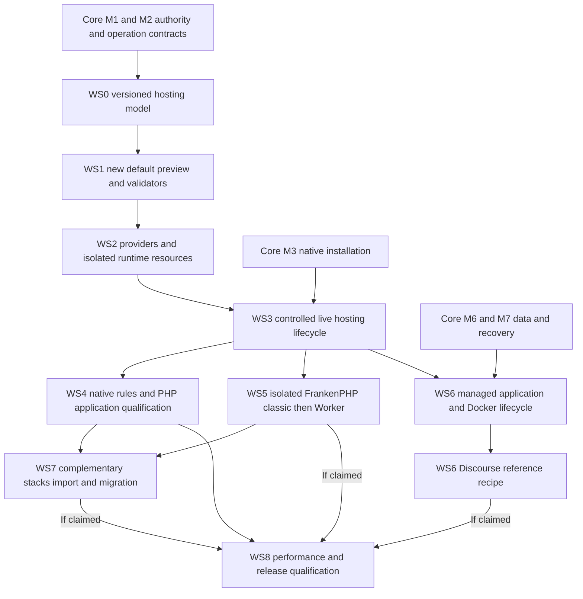

# Web-server and application-hosting development roadmap

**Recorded: 2026-11-02. Ordered delivery plan; no release date or production qualification is implied.**

The [adopted strategy](WEB-SERVER-STRATEGY.md) defines Nginx → Apache event → PHP-FPM as the target default for new general-purpose installations, with alternative PHP stacks and managed native/container backends. This roadmap implements that direction through one Core orchestration model.

Scope: `WCP360_Core/`, on the existing development branch. Templates, services, Docker providers and application recipes become available only when implemented and qualified. This plan does not install packages, start Docker, change existing defaults or migrate a site.

## Starting point and evidence

| Area | Existing candidate evidence | Remaining delivery boundary |
| :--- | :--- | :--- |
| Durable PHP profiles | Classic Nginx/FPM and opt-in Advanced Nginx/FrankenPHP Worker; explicit revision 1 metadata. | New topology identity, capability model and explicit upgrades; no silent reinterpretation. |
| Application previews | Six original recipes plus a version-2 Nginx/Apache/FPM target preview; three application behaviors, ROOT browser/API/Go generation. | Native Apache/event/FPM/HTTP qualification remains open; previews do not create live applications. |
| Native syntax inspection | Bounded opt-in Nginx grammar and Caddy/FrankenPHP adaptation with exact artifact hashes. | Real provider availability, Apache/FPM/module harnesses, full semantic/HTTP/systemd qualification. |
| Controlled effects | Guarded isolated FPM activation, separate permissions/revisions and uncertain-outcome handling. | General production provider lifecycle and effects across claimed OS targets. |
| Installer and operations | Checkout preparation/resume, host/artifact inspection and bounded durable jobs. | Production identity/grant integration, trusted artifacts, native installation, wizard and general fencing/recovery. |
| Containers | Development infrastructure and existing isolated test environments. | Tenant workload inventory, provider admission, networking, secrets, volumes, lifecycle and recovery. |
| Performance | Bounded candidate checks, including an existing generic FrankenPHP Worker journey. | Reproducible application benchmarks and operational SLOs for each supported profile. |

Source checkpoint `72aea4ed31bd7e4d993e104ffa87274dcf047345`: [CI run 41428259383](https://github.com/yyogas/wcp360/actions/runs/41428259383) completed all **14 jobs successfully**, including 1,147 PHPUnit tests / 12,323 assertions in the main suite. This is historical candidate evidence; it does not qualify the new topology, all six preview recipes, Docker/Discourse or a production release. Two pre-existing PHPUnit notices remain outside this documentation change.

The [Core roadmap](../../../ROADMAP.md) and [capability register](../../../CAPABILITY-MAP.md) keep their existing milestone/status meanings. This sub-roadmap does not increase the completion estimate merely by describing planned work.

## Dependency order

Design, inert rendering and disposable CI harnesses may progress while production foundations remain open. Privileged/live execution waits for the relevant authority, identity, artifact and operation contracts. Security, recovery and performance evidence accompany each slice; WS8 consolidates them. Its optional-profile dependencies apply only to features claimed by that release: an initial qualified FPM scope need not wait for Docker, Worker or assisted migration. Unfinished features remain explicitly unavailable.

| Stage | Status | Main owner | Dependency |
| :--- | :--- | :--- | :--- |
| WS0 — Versioned model | Candidate preview versioning implemented; durable production model open | Hosting / Platform / Operations | Required M1/M2 contracts. |
| WS1 — New default renderer | Inert target renderer implemented; Apache/FPM/HTTP harnesses open | Hosting / Go planner | WS0 preview contract. |
| WS2 — Providers and isolation | Partial candidate foundations | Hosting / Platform | WS0/WS1, trusted provider admission. |
| WS3 — Live resource lifecycle | Isolated FPM experiment only | Hosting / Operations / Setup | WS2 and relevant M1–M4 acceptance. |
| WS4 — Rules and PHP apps | Preview examples only | Hosting / Files | WS3 plus required M4 limits, M6 files/data and M7 recovery. |
| WS5 — FrankenPHP lifecycle | Classic/Worker previews; generic Worker CI only | Hosting / Platform | WS3 plus per-application isolation. |
| WS6 — Apps, Docker and Discourse | Planned | Hosting / Platform / Data / BackupRestore | WS3, required M6/M7 recovery. |
| WS7 — Import and migration | Planned; complementary previews exist | Hosting / Operations | Qualified source and destination profiles. |
| WS8 — Performance and release support | Planned; baseline CI remains separate | Observability / Hosting / Setup | Claimed profiles/apps qualified through prior stages. |

## WS0 — Versioned profiles and shared resource contracts

- Separate topology, PHP execution mode, application behavior, provider version and capabilities. Specify a distinct Nginx/Apache/FPM profile without selecting a public identifier prematurely.
- Bind desired/observed state, template/policy revision, actor/tenant/resource ownership, listeners, TLS owner, secrets and dependency references to one durable resource model. Snapshot topology/provider intent in each job so historical downloads and retries retain their original meaning.
- Specify capability responses that distinguish preview, parser coverage, installation, activation, migration and release support. Unsupported combinations fail explicitly.
- Define the future default for fresh installations; provide an explicit choice for an existing installation. Keep current Classic/Advanced, plan/1–3, application-plan/1 and stored jobs unchanged.
- Define forward schema migration and API/worker/decoder compatibility, including queued older plans and rollback constraints. Do not relax current revision-1 constraints globally.

**Acceptance:** a reviewed contract maps every consumer and migration path; old persisted profiles/jobs retain their exact topology and meaning; stale or unsupported profiles cannot reach a host-effect path.

## WS1 — Add the new default as an inert preview first

- Extend the shared recipe catalogue, bounded Go renderer and strict PHP decoder for Nginx → Apache event → FPM through an explicitly versioned/additive contract.
- Render the edge, private Apache vhost/module policy and per-site FPM artifacts from one canonical template family. All content requests traverse Apache; dynamic response caching and direct static serving are off.
- Keep ROOT preview non-mutating with current authorization, exact Origin/CSRF, fresh authentication, optional/enabled MFA and bounded input/output. Never accept caller-selected paths, upstream URLs, commands or privileged apply flags.
- Build controlled Nginx, Apache/module and FPM syntax harnesses with known identities/dependencies. Distinguish parser adaptation, full validation and runtime behavior. Preserve exact artifact hash binding and truthful unavailable/not-run stages.
- Document how a preview's synthetic resources differ from provisioned identities, reserved listeners and live services.

**Acceptance:** positive/negative renderer and decoder cases preserve old formats; real native harnesses inspect exact artifacts without starting services; a missing parser/module is not reported as passed. The public preview still authorizes no installation or activation.

## WS2 — Admit providers and isolate runtime resources

- Qualify Nginx, Apache event/modules and FPM packages/binaries against reviewed target/provider manifests, provenance, update policy and installed ownership.
- Establish site identities, document-root access, private listeners/sockets, service users, filesystem permissions and limits. Include the shared Apache/static-reader threat model.
- Implement managed PHP versions/extensions and per-site configuration, with explicit compatibility, socket/CLI mapping and coordinated edge/Apache/FPM connection and concurrency budgets. Qualify FastCGI connection reuse against available FPM children.
- Reserve ports/routes/certificate references centrally; register backends under their current tenant/site and prevent collisions or unauthorized local destinations.
- Specify actual process/systemd hardening, drift inspection and restore inputs. An OS/package version probe is not an installation provider.

**Acceptance:** two isolated sites cannot read/write or proxy to each other's protected resources; a compromised application cannot access panel/metadata/daemon endpoints; provider/version/path drift is refused. Prove each claimed provider on a disposable native target before expanding its OS claims.

## WS3 — Controlled native installation and site lifecycle

- Integrate typed hosted-resource operations with durable intent, leases/fencing, idempotency, cancellation, crash recovery and current-authority checks.
- Plan/create/modify/suspend/resume/delete sites with domain, DNS/TLS, storage, PHP and application dependencies. Protect deletion with explicit retention/recovery rules.
- Present a configuration diff, stage exact validated artifacts, activate the affected resources, verify observed health and reconcile uncertain outcomes.
- Extend installer/wizard choices only after their native provider and effect paths are admitted. Show the new target default separately from existing-install migration.
- Prove reload/drain behavior and management access under failure; avoid restarting unrelated tenant services.

**Acceptance:** a real-domain site serves under its intended policy/identity; interruption, lost acknowledgement, revocation, stale revisions and concurrent applies cause no unauthorized or duplicate effect. Failed changes recover the previous observed state or expose a bounded operator recovery action.

## WS4 — Native rules, portable rules and PHP applications

Depends on the relevant Files/Data/BackupRestore capabilities in M6/M7 and M4 limits. Preview/routing work may proceed earlier; application creation, updates and full restoration are accepted only when their dependencies are implemented and exercised.

- Implement HTACCESS Manager's native editor/history/conflict/restore/diagnostics and effective module/directive/argument/flag policy. Account for direct application/SFTP modifications.
- Implement portable structured rules through engine adapters; no universal translation. Keep advanced import in WS7.
- Qualify WordPress first on the new default and Nginx/FPM, then on each additional claimed topology. Include REST, permalinks, administration and a version-pinned WooCommerce extension workload; this does not qualify all plugins. Exercise conventional PHP scripts and Symfony/Laravel reference cases too.
- Cover normal application lifecycle: database/secret setup, permissions, admin/login, routing, uploads, scheduled tasks/queues, updates and full restoration.
- Enforce per-directory authorization at the delivery path, including static/error/cache/range/conditional paths. Report unsupported native semantics clearly.

**Acceptance:** the protected PDF/static and nested-rule cases below pass; application-written permalink changes work where claimed; PHP source and secrets are never served after runtime failure. An application feature remains unsupported until its tested route/profile is recorded.

## WS5 — Isolated FrankenPHP classic, then qualified Worker

- Admit versioned FrankenPHP providers and required PHP extensions; treat embedded Caddy as the same runtime instance.
- Deliver a private per-application classic backend behind Nginx, then a separately owned standalone public-node profile. Verify bind scope, trusted headers, health and TLS ownership.
- Enforce independent customer identities/processes, CPU/RAM/tasks/concurrency, bounded queues, restart budgets and instance-level logs.
- Enable Worker only for a reviewed application adapter with explicit owner opt-in, initialization/state reset, request isolation, exception handling, graceful drain and bounded recycling.
- Extend actual parser/HTTP CI for these recipes; existing generic Worker CI does not establish compatibility of new classic or application-specific Worker paths.

**Acceptance:** classic WordPress and qualified framework cases work with private/public topology as claimed; sequential and concurrent Worker requests do not leak session, identity or state. Endurance and crash/restart tests stay within declared budgets.

## WS6 — Native applications, Docker and the Discourse reference

Deliver the generic substrate before the Discourse-specific recipe.

| Work package | Deliverable | Acceptance |
| :--- | :--- | :--- |
| Registered application backends | Tenant-owned HTTP endpoint references, runtime/process identity, readiness, stream/upload/timeout policy and ingress adapter. | WebSocket/SSE and uploads behave correctly; foreign/local-control endpoints and spoofed forwarding fail. |
| Workload admission | Versioned image/provider identity, approved service graph, secret references and bounded operations. | No Docker socket/API or arbitrary host execution is exposed to PHP, tenants or detached plugins. |
| Build and rebuild | Admitted recipe/context, pinned source/dependencies/plugins, resulting image/artifact identity and bounded build operations. | Tenant Dockerfiles, hooks and build arguments cannot bypass admission; rebuild inputs and observed outputs are traceable. |
| Resource budgets | Separate build/run/rebuild CPU, RAM, PID, storage/inode, log, volume and concurrency limits. | Observe effective enforcement; rootless requires compatible cgroup/systemd/controller delegation before claiming these controls. |
| Networking and storage | Private scoped networks, explicit ingress/egress, port reservation, confined volumes and documented UID mapping. | No cross-tenant access, metadata/control-plane reachability or unrestricted host bind mounts. |
| Lifecycle | Plan/install/start/stop/drain/restart/update/inspect/remove with durable state and dependencies. | Failures, reboot, disk exhaustion and lost acknowledgements preserve durable evidence, avoid duplicate destructive effects and meet documented recovery objectives or expose uncertain/unrecoverable state. |
| Data and recovery | Consistent app/database/uploads backups, credential rotation, retention, fresh-target restoration and supported upgrade recovery. | Actual restore is compared with application state; irreversible migrations never claim automatic binary rollback. |
| Discourse adapter | Pinned upstream Docker workflow, private ingress, version-specific PostgreSQL/Redis needs, identity/notification choice and update/rebuild integration. | Setup/login/topics/search/uploads/background processing/real-time behavior, backup/restore, update, failed migration and host reboot pass. |

Keep Docker provider authority distinct from self-service recipe permissions. Rootless/user-namespace support and the upstream Discourse workflow need separate compatibility evidence; do not force one provider on an application it cannot run safely. High-authority workloads require stronger node/VM isolation or refusal.

Optional catalogues/plugins may later contribute application recipes through stable contracts. The Core retains workload ownership, ingress, safe shutdown/recovery and inventory after a plugin is disabled or removed. This stage edits no external plugin project.

## WS7 — Complementary stacks, rule import and assisted migration

- Qualify dedicated Apache/FPM and Caddy/FPM, plus Apache/FrankenPHP only where an actual use case justifies its routing complexity.
- Implement bounded .htaccess subset analysis with per-directory context, explicit unsupported-rule reporting, candidate output and behavior comparisons. Preserve Apache for incompatible applications.
- Build an explicit source/destination migration plan: requirements, backups/recovery point, configuration diff, listener/TLS handover, data implications, drain, health checks and supported recovery.
- Add post-authorization accelerated static delivery or caching only as distinct capabilities with proof that denied/private content stays denied/private.
- Never silently change an existing site's topology when a global default changes or a better-performing provider becomes available.

**Acceptance:** migrate a qualified application in both supported directions, reproduce rules/authentication/URLs/data, inject failure at each handover and recover without exposing another tenant or the management plane. Apache HTTP proxying alone never earns native .htaccess support.

## WS8 — Performance matrix and supported-release qualification

Define and record numeric SLOs/resource budgets before accepting a profile; this roadmap does not invent throughput or percentage gains. Compare the same application/version/dataset, dependencies, resource envelope and cache policy.

| Workload / scenario | Evidence to retain |
| :--- | :--- |
| WordPress public, login/admin, authenticated/private pages, uploads and background jobs | Cold/warm latency percentiles, sustained throughput within error/latency budget, cache correctness and database impact. |
| Traditional PHP and Symfony/Laravel reference | FPM vs classic vs explicitly qualified Worker, equal extensions/limits; initialization cost and request-state isolation. |
| Static/protected content and nested rules | Native authorization remains effective for GET/HEAD, range/conditional requests, error handling and cache changes. |
| Discourse and generic HTTP apps | Long-lived connections, uploads, search/jobs, dependency contention, user-visible latency and recovery. |
| Multi-tenant contention and overload | CPU/RAM/I/O, queue delay, fairness, limits, backpressure, recovery and unaffected-tenant/management availability. |
| Reload, deploy, crash, reboot and restore | In-flight behavior, readiness/drain, uncertain-result reconciliation, recovery time and verified data integrity. |
| Worker/container endurance | Memory/thread/process/file-descriptor growth, state leaks, restart/recycle budget and failed-dependency behavior. |

Qualification targets are **Debian 12, Debian 13, Ubuntu 22.04, Ubuntu 24.04 and Ubuntu 26.04 LTS**. Maintain a provider/application matrix showing supported, unqualified or unsupported with reasons. Core support for an OS does not assert upstream Discourse support, native modules or container-provider qualification.

Release evidence includes exact source/artifact/provider revisions, signed distribution admission, native syntax + HTTP tests, relevant PHPUnit/PHPStan/Go/Panther checks, vulnerability/dependency review, installer/upgrade/recovery exercises and documented support limits. Shared CI success alone cannot qualify an unexercised profile.

## Cross-profile refusal and regression checklist

| Boundary | Minimum cases |
| :--- | :--- |
| Native rules and static delivery | Protected PDF/image/archive, nested overrides, new application-written .htaccess, encoded paths, alternate methods, range/conditional responses and cache hit/miss after policy changes. |
| Handler and rewrite policy | Denied directives/flags/proxy targets, absent modules, rewrite loops, unsafe handler changes, PHP failure without source disclosure. |
| Public edge | Host/SNI mismatch, unknown domain, HTTP→HTTPS loops, spoofed client/host/scheme, backend directly unreachable and no management-origin proxying. |
| Tenant authority | Foreign resource/backend/network/volume, stale revision, revoked actor, changed ownership and racing operations. |
| Runtime/service failure | Missing provider, invalid native configuration, backend crash, readiness failure, reload error, lost acknowledgement and host reboot. |
| Application and data | Session/cache privacy, updates, failed migration, inconsistent backup refusal and clean-destination restore. |
| Resource pressure | Slow clients, uploads, oversized configs/logs, disk/FD/thread exhaustion, bounded queues and per-tenant fairness. |
| Extensibility | Unknown recipe capabilities, invalid contribution, disabled/removed plugin with a live workload and retained Core management/recovery. |

## Next concrete implementation slice

1. Retain the reviewed candidate WS0-preview contract: catalogue/2 announces plan/1 for the six original recipes and plan/2 only for the new Nginx/Apache/FPM recipe. Complete the separate durable ownership/provider/migration contracts before any persisted selection or activation.
2. Complete **WS1 native acceptance** around the implemented inert target renderer: admitted Apache event/modules and FPM harnesses, actual per-directory/static/PHP behavior and exact artifact evidence. Current Nginx grammar coverage is partial; missing/unexecuted stages remain explicit.
3. Use its evidence to select and qualify the first native provider/target under WS2, while M1/M2/M3 production prerequisites continue.
4. Develop the registered application/backend and container contracts in parallel where independent; implement Docker/Discourse activation only after their authority, data and recovery prerequisites.

Keep repository documentation and the capability register aligned with actual behavior at each slice. This plan provides no implicit new permission, release approval or production readiness claim.
