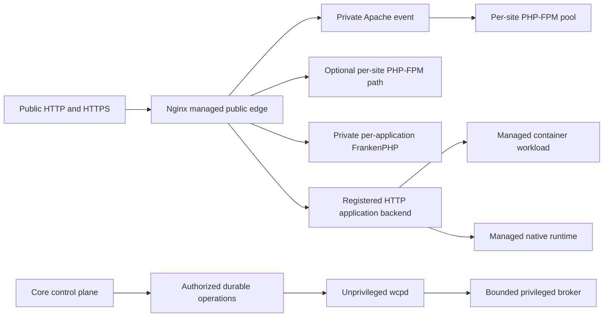

# Web-server and application-hosting strategy

**Decision recorded: 2026-11-02. Target architecture; production implementation remains open.**

This document adopts the project owner's supplied web-server strategy. It defines the intended hosting behavior and feeds the [ordered web-server roadmap](WEB-SERVER-ROADMAP.md), which expands Core milestones M2–M7 and M9. It does not amend accepted security/API/agent contracts, qualify a release or change an installed service.

## Target and current behavior

The target default for **new general-purpose hosting installations** is **Nginx → Apache MPM event → PHP-FPM**. Nginx owns the public edge; Apache applies controlled native per-directory rules; isolated PHP-FPM pools execute hosted PHP. These are components on a node, not a requirement for three servers.

The implemented candidate still defaults to **Nginx → PHP-FPM**. The [application recipes](APPLICATION-PROFILES.md) now add the three-layer topology as a seventh inert preview with a dedicated version-2 document. It remains a target for future installation defaults. Current runtime settings, database constraints, stored plans and existing site assignments retain their behavior.

Existing `php_fpm` / `classic` / revision 1 and plan/1 retain their Nginx/FPM meaning. Existing `frankenphp_worker` / `advanced` and plan/2 retain their Nginx-edge Worker meaning; the separate Modern plan/3 remains a Worker preview. A new topology requires its own explicit versioned representation, reviewed forward migration and decoder/consumer support. A global default applies to new inheriting resources only. Existing installations and sites require a separately reviewed transition. The panel application's own runtime is a separate decision.

Compatibility is the reason for the new default. An extra proxy layer has resource and operational costs; speed must be measured against each workload. WCP360 aims to host broad application families through qualified adapters, with explicit requirements and refusals.

## Ingress and execution model

The standard node has one owner for public ports, routes and certificates. Dedicated standalone Caddy/FrankenPHP nodes are an alternative topology with their own explicit listener/TLS ownership. Two engines must never independently claim the same address/protocol/port. HTTP/3 additionally needs a qualified UDP/TLS/network path; a catalogue label does not enable it.

In the default topology, **every site request passes through Apache, including images, archives, PDFs and other static files**. Nginx direct-file serving and response caching are disabled by default for that profile. Otherwise a public edge could return content that Apache's per-directory authorization would deny. A future accelerated file handoff must occur only after authorization and have its own tested contract.

An HTTP application's response can instead use a directly registered backend. PHP-FPM speaks FastCGI and is selected through a dedicated adapter; a Ruby, Node.js or container application is not routed to a PHP pool.

## Target topology catalogue

These are design targets, not new public enum values or currently available install options.

| Topology | Intended use | Rules and mode | Current boundary |
| :--- | :--- | :--- | :--- |
| **Nginx → Apache event → PHP-FPM** | New general-purpose default | Controlled native .htaccess; per-site FPM | New driver, durable selection and native lifecycle still required. |
| Nginx → PHP-FPM | Simpler managed-rules hosting | Structured server rules; no native .htaccess | Current durable Classic candidate; separately guarded isolated activation only. |
| Apache event → PHP-FPM | Dedicated Apache ingress or private compatibility backend | Controlled native .htaccess | Generated preview exists; complete public/backend lifecycle remains open. |
| Nginx → FrankenPHP | Isolated modern PHP application | Classic initially; Worker explicitly qualified per application | Classic recipe preview and separate generic Worker plans exist; general activation remains open. |
| Standalone FrankenPHP / embedded Caddy | Dedicated modern node | Classic initially; separately qualified Worker | Classic recipe and separate Worker Modern previews exist; public lifecycle remains open. |
| Apache → FrankenPHP | Justified advanced composition | HTTP proxy; no native .htaccess guarantee | Generated preview only; filesystem/rule behavior must be explicitly qualified. |
| Caddy → PHP-FPM | Complementary dedicated topology | Structured server rules | Generated preview only; public lifecycle remains open. |
| Nginx → registered native/container HTTP backend | Non-PHP applications and services | App-owned routing behind Core ingress policy | General application/container orchestration remains planned. |

FrankenPHP embeds Caddy; it does not require a second Caddy daemon. Classic mode handles ordinary PHP requests; persistent Worker execution needs an application integration and request-state management. WCP360 will admit Worker only after application-specific tests and resource/recycling policy. See the official [classic](https://frankenphp.dev/docs/classic/) and [Worker](https://frankenphp.dev/docs/worker/) documentation.

Do not substitute mod_php for FPM under the Apache event target. A future legacy handler would need a separate supported profile and isolation decision.

## Shared managers and code ownership

The managers below are logical Core capabilities, not four competing orchestrators or new top-level projects. HTTP, CLI, jobs and detached plugins call the same owning use cases.

| Capability | Core owner and collaborators | Responsibility |
| :--- | :--- | :--- |
| Web Stack Manager | [Hosting](README.md), Platform, Operations | Typed topology, effective profile, renderer selection, changes and reconciliation. |
| PHP Runtime Manager | Hosting, Files, Tenancy | Version/extension providers, FPM pools, FrankenPHP instances, PHP directives, CLI and resource limits. |
| Web Rules / HTACCESS Manager 360 | Hosting, Files, IdentityAccess | Native Apache rule workflow and portable structured rules with explicit engine capabilities. |
| Reverse Proxy Manager 360 | Hosting, Platform | Registered backend references, ingress routes, listener/TLS ownership and forwarding policy. |
| Application/container lifecycle | Hosting, [Platform](../Platform/README.md), [Operations](../Operations/README.md) | Application instances, private service dependencies, provider supervision and bounded effects. |
| Data, recovery and limits | [Data](../Data/README.md), [BackupRestore](../BackupRestore/README.md), [Tenancy](../Tenancy/README.md), Observability | Hosted databases/cache boundaries, consistent backups, quotas, health and diagnostic evidence. |
| Optional installers and integrations | [ExtensionManagement](../ExtensionManagement/README.md) and published extension APIs | Contribute approved recipes without becoming the authority for ingress, privileges or resource ownership. |

Keep orchestration policy in Hosting's Domain/Application layers, adapters in Infrastructure and bounded host effects in the Go agent/broker. Existing candidate templates live under [the Go planner](../../../agents/wcpd/candidate/planner/README.md); do not copy them into resource directories. Select a single canonical source for each new versioned template and link its service resource index. Create directories with actual implementation, rather than empty placeholder trees.

The Core must retain essential hosting, safe failure/recovery and lifecycle management with zero optional plugins. Disabling a recipe plugin must not terminate its running sites. Removing a plugin must refuse or explicitly transfer live resource ownership and preserve a Core-readable inventory.

## Native .htaccess and portable rules

Apache's [documentation](https://httpd.apache.org/docs/2.4/howto/htaccess.html) describes the performance/security cost of per-directory overrides. WCP360 accepts that cost where compatibility requires it; a managed-rules profile can avoid it.

The native workflow needs an effective policy for allowed modules, directives, arguments, rewrite flags, paths, handlers and network effects. Do not enable blanket `AllowOverride All`. [AllowOverrideList](https://httpd.apache.org/docs/2.4/mod/core.html#allowoverridelist) constrains directive names, but does not validate every allowed argument. A rewrite rule can enable proxying or change handling through flags; [flag semantics](https://httpd.apache.org/docs/2.4/rewrite/flags.html) need explicit policy and negative tests.

Native editing includes inspection, bounded preview, history, conflict detection, restore and diagnostics for unavailable directives. PHP settings belong to PHP Runtime Manager: legacy mod_php `php_value` / `php_flag` entries are not accepted as an automatic FPM configuration mechanism.

Applications and SFTP users can modify .htaccess directly. A panel editor cannot promise validation before those writes take effect. Runtime module restrictions, filesystem confinement, backend/egress controls and diagnosis remain necessary; watchers cannot replace an enforcement boundary.

Portable rules cover typed redirects, authentication, directory protection, headers and other explicitly supported operations. Each engine renders its own tested equivalent. An importer analyzes a bounded supported subset and its per-directory context, reports losses, builds a candidate and verifies behavior before offering activation. Unsupported semantics require refusal or retaining Apache. No universal live translator is promised.

## Isolation, routing and change safety

- Evaluate current actor, tenant, resource revision, entitlement and capability at planning and execution boundaries. A route/backend ID is not permission.
- Keep PHP, the panel and wcpd unprivileged. Only the minimal wcp-privd broker performs bounded authenticated operations; no generic shell, tenant-selected service names or arbitrary configuration paths.
- Assign each site's PHP pool and each independent customer's FrankenPHP instance an explicit unprivileged identity, filesystem scope, service resource budget and private listener. Do not share a FrankenPHP process across independent customers.
- Prove the shared Apache/edge access model as well as PHP UID separation. A shared static-serving process can read more than a single FPM identity; Unix pool separation alone does not establish complete tenant isolation.
- Register private backends under their owner. Deny access to the Core/admin origins, control-plane data, other tenants, metadata endpoints and unauthorized local services. Loopback alone is not an authorization boundary.
- Strip untrusted forwarding headers at the edge and rebuild a documented trusted chain for client address, host and scheme. Define WebSocket/SSE, uploads, timeouts, retries, error handling and streaming per route. Never retry a potentially committed mutation blindly.
- Bind plan, policy/provider/template versions and exact artifact hashes to the authorized operation. Reserve listeners and dependencies transactionally, detect drift and preserve an explicit uncertain outcome after lost acknowledgements.
- Use **plan → authorize → stage candidate → native validation → targeted behavior checks → controlled activation → observed health → reconcile or recover**. An earlier read-only preview may precede authorization for effects. Record actor, revision and outcome without secrets.

Normal changes target the affected instance or a validated graceful shared reload. Capacity, concurrent changes and reload failure must be checked; availability cannot be guaranteed by a syntax pass. Data migrations need their own recovery plan and must not be blindly rolled back with a configuration symlink.

## Application compatibility model

Support is attached to a **versioned application recipe + topology + runtime/provider + OS + tested features**. Discovery, generated preview, syntax pass, HTTP acceptance, operational qualification and release support are distinct states.

| Application family | Intended execution | Required qualification examples |
| :--- | :--- | :--- |
| Traditional PHP, WordPress, compatible CMS/e-commerce | FPM or isolated FrankenPHP classic | Install/login/admin, permalinks, uploads, scheduled jobs, plugin/theme updates, cache privacy and restore. |
| Symfony, Laravel and other front controllers | FPM or FrankenPHP classic; opted-in Worker adapter | Routing, secrets, writable paths, migrations/queues, request-state reset and worker recycling. |
| Native .htaccess-dependent applications | Apache/FPM directly or behind Nginx | Nested rules, protected static files, redirects, supported directives and application-written updates. |
| Node.js, Python ASGI/WSGI, Ruby/Rails, Go/JVM and other services | Managed application process or qualified container behind a private HTTP backend | Runtime provider, bind/identity policy, workers, readiness, graceful shutdown, streaming and data dependencies. |
| Static sites and SPAs | Qualified managed-rules ingress or application backend | Fallback routing, MIME, hidden-file rules, TLS, deploy/version switch and rollback. |
| Multi-service applications, including Discourse | Versioned application-specific container recipe | Dependencies, private networking, volumes, jobs, upgrade/migrations, backup/restore and ingress semantics. |

WordPress must be exercised on each claimed PHP topology; a generated front-controller snippet is insufficient. Native .htaccess is available only on profiles that actually traverse Apache's filesystem/rule handling. Apache HTTP proxying to FrankenPHP does not by itself provide that behavior. Worker support is never inferred from WordPress running in classic mode.

## Docker and OCI workload strategy

Docker is a planned application-runtime provider, separate from web-server choice. Core-managed ingress can proxy an admitted workload without forcing Apache or a PHP runtime into its application container. The Core's own development Docker environment is not a tenant application manager.

The provider contract must include image identity/digest and admission, resource ownership, private networks/endpoints, allocated ports, persistent volumes and UID mapping, secret references, dependency order, health/readiness, restart/drain policy, quota enforcement, logs, updates and deletion/retention rules. Do not expose secrets in generated configuration downloads or routine logs.

A Docker daemon API is a powerful host-control surface. PHP, tenants and plugins must not receive the Docker socket or membership of its privileged access group. Fixed typed provider operations enforce the full admitted workload specification; arbitrary unreviewed Compose files, host mounts, host networking, privileged mode and extra capabilities are not a general self-service escape hatch. Provider-specific administrator exceptions need a separate authority and isolation decision. See [Docker Engine security](https://docs.docker.com/engine/security/).

Rootless engines and user namespaces are candidate isolation options, not interchangeable compatibility claims. Verify networking, volume ownership, limits and upstream application support for the chosen provider. The qualified profile owns in-container identities and capabilities: a multiprocess upstream image may initialize as container root before starting restricted services. That does not justify privileged mode, an obligatory rootful daemon or broader host authority. Do not apply a universal non-root image override that breaks the admitted workflow. An application requiring excessive host authority belongs on a separately isolated node/VM or is refused. See [rootless limitations](https://docs.docker.com/engine/security/rootless/).

### Discourse reference workload

Discourse is a Ruby/Rails application with its own container deployment and service dependencies; it is not a PHP application. Use the upstream [Docker deployment repository](https://github.com/discourse/discourse_docker) and [installation guide](https://github.com/discourse/discourse/blob/main/docs/INSTALL-cloud.md) as the integration reference. WCP360's adapter is a separately qualified third-party integration.

Pin a reviewed upstream revision/image and resolve that version's Ruby, PostgreSQL, Redis, CPU/RAM/disk, hostname and outbound-service requirements. Do not reuse the panel's database or assume its PostgreSQL major version is sufficient. Decide explicitly whether dependencies are bundled or external and include them in recovery.

The first recipe should preserve Discourse's internal Nginx and expose a private HTTP endpoint to the managed WCP360 edge. The upstream [coexistence guide](https://meta.discourse.org/t/run-other-websites-on-the-same-machine-as-discourse/17247) documents a Unix-socket approach. If WCP360 owns public TLS, disable competing container TLS/ACME templates and public port publication. Qualify any private TCP publication against effective Docker version, IPv4/IPv6 exposure and firewall behavior; see [Docker port publishing](https://docs.docker.com/engine/network/port-publishing/).

Preserve correct host/client-IP/scheme handling, application-declared upload/header limits and long-lived connections, including Discourse MessageBus long polling. The [upstream Nginx configuration](https://github.com/discourse/discourse/blob/main/config/nginx.sample.conf) is a versioned input, not a universal setting for every application. Reconcile the upstream launcher/rebuild/template workflow with bounded provider operations instead of executing tenant-provided commands; pin the recipe, application, image and plugin revisions because a rebuild may otherwise resolve newer source. The [upstream launcher](https://github.com/discourse/discourse_docker/blob/main/launcher) is part of that reviewed build/rebuild contract.

Qualification includes first setup, login and the selected identity/email flow, topics/search/uploads, background processing, real-time behavior, application backup and restore, rebuild/update, failed migration, restart and host reboot. Messaging requirements follow the pinned deployment's supported authentication/notification mode; do not copy an obsolete universal SMTP assumption. Application rollback is allowed only when its schema/data state supports it; otherwise restore or reconcile explicitly.

## Performance and support policy

Measure real application behavior before choosing optimizations. Keep the same workload, dependencies, machine budget, PHP extensions and cache policy across comparisons. Record repeated cold/warm runs, authenticated/private paths, p50/p95/p99 latency, sustained throughput at an error/latency budget, CPU/RAM/I/O, queue delay and overload recovery. A public cache hit is not evidence for dynamic PHP performance. Coordinate edge connections, Apache workers and FPM capacity; [Apache documents](https://httpd.apache.org/docs/2.4/mod/mod_proxy_fcgi.html) how persistent FastCGI connections can occupy available FPM children.

Test multi-tenant contention, worker leaks/state carryover, backend failure, reload/drain and restoration as part of performance acceptance. Cache/compression changes must preserve authentication, cookies, uploads, purge/invalidation and .htaccess authorization. Protected-file delivery cannot become an optimization tradeoff.

Core OS targets remain **Debian 12/13 and Ubuntu 22.04/24.04/26.04 LTS**. Qualify each claimed web/container provider and application combination independently on its supported targets. Core userspace CI does not certify Apache modules, container hosts, all Discourse deployments, public TLS/HTTP3 or production hosting.

The [web-server roadmap](WEB-SERVER-ROADMAP.md) records dependencies, acceptance evidence and the next implementation slice. The [Core roadmap](../../../ROADMAP.md#m5) remains the project-wide delivery authority.
