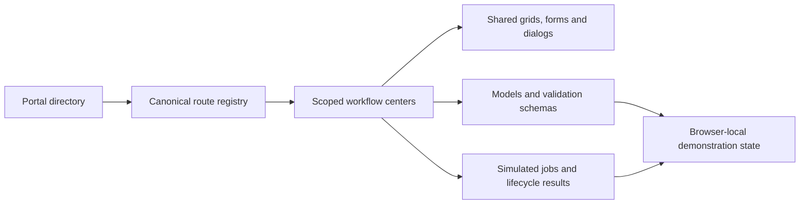

# WCP360 Prototype

Interactive, local HTML prototype of the WCP360 hosting control panel. It explores the USER, RESELLER and ROOT interfaces before their implementation in the production Core.

> Demonstration data only. Actions are simulated in the browser. No Linux command, production installation, mail delivery or privileged operation is performed.

## Start the prototype

From the `WCP360_Prototype` directory, choose one preview server:

### Windows PowerShell — no additional runtime

```powershell
powershell.exe -NoProfile -ExecutionPolicy Bypass -File .\serve-prototype.ps1
```

### Linux, macOS or Windows with Node.js

```sh
node serve-prototype.mjs
```

Open **http://127.0.0.1:8790/**. Both servers bind only to loopback and run without root privileges. Stop them with Ctrl+C. Use `-Port 8792` for PowerShell or append `8792` to the Node command to choose another port.

Keep the same host and port to retain browser state between pages. Direct `file://` navigation does not guarantee shared persistence. A separate browser profile provides an independent demo. Google Fonts and Material Symbols require network access; application source has no package installation step.

## Explore the panel

The home page provides portal selection, a categorized tool directory, multilingual search and six guided journeys. Search examples: `sécurité audit`, `sauvegardes`, `certificats`. Press / to focus the home search; Escape clears it. Search URLs can be bookmarked.

The [demo sign-in](login.html) offers USER, RESELLER and ROOT. Use the displayed fictional values: `admin@example.com`, password `demo-wcp360`, then code `123456` (or `DEMO-RECOVERY` in recovery mode). These forms simulate navigation; they do not authenticate a real account. Input values are never saved or included in the destination URL.

| Portal | Purpose | Entry |
| :--- | :--- | :--- |
| USER | Websites, domains, files, mail, databases, applications and account operations | [USER dashboard](canonical-user-dashboard.html) |
| RESELLER | Delegated customers, packages, quotas and allowed services | [Reseller center](reseller.html) |
| ROOT | Infrastructure, hosting inventory, policies, services, security and software governance | [ROOT dashboard](canonical-admin-dashboard.html) |
| Components | Shared grids, forms, validation, dialogs, exports and interface states | [UI component gallery](components.html) |

The default navigation registry exposes 61 ROOT tools, 21 USER tools, 10 RESELLER tools and 6 design/validation entries. Availability can change when optional extensions are disabled. The folder preserves **232 HTML pages**, including historical compatibility redirects; a page count does not represent 232 implemented production features.

## Functional areas and canonical centers

| Area | Canonical surface | Prototype behavior |
| :--- | :--- | :--- |
| First-run setup | [Setup wizard](setup-wizard.html) | Quick/expert forms, validation, synthetic secret references, blocked/successful Linux fixtures and local settings revision |
| Identity and delegation | [Identity & Access](users-roles.html), [reseller](reseller.html) | Users, roles, plans, effective permissions and delegated limits |
| Hosting lifecycle | [Hosting accounts](hosting-accounts.html), [websites](websites.html) | Creation, admission, suspension, removal/recovery and job-linked reconciliation |
| Runtime policies | [Web runtime](web-runtime.html) | Web engines, language versions, profiles and allowed modules |
| Data and access | [Files](file-manager.html), [databases](databases.html), [transfer access](file-access-center.html) | Shared collections, validation, local file metadata, database users and access settings |
| DNS and TLS | [ROOT DNS](admin-dns.html), [USER DNS](canonical-dns.html), [certificates](certificates.html), [USER TLS](ssl.html) | Policy inheritance, records and certificate workflows |
| Mail | [ROOT mail](admin-mail.html), [USER email](email.html) | Mailbox lifecycle, rules, retention, provider visibility and simulated publication |
| Applications and delivery | [Catalog](application-catalog.html), [USER installer](app-installer.html), [delivery](delivery-platform.html) | Approved recipes, application operations and delivery workflows |
| Protection and recovery | [ROOT backups](admin-backups.html), [USER backups](backups.html), [restore tests](restore-tests.html) | Policy, scheduled jobs, restore review and recovery states |
| Operations | [Jobs](jobs.html), [notifications](notifications-center.html), [services](service-manager.html), [incidents](incidents.html), [audit](audit-explorer.html) | Shared progress, failure, cancellation, retry and trace views where supported |
| System and extensions | [System settings](system-settings.html), [software manager](software-manager.html) | 24 settings sections, 248 settings and lists, grouped overview, editable connectors/storage/IP pools, separate drafts, reviewed revisions and optional-plugin lifecycle isolation |

See the [operation guide](23-prototype-operation-guide.md) for ordered scenarios and the [page-by-page verification inventory](26-page-verification-inventory.md) ([CSV](26-page-verification.csv)) for the current evidence and unverified pages. The [earlier integration inventory](20-integration-coverage-audit.md) retains its historical scope. Existing design-closure labels describe design coverage; they do not certify working backend behavior.

## Folder structure

```text
WCP360_Prototype/
├── index.html                       # Portal chooser, journeys and tool directory
├── canonical-*.html                 # Reference dashboards and centers
├── *.html                           # Workflows and compatibility routes
├── assets/
│   ├── reference-ui.js / .css       # Shared shell and canonical route ownership
│   ├── foundation.js / .css         # Reusable data and interface components
│   ├── product-runtime.js           # Shared simulated jobs and notifications
│   ├── setup-model.js              # Pure setup validation and Linux fixtures
│   ├── setup-wizard.js / .css       # Setup controller and presentation
│   ├── settings-model.js            # System Settings schema and validation
│   ├── settings-store.js            # Separate drafts, revisions and recovery
│   ├── system-settings.js / .css     # Settings controller and presentation
│   ├── prototype-search.js          # Multilingual token matching
│   └── *-model / *-schemas / *-center
├── tests/                           # Static, controller, HTTP and browser audits
├── serve-prototype.ps1              # Dependency-free Windows preview
├── serve-prototype.mjs              # Portable Node preview
├── 01-*.md … 25-*.md                # Design contracts and historical checks
├── 26-page-verification*            # Per-page evidence inventory and CSV
├── 27-system-settings-reconstruction.md # Previous settings reconstruction
├── 28-system-settings-functional-restoration.md # Restored advanced settings
├── STYLE_LOCK.md                    # Historical visual constraints
└── AUDIT-CONSOLIDATION.md            # Historical consolidated design audit
```

## Shared architecture



Each workflow keeps its canonical owner. Historical creation forms and duplicate centers remain compatibility redirects instead of parallel implementations. Reusable components and schema rules should be extended once and consumed by their centers.

## Setup and Linux boundaries

The setup model validates management identity, PostgreSQL metadata, dedicated paths, credential-free endpoints, numeric bounds and service dependencies. ROOT MFA, a host firewall and no direct root SSH form its demo baseline. The five Linux fixtures represent a ready Debian 13 / amd64 host, insufficient space, unresolved DNS, port conflict and clock drift.

Preflight results are invalidated after edits and reloads. They never inspect the actual machine. Apply saves a local revision and a simulated operation; storage failures must prevent successful completion. Secret fields accept synthetic `secret://demo/…` references only, and old literal credentials in wizard drafts are discarded. Other prototype forms also require fictitious input; this folder is not a secrets vault.

The intended production implementation belongs in [WCP360_Core](../WCP360_Core/README.md): Symfony/Twig/Turbo/Stimulus, PostgreSQL, workers and controlled Go agents. Plugin source belongs in [WCP360_Plugins](../WCP360_Plugins/README.md). This folder neither changes system-runtime authorization nor qualifies a production release.

## Verification

```sh
node tests/run.mjs
# Start either preview server, then:
node tests/http_preview.mjs 8790
```

The [System Settings restoration record](28-system-settings-functional-restoration.md) describes the current implementation: 24 sections and 248 settings and lists, with additive draft migration and editable provider/storage/IP collections. The latest run passed 25 suites, plus 254 HTTP checks covering 232 pages. The [page-by-page inventory](26-page-verification-inventory.md) ([CSV](26-page-verification.csv)) distinguishes initial HTML checks from targeted controller coverage: 32 pages have the latter, while 200 do not in the listed suites. This is not a full browser verification of 232 workflows.

See [tests/README.md](tests/README.md) for individual suites and separate Chrome audits. VM and HTTP checks do not establish visual quality, native keyboard focus, server authorization or Linux security. The [UI/UX correction record](25-ui-ux-remediation.md) and [previous verification record](24-verification-record.md) retain the earlier results and their limits.

## Naming and historical references

This directory replaces `WCP360_Design_System/`. Active repository links and test paths use `WCP360_Prototype/`. Frozen specification packages, historical branch names and baseline identifiers retain their original names for traceability. The canonical design reference package remains V2.5.3.36.4; executable prototype changes do not create a new frozen baseline.
