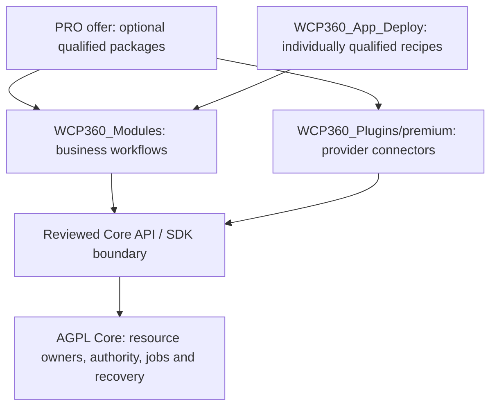

# Community, PRO and premium packages

**Product direction recorded on 2026-11-02.** WCP360 uses one open-source Core and separately packaged optional products. This document records the edition boundaries and the work required to deliver them; it does not activate an edition, admit a package or qualify an application recipe.

The [Core working guide](../../WCP360_Core/WORKING-GUIDE.md), [current status](../../WCP360_Core/STATUS.md) and [roadmap](../../WCP360_Core/ROADMAP.md) describe the executable candidate. The licensing scope is defined in [Core licensing](../../WCP360_Core/LICENSING.md) and its [AGPL-3.0-only license](../../WCP360_Core/LICENSE). Product descriptions and planning catalogues must not override those sources.

## Decisions and present limits

| Topic | Decision | Current implementation boundary |
| :--- | :--- | :--- |
| Community | The Core is 100% open source under AGPL-3.0-only. | The existing candidate remains incomplete; open-source scope is not a claim that every planned capability works. |
| Essential platform | The thirteen Core domain owners, 233 essential functional capabilities and seven Core engine/provider adapters remain in the open-source perimeter. | Their individual implementation and qualification states still apply. No essential adapter is moved behind a premium entitlement. |
| PRO | A commercial offer of optional business modules, connectors and advanced workflows using the same Core. | No executable edition selector, subscription entitlement verifier or PRO activation protocol is delivered by this document. |
| Premium business modules | Independently versioned packages under `WCP360_Modules/`. | The catalogue contains 36 design proposals, not 36 installable packages. |
| Premium connectors | Independently versioned integrations under `WCP360_Plugins/premium/`. | The catalogue contains 60 design proposals, not 60 admitted or qualified connectors. |
| App Install PRO | Full access to application installation workflows for recipes that have passed the required qualification and admission checks. | No executable general App Installer exists today; the 410 App Deploy references are not all installable applications. |
| Package licensing | Decide and publish the source model and license for each optional artifact before release. | Premium source models and licenses remain undecided. A commercial product may also be open source. |
| SDK | Keep a separate dependency and distribution boundary. | The SDK license requires its own decision; Core licensing does not silently settle it. |

PRO is neither a Core fork nor a `ROOT` privilege flag. Community and PRO use the same supported Core release, owning use cases, resource inventory and recovery paths. An upgrade to PRO must not require migrating a server into a different Core codebase.

## Edition boundaries

The matrix defines the product direction. A check in this table is not evidence that the corresponding production workflow is implemented or qualified.

| Area | Community | PRO |
| :--- | :--- | :--- |
| Core installation, setup wizard, supported updates and repair | Open-source Core scope. | The same Core and recovery path. |
| Authentication, tenant isolation, permissions, audit and security controls | Essential Core scope; no commercial dependency. | The same controls, including checks for every premium action. |
| Hosting, files, databases, mail and essential resource management | The essential capabilities and adapters remain open source. | The same ownership, extended through optional admitted workflows. |
| Existing sites, applications and retained customer data | Remain manageable through supported Core workflows. | Premium management never becomes the sole keeper of these resources. |
| Baseline backup, restore, export and recovery | Remain accessible according to current resource permissions. | Optional advanced orchestration may add capabilities without removing baseline access. |
| Optional community packages | May be offered under their published terms and accepted package contract. | May coexist with premium packages when dependencies and permissions allow. |
| Advanced business modules | No PRO entitlement is assumed. | Access to the offered premium modules after package admission, configuration and explicit activation. Final bundle contents remain to be defined. |
| Provider-specific premium connectors | No PRO entitlement is assumed; baseline Core adapters remain available. | Access to the offered connectors after trust, compatibility, credential and scope checks. |
| Full App Install | Essential Core site/resource primitives remain available; this strategy invents no free installer quota or recipe subset. | Full qualified-recipe workflow access, subject to the host, provider, application license, compatibility, entitlement and actor permissions. |
| Vendor outage or subscription expiry | Essential operation and recovery continue. | The same continuity requirement; changes to new premium work require an accepted commercial policy. |
| Support, service levels and pricing | No commitment is created here. | No price, support guarantee or service level is defined here. |

The functional scope in the [capability map](../../WCP360_Core/CAPABILITY-MAP.md) remains the reference for Core ownership. Premium automation may combine existing owning use cases; it cannot take ownership of essential resource records, move security checks into paid code or make Core depend on an optional package.

## Repository and catalogue ownership

| Location | Owns | Does not mean |
| :--- | :--- | :--- |
| [`WCP360_Core/`](../../WCP360_Core/README.md) | The open-source panel, thirteen domain owners, Core engine/provider adapters, authorization, durable operations and resource recovery. | A place to inject premium PHP, optional Composer dependencies or arbitrary hooks. |
| [`WCP360_Modules/`](../../WCP360_Modules/README.md) | Detached optional business products and their independently built dependencies. | New built-in Core domain owners or automatically discovered Symfony bundles. |
| [`WCP360_Plugins/premium/`](../../WCP360_Plugins/premium/README.md) | Detached provider-specific premium connectors. | Privileged brokers, essential Core engines or a second authorization system. |
| [`WCP360_Plugins/`](../../WCP360_Plugins/README.md) | Existing plugin development and reference candidates, with their individual status. | An automatic license or admission decision for every directory. |
| [`WCP360_App_Deploy/`](../../WCP360_App_Deploy/README.md) | Editorial application references, draft recipe authoring, profiles and qualification evidence. | An installer service, a replacement for Core resource owners or 410 supported applications. |
| [`WCP360_SDK/`](../../WCP360_SDK/README.md) | Contract-oriented integration tooling and development support. | Permission to load package code into the Core process or an already selected SDK license. |
| [`WCP360_Releases/`](../../WCP360_Releases/README.md) | Controlled release preparation and published evidence when available. | Proof that a catalogue entry has a released artifact. |

The authoritative premium proposal inventories are the [module JSON catalogue](../../WCP360_Modules/CATALOG.json) and [connector JSON catalogue](../../WCP360_Plugins/premium/CATALOG.json). Their [module Markdown view](../../WCP360_Modules/CATALOG.md) and [connector Markdown view](../../WCP360_Plugins/premium/CATALOG.md) support human review and must be regenerated from those inventories rather than edited into a competing authority.

A `package.proposal.json` describes planning metadata under the [proposal schema](../../WCP360_Modules/schemas/package-proposal.schema.json). It is not an accepted production package manifest, an executable recipe or proof of admission. Catalogue presence, an identifier or a matching schema does not authorize download, install, enablement, system effects or billing.

Business modules cover areas such as App Install, application fleets, staging, delivery orchestration, database/mail operations, recovery, security operations, observability, enterprise access and AI assistance. Connectors integrate specific DNS/CDN, cloud, storage, identity, payment, delivery, registry, collaboration or AI/MCP providers. The linked catalogues hold the full inventories; this strategy does not duplicate or redefine their IDs.

The diagram shows the target collaboration. Every arrow still requires accepted contracts and qualification; it is not automatic discovery or an implemented runtime.

## Open-source licensing and commercial rights

The Core license decision is **AGPL-3.0-only**, not an automatic grant of later license versions. Preserve the applicable notices and fulfill the license obligations for the covered code. In particular, AGPL version 3 addresses corresponding-source access for users interacting remotely with a modified version; see the [license text](../../WCP360_Core/LICENSE) and the [GNU explanation](https://www.gnu.org/licenses/gpl-faq.en.html#UnreleasedModsAGPL).

Charging for software does not by itself make it proprietary; see the [GNU explanation of commercial distribution](https://www.gnu.org/licenses/gpl-faq.en.html#GPLCommercially). Each premium package must declare its actual source model, license, notices and dependency obligations before distribution.

Separate processes and public APIs are execution boundaries. They do not by themselves settle whether an integration is a separate work or a derivative/combined work under the applicable license. Review the actual code, dependencies and interaction for each package; no blanket proprietary-compatibility promise or additional AGPL exception is granted here. The [GNU discussion of aggregation](https://www.gnu.org/licenses/gpl-faq.en.html#MereAggregation) explains why substance as well as communication matters.

Commercial terms govern services, subscriptions and specifically offered optional rights. They cannot withdraw rights already granted by an applicable open-source license. This strategy does not relicense third-party dependencies, hosted applications, documentation, logos or SDK artifacts by implication. Use [Core licensing](../../WCP360_Core/LICENSING.md) for scope and unresolved distribution reviews.

## Independent admission decisions

Every premium operation requires independent answers to the following questions.

| Decision | Owner or evidence | A positive answer does not grant |
| :--- | :--- | :--- |
| Is the current actor authenticated and permitted on this tenant/resource? | Core IdentityAccess and the owning domain. | A subscription, publisher trust or a new capability. |
| Is the optional commercial right currently accepted? | Tenancy under a reviewed entitlement contract. | Another tenant's data, root authority or permission to bypass Core checks. |
| Are these exact package bytes and their publisher admitted? | ExtensionManagement trust, artifact and compatibility checks. | Commercial rights, installation consent or activation consent. |
| Has this installation or change been approved? | Authorized operator, declared effects and owning use cases. | Automatic enablement, undeclared dependency changes or broader permissions. |
| Is this runtime action allowed now? | Current resource authority, approved capabilities, budgets and effect policy. | A general shell, direct database access or unrestricted filesystem/network access. |

The server administrator's ROOT context is separate from a PRO subscription. A customer with a premium subscription does not become the server administrator. Conversely, administrator authority does not prove a commercial entitlement.

Run optional package code in a dedicated non-root process with its own dependencies, bounded resources and revocable scoped credentials. Use reviewed API/SDK contracts and the existing authorized use cases. Do not add premium PHP to the Core Symfony process, mutate its Composer lock/vendor, register unrestricted bundles, load plugin Twig/JavaScript into the Core origin or grant a host Docker socket/direct privileged broker channel.

Installation and activation require distinct explicit consent. Neither buying a subscription nor refreshing an entitlement installs code, activates a connector, accepts new scopes or changes a running site's engine.

See the Core [local licensing reservation](../../WCP360_Core/src/Module/Tenancy/design/licensing/README.md), [package reservation](../../WCP360_Core/src/Module/ExtensionManagement/design/packages/README.md) and [detached lifecycle design](PLUGIN-LIFECYCLE.md).

## Full App Install PRO

Full App Install is access to the complete set of **qualified, eligible recipes offered by the product**, without inventing a numerical recipe limit here. It does not promise that every catalogue reference can be installed on every server.

The [App Deploy catalogue](../../WCP360_App_Deploy/README.md) currently contains 410 references across 70 categories, 17 natures and 16 profiles. These include applications, services, runtimes, extensions, templates and libraries. A reference can require specialized hardware, isolation, provider services, commercial application rights or an unsupported host. Editorial classification and source verification are not runtime qualification.

The [read-only Core catalogue](../../WCP360_Core/src/Module/Hosting/APPLICATION-CATALOGUE.md) currently reports all entries as non-installable. The draft [recipe schema](../../WCP360_App_Deploy/schemas/app-recipe.schema.json), [Core integration design](../../WCP360_App_Deploy/docs/CORE-INTEGRATION.md), [lifecycle design](../../WCP360_App_Deploy/docs/LIFECYCLE.md) and [qualification process](../../WCP360_App_Deploy/docs/QUALIFICATION.md) define preparation work; they do not deliver an executable installer.

A future qualified recipe needs an immutable admitted source/artifact, applicable application/dependency licenses, fixed typed operations, compatible host/provider/isolation, bounded declared effects, health evidence and tested install/configure/update/remove/recovery behavior. Core Hosting owns application instances and ingress; Files, Data, Platform, Operations and BackupRestore keep their existing responsibilities. The optional App Install module orchestrates those owners rather than becoming a privileged installer outside their controls.

Installing an application does not transfer its license, credentials, persistent data or recovery path to the PRO subscription. Disabling the installer or connector must not stop, delete or orphan an already running application.

## Subscription and package lifecycle

The phases below are product requirements, not new canonical states, implemented endpoints or a token protocol.

| Phase | Required behavior |
| :--- | :--- |
| Select an offer | Explain the offered modules/connectors, qualified recipe access and applicable terms before subscription. Do not change Core permissions or install code. |
| Accept entitlement evidence | Tenancy verifies accepted product rights under a reviewed contract; distinguish unconfigured, unreachable, invalid, stale, expired and accepted evidence. |
| Browse the catalogue | Show bounded metadata, availability, compatibility and qualification separately from commercial eligibility. Catalogue outages do not block existing Core workflows. |
| Admit and stage | Verify publisher trust, immutable bytes, licenses, compatibility, dependencies and declared capability/data changes without executing untrusted code. |
| Configure | Collect only typed settings and scoped secret references. Validate tenant/provider access, resource budgets and recovery prerequisites. |
| Install disabled | Require explicit approval of the exact package and declared preparation/migrations; record durable partial or uncertain outcomes. |
| Activate | Require separate explicit approval, current permissions and accepted rights; publish approved contributions only after readiness checks. |
| Operate | Reauthorize each concrete effect and reuse Core jobs, audit, idempotency, concurrency controls and reconciliation. |
| Update | Review exact artifact/capability changes, back up state, drain or fence work, run accepted migrations and verify readiness before explicit reactivation. |
| Downgrade, expire or disable | Apply the accepted policy at a safe boundary; preserve Core administration, existing resources, retained data and recovery. Withdraw new premium entry points without blindly cancelling irreversible work. |
| Uninstall | Require a disabled/drained package and resolved dependencies; revoke credentials and remove declared package-owned components. Retain customer data by default. |
| Purge | Use a separate explicit authorized decision, with scope, retention and recovery checks. Never imply deletion of Core/tenant resources or retained audit evidence. |

A previous image or package archive is not a database rollback. Recovery plans must distinguish code rollback, backward-compatible state, forward repair and tested data restoration. A failed migration or lost acknowledgement is an uncertain outcome until reconciled; it is not permission to replay a destructive step.

Revocation of permissions or entitlement while a job is queued must be handled by the owning use case before effects or publication. Completed resource changes remain in Core inventory even when the optional package is no longer available.

## Offline operation, expiry and service continuity

The essential Core must work with zero optional packages and without a permanent vendor/license connection. Authentication, local administration, security controls, existing hosted workloads, retained inventory/data and supported baseline backup/recovery remain accessible according to current Core permissions.

An outage, expired trial, subscription downgrade, invalid proof and unknown entitlement are distinct situations. Do not silently treat uncertainty as a valid premium right; do not interpret it as a command to stop hosting, erase data or disable essential security and recovery.

Offline proof acceptance, refresh frequency, grace, revocation freshness, clock handling, transfers and treatment of in-flight premium jobs still require explicit product and security decisions. No duration, perpetual premium access or offline-validity guarantee is invented here. Where new commercial work requires an unresolved decision, it remains unavailable until policy is accepted; existing supported management and recovery continue.

Preserve only the bounded verified evidence that the accepted policy permits. Keep entitlement proofs, signing/activation material, provider secrets and subscription identifiers out of ordinary logs, exports, support bundles and AI/MCP prompts. Private issuer keys do not belong on installed servers.

## Ordered delivery work

1. **Establish the public scope.** Record AGPL-3.0-only for the Core, retain the thirteen owners and essential capabilities/adapters, and identify the separate license reviews for packages, SDK, dependencies and distribution artifacts. This document and the catalogue proposals record direction; they do not complete those reviews.
2. **Review the proposed inventories.** Maintain the JSON catalogues and generated Markdown views, consolidate overlap between business modules and connectors, and identify a small pilot set. Decide the actual PRO offer and publish package terms before promising availability.
3. **Accept versioned integration contracts.** Review detached package admission, contributions, entitlement evidence, API/SDK compatibility and the application-recipe boundary. Existing design reservations and proposal schemas remain non-production inputs until that work is accepted.
4. **Implement bounded Core admission and rights consumers.** Keep Tenancy, ExtensionManagement, IdentityAccess, Operations, Setup and resource owners separate. Add explicit consent, safe offline/error behavior, revocation, durable evidence and reconciliation without loading optional code into Core.
5. **Deliver isolated pilot packages and qualified application recipes.** Build independent dependencies and controlled artifacts; prove refusal, lifecycle, migration, retention and recovery behavior on supported disposable environments before offering installation.
6. **Integrate the catalogue and App Install experience.** Expose eligibility, qualification, pending changes, job outcomes and safe recovery through the same authorized use cases. Keep the 410-reference editorial catalogue separate from the installable set.
7. **Release with evidence and maintain compatibility.** Publish exact artifacts, licenses/notices, supported versions, qualification evidence and recovery instructions. Admit later modules, connectors and recipes individually rather than treating catalogue membership as release approval.

These steps define dependency order, without invented dates, prices or completion percentages. Follow the [Core roadmap](../../WCP360_Core/ROADMAP.md) and [delivery process](DELIVERY-AND-RELEASES.md) for candidate and release gates.

## Acceptance before a commercial launch

| Boundary | Evidence required |
| :--- | :--- |
| Core continuity | Zero optional packages, catalogue failure, license vendor outage and expiry preserve essential Core operation and supported recovery. |
| Authority separation | A subscription cannot grant ROOT/tenant scope, accept a publisher, install a package or authorize a concrete resource effect. |
| Artifact and compatibility | Reject unknown/revoked publishers, altered artifacts, unsupported versions, undeclared scopes, unsafe paths and incompatible dependencies. |
| Lifecycle and migration | Cover interrupted install/update, stale permissions, revoked rights, concurrent disable, lost acknowledgement, failed migration and honest recovery. |
| Data retention | Disable/uninstall/expiry preserve hosted resources and retained customer data; purge is separately approved and bounded. |
| App Install | Offer only individually qualified and compatible recipes; unsupported hardware, provider, application license and unsafe input cannot become installable through PRO. |
| Isolation and privacy | A package cannot access Core dependencies/database, arbitrary paths/root channels, other tenants or unapproved egress; secrets stay out of reports and AI input. |
| Licensing and distribution | Publish the actual terms and notices, corresponding-source obligations where applicable and artifact-specific compatibility decisions. No proprietary-compatibility assumption follows from API isolation. |

This strategy adds documentation and planning boundaries only. It supplies no production entitlement verifier, billing integration, package admission engine or general application installer, and records no executed runtime qualification.
