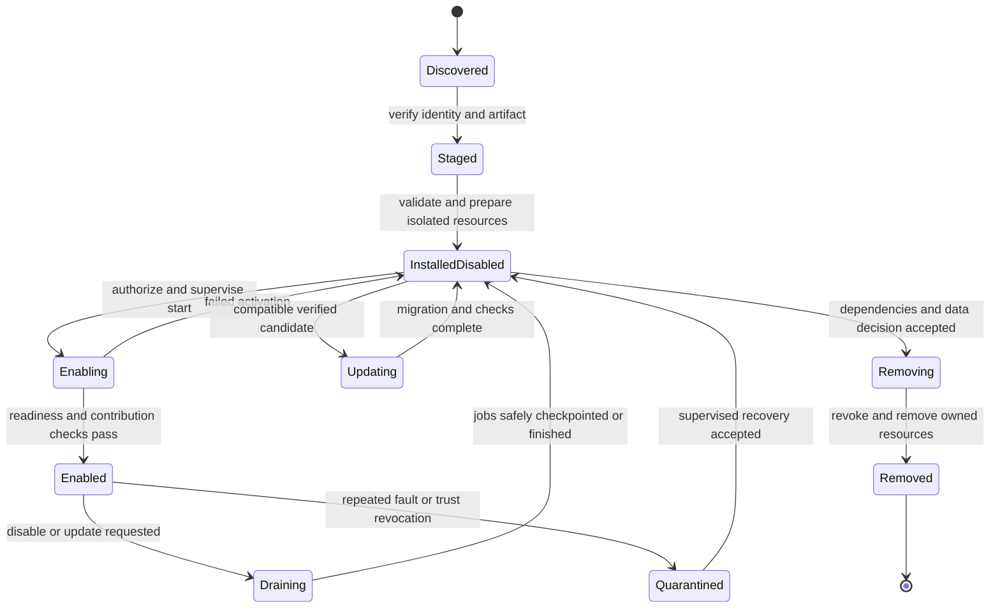

# Detached plugin lifecycle

This is the target implementation/acceptance design. Logical state names below are explanatory, not new canonical API/database enums. Ratify the manifest, transport, persistence and operation contracts before implementing them.

## Two kinds of modularity

| Kind | Execution and ownership | Removal |
| :--- | :--- | :--- |
| Built-in Core module | Reviewed services within the controlled Core build, owning essential rules/data. | Core upgrade/migration procedure; not an arbitrary runtime uninstall. |
| Detached optional plugin | Independent package/process, dedicated identity/data/budget, approved APIs/events and isolated UI contribution. | Managed plugin lifecycle, preserving Core and hosted workloads. |
| Essential engine adapter | Implements an active web/mail/database/storage capability. | Refuse removal until dependent resources have an accepted replacement/migration. |

A plugin host must never discover a directory and automatically execute its PHP, register it as an unrestricted Symfony bundle or expose its files under the Core web root.

## Proposed logical flow

An enabled update first drains to the disabled state; any return to enabled requires a fresh activation/health check. Failed migration or partial removal is persisted as a failed/uncertain operation for reconciliation; it must not be labeled successful or silently returned to a previous state. Exact failure states belong to the approved operation/data contracts.

## Transition requirements

| Operation | Preconditions | Success boundary | Failure behavior |
| :--- | :--- | :--- | :--- |
| Discover | Scoped catalog access; trusted metadata source. | Metadata listed without executing code. | Catalog unavailability cannot block local Core administration. |
| Stage | Authorized operator, bounded artifact, declared identity/version and expected digest. | Trust/revocation, path, size and compatibility checks complete in private staging. | Reject malformed/unknown input; no activation or Core mutation. |
| Install | Compatible Core/API/SDK, dependency graph, accepted capability set and isolation plan. | Owned resources prepared; plugin remains disabled. | Reconcile partial work; do not claim rollback after irreversible effects. |
| Enable | Current permissions, license/consent where applicable, required dependencies, readiness. | Start isolated service, issue scoped credentials and publish validated contributions. | Revoke provisional contributions/credentials; preserve Core operation. |
| Run | Supervision, timeout/resource/network budgets and current scoped authorization. | Only approved APIs/events/jobs used. | Circuit break/quarantine the plugin; bound logs, retries and buffering. |
| Disable | Current authority; active jobs and consumer dependencies examined. | Refuse new work, withdraw entry points, drain/checkpoint jobs, stop schedules and revoke access. | Fence stale execution; uncertain effects require reconciliation. |
| Update | Verified candidate, capability diff, backup/export where needed, tested compatibility/migration. | Disabled candidate passes migration/readiness before optional reactivation. | Retain recovery evidence; never blindly roll back incompatible data. |
| Uninstall | Disabled/drained; no blocking consumer; explicit retain/export/purge choice. | Remove owned process/contributions and revoke credentials/subscriptions. | Record partial removal and expose repair/reconciliation. |
| Purge owned data | Separate explicit authorization, retention/legal/dependency checks and recovery decision. | Delete only declared plugin-owned data through reviewed mechanisms. | No Core-table, hosted-resource or another plugin's data deletion. |

Uninstall retains owned data by default unless the operator explicitly chooses an allowed purge. Core audit/history remains under Core retention rules. Removing a management plugin must not delete the sites, applications, databases, mailboxes or remote provider resources it helped manage.

## Manifest and artifact admission

The production manifest contract must cover identity/publisher, version, supported Core/API/SDK ranges, dependencies/conflicts, capabilities, settings/secrets, owned data/migrations, approved contributions, health, budgets, egress, lifecycle, recovery and artifact provenance.

The existing File Manager extension.json and Insights manifest.json are different candidate formats. Keep them intact; a versioned production schema and explicit migration/adapters are needed. The [_template record](../../WCP360_Plugins/_template/PLUGIN.md) is authoring guidance, not a production manifest or approved permission registry.

Build dependency trees in a controlled build environment. Production plugin installation consumes a verified package; it must not execute arbitrary root hooks, modify the Core Composer lock/vendor directory or run dependency updates inside the Core process. Trusted root installation operations still require a closed owner-approved provisioning mechanism.

## Failure containment

| Boundary | Required design |
| :--- | :--- |
| Process | Dedicated non-root service identity, supervision, restart budget and clean shutdown. |
| Resource | Bound memory, CPU, processes, descriptors, storage, request size, logs and queue backlog. |
| Network | Declared scoped destinations; prevent SSRF and metadata/internal access outside approved policy. |
| Persistence | Plugin-owned storage/schema and migrations; no direct Core-table writes or shared administrator DB account. |
| Credentials | Scoped short-lived/revocable access, secret references and no tenant-independent universal authority. |
| API | Typed versioned contracts; authorize concrete caller, tenant, resource and current state on every effect. |
| Jobs | Durable acceptance/outcome, bounded retries, drain/checkpoint and no blind replay after uncertain effects. |
| UI | Approved navigation/typed contributions or an isolated origin; no unreviewed Twig/JS injected into the Core origin. |
| Availability | Circuit breakers, health visibility, bounded buffering and local Core recovery independent of the plugin. |

The target is plugin operations without a global Core restart. Continuous service must be demonstrated under the applicable workload/failure cases. Removing an active engine or applying an incompatible Core/database update can require migration or a declared maintenance window; do not promise universal zero downtime.

## Plugin development loop

1. Create one directory from [_template](../../WCP360_Plugins/_template/README.md), choose a stable identity and record ownership/data/failure boundaries.
2. Implement the plugin with its own dependency definition and tests. Use SDK fixtures for isolated work; fake Core responses are not integration proof.
3. Test against the approved SDK/API versions and supported Core candidates with synthetic tenants.
4. Exercise install-disabled, enable, actual work, crash, timeout, disable, update, interrupted migration, uninstall and retained-data reinstall.
5. Record exact source/lock/toolchain versions, supported compatibility and bounded evidence.
6. Review, package and publish that plugin independently. Activate on a server only after host admission and operator authorization.

## Required negative integration cases

| Test group | Assertions |
| :--- | :--- |
| Trust/package | Wrong signature/digest, revoked publisher/artifact, traversal/symlink escape, oversized/malformed archive. |
| Compatibility | Unknown schema/API, unsupported Core, missing/conflicting/cyclic dependency, undeclared capability increase. |
| Authorization | Wrong tenant/surface/resource; revoked/expired credentials; fabricated permission/action binding. |
| Isolation | Plugin process crash, memory/queue exhaustion, unapproved egress, attempted Core DB/file access. |
| Activation | Failed health check does not leave routes, schedules or usable provisional credentials. |
| Disablement | New requests stop; in-flight jobs drain/checkpoint; stale workers cannot apply another effect. |
| Update | Interrupted/rejected migration, permission drift, incompatible data rollback and uncertain operation recovery. |
| Removal | Dependency in use, data retained by default, denied purge, preserved hosted workloads and Core audit. |
| Vendor outage | Marketplace/license/telemetry provider unavailable while local Core login and recovery continue. |

Use the [Core acceptance journey](CORE-ENGINE.md#core-acceptance-journey) to prove the service remains usable before, during and after each optional-plugin transition.
