# WCP360 engineering quality and security toolchain

This catalogue incorporates the proposed PHP, Go, Python, Shell, Linux, API, browser and software-delivery toolchain. It applies to Core, system agents, developer tooling, SDKs and separately qualified plugins. A listed tool is not evidence that it is installed, enabled or has passed.

The current frontend remains Symfony-rendered Twig with Symfony UX, Turbo and Stimulus. Vue, a separate SPA and a TypeScript build are conditional choices for a package that actually adopts them. PHP-FPM remains the default hosting runtime; FrankenPHP Worker requires its own state-isolation and recycling tests.

## Reading the catalogue

| Status | Meaning |
| :--- | :--- |
| Existing | Present in the executable candidate's dependencies, checks or test harness. Consult the exact commit's workflow for its result. |
| Configured | Configuration or test code is included in this change; execution or service activation must be evidenced separately. |
| Complement | A selected addition to the engineering catalogue, with adoption/configuration still required for the affected package. |
| Conditional | Applies only when the relevant language, contract, platform, artifact or service is present. |

Use one maintained configuration for a check. Panther and ZAP appear in more than one domain because their results are reused; this does not require duplicate installations or duplicate pipelines. Alternative frameworks such as Pest/PHPUnit, tox/nox and Bats/ShellSpec do not all have to run simultaneously. No arbitrary number of tools establishes security.

## PHP and Symfony

| Tool | Responsibility | Integration |
| :--- | :--- | :--- |
| PHPUnit | Unit, integration and HTTP functional tests using KernelTestCase/WebTestCase. | Existing; separate PostgreSQL and local SQLite execution. |
| PHPStan | Type and correctness analysis of implemented PHP packages. | Existing; level 8, PHP 8.4, explicit paths and no blanket baseline. |
| PHPStan Symfony | Understand the compiled container, services and Symfony APIs. | Existing; locked extension, freshly prepared test/user container XML, Console definitions and positive/negative rule regressions. |
| Symfony Test Pack | Symfony testing dependencies and integration. | Existing; explicit project configuration, without enabling arbitrary Composer plugins. |
| PHP-CS-Fixer | Reproducible PHP formatting and conventions. | Complement; use a reviewed ruleset, dry-run in CI and explicit local fixes. |
| Symfony Panther | Real Chromium/WebDriver, Turbo and Stimulus journeys. | Existing; separate browser job. |
| PestPHP | Optional test syntax over a compatible PHPUnit major. | Conditional; preserve existing suites and check the lock's constraints. |
| Rector | Reviewed automated refactoring and framework/runtime migrations. | Complement; preview the diff and run regression checks before applying. |
| Psalm | Additional static analysis for a justified package scope. | Complement; avoid a second conflicting source of type configuration. |
| Infection | Mutation testing of security policies, quotas, validators and other pure services. | Complement; deterministic focused suites, with coverage and documented mutation exclusions. |
| Composer Audit | Known vulnerability checks against the actual Composer lock. | Existing in Linux CI; retain advisory identity and affected dependency paths. |
| Symfony Security Checker / Symfony CLI | Additional dependency checking under the maintained Symfony tooling. | Complement; prefer Composer audit or the current Symfony CLI `check:security` command over copying historical checker setup. |

The selected PHP foundation is PHPUnit, PHPStan with Symfony-aware analysis, and consistent formatting. The current lock implements PHPUnit/PHPStan/PHPStan Symfony/Test Pack/Panther; it does not yet install PHP-CS-Fixer, Rector, Psalm, Infection or Pest. Each addition must resolve against PHP 8.4 and the existing lock, rather than promising universal compatibility.

## Go agents and privileged operations

| Tool | Responsibility | Integration |
| :--- | :--- | :--- |
| `go test` | Policies, rendering, protocol, journals and command behavior. | Existing; planner and provisioning modules. |
| `go test -race` | Detect concurrent memory access defects. | Existing for the Linux provisioning candidate; requires a supported race-detector platform/toolchain. |
| `go test -fuzz` | Exercise untrusted frames, duplicate keys, malformed values and corrupted journals. | Configured; bounded, side-effect-free envelope and journal targets. |
| `go vet` | Compiler-adjacent correctness checks. | Existing for both candidate modules. |
| Staticcheck | Additional Go correctness and API-use checks. | Complement; may be orchestrated once through golangci-lint. |
| golangci-lint | Maintain a single explicit set of Go linters. | Complement; use the selected major's configuration schema. |
| govulncheck | Known vulnerabilities in reachable Go code and modules. | Complement; include toolchain/standard-library findings and database freshness. |
| Gosec | Review security-sensitive Go patterns. | Complement; triage typed fixed-command and filesystem code rather than globally suppressing findings. |
| gofmt / goimports | Formatting and import consistency. | gofmt exists; goimports is a complement. |
| pprof | CPU, heap, goroutine and contention diagnostics. | Conditional; private diagnostics on an owned environment, with redacted profiles. |
| `go tool cover` | Coverage by package and function. | Complement; retain profiles tied to the exact build and do not equate coverage with security. |
| Go benchmarks | Latency, allocations and bounded-resource regressions. | Complement; compare like-for-like machines and workloads. |

Agent qualification must cover paths, Unix sockets and peer credentials, operation/target allowlists, UID/GID boundaries, tenant scope, deadlines, uncertain outcomes and privileged-operation refusal. Fuzz targets must not invoke the broker, create Unix accounts, execute system commands or alter services. Existing VM tests remain necessary for actual Linux effects.

## Python auxiliary services and diagnostics

| Tool | Responsibility | Integration |
| :--- | :--- | :--- |
| pytest | Unit and integration suites for Python packages. | Complement; the current standalone VM identity probe is not a Python service package. |
| pytest-cov | pytest coverage integration. | Complement; use the same coverage configuration as coverage.py. |
| pytest-xdist | Parallelize independent tests. | Conditional; isolate state, ports and fixtures between workers. |
| Hypothesis | Generated inputs and property-based checks. | Complement; parsers, normalization, bounds and idempotence. |
| Ruff | Lint and format Python. | Complement; explicit Python target and package scope. |
| mypy | Static type analysis. | Complement; configure supported interpreters, stubs and strictness per package. |
| Bandit | Detect potentially unsafe Python patterns. | Complement; review the actual source-to-effect path. |
| pip-audit | Known Python dependency vulnerabilities. | Conditional; analyze the resolved project/tooling environment or lock, not an invented requirements list. |
| tox / nox | Reproducible environments and interpreter matrices. | Complement; select one orchestration mechanism for each package. |
| coverage.py | Coverage collection and reporting. | Complement; shared with pytest-cov, not a competing measurement. |
| Scalene | CPU/memory profiling. | Conditional; controlled workloads and private diagnostic output. |

The VM probe's deliberate `fork`, `setgid`, `initgroups` and `setuid` behavior belongs only in the disposable Linux harness. Static tools must not execute or import it as part of discovery. Future Python services need import-safe modules and independent tests before receiving a service role.

## Shell installation and maintenance

| Tool | Responsibility | Integration |
| :--- | :--- | :--- |
| ShellCheck | Shell correctness and unsafe expansion diagnostics. | Complement; scope source scripts separately from generated configuration templates. |
| shfmt | Stable Shell formatting. | Complement; agree the dialect and indentation before bulk formatting. |
| Bats-core | Automated command/exit-status and filesystem fixture tests. | Complement; recommended Shell test harness. |
| ShellSpec | Behavioral Shell specifications. | Complement; use where behavior warrants an additional framework. |
| bashate | Additional Shell style rules. | Complement; reconcile with shfmt rather than enforcing contradictory style. |
| shunit2 | Alternative Shell unit-test framework. | Conditional; retain only for a package that uses it. |
| `bash -n` | Shell syntax checks. | Existing in candidate CI. |
| strace | Inspect actual system calls. | Conditional; owned disposable processes only, with secret redaction. |
| systemd-analyze | Unit syntax, ordering and service diagnostics. | Existing unit verification in the VM; security scoring is a complement. |

Installation, upgrade, rollback, backup, restore and uninstall checks must cover repeated execution, existing/unexpected state, exit codes, permissions, interrupted writes, cancellation and partial failures. A mock of a privileged operation does not replace its disposable Linux execution test. A failed check must not silently turn into a passing skip.

## Linux security and hardening

| Tool or control | Responsibility | Integration |
| :--- | :--- | :--- |
| Lynis | Host security assessment and configuration evidence. | Complement; disposable target images first. |
| OpenSCAP | Evaluation against a selected supported profile. | Conditional; identify profile/version and distribution applicability. |
| auditd | Selected kernel/system audit events. | Complement; explicit rules, retention and access control. |
| AIDE | Baseline file-integrity monitoring. | Complement; protect the baseline and distinguish authorized upgrades from drift. |
| `systemd-analyze security` | Inspect unit hardening directives. | Complement; the score does not prove that a service is secure or functional. |
| AppArmor / SELinux | Mandatory access-control policy. | Conditional on platform and deployed policy; preserve enforcing-mode tests. |
| libseccomp / seccomp-tools | Syscall restrictions and inspection. | Complement; validate legitimate UID/GID changes and recovery, not just a restrictive-looking profile. |
| Rootless containers / namespaces | Isolated test/service environments. | Conditional; the privileged broker rehearsal still requires an explicitly guarded disposable VM or test container. |
| nftables | Validate intended ingress, egress and default-deny behavior. | Complement; test candidate rules in an owned namespace/VM before application. |
| tcpdump / Wireshark | Network diagnostics. | Conditional; authorized traffic, limited capture, redaction and deletion. |
| Falco | Runtime suspicious-behavior detection. | Complement; tune rules and validate alert paths in controlled tests. |
| osquery | Inventory and configuration queries. | Complement; least-privilege queries and protected results. |
| Linux Test Project | Kernel/interface behavior qualification. | Conditional; dedicated disposable test machines, with an applicable test selection. |

Test traversal and mount escape, symlink/hardlink substitution, ownership and permission changes, cross-tenant access, forbidden privileged calls, resource exhaustion and recovery. Run destructive checks against synthetic disposable systems. No tooling installation, firewall change, kernel test or hardening policy is authorized on a developer's host merely by listing it here.

## HTTP API, IPC and PostgreSQL contracts

| Tool | Responsibility | Integration |
| :--- | :--- | :--- |
| Schemathesis | Generate positive/negative cases from an implemented OpenAPI contract. | Conditional; synthetic disposable API/database, with bounded stateful cases. |
| OpenAPI Schema Validator | Validate values against OpenAPI schemas. | Complement; use a specification validator as well when validating the entire OpenAPI document. |
| Spectral | Lint OpenAPI conventions and contract rules. | Conditional on a published, versioned contract. |
| OWASP ZAP | Dynamic web/API security tests. | Complement; passive/active scope must be explicit; active scans use disposable targets. |
| Bruno / Newman | Execute maintained HTTP collections. | Complement; select one source of collections and keep credentials external. |
| pgTAP | PostgreSQL invariants, grants, constraints and migrations. | Complement; separate test databases/roles. |
| pg_prove | Run pgTAP suites and retain results. | Conditional on pgTAP adoption. |
| pgbench | PostgreSQL load and contention tests. | Conditional; disposable data, defined limits and representative transactions. |
| Testcontainers | Disposable database/service fixtures. | Complement; current CI already runs real disposable PostgreSQL through Docker directly. |
| Pact | Consumer/provider compatibility contracts. | Conditional on independently versioned consumers/providers. |

WCP360 also needs its own PHP ↔ Go IPC harness: strict frame bounds and schema, peer authentication, tenant/resource/revision binding, mutable authorization before effects, idempotency conflicts, response correlation, cancellation, retry policy, deadlines and undeclared-operation refusal. The experimental candidate protocol is not canonical IPC-B certification.

PostgreSQL checks must exercise tenant constraints, least-privilege roles, transaction rollback on audit failure, concurrency, migrations, backup integrity and restore into an empty database. Exercise Redis transport/cache behavior only when that integration is actually used; a queue mock cannot establish delivery or retry semantics.

## Frontend and browser quality

| Tool | Responsibility | Integration |
| :--- | :--- | :--- |
| Playwright | Cross-browser, desktop/mobile and E2E journeys. | Complement; add browsers/viewport coverage without duplicating every Panther test. |
| Vitest | JavaScript/TypeScript unit tests. | Conditional on an actual package/build setup; suitable for isolated frontend logic. |
| Vue Test Utils | Vue component tests. | Conditional on a plugin choosing Vue; Core does not adopt Vue through this catalogue. |
| TypeScript / vue-tsc | Type checks for the relevant source language. | Conditional; vue-tsc requires Vue components, TypeScript requires a defined compilation scope. |
| ESLint | JavaScript correctness and conventions. | Complement; cover implemented Stimulus/browser code. |
| Prettier | Frontend/configuration formatting. | Complement; keep responsibility distinct from PHP-CS-Fixer, Ruff and shfmt. |
| axe-core | Automated accessibility checks. | Complement; add keyboard/focus and manual assistive-technology checks. |
| Lighthouse CI | Repeatable web-quality/performance budgets. | Complement; fixed routes, devices and representative data. |
| k6 | Bounded HTTP/API load and latency/error budgets. | Conditional; owned disposable/staging targets and pre-agreed resource limits. |
| Symfony Panther | PHP-maintained real-browser integration. | Existing; reuse the PHP/browser suite described above. |

Relevant journeys include authentication/MFA when implemented, CSRF and tenant denial, tables/search/filter/pagination, file-manager sorting/context menus, keyboard navigation, theme changes and Turbo/Stimulus behavior. Add assertions against implemented behavior; mock screens and placeholder assertions are not release evidence.

## Code, dependencies, CI and distribution

| Tool | Responsibility | Integration |
| :--- | :--- | :--- |
| Semgrep | Reviewed SAST rules across supported languages, including PHP. | Complement; scan project-owned code and track justified rule exceptions. |
| CodeQL | Go, Python, JavaScript/TypeScript and GitHub Actions workflow analysis. | Conditional; PHP is not supported; confirm private-repository licensing/enablement. |
| Gitleaks | Secret detection in source/history and generated delivery inputs. | Complement; redact results and review narrowly scoped fixture allowances. |
| Trivy | Dependency, image, filesystem and configuration checks. | Complement; identify the actual image/artifact digest and vulnerability database version. |
| OSV-Scanner | Known dependency vulnerabilities. | Complement; analyze real supported manifests/locks, with reachability context where available. |
| Dependabot | Reviewed dependency-update pull requests. | Configured in `.github/dependabot.yml`; activation requires the configuration on the default branch and repository availability. No auto-merge is configured. |
| Syft | SPDX/CycloneDX SBOM generation. | Complement; bind SBOMs to the exact artifact digest and retained dependencies. |
| Cosign | Verify/sign artifacts and attestations. | Conditional on approved signing identity, trusted issuer/key, provenance policy and release flow. |
| OWASP ZAP | Dynamic web/API analysis. | Reuse the scoped API/browser security job; do not configure a second unsupervised active scan. |
| actionlint | GitHub Actions syntax, expressions and workflow checks. | Complement; run before workflow publication. |
| zizmor | GitHub Actions security analysis. | Complement; check permissions, untrusted input, mutable action references and privileged triggers. |
| Checkov | Infrastructure-as-code configuration analysis. | Conditional on actual supported IaC definitions. |
| checksec | Inspect supported Linux binary protection properties. | Conditional; interpret results for the compiler/runtime and actual threat boundary. |

CodeQL is not a substitute for PHP analysis. A private repository must not show a successful CodeQL job when the service is unavailable or its language scope is empty. Dependency update bots, vulnerability databases and artifact verification require separate access and configuration; the catalogue does not enable paid services or create signing identities.

## Execution and evidence

Use the [security test matrix](SECURITY-TEST-MATRIX.md) to select required behavior and evidence. Use [TESTING.md](TESTING.md) for existing executable commands and [systemd recovery](SYSTEMD-RECOVERY.md) for the guarded Linux rehearsal.

```mermaid
flowchart LR
    Change[Source and dependency change] --> Static[Formatting, types, SAST and secret checks]
    Static --> Tests[Unit, contract and integration tests]
    Tests --> Runtime[Browser, runtime and disposable Linux tests]
    Runtime --> Evidence[Revision-bound reports and triage]
    Evidence --> Review[Independent engineering and security review]
    Review --> Delivery[Verified artifacts, SBOM and approved release gates]
```

For each executed check, retain source/merge SHA, package and tool versions, resolved dependencies, platform/runtime/image identity, scope and exclusions, command/configuration, outcome, database freshness where relevant and redacted reports. Distinguish **not applicable**, **not configured**, **not run**, **failed** and **passed**. A scan crash, empty target, missing dependency or absent browser is not a passing result.

Findings require triage and a fix or an explicit owner-approved, scoped and expiring decision. Do not hide a new security problem with a global ignore, lowered analysis level, skipped suite or permanent `continue-on-error`. Automated checks support review; they do not close the independent review or production gates in the [merge policy](https://github.com/yyogas/wcp360/blob/9d159fd81352201e8af5bbdd81bb65c53e46c52c/documentation/governance/REVIEW-MERGE-POLICY.md).

Release verification must inspect the distributed artifact, not just the source tree: dependencies/locks, provenance and identity, signatures/attestations, SBOM, secret absence, install/upgrade/rollback/restore behavior, plugin compatibility, tenant isolation and operational recovery. No stable release is created by adding tools or obtaining a high coverage/hardening score.

## Primary references

- [Symfony testing](https://symfony.com/doc/7.4/testing.html), [Symfony dependency checks](https://github.com/symfony/symfony-docs/blob/7.4/setup.rst), [PHPStan Symfony extension](https://github.com/phpstan/phpstan-symfony), [Composer audit](https://getcomposer.org/doc/03-cli.md#audit).
- [Go fuzzing](https://go.dev/doc/security/fuzz/), [govulncheck](https://go.dev/doc/security/vuln/), [golangci-lint configuration](https://golangci-lint.run/docs/configuration/file/).
- [Ruff configuration](https://docs.astral.sh/ruff/configuration/), [Bandit](https://bandit.readthedocs.io/), [ShellCheck](https://www.shellcheck.net/), [Bats-core](https://bats-core.readthedocs.io/).
- [systemd execution controls](https://www.freedesktop.org/software/systemd/man/latest/systemd.exec.html), [Schemathesis](https://schemathesis.readthedocs.io/), [OWASP ZAP](https://www.zaproxy.org/docs/).
- [CodeQL language support](https://docs.github.com/en/code-security/concepts/code-scanning/codeql/codeql-code-scanning), [private-repository code scanning](https://docs.github.com/en/code-security/concepts/code-scanning/integration-with-code-scanning), [Dependabot configuration](https://docs.github.com/en/code-security/dependabot/working-with-dependabot/dependabot-options-reference).
