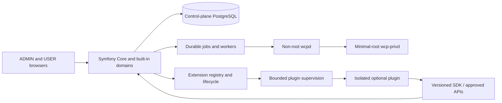

# WCP360 development strategy

**Decision scope:** repository organization and target development method, October 31, 2026. The folders created with this strategy contain documentation scaffolds. The Symfony bootstrap, SDK, plugin host, wizard and production installer still need implementation and verification. The [baseline manifest](../manifests/WCP360-BM-0001.md) and owner specifications retain authority; no runtime gate or independent review is silently granted.

Build one autonomous hosting Core, develop detached plugins against a versioned SDK, and publish each product only from qualified source and evidence. A complete Core must operate with zero optional plugins.

## Repository responsibilities

| Location | Responsibility |
| :--- | :--- |
| [WCP360_Core](../../WCP360_Core/README.md) | Symfony application, built-in hosting domains, reusable UI/services, extension manager, installer source, Go agents and integrated tests. |
| [WCP360_Plugins](../../WCP360_Plugins/README.md) | One independently versioned/tested package per plugin. Current packages keep their names and source bytes. |
| [WCP360_SDK](../../WCP360_SDK/README.md) | Public PHP client/contracts and synthetic testing support for integrations; no Core internals or privileged broker client. |
| [WCP360_Build](../../WCP360_Build/README.md) | Build environments, package assembly and qualification/publication procedures. Generated output goes under ignored `build/`. |
| [WCP360_Releases](../../WCP360_Releases/README.md) | Records for qualified releases and their immutable artifact references. No qualified version currently exists. |
| [WCP360_Prototype](../../WCP360_Prototype/README.md) | Existing UI prototype and visual reference. Port reviewed components to Twig; browser simulation is not production logic. |
| [WCP360_Developper](../../WCP360_Developper/README.md) | Existing developer/product corpus and historical evidence. |
| [documentation](../README.md) | Current specifications, baseline membership, governance, development method and provenance. |

Use the [Core change-location index](../../WCP360_Core/NAVIGATION.md) for task-based navigation, the [module index](../../WCP360_Core/src/Module/README.md) for business ownership and the [Linux-service directory](../../WCP360_Core/resources/services/README.md) for configuration sources. Dependency graphs and generated libraries are detailed in [Core/DEPENDENCIES.md](../../WCP360_Core/DEPENDENCIES.md).

The [README capability map](../../WCP360_Core/CAPABILITY-MAP.md) accounts for the 233 functional entries and distinguishes the 149 catalog candidates from missing source directories. It maps capability ownership; it does not certify implementation or authorize another runtime slice.

## Where code, functions, templates and dependencies belong

| Concern | Source location | Rule |
| :--- | :--- | :--- |
| Business rules | `WCP360_Core/src/Module/<Domain>/Domain/` | PHP classes with explicit ownership; no framework, HTTP or privileged shell dependency. |
| Use cases and functions | `.../Application/` | Symfony-injected services, command/query handlers and ports; avoid a global functions/Utils directory. |
| Persistence and external adapters | `.../Infrastructure/` | Implement domain ports; use only the approved database and transport contracts. |
| Controllers, forms and presenters | `.../UI/` | Thin transport/UI layer; authorization and business invariants remain server-side. |
| Domain CLI commands | `WCP360_Core/src/Module/<Domain>/UI/Console/` | Thin registered Symfony adapters reuse the same authorized application use cases as HTTP. |
| Symfony configuration | `WCP360_Core/config/` | Packages, routes, service wiring and explicit per-runtime contexts; no applied Linux-service files. |
| Linux configuration sources | `WCP360_Core/resources/services/<service>/` | Reviewed templates/profiles, with one owning domain and bounded configuration lifecycle. Applied /etc files and secrets stay outside Git. |
| Reusable foundations | `WCP360_Core/src/Shared/` | One implementation of shared policies and typed infrastructure; domain-specific rules stay in their module. |
| Twig views | `WCP360_Core/templates/{admin,user,components,setup}/` | First-party templates only; ADMIN/USER runtime and session isolation remains mandatory. |
| Stimulus and styles | `WCP360_Core/assets/` | Symfony UX, AssetMapper and the approved CSS pipeline; do not require Node for the panel runtime. |
| Go services | `WCP360_Core/agents/{wcpd,wcp-privd}/` | Separate modules, processes and identities. Reviewed candidates keep their current SOURCE/ paths until a tested migration is accepted. |
| Python diagnostics | `WCP360_Core/diagnostics/` | Specialized non-root diagnostics behind reviewed typed boundaries; no alternative root executor. |
| Core PHP dependencies | `WCP360_Core/vendor/` | Generated by Composer from the Core manifest/lock when the bootstrap exists; not committed. |
| Plugin PHP dependencies | `WCP360_Plugins/<plugin>/vendor/` | Each PHP plugin owns its manifest and application lock. Never change the Core vendor tree to install a plugin. |
| SDK dependencies | `WCP360_SDK/php/` | Public library graph/version separate from Core and plugin applications; client applications retain their own locks. |
| Go dependencies | Per-agent `go.mod` / `go.sum` | Go module cache by default; vendoring is a distinct approved build choice, not a shared PHP vendor directory. |
| Optional Node tooling | Per-package `package.json` and lock | Only where selected for asset/testing tooling; generated node_modules is not committed or required on production servers. |
| Installer | `WCP360_Core/installer/` | Reviewed installation CLI/recipes and recovery orchestration. Wizard UI belongs to templates/setup and the Setup module. |
| Tests | Core tests and each plugin's tests | Unit, integration, contract, security, lifecycle and supported-target evidence have separate scopes. |
| Generated artifacts | `WCP360_Build/build/` | Disposable candidate output, excluded by the existing build/ ignore rule. |
| Published product | GitHub Releases + WCP360_Releases records | Reviewed source/tag, retained evidence, immutable artifacts, integrity and trust verification. |

Composer generates vendor from a project's dependency definition and lock. Go keeps downloaded modules in its module cache unless vendoring is selected. These follow [Composer's dependency workflow](https://getcomposer.org/doc/01-basic-usage.md) and the [Go modules reference](https://go.dev/ref/mod).

## Architecture of modularity

Core domain modules are namespaces/services assembled during a controlled Core build. Detached plugins are separate packages/processes. Installing an optional plugin must not insert arbitrary PHP bundles, service-container definitions, Twig templates or JavaScript into the Core runtime.

Symfony's [application conventions](https://symfony.com/doc/current/best_practices.html) support namespaces and services for application business logic. [Turbo](https://symfony.com/bundles/ux-turbo) and [StimulusBundle](https://symfony.com/bundles/StimulusBundle) support the selected server-rendered frontend.

## Development order

Work in dependency order with a usable, tested result at each step. These work packages organize the target; selecting an additional runtime slice still requires the existing owner-backed gate.

| Step | Deliverable | Evidence before advancing |
| :--- | :--- | :--- |
| 1. Foundation | Reconcile the existing inert daemon and test candidates; bootstrap the approved Symfony/toolchain layout. | Current paths/toolchains, executed checks and applicable exact-SHA reviews. |
| 2. Autonomous Core | Local identity, tenant isolation, permissions, jobs/audit, built-in hosting adapters, health and recovery. | Baseline hosting workflow operates with no optional plugin or vendor-service dependency. |
| 3. Extension seam | Versioned API/SDK, package identity, compatibility, capabilities, data ownership and lifecycle registry. | Contract tests; denied cross-tenant/unknown operations; no private Core imports. |
| 4. Plugin host | Admission, supervision, lifecycle, drain/recovery, menu registry and isolated UI contributions. | Install/enable/crash/disable/update/uninstall scenarios preserve Core and hosted workloads. |
| 5. Reference plugin | One small optional integration developed in isolation, then tested against Core. | Standalone tests plus compatibility and lifecycle integration evidence. |
| 6. Install and setup | CLI installation, restricted wizard, upgrade and recovery using assembled artifacts. | Fresh Debian installation, interrupted setup/resume, wrong-origin/session negatives and restore rehearsal. |
| 7. Product qualification | Complete the selected functional release scope and dependency/security/recovery checks. | Trace the applicable requirements from the existing 233-capability inventory to executed evidence. |
| 8. Release | Publish the exact qualified revision and immutable artifacts. | Release checklist, supported-target results, provenance, recovery instructions and required signoffs. |

Plugin discovery/design and isolated unit work can proceed alongside Core development once the SDK seam is agreed. Core-affecting integration follows the dependencies above. Do not build 149 plugins before validating one complete optional-plugin lifecycle.

## Working with existing packages and branches

- File Manager remains a standalone single-owner candidate. It must not become a second file-operation authority or be used as a live multi-tenant adapter without the required contract and validation.
- Insights remains a UI/metadata prototype. Its version and crypto declarations do not prove a production transport or lifecycle.
- The two package manifest shapes are not silently unified. Define and ratify one production manifest contract, then provide explicit migration/validation for existing packages.
- Existing #108/#114/#110/#109 candidates keep their SHA-bound reviews. This scaffold does not copy or merge them into the target folders.
- Feature branches can use `feature/core-<topic>`, `plugin/<id>/<topic>`, `sdk/<topic>` and `release/<version>`. Keep PRs bounded; integrate only applicable tests, owner decisions and genuine independent review.
- Core, SDK and plugins have independent versions and compatibility matrices. A plugin update does not require a new Core release when the approved compatibility contract remains satisfied.

## Detailed implementation guides

- [Core engine and reusable services](CORE-ENGINE.md)
- [Plugin lifecycle and failure containment](PLUGIN-LIFECYCLE.md)
- [Installer, wizard, builds and release acceptance](DELIVERY-AND-RELEASES.md)
- [Repository directory guide](../REPOSITORY-STRUCTURE.md)
- [Functional inventory](../../README.md) and [149-entry extension catalogue](../../PLUGIN_CATALOG.md)

The production goal is a complete Core and detachable ecosystem. This organizational publication provides the implementation map and acceptance work; it does not assert that those engines already run.
