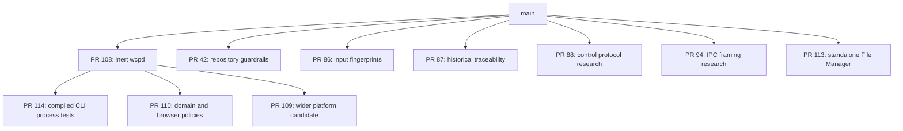

# WCP360 — Branch reconciliation

**Observed:** October 31, 2026 
**Repository:** `yyogas/wcp360` 
**Comparison reference:** `main@6ebcbab994696cb897dbc05e13b456daa2ff2ffa` 
**Classification:** G0/G1 documentation and repository coordination; same-author E2 verification.

All **14 branches** were enumerated: `main` and 13 work branches. This publication consolidates **two documentation branches**, records the disposition of **one superseded closed integration bundle**, and preserves **10 open PR candidates** with their exact heads and bases. It does not merge their application code or workflows.

Branch counts and ahead/behind values below describe the comparison reference before this reconciliation commit. The two documentation heads are additional parents of this publication commit, so subsequent ancestry comparisons will show them as integrated. Their exact content resolutions are recorded in the companion JSON.

## Branch register

| Branch | Observed head | Ahead / behind main | Changed files | PR | Disposition |
| :--- | :--- | ---: | ---: | :--- | :--- |
| [`audit/closure-matrix-refresh-2026-10-03`](https://github.com/yyogas/wcp360/tree/audit/closure-matrix-refresh-2026-10-03) | `1fdbe4994f54` | 3 / 110 | 1 | — | Integrated as a dated historical closure matrix; no audit closure claimed. |
| [`design-system/import-v2.5.3.36.4-markdown`](https://github.com/yyogas/wcp360/tree/design-system/import-v2.5.3.36.4-markdown) | `5ff41780a5b7` | 3 / 321 | 22 | — | Consolidated: 20 existing identical documents reused; 2 metadata files archived. |
| [`extensions/file-manager-v0.3.0-import`](https://github.com/yyogas/wcp360/tree/extensions/file-manager-v0.3.0-import) | `899e0020a342` | 13 / 16 | 91 | [#113](https://github.com/yyogas/wcp360/pull/113) | PR #113: path reconciliation, final owner revalidation and independent review pending. |
| [`integration/sc-m01-owner-readiness-20261026`](https://github.com/yyogas/wcp360/tree/integration/sc-m01-owner-readiness-20261026) | `b1ae801dbc82` | 35 / 52 | 26 | [#90](https://github.com/yyogas/wcp360/pull/90) | Historical bundle; PR #90 closed without merge. Current narrow PRs take precedence. |
| [`main`](https://github.com/yyogas/wcp360/tree/main) | `6ebcbab99469` | — | — | — | Reference; existing source imports and canonical contracts preserved. |
| [`maintenance/sc-m01-repository-guardrails`](https://github.com/yyogas/wcp360/tree/maintenance/sc-m01-repository-guardrails) | `fb2a95620f35` | 34 / 55 | 18 | [#42](https://github.com/yyogas/wcp360/pull/42) | PR #42: independent review and current-base checks pending. |
| [`research/sc-m01-control-protocol-options-20261026`](https://github.com/yyogas/wcp360/tree/research/sc-m01-control-protocol-options-20261026) | `44c85eebcd29` | 8 / 10 | 4 | [#88](https://github.com/yyogas/wcp360/pull/88) | PR #88: research only; independent review pending. |
| [`research/sc-m01-ipcb-go-framing-20261027`](https://github.com/yyogas/wcp360/tree/research/sc-m01-ipcb-go-framing-20261027) | `c5ef94c875fe` | 43 / 48 | 11 | [#94](https://github.com/yyogas/wcp360/pull/94) | PR #94: research only; independent review pending. |
| [`source/full-platform-candidate`](https://github.com/yyogas/wcp360/tree/source/full-platform-candidate) | `284daabc8d57` | 19 / 19 | 185 | [#109](https://github.com/yyogas/wcp360/pull/109) | Draft PR #109: wider scope decisions and independent review pending. |
| [`source/sc-m01-domain-foundation`](https://github.com/yyogas/wcp360/tree/source/sc-m01-domain-foundation) | `31fd3fe4d920` | 16 / 19 | 32 | [#110](https://github.com/yyogas/wcp360/pull/110) | Draft PR #110: stacked on #108; wider scope decisions and independent review pending. |
| [`source/sc-m01-inert-daemon`](https://github.com/yyogas/wcp360/tree/source/sc-m01-inert-daemon) | `71deefa2976a` | 6 / 19 | 13 | [#108](https://github.com/yyogas/wcp360/pull/108) | PR #108: selected inert slice; independent review pending. |
| [`test/sc-m01-cli-process-contract`](https://github.com/yyogas/wcp360/tree/test/sc-m01-cli-process-contract) | `462792110330` | 7 / 19 | 14 | [#114](https://github.com/yyogas/wcp360/pull/114) | PR #114: stacked on #108; independent review pending. |
| [`tooling/sc-m01-contract-traceability-20261026`](https://github.com/yyogas/wcp360/tree/tooling/sc-m01-contract-traceability-20261026) | `a1c7a2743c30` | 21 / 10 | 11 | [#87](https://github.com/yyogas/wcp360/pull/87) | PR #87: historical reference tooling; independent review pending. |
| [`tooling/sc-m01-preflight-checks-20261026`](https://github.com/yyogas/wcp360/tree/tooling/sc-m01-preflight-checks-20261026) | `547669eee40d` | 8 / 10 | 6 | [#86](https://github.com/yyogas/wcp360/pull/86) | Draft PR #86: read-only 8/8 preflight; independent review pending. |

**434 changed-path records** were inspected structurally across the 13 comparisons. All recursive tree responses were complete, and every individual comparison contained fewer than GitHub's 300-file response limit. Counts are per branch and overlap; they are not a count of 434 unique product files. Every path, merge-base/head/main blob, mode, duplicate destination and disposition is recorded in [the machine-readable evidence](BRANCH-RECONCILIATION-2026-10-31.json).

## Documentation integrated by this publication

### Audit closure matrix

The three commits on `audit/closure-matrix-refresh-2026-10-03` change only `governance/audits/AUDIT-WCP-0100/CLOSURE-MATRIX.md`. Its 2026-10-03 body replaces the older 2026-10-02 snapshot, with an explicit historical notice. Its original 5/8, paused, owner-publication and CI statements remain historical; current status is selected by the [baseline manifest](../../manifests/WCP360-BM-0001.md). No finding is marked VERIFIED or CLOSED by this reconciliation.

### Design System Markdown import

Of the branch's 22 added files:

- **20 files** already exist with exactly the same Git blob and mode under `documentation/design-system/V2.5.3.36.4/`. Those existing copies are reused; a second `design-system/baselines/` tree is not created.
- **2 unique metadata files** are preserved byte-for-byte under [the historical metadata archive](../../archive/branch-reconciliation/design-system-import-v2.5.3.36.4/README.md). Their old active-candidate and proposed-adapter statements are evidence from that import, not new baseline or implementation decisions.

The JSON maps every original branch path to its retained destination. Historical mirrors and their integrity manifests remain unchanged.

## Superseded integration bundle

[PR #90](https://github.com/yyogas/wcp360/pull/90) was closed without merge on October 27, 2026. Its branch remains available as historical evidence. Six of its 26 changed paths are already byte-identical at the same paths in main. Its old five-artifact preflight, research fixture and traceability code are superseded by the current narrow candidates #86, #87 and #88.

Two handoffs were changed independently in both main and the bundle:

- `governance/handoffs/SC-M01-FIRST-CODE-DEPENDENCY-PLAN-2026-10-26.md`;
- `governance/handoffs/SC-M01-SECURITY-IPC-PARENT-BINDING-REVIEW-2026-10-26.md`.

Main's versions are retained. The old bundle describes a 5/8 publication state and must not replace the accepted 8/8 manifest or newer owner decisions. Its integration-only workflow is not activated. No code is imported through this closed bundle as a substitute for the narrow PR reviews.

## File Manager path reconciliation

[PR #113](https://github.com/yyogas/wcp360/pull/113) contains 90 package files at `WCP360_Extensions/WCP360-File-Manager/` plus one repository workflow. Main now contains the workspace package at `WCP360_Plugins/wcp360-file-manager-xampp/`.

| Comparison at the intended package path | Files | Handling before merge |
| :--- | ---: | :--- |
| Identical blob and mode | 55 | Reuse the canonical main files. |
| Existing file with different content | 5 | Reconcile README, Windows launcher, browser test, HTTP test and setup test. |
| Candidate-only package additions | 30 | Retain CI harness, provenance and documentation additions for review. |
| Repository workflow | 1 | Retarget workflow and harness path assumptions together. |

The exact 90-file source-to-destination map is included in the JSON. A wholesale merge would create a second package directory and split maintenance. The existing ZIP packages in main are separate distribution inputs; they do not replace the candidate's CI/provenance review.

PR #113's recorded final checkpoint still reports final owner revalidation **0/4** and independent E3 missing. Its successful standalone matrix does not authorize a Core adapter, multi-tenant isolation, public deployment or a stable release. The candidate is preserved at its reviewed/tested SHA rather than silently migrating paths and transferring old approvals to new bytes.

## Source and test dependencies

The arrows show ancestry/dependency, not merge approval. PR #114 and #110 actually target #108's branch. PR #109 targets main but contains all 13 #108 changed files with identical blobs.

- **#108:** the only selected runtime slice is the inert CLI. Applicable owner E2 evidence is recorded, but genuine E3 remains missing. Existing [review packet](../reviews/PR108-E3-INDEPENDENT-REVIEW-PACKET.md).
- **#114:** one commit on #108; four existing files change and `SOURCE/daemon/tools/check-cli.sh` is added. The workflow change is included. Its own [review packet](../reviews/PR114-E3-INDEPENDENT-REVIEW-PACKET.md) and separate E3 are required.
- **#110:** changes the CLI (`--contracts`), its tests and `tools/check.sh` relative to #108, and adds domain/session/browser policies. These additions require a separately selected owner-backed scope. They are not covered by #108's review.
- **#109:** wider PHP kernel, transport/security policies, catalogues and static UI remain a candidate. This is not the implemented Symfony/Twig product described by the target architecture. Wider component/toolchain/scope acceptance is still required.

Combining #114 with #110 creates six divergent shared paths: the daemon workflow, README, CLI source, CLI unit tests, negative gate script and main check script. Combining #109 with #110 creates three divergent daemon paths: CLI source, CLI tests and `tools/check.sh`. These must be reconciled and retested rather than resolved by replacing one branch's entire daemon directory.

## Recorded CI and review evidence

Each open PR has a completed successful workflow at its frozen candidate head. The following are **existing GitHub conclusions read during this reconciliation**, not newly executed tests or proof against the current main tree.

| PR | Candidate head | Recorded run | Conclusion | Applicability |
| :--- | :--- | :--- | :--- | :--- |
| [#113](https://github.com/yyogas/wcp360/pull/113) | `899e0020a342` | [41148808756](https://github.com/yyogas/wcp360/actions/runs/41148808756) | SUCCESS | Recorded integration predates the selected main snapshot; revalidate. |
| [#42](https://github.com/yyogas/wcp360/pull/42) | `fb2a95620f35` | [41139175281](https://github.com/yyogas/wcp360/actions/runs/41139175281) | SUCCESS | Recorded integration predates the selected main snapshot; revalidate. |
| [#88](https://github.com/yyogas/wcp360/pull/88) | `44c85eebcd29` | [41139823315](https://github.com/yyogas/wcp360/actions/runs/41139823315) | SUCCESS | Recorded integration predates the selected main snapshot; revalidate. |
| [#94](https://github.com/yyogas/wcp360/pull/94) | `c5ef94c875fe` | [41139668563](https://github.com/yyogas/wcp360/actions/runs/41139668563) | SUCCESS | Recorded integration predates the selected main snapshot; revalidate. |
| [#109](https://github.com/yyogas/wcp360/pull/109) | `284daabc8d57` | [40852680911](https://github.com/yyogas/wcp360/actions/runs/40852680911) | SUCCESS | Recorded integration predates the selected main snapshot; revalidate. |
| [#110](https://github.com/yyogas/wcp360/pull/110) | `31fd3fe4d920` | [40869163430](https://github.com/yyogas/wcp360/actions/runs/40869163430) | SUCCESS | Stacked candidate; recorded result applies to its stated parent/merge. |
| [#108](https://github.com/yyogas/wcp360/pull/108) | `71deefa2976a` | [41138734219](https://github.com/yyogas/wcp360/actions/runs/41138734219) | SUCCESS | Recorded integration predates the selected main snapshot; revalidate. |
| [#114](https://github.com/yyogas/wcp360/pull/114) | `462792110330` | [41133175259](https://github.com/yyogas/wcp360/actions/runs/41133175259) | SUCCESS | Stacked candidate; recorded result applies to its stated parent/merge. |
| [#87](https://github.com/yyogas/wcp360/pull/87) | `a1c7a2743c30` | [41139706113](https://github.com/yyogas/wcp360/actions/runs/41139706113) | SUCCESS | Recorded integration predates the selected main snapshot; revalidate. |
| [#86](https://github.com/yyogas/wcp360/pull/86) | `547669eee40d` | [41138303667](https://github.com/yyogas/wcp360/actions/runs/41138303667) | SUCCESS | Recorded integration predates the selected main snapshot; revalidate. |

All review submissions returned for these open PRs were by `yyogas`; their recorded GitHub events are COMMENTED, not independent approvals. PR #109 and #110 have no submitted reviews in the inspected response. PR #113's submitted review predates its final candidate. The JSON retains review identities and SHA bindings.

New current-main integration evidence is required before merging main-targeting candidates. Re-running a historical job alone would not prove a new merge against the expanded workspace tree.

## Merge conditions that remain

The existing [review policy](../REVIEW-MERGE-POLICY.md) requires R1 tooling and I1 implementation to have E1 plus genuinely independent E3. Engineering v0.3 and the manifest retain this requirement. This reconciliation does not change it, invent a reviewer or convert same-account owner reviews into E3.

| Work | Remaining condition |
| :--- | :--- |
| #42, #86, #87 | Independent E3; current-main integration checks; keep canonical/fingerprint/publication assertions scoped honestly. |
| #88, #94 | Independent E3 and current-main integration checks for research retention; production protocol hypotheses still need owner ratification. |
| #108 | Independent E3 on the exact candidate and applicable current integration. |
| #114 | #108 dependency acceptance plus separate independent E3 and integration verification. |
| #113 | Canonical package-path reconciliation, fresh CI, final owner revalidation and independent E3. |
| #109, #110 | Explicit owner-backed component/scope activation, compatible toolchain decisions, reconciliation with accepted foundation, relevant tests and E3. |

Observed branch protection was `false` for all 14 branches. GitHub reporting a PR as mergeable is not a review or policy verdict. Enforcement and the related audit findings are not declared closed.

## Concurrent main updates preserved

While this reconciliation was being prepared, main advanced by two directory-deletion commits: `8420220c5c7e23951a31bb6f31473f1e880d9643` removed the 9 Internal Management files, and `6ebcbab994696cb897dbc05e13b456daa2ff2ffa` removed the 443 Official Website files. The comparisons were refreshed against that new main. No other existing file blob changed. This publication preserves both removals and updates the active README layout/links accordingly; local workspace copies are not deleted or republished.

## Verification and preservation

- Branch inventory: 14; open PRs: 10; complete comparison/tree data; 434 changed-path records.
- Exact duplicate checks use Git blobs and modes, including the 20 Design System and 55 File Manager matches.
- The two documentation branches are integrated with recorded source parents and explicit content selection; code/workflow branches retain their heads and PR bases.
- Existing `specifications/`, `contracts/`, `manifests/`, `SECURITY.md`, remaining application/prototype folders and release scaffold are preserved. The concurrent Internal Management and Official Website deletions are retained.
- No branch is deleted, no candidate is force-pushed, no application workflow is activated, and no CODE-BASELINE or release is created.
- Verification is repository metadata/content analysis (E2). No local Go/PHP/Bash product execution or independent security audit is claimed.
